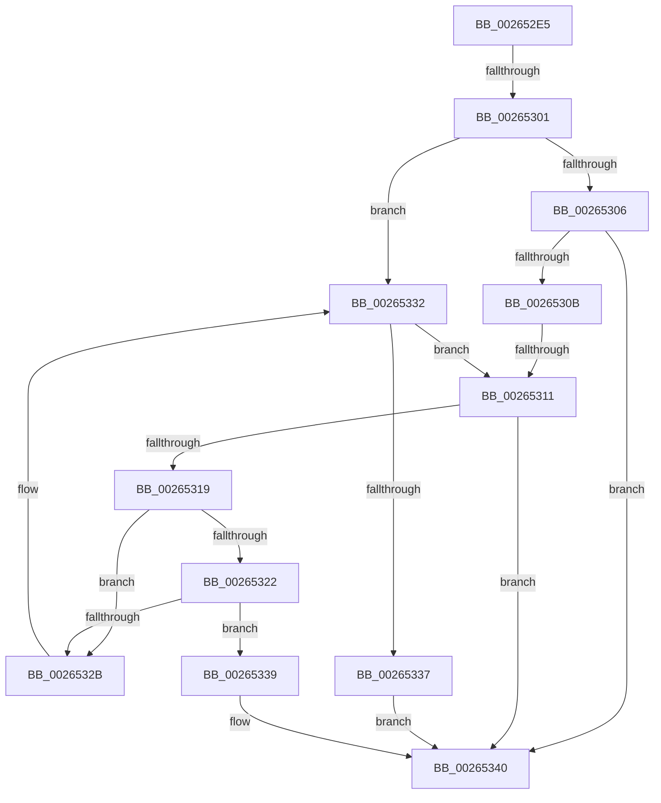

# sub_002652E5

- RVA: `0x002652E5`–`0x00265360` (길이 `123` bytes)
- VA: `0x00000001402652E5`
- 실행 섹션: `.text`
- PDB 이름 있음: `아니요`; PDB Function 태그: `아니요`
- unwind 정보 RVA: `0x00064B0C`
- 디코드: `39`개 명령, `123/123` bytes 표시
- 미해석 바이트: `0` (있으면 어셈블리에 `.byte`로 보존)

> 이 문서는 커널 이미지의 기계어와 PDB 기호를 분석해 생성했습니다. 4번과 5번은 함수 원형과 자료형을 바이너리 사용 방식에서 추정한 C 해석이며 원본 소스 복구 결과는 아닙니다.

## 1. Dependencies

- 직접 호출 지점: **2**; 고유 호출 대상: **2**
- 직접 호출자로 확인된 함수: **0**
- RIP 상대 이미지 참조: **0**

### Outgoing calls
- `0x002652EF` → [FsRtlAcquireAutoExpandPushLockExclusive](FsRtlAcquireAutoExpandPushLockExclusive_function_0026539C.md) (function, `0x0026539C`)
- `0x00265343` → [FsRtlReleaseAutoExpandPushLockExclusive](FsRtlReleaseAutoExpandPushLockExclusive_function_00265B5C.md) (function, `0x00265B5C`)

### Direct callers
- 이 함수 시작 RVA로 연결되는 직접 call은 확인되지 않았습니다. 간접 호출은 완전히 역산할 수 없습니다.

### Static image references
- 디코드된 RIP-relative 메모리 참조가 없습니다.

## 2. Other-region calls and transfers

- 다른 실행 섹션으로 향하는 call: **0**
- call이 아닌 외부 분기/꼬리 이동: **2**
  - `0x002652FF` → [sub_00265374](Unknown_function_00265374.md) (`tail-transfer`)
  - `0x0026530F` → [sub_00265374 + 0x1A](Unknown_function_00265374.md) (`tail-transfer`)

## 3. Assembly (complete function range)

```asm
002652E5  48 89 5C 24 30                  mov qword ptr [rsp + 0x30], rbx
002652EA  48 8B CF                        mov rcx, rdi
002652ED  33 DB                           xor ebx, ebx
002652EF  E8 A8 00 00 00                  call 0x14026539c
002652F4  48 8B 4F 10                     mov rcx, qword ptr [rdi + 0x10]
002652F8  48 8D 47 10                     lea rax, [rdi + 0x10]
002652FC  48 85 ED                        test rbp, rbp
002652FF  75 73                           jne 0x140265374
00265301  48 85 F6                        test rsi, rsi
00265304  74 2C                           je 0x140265332
00265306  48 3B C8                        cmp rcx, rax
00265309  74 35                           je 0x140265340
0026530B  48 39 71 10                     cmp qword ptr [rcx + 0x10], rsi
0026530F  75 7D                           jne 0x14026538e
00265311  48 8B D9                        mov rbx, rcx
00265314  48 85 C9                        test rcx, rcx
00265317  74 27                           je 0x140265340
00265319  48 8B 09                        mov rcx, qword ptr [rcx]
0026531C  48 39 59 08                     cmp qword ptr [rcx + 8], rbx
00265320  75 09                           jne 0x14026532b
00265322  48 8B 43 08                     mov rax, qword ptr [rbx + 8]
00265326  48 39 18                        cmp qword ptr [rax], rbx
00265329  74 0E                           je 0x140265339
0026532B  B9 03 00 00 00                  mov ecx, 3
00265330  CD 29                           int 0x29
00265332  48 3B C8                        cmp rcx, rax
00265335  75 DA                           jne 0x140265311
00265337  EB 07                           jmp 0x140265340
00265339  48 89 08                        mov qword ptr [rax], rcx
0026533C  48 89 41 08                     mov qword ptr [rcx + 8], rax
00265340  48 8B CF                        mov rcx, rdi
00265343  E8 14 08 00 00                  call 0x140265b5c
00265348  48 8B C3                        mov rax, rbx
0026534B  48 8B 5C 24 30                  mov rbx, qword ptr [rsp + 0x30]
00265350  48 8B 6C 24 38                  mov rbp, qword ptr [rsp + 0x38]
00265355  48 8B 74 24 40                  mov rsi, qword ptr [rsp + 0x40]
0026535A  48 83 C4 20                     add rsp, 0x20
0026535E  5F                              pop rdi
0026535F  C3                              ret
```

## 4. C-style interpretation (structured pseudocode)

```c
__int64 __fastcall sub_002652E5(__int64 a1, __int64 a2, __int64 a3, __int64 a4, __int64 a5, __int64 a6, __int64 a7, __int64 a8)
{
    __int64 result;
    __int64 v_rbx;
    __int64 v_rsp;
    unsigned __int64 v_stack_p30;

    v_stack_p30 = v_rbx;
    v_rbx = 0;
    result = FsRtlAcquireAutoExpandPushLockExclusive(v_rdi, a2, a3, a4);
    if (v_rsi == 0) goto loc_00265332;
    if ((*(unsigned __int64 *)(v_rdi + 16)) == (v_rdi + 16)) goto loc_00265340;
loc_00265311:
    if (*(unsigned __int64 *)(v_rdi + 16) == 0) goto loc_00265340;
    if ((*(unsigned __int64 *)(*(unsigned __int64 *)(*(unsigned __int64 *)(v_rdi + 16)) + 8)) != (*(unsigned __int64 *)(v_rdi + 16))) goto loc_0026532B;
    if ((*(unsigned __int64 *)(*(unsigned __int64 *)(*(unsigned __int64 *)(v_rdi + 16) + 8))) == (*(unsigned __int64 *)(v_rdi + 16))) goto loc_00265339;
loc_0026532B:
loc_00265332:
    if (3 != (*(unsigned __int64 *)(*(unsigned __int64 *)(v_rdi + 16) + 8))) goto loc_00265311;
    goto loc_00265340;
loc_00265339:
    *(unsigned __int64 *)(*(unsigned __int64 *)(*(unsigned __int64 *)(v_rdi + 16) + 8)) = 3;
    *(unsigned __int64 *)(3 + 8) = *(unsigned __int64 *)(*(unsigned __int64 *)(v_rdi + 16) + 8);
loc_00265340:
    result = FsRtlReleaseAutoExpandPushLockExclusive(v_rdi, a2, a3, a4);
    v_rsp = (v_rsp) + (32);
    return *(unsigned __int64 *)(v_rdi + 16);
}
```

## 5. (Beta) C Style

```c
int64_t sub_002652E5(int64_t Arg1, int64_t Arg2, int64_t Arg3, int64_t Arg4, uint64_t Arg5, int64_t Arg6, int64_t Arg7, int64_t Arg8)
{
    int64_t result;
    int64_t local_rbx;
    int64_t local_rsp;
    uint64_t v_stack_p30;

    v_stack_p30 = local_rbx;
    local_rbx = 0;
    result = FsRtlAcquireAutoExpandPushLockExclusive(local_rdi, Arg2, Arg3, Arg4);
    if (local_rsi == 0) goto loc_00265332;
    if ((*(uint64_t *)(local_rdi + 0x10)) == (local_rdi + 16)) goto loc_00265340;
loc_00265311:
    if (*(uint64_t *)(local_rdi + 0x10) == 0) goto loc_00265340;
    if ((*(uint64_t *)(*(uint64_t *)(*(uint64_t *)(local_rdi + 0x10)) + 0x8)) != (*(uint64_t *)(local_rdi + 0x10))) goto loc_0026532B;
    if ((*(uint64_t *)(*(uint64_t *)(*(uint64_t *)(local_rdi + 0x10) + 0x8))) == (*(uint64_t *)(local_rdi + 0x10))) goto loc_00265339;
loc_0026532B:
loc_00265332:
    if (3 != (*(uint64_t *)(*(uint64_t *)(local_rdi + 0x10) + 0x8))) goto loc_00265311;
    goto loc_00265340;
loc_00265339:
    *(uint64_t *)(*(uint64_t *)(*(uint64_t *)(local_rdi + 0x10) + 0x8)) = 3;
    *(uint64_t *)(3 + 0x8) = *(uint64_t *)(*(uint64_t *)(local_rdi + 0x10) + 0x8);
loc_00265340:
    result = FsRtlReleaseAutoExpandPushLockExclusive(local_rdi, Arg2, Arg3, Arg4);
    local_rsp = (local_rsp) + (32);
    return *(uint64_t *)(local_rdi + 0x10);
}
```

## 6. Execution-region graph

[열기: 2D/3D 그래프와 함수 탐색 컨트롤 패널](../../../control-panel.html?section=text&rva=0x002652E5&view=graph)

- 2D 그래프는 위에서 아래로 흐르고, 3D 그래프는 빈 공간을 드래그해 회전합니다. Shift+드래그는 이동, 휠은 확대·축소, 함수 노드 선택은 대상 보고서 이동입니다.

### Static fallback


