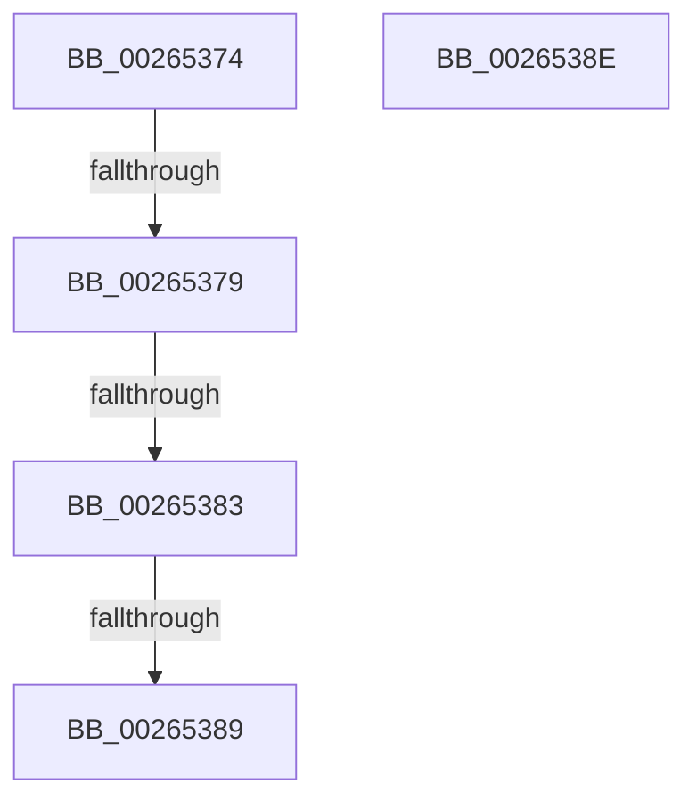

# sub_00265374

- RVA: `0x00265374`–`0x00265396` (길이 `34` bytes)
- VA: `0x0000000140265374`
- 실행 섹션: `.text`
- PDB 이름 있음: `아니요`; PDB Function 태그: `아니요`
- unwind 정보 RVA: `0x00064B38`
- 디코드: `9`개 명령, `34/34` bytes 표시
- 미해석 바이트: `0` (있으면 어셈블리에 `.byte`로 보존)

> 이 문서는 커널 이미지의 기계어와 PDB 기호를 분석해 생성했습니다. 4번과 5번은 함수 원형과 자료형을 바이너리 사용 방식에서 추정한 C 해석이며 원본 소스 복구 결과는 아닙니다.

## 1. Dependencies

- 직접 호출 지점: **0**; 고유 호출 대상: **0**
- 직접 호출자로 확인된 함수: **0**
- RIP 상대 이미지 참조: **0**

### Outgoing calls
- 직접 디코드된 call 명령이 없습니다.

### Direct callers
- 이 함수 시작 RVA로 연결되는 직접 call은 확인되지 않았습니다. 간접 호출은 완전히 역산할 수 없습니다.

### Static image references
- 디코드된 RIP-relative 메모리 참조가 없습니다.

## 2. Other-region calls and transfers

- 다른 실행 섹션으로 향하는 call: **0**
- call이 아닌 외부 분기/꼬리 이동: **5**
  - `0x00265377` → [sub_002652E5 + 0x5B](Unknown_function_002652E5.md) (`tail-transfer`)
  - `0x0026537D` → [sub_006D8E58](../6D/Unknown_function_006D8E58.md) (`tail-transfer`)
  - `0x00265387` → [sub_002652E5 + 0x2C](Unknown_function_002652E5.md) (`tail-transfer`)
  - `0x00265389` → [sub_006D8E58](../6D/Unknown_function_006D8E58.md) (`tail-transfer`)
  - `0x00265391` → [sub_002652E5 + 0x21](Unknown_function_002652E5.md) (`tail-transfer`)

## 3. Assembly (complete function range)

```asm
00265374  48 3B C8                        cmp rcx, rax
00265377  74 C7                           je 0x140265340
00265379  48 39 71 10                     cmp qword ptr [rcx + 0x10], rsi
0026537D  0F 85 D5 3A 47 00               jne 0x1406d8e58
00265383  48 39 69 18                     cmp qword ptr [rcx + 0x18], rbp
00265387  74 88                           je 0x140265311
00265389  E9 CA 3A 47 00                  jmp 0x1406d8e58
0026538E  48 8B 09                        mov rcx, qword ptr [rcx]
00265391  E9 70 FF FF FF                  jmp 0x140265306
```

## 4. C-style interpretation (structured pseudocode)

```c
void __fastcall sub_00265374(__int64 a1)
{
}
```

## 5. (Beta) C Style

```c
void sub_00265374(int64_t Arg1)
{
}
```

## 6. Execution-region graph

[열기: 2D/3D 그래프와 함수 탐색 컨트롤 패널](../../../control-panel.html?section=text&rva=0x00265374&view=graph)

- 2D 그래프는 위에서 아래로 흐르고, 3D 그래프는 빈 공간을 드래그해 회전합니다. Shift+드래그는 이동, 휠은 확대·축소, 함수 노드 선택은 대상 보고서 이동입니다.

### Static fallback


