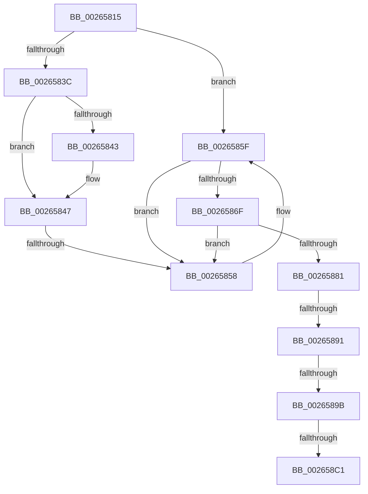

# sub_00265815

- RVA: `0x00265815`–`0x002658E2` (길이 `205` bytes)
- VA: `0x0000000140265815`
- 실행 섹션: `.text`
- PDB 이름 있음: `아니요`; PDB Function 태그: `아니요`
- unwind 정보 RVA: `0x00064BB4`
- 디코드: `56`개 명령, `205/205` bytes 표시
- 미해석 바이트: `0` (있으면 어셈블리에 `.byte`로 보존)

> 이 문서는 커널 이미지의 기계어와 PDB 기호를 분석해 생성했습니다. 4번과 5번은 함수 원형과 자료형을 바이너리 사용 방식에서 추정한 C 해석이며 원본 소스 복구 결과는 아닙니다.

## 1. Dependencies

- 직접 호출 지점: **0**; 고유 호출 대상: **0**
- 직접 호출자로 확인된 함수: **0**
- RIP 상대 이미지 참조: **0**

### Outgoing calls
- 직접 디코드된 call 명령이 없습니다.

### Direct callers
- 이 함수 시작 RVA로 연결되는 직접 call은 확인되지 않았습니다. 간접 호출은 완전히 역산할 수 없습니다.

### Static image references
- 디코드된 RIP-relative 메모리 참조가 없습니다.

## 2. Other-region calls and transfers

- 다른 실행 섹션으로 향하는 call: **0**
- call이 아닌 외부 분기/꼬리 이동: **5**
  - `0x00265852` → [sub_00265998 + 0x5E](Unknown_function_00265998.md) (`tail-transfer`)
  - `0x0026588B` → [sub_00265998 + 0x149](Unknown_function_00265998.md) (`tail-transfer`)
  - `0x00265895` → [sub_00265998 + 0x138](Unknown_function_00265998.md) (`tail-transfer`)
  - `0x002658BB` → [sub_00265998 + 0x114](Unknown_function_00265998.md) (`tail-transfer`)
  - `0x002658DD` → [sub_002658EE + 0x8D](Unknown_function_002658EE.md) (`tail-transfer`)

## 3. Assembly (complete function range)

```asm
00265815  48 89 6C 24 20                  mov qword ptr [rsp + 0x20], rbp
0026581A  83 E0 03                        and eax, 3
0026581D  48 89 74 24 28                  mov qword ptr [rsp + 0x28], rsi
00265822  48 89 7C 24 30                  mov qword ptr [rsp + 0x30], rdi
00265827  4C 89 74 24 38                  mov qword ptr [rsp + 0x38], r14
0026582C  45 0F B6 F0                     movzx r14d, r8b
00265830  4C 89 3C 24                     mov qword ptr [rsp], r15
00265834  0F B6 CB                        movzx ecx, bl
00265837  41 3B C6                        cmp eax, r14d
0026583A  74 23                           je 0x14026585f
0026583C  49 8B 1A                        mov rbx, qword ptr [r10]
0026583F  85 C9                           test ecx, ecx
00265841  75 04                           jne 0x140265847
00265843  49 8B 5A 08                     mov rbx, qword ptr [r10 + 8]
00265847  48 8B 43 10                     mov rax, qword ptr [rbx + 0x10]
0026584B  48 83 E0 FC                     and rax, 0xfffffffffffffffc
0026584F  49 3B C2                        cmp rax, r10
00265852  0F 84 9E 01 00 00               je 0x1402659f6
00265858  B9 1D 00 00 00                  mov ecx, 0x1d
0026585D  CD 29                           int 0x29
0026585F  49 8B 42 10                     mov rax, qword ptr [r10 + 0x10]
00265863  83 F1 01                        xor ecx, 1
00265866  48 83 E0 FC                     and rax, 0xfffffffffffffffc
0026586A  48 3B C2                        cmp rax, rdx
0026586D  75 E9                           jne 0x140265858
0026586F  8B C1                           mov eax, ecx
00265871  48 83 F0 01                     xor rax, 1
00265875  8B D9                           mov ebx, ecx
00265877  4C 39 14 C2                     cmp qword ptr [rdx + rax*8], r10
0026587B  4C 8D 04 C2                     lea r8, [rdx + rax*8]
0026587F  75 D7                           jne 0x140265858
00265881  4D 8B 0B                        mov r9, qword ptr [r11]
00265884  49 8B C9                        mov rcx, r9
00265887  48 83 E1 FC                     and rcx, 0xfffffffffffffffc
0026588B  0F 84 50 02 00 00               je 0x140265ae1
00265891  48 39 51 08                     cmp qword ptr [rcx + 8], rdx
00265895  0F 85 35 02 00 00               jne 0x140265ad0
0026589B  4C 89 51 08                     mov qword ptr [rcx + 8], r10
0026589F  49 8B 42 10                     mov rax, qword ptr [r10 + 0x10]
002658A3  48 8B C8                        mov rcx, rax
002658A6  49 33 C9                        xor rcx, r9
002658A9  48 83 E1 FC                     and rcx, 0xfffffffffffffffc
002658AD  48 33 C8                        xor rcx, rax
002658B0  49 89 4A 10                     mov qword ptr [r10 + 0x10], rcx
002658B4  49 8B 0C DA                     mov rcx, qword ptr [r10 + rbx*8]
002658B8  48 85 C9                        test rcx, rcx
002658BB  0F 85 EB 01 00 00               jne 0x140265aac
002658C1  49 89 08                        mov qword ptr [r8], rcx
002658C4  49 89 14 DA                     mov qword ptr [r10 + rbx*8], rdx
002658C8  41 8B 03                        mov eax, dword ptr [r11]
002658CB  83 E0 03                        and eax, 3
002658CE  49 0B C2                        or rax, r10
002658D1  49 89 03                        mov qword ptr [r11], rax
002658D4  41 80 62 10 FC                  and byte ptr [r10 + 0x10], 0xfc
002658D9  41 80 23 FC                     and byte ptr [r11], 0xfc
002658DD  E9 99 00 00 00                  jmp 0x14026597b
```

## 4. C-style interpretation (structured pseudocode)

```c
__int64 __fastcall sub_00265815(__int64 a1, __int64 a2, unsigned __int8 a3)
{
    __int64 result;
    __int64 v_rbx;
    unsigned __int64 v_stack_p0;
    unsigned __int64 v_stack_p20;
    unsigned __int64 v_stack_p28;
    unsigned __int64 v_stack_p30;
    unsigned __int64 v_stack_p38;

    v_stack_p20 = v_rbp;
    result = (unsigned int)((result) & (3));
    v_stack_p28 = v_rsi;
    v_stack_p30 = v_rdi;
    v_stack_p38 = v_r14;
    v_stack_p0 = v_r15;
    if (((unsigned int)(result)) == a3) goto loc_0026585F;
    v_rbx = *(unsigned __int64 *)(v_r10);
    if ((unsigned int)((unsigned __int8)(v_rbx)) == 0) {
        v_rbx = *(unsigned __int64 *)(v_r10 + 8);
    }
    result = (*(unsigned __int64 *)(v_rbx + 16)) & (-4);
loc_00265858:
loc_0026585F:
    a1 = (unsigned int)((29) ^ (1));
    result = (*(unsigned __int64 *)(v_r10 + 16)) & (-4);
    if (result != a2) goto loc_00265858;
    result = ((unsigned int)((unsigned int)(a1))) ^ (1);
    if ((*(unsigned __int64 *)(a2 + result * 8)) != v_r10) goto loc_00265858;
    a1 = (*(unsigned __int64 *)(v_r11)) & (-4);
    *(unsigned __int64 *)(a1 + 8) = v_r10;
    a1 = (*(unsigned __int64 *)(v_r10 + 16)) ^ (*(unsigned __int64 *)(v_r11));
    a1 = (a1) & (-4);
    a1 = (a1) ^ (*(unsigned __int64 *)(v_r10 + 16));
    *(unsigned __int64 *)(v_r10 + 16) = a1;
    *(unsigned __int64 *)(a2 + result * 8) = *(unsigned __int64 *)(v_r10 + (unsigned int)((unsigned int)(a1)) * 8);
    *(unsigned __int64 *)(v_r10 + (unsigned int)((unsigned int)(a1)) * 8) = a2;
    result = (unsigned int)(((unsigned int)(*(unsigned int *)(v_r11))) & (3));
    result = (result) | (v_r10);
    *(unsigned __int64 *)(v_r11) = result;
}
```

## 5. (Beta) C Style

```c
int64_t sub_00265815(int64_t Arg1, void *Arg2, uint8_t Arg3)
{
    uint8_t *arg2 = (uint8_t *)Arg2;

    int64_t result;
    int64_t local_rbx;
    uint64_t v_stack_p0;
    uint64_t v_stack_p20;
    uint64_t v_stack_p28;
    uint64_t v_stack_p30;
    uint64_t v_stack_p38;

    v_stack_p20 = local_rbp;
    result = (uint32_t)((result) & (3));
    v_stack_p28 = local_rsi;
    v_stack_p30 = local_rdi;
    v_stack_p38 = local_r14;
    v_stack_p0 = local_r15;
    if (((uint32_t)(result)) == Arg3) goto loc_0026585F;
    local_rbx = *(uint64_t *)(local_r10);
    if ((uint32_t)((uint8_t)(local_rbx)) == 0) {
        local_rbx = *(uint64_t *)(local_r10 + 0x8);
    }
    result = (*(uint64_t *)(local_rbx + 0x10)) & (-4);
loc_00265858:
loc_0026585F:
    Arg1 = (uint32_t)((29) ^ (1));
    result = (*(uint64_t *)(local_r10 + 0x10)) & (-4);
    if (result != Arg2) goto loc_00265858;
    result = ((uint32_t)((uint32_t)(Arg1))) ^ (1);
    if ((*(uint64_t *)(arg2 + result * 8)) != local_r10) goto loc_00265858;
    Arg1 = (*(uint64_t *)(local_r11)) & (-4);
    *(uint64_t *)(Arg1 + 0x8) = local_r10;
    Arg1 = (*(uint64_t *)(local_r10 + 0x10)) ^ (*(uint64_t *)(local_r11));
    Arg1 = (Arg1) & (-4);
    Arg1 = (Arg1) ^ (*(uint64_t *)(local_r10 + 0x10));
    *(uint64_t *)(local_r10 + 0x10) = Arg1;
    *(uint64_t *)(arg2 + result * 8) = *(uint64_t *)(local_r10 + (uint32_t)((uint32_t)(Arg1)) * 8);
    *(void **)(local_r10 + (uint32_t)((uint32_t)(Arg1)) * 8) = Arg2;
    result = (uint32_t)(((uint32_t)(*(uint32_t *)(local_r11))) & (3));
    result = (result) | (local_r10);
    *(uint64_t *)(local_r11) = result;
}
```

### 관측된 메모리 오프셋

구조체 형식이 확인되지 않은 접근은 인자 기준의 오프셋으로만 기록했습니다.

| 기준 인자 | 오프셋 표현 | 폭 (bit) | 접근 |
|---|---:|---:|---|
| `Arg2` | `+ 0x0` | `64` | `W` |
| `Arg2` | `+ 0x0 + rax*8` | `64` | `R` |

## 6. Execution-region graph

[열기: 2D/3D 그래프와 함수 탐색 컨트롤 패널](../../../control-panel.html?section=text&rva=0x00265815&view=graph)

- 2D 그래프는 위에서 아래로 흐르고, 3D 그래프는 빈 공간을 드래그해 회전합니다. Shift+드래그는 이동, 휠은 확대·축소, 함수 노드 선택은 대상 보고서 이동입니다.

### Static fallback


