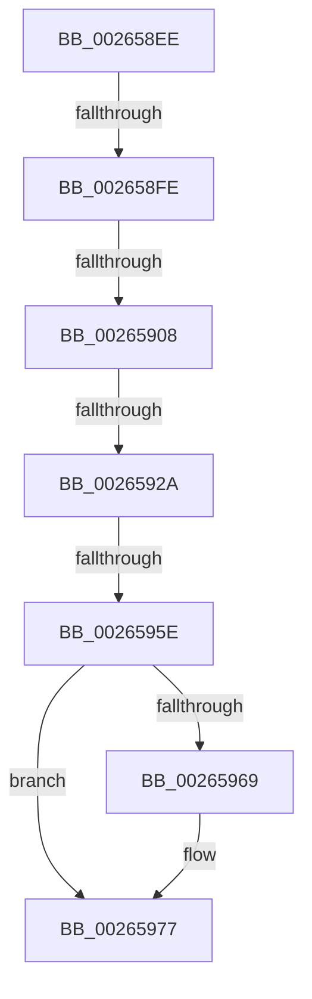

# sub_002658EE

- RVA: `0x002658EE`–`0x00265998` (길이 `170` bytes)
- VA: `0x00000001402658EE`
- 실행 섹션: `.text`
- PDB 이름 있음: `아니요`; PDB Function 태그: `아니요`
- unwind 정보 RVA: `0x00064BEC`
- 디코드: `49`개 명령, `170/170` bytes 표시
- 미해석 바이트: `0` (있으면 어셈블리에 `.byte`로 보존)

> 이 문서는 커널 이미지의 기계어와 PDB 기호를 분석해 생성했습니다. 4번과 5번은 함수 원형과 자료형을 바이너리 사용 방식에서 추정한 C 해석이며 원본 소스 복구 결과는 아닙니다.

## 1. Dependencies

- 직접 호출 지점: **0**; 고유 호출 대상: **0**
- 직접 호출자로 확인된 함수: **0**
- RIP 상대 이미지 참조: **0**

### Outgoing calls
- 직접 디코드된 call 명령이 없습니다.

### Direct callers
- 이 함수 시작 RVA로 연결되는 직접 call은 확인되지 않았습니다. 간접 호출은 완전히 역산할 수 없습니다.

### Static image references
- 디코드된 RIP-relative 메모리 참조가 없습니다.

## 2. Other-region calls and transfers

- 다른 실행 섹션으로 향하는 call: **0**
- call이 아닌 외부 분기/꼬리 이동: **5**
  - `0x002658F8` → [sub_00265998 + 0x4B](Unknown_function_00265998.md) (`tail-transfer`)
  - `0x00265902` → [sub_00265998 + 0x3A](Unknown_function_00265998.md) (`tail-transfer`)
  - `0x00265928` → [sub_00265998](Unknown_function_00265998.md) (`tail-transfer`)
  - `0x0026595C` → [sub_00265998 + 0x23](Unknown_function_00265998.md) (`tail-transfer`)
  - `0x00265993` → [RtlAvlInsertNodeEx + 0x77](RtlAvlInsertNodeEx_function_00265790.md) (`tail-transfer`)

## 3. Assembly (complete function range)

```asm
002658EE  49 8B 2B                        mov rbp, qword ptr [r11]
002658F1  48 8B CD                        mov rcx, rbp
002658F4  48 83 E1 FC                     and rcx, 0xfffffffffffffffc
002658F8  0F 84 E5 00 00 00               je 0x1402659e3
002658FE  48 39 51 08                     cmp qword ptr [rcx + 8], rdx
00265902  0F 85 CA 00 00 00               jne 0x1402659d2
00265908  48 89 59 08                     mov qword ptr [rcx + 8], rbx
0026590C  48 8B 43 10                     mov rax, qword ptr [rbx + 0x10]
00265910  48 8B C8                        mov rcx, rax
00265913  48 33 CD                        xor rcx, rbp
00265916  48 83 E1 FC                     and rcx, 0xfffffffffffffffc
0026591A  48 33 C8                        xor rcx, rax
0026591D  48 89 4B 10                     mov qword ptr [rbx + 0x10], rcx
00265921  48 8B 0C FB                     mov rcx, qword ptr [rbx + rdi*8]
00265925  48 85 C9                        test rcx, rcx
00265928  75 6E                           jne 0x140265998
0026592A  48 89 0E                        mov qword ptr [rsi], rcx
0026592D  48 89 14 FB                     mov qword ptr [rbx + rdi*8], rdx
00265931  41 8B 03                        mov eax, dword ptr [r11]
00265934  83 E0 03                        and eax, 3
00265937  48 0B C3                        or rax, rbx
0026593A  49 89 03                        mov qword ptr [r11], rax
0026593D  24 FC                           and al, 0xfc
0026593F  41 88 03                        mov byte ptr [r11], al
00265942  41 0F B6 52 10                  movzx edx, byte ptr [r10 + 0x10]
00265947  0F B6 C2                        movzx eax, dl
0026594A  24 FC                           and al, 0xfc
0026594C  41 88 42 10                     mov byte ptr [r10 + 0x10], al
00265950  0F B6 4B 10                     movzx ecx, byte ptr [rbx + 0x10]
00265954  8B C1                           mov eax, ecx
00265956  83 E0 03                        and eax, 3
00265959  44 3B F0                        cmp r14d, eax
0026595C  74 5D                           je 0x1402659bb
0026595E  83 F1 FE                        xor ecx, 0xfffffffe
00265961  83 E1 03                        and ecx, 3
00265964  44 3B F1                        cmp r14d, ecx
00265967  75 0E                           jne 0x140265977
00265969  0F B6 C2                        movzx eax, dl
0026596C  41 32 C1                        xor al, r9b
0026596F  24 03                           and al, 3
00265971  32 C2                           xor al, dl
00265973  41 88 42 10                     mov byte ptr [r10 + 0x10], al
00265977  80 63 10 FC                     and byte ptr [rbx + 0x10], 0xfc
0026597B  4C 8B 74 24 38                  mov r14, qword ptr [rsp + 0x38]
00265980  48 8B 7C 24 30                  mov rdi, qword ptr [rsp + 0x30]
00265985  48 8B 74 24 28                  mov rsi, qword ptr [rsp + 0x28]
0026598A  48 8B 6C 24 20                  mov rbp, qword ptr [rsp + 0x20]
0026598F  4C 8B 3C 24                     mov r15, qword ptr [rsp]
00265993  E9 6F FE FF FF                  jmp 0x140265807
```

## 4. C-style interpretation (structured pseudocode)

```c
__int64 __fastcall sub_002658EE(__int64 a1, __int64 a2, __int64 a3, unsigned __int8 a4, __int64 a5, __int64 a6, __int64 a7)
{
    __int64 result;
    unsigned __int64 v_stack_p0;
    unsigned __int64 v_stack_p20;

    a1 = (*(unsigned __int64 *)(v_r11)) & (-4);
    *(unsigned __int64 *)(a1 + 8) = v_rbx;
    a1 = (*(unsigned __int64 *)(v_rbx + 16)) ^ (*(unsigned __int64 *)(v_r11));
    a1 = (a1) & (-4);
    a1 = (a1) ^ (*(unsigned __int64 *)(v_rbx + 16));
    *(unsigned __int64 *)(v_rbx + 16) = a1;
    *(unsigned __int64 *)(v_rsi) = *(unsigned __int64 *)(v_rbx + v_rdi * 8);
    *(unsigned __int64 *)(v_rbx + v_rdi * 8) = a2;
    result = (unsigned int)(((unsigned int)(*(unsigned int *)(v_r11))) & (3));
    result = (result) | (v_rbx);
    *(unsigned __int64 *)(v_r11) = result;
    result = (unsigned __int8)((result) & (252));
    *(unsigned __int8 *)(v_r11) = (unsigned __int8)(result);
    result = (unsigned __int8)(((unsigned __int8)(*(unsigned __int8 *)(v_r10 + 16))) & (252));
    *(unsigned __int8 *)(v_r10 + 16) = (unsigned __int8)(result);
    result = (unsigned int)(((unsigned int)((unsigned int)(*(unsigned __int8 *)(v_rbx + 16)))) & (3));
    a1 = (unsigned int)((*(unsigned __int8 *)(v_rbx + 16)) ^ (0xFFFFFFFEULL));
    a1 = (unsigned int)((a1) & (3));
    if (((unsigned int)(v_r14)) == ((unsigned int)(a1))) {
        result = (unsigned __int8)(*(unsigned __int8 *)(v_r10 + 16));
        result = (unsigned __int8)((result) ^ (a4));
        result = (unsigned __int8)((result) & (3));
        result = (unsigned __int8)((result) ^ ((unsigned __int8)(*(unsigned __int8 *)(v_r10 + 16))));
        *(unsigned __int8 *)(v_r10 + 16) = (unsigned __int8)(result);
    }
}
```

## 5. (Beta) C Style

```c
int64_t sub_002658EE(int64_t Arg1, int64_t Arg2, int64_t Arg3, uint8_t Arg4, int64_t Arg5, int64_t Arg6, int64_t Arg7)
{
    int64_t result;
    uint64_t v_stack_p0;
    uint64_t v_stack_p20;

    Arg1 = (*(uint64_t *)(local_r11)) & (-4);
    *(uint64_t *)(Arg1 + 0x8) = local_rbx;
    Arg1 = (*(uint64_t *)(local_rbx + 0x10)) ^ (*(uint64_t *)(local_r11));
    Arg1 = (Arg1) & (-4);
    Arg1 = (Arg1) ^ (*(uint64_t *)(local_rbx + 0x10));
    *(uint64_t *)(local_rbx + 0x10) = Arg1;
    *(uint64_t *)(local_rsi) = *(uint64_t *)(local_rbx + local_rdi * 8);
    *(uint64_t *)(local_rbx + local_rdi * 8) = Arg2;
    result = (uint32_t)(((uint32_t)(*(uint32_t *)(local_r11))) & (3));
    result = (result) | (local_rbx);
    *(uint64_t *)(local_r11) = result;
    result = (uint8_t)((result) & (252));
    *(uint8_t *)(local_r11) = (uint8_t)(result);
    result = (uint8_t)(((uint8_t)(*(uint8_t *)(local_r10 + 0x10))) & (252));
    *(uint8_t *)(local_r10 + 0x10) = (uint8_t)(result);
    result = (uint32_t)(((uint32_t)((uint32_t)(*(uint8_t *)(local_rbx + 0x10)))) & (3));
    Arg1 = (uint32_t)((*(uint8_t *)(local_rbx + 0x10)) ^ (0xFFFFFFFEULL));
    Arg1 = (uint32_t)((Arg1) & (3));
    if (((uint32_t)(local_r14)) == ((uint32_t)(Arg1))) {
        result = (uint8_t)(*(uint8_t *)(local_r10 + 0x10));
        result = (uint8_t)((result) ^ (Arg4));
        result = (uint8_t)((result) & (3));
        result = (uint8_t)((result) ^ ((uint8_t)(*(uint8_t *)(local_r10 + 0x10))));
        *(uint8_t *)(local_r10 + 0x10) = (uint8_t)(result);
    }
}
```

## 6. Execution-region graph

[열기: 2D/3D 그래프와 함수 탐색 컨트롤 패널](../../../control-panel.html?section=text&rva=0x002658EE&view=graph)

- 2D 그래프는 위에서 아래로 흐르고, 3D 그래프는 빈 공간을 드래그해 회전합니다. Shift+드래그는 이동, 휠은 확대·축소, 함수 노드 선택은 대상 보고서 이동입니다.

### Static fallback


