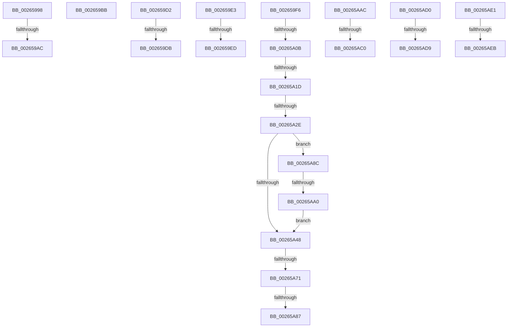

# sub_00265998

- RVA: `0x00265998`–`0x00265AF4` (길이 `348` bytes)
- VA: `0x0000000140265998`
- 실행 섹션: `.text`
- PDB 이름 있음: `아니요`; PDB Function 태그: `아니요`
- unwind 정보 RVA: `0x00064C10`
- 디코드: `88`개 명령, `348/348` bytes 표시
- 미해석 바이트: `0` (있으면 어셈블리에 `.byte`로 보존)

> 이 문서는 커널 이미지의 기계어와 PDB 기호를 분석해 생성했습니다. 4번과 5번은 함수 원형과 자료형을 바이너리 사용 방식에서 추정한 C 해석이며 원본 소스 복구 결과는 아닙니다.

## 1. Dependencies

- 직접 호출 지점: **0**; 고유 호출 대상: **0**
- 직접 호출자로 확인된 함수: **0**
- RIP 상대 이미지 참조: **0**

### Outgoing calls
- 직접 디코드된 call 명령이 없습니다.

### Direct callers
- 이 함수 시작 RVA로 연결되는 직접 call은 확인되지 않았습니다. 간접 호출은 완전히 역산할 수 없습니다.

### Static image references
- 디코드된 RIP-relative 메모리 참조가 없습니다.

## 2. Other-region calls and transfers

- 다른 실행 섹션으로 향하는 call: **0**
- call이 아닌 외부 분기/꼬리 이동: **20**
  - `0x002659A6` → [sub_00265815 + 0x43](Unknown_function_00265815.md) (`tail-transfer`)
  - `0x002659B6` → [sub_002658EE + 0x3C](Unknown_function_002658EE.md) (`tail-transfer`)
  - `0x002659D0` → [sub_002658EE + 0x89](Unknown_function_002658EE.md) (`tail-transfer`)
  - `0x002659D5` → [sub_00265815 + 0x43](Unknown_function_00265815.md) (`tail-transfer`)
  - `0x002659DE` → [sub_002658EE + 0x1E](Unknown_function_002658EE.md) (`tail-transfer`)
  - `0x002659E7` → [sub_00265815 + 0x43](Unknown_function_00265815.md) (`tail-transfer`)
  - `0x002659F1` → [sub_002658EE + 0x1E](Unknown_function_002658EE.md) (`tail-transfer`)
  - `0x00265A05` → [sub_00265815 + 0x43](Unknown_function_00265815.md) (`tail-transfer`)
  - `0x00265A17` → [sub_00265815 + 0x43](Unknown_function_00265815.md) (`tail-transfer`)
  - `0x00265A28` → [sub_00265815 + 0x43](Unknown_function_00265815.md) (`tail-transfer`)
  - `0x00265A6B` → [sub_00265815 + 0x43](Unknown_function_00265815.md) (`tail-transfer`)
  - `0x00265A81` → [sub_00265815 + 0x43](Unknown_function_00265815.md) (`tail-transfer`)
  - `0x00265A87` → [sub_002658EE](Unknown_function_002658EE.md) (`tail-transfer`)
  - `0x00265A9A` → [sub_00265815 + 0x43](Unknown_function_00265815.md) (`tail-transfer`)
  - `0x00265ABA` → [sub_00265815 + 0x43](Unknown_function_00265815.md) (`tail-transfer`)
  - `0x00265ACB` → [sub_00265815 + 0xAC](Unknown_function_00265815.md) (`tail-transfer`)
  - `0x00265AD3` → [sub_00265815 + 0x43](Unknown_function_00265815.md) (`tail-transfer`)
  - `0x00265ADC` → [sub_00265815 + 0x8A](Unknown_function_00265815.md) (`tail-transfer`)
  - `0x00265AE5` → [sub_00265815 + 0x43](Unknown_function_00265815.md) (`tail-transfer`)
  - `0x00265AEF` → [sub_00265815 + 0x8A](Unknown_function_00265815.md) (`tail-transfer`)

## 3. Assembly (complete function range)

```asm
00265998  48 8B 69 10                     mov rbp, qword ptr [rcx + 0x10]
0026599C  48 8B C5                        mov rax, rbp
0026599F  48 83 E0 FC                     and rax, 0xfffffffffffffffc
002659A3  48 3B C3                        cmp rax, rbx
002659A6  0F 85 AC FE FF FF               jne 0x140265858
002659AC  83 E5 03                        and ebp, 3
002659AF  48 0B EA                        or rbp, rdx
002659B2  48 89 69 10                     mov qword ptr [rcx + 0x10], rbp
002659B6  E9 6F FF FF FF                  jmp 0x14026592a
002659BB  41 0F B6 03                     movzx eax, byte ptr [r11]
002659BF  44 32 C0                        xor r8b, al
002659C2  41 80 F0 FE                     xor r8b, 0xfe
002659C6  41 80 E0 03                     and r8b, 3
002659CA  44 32 C0                        xor r8b, al
002659CD  45 88 03                        mov byte ptr [r11], r8b
002659D0  EB A5                           jmp 0x140265977
002659D2  48 39 11                        cmp qword ptr [rcx], rdx
002659D5  0F 85 7D FE FF FF               jne 0x140265858
002659DB  48 89 19                        mov qword ptr [rcx], rbx
002659DE  E9 29 FF FF FF                  jmp 0x14026590c
002659E3  49 39 14 24                     cmp qword ptr [r12], rdx
002659E7  0F 85 6B FE FF FF               jne 0x140265858
002659ED  49 89 1C 24                     mov qword ptr [r12], rbx
002659F1  E9 16 FF FF FF                  jmp 0x14026590c
002659F6  48 8B C1                        mov rax, rcx
002659F9  48 83 F0 01                     xor rax, 1
002659FD  49 39 1C C2                     cmp qword ptr [r10 + rax*8], rbx
00265A01  49 8D 34 C2                     lea rsi, [r10 + rax*8]
00265A05  0F 85 4D FE FF FF               jne 0x140265858
00265A0B  4C 8D 3C CD 00 00 00 00         lea r15, [rcx*8]
00265A13  4D 39 14 17                     cmp qword ptr [r15 + rdx], r10
00265A17  0F 85 3B FE FF FF               jne 0x140265858
00265A1D  49 8B 42 10                     mov rax, qword ptr [r10 + 0x10]
00265A21  48 83 E0 FC                     and rax, 0xfffffffffffffffc
00265A25  48 3B C2                        cmp rax, rdx
00265A28  0F 85 2A FE FF FF               jne 0x140265858
00265A2E  49 89 1C 17                     mov qword ptr [r15 + rdx], rbx
00265A32  8B 43 10                        mov eax, dword ptr [rbx + 0x10]
00265A35  83 E0 03                        and eax, 3
00265A38  48 0B C2                        or rax, rdx
00265A3B  48 89 43 10                     mov qword ptr [rbx + 0x10], rax
00265A3F  49 8B 3C 1F                     mov rdi, qword ptr [r15 + rbx]
00265A43  48 85 FF                        test rdi, rdi
00265A46  75 44                           jne 0x140265a8c
00265A48  48 89 3E                        mov qword ptr [rsi], rdi
00265A4B  83 F1 01                        xor ecx, 1
00265A4E  4D 89 14 1F                     mov qword ptr [r15 + rbx], r10
00265A52  41 8B 42 10                     mov eax, dword ptr [r10 + 0x10]
00265A56  83 E0 03                        and eax, 3
00265A59  48 0B C3                        or rax, rbx
00265A5C  49 89 42 10                     mov qword ptr [r10 + 0x10], rax
00265A60  48 8B 43 10                     mov rax, qword ptr [rbx + 0x10]
00265A64  48 83 E0 FC                     and rax, 0xfffffffffffffffc
00265A68  48 3B C2                        cmp rax, rdx
00265A6B  0F 85 E7 FD FF FF               jne 0x140265858
00265A71  8B C1                           mov eax, ecx
00265A73  48 83 F0 01                     xor rax, 1
00265A77  8B F9                           mov edi, ecx
00265A79  48 39 1C C2                     cmp qword ptr [rdx + rax*8], rbx
00265A7D  48 8D 34 C2                     lea rsi, [rdx + rax*8]
00265A81  0F 85 D1 FD FF FF               jne 0x140265858
00265A87  E9 62 FE FF FF                  jmp 0x1402658ee
00265A8C  48 8B 6F 10                     mov rbp, qword ptr [rdi + 0x10]
00265A90  48 8B C5                        mov rax, rbp
00265A93  48 83 E0 FC                     and rax, 0xfffffffffffffffc
00265A97  48 3B C3                        cmp rax, rbx
00265A9A  0F 85 B8 FD FF FF               jne 0x140265858
00265AA0  83 E5 03                        and ebp, 3
00265AA3  49 0B EA                        or rbp, r10
00265AA6  48 89 6F 10                     mov qword ptr [rdi + 0x10], rbp
00265AAA  EB 9C                           jmp 0x140265a48
00265AAC  4C 8B 49 10                     mov r9, qword ptr [rcx + 0x10]
00265AB0  49 8B C1                        mov rax, r9
00265AB3  48 83 E0 FC                     and rax, 0xfffffffffffffffc
00265AB7  49 3B C2                        cmp rax, r10
00265ABA  0F 85 98 FD FF FF               jne 0x140265858
00265AC0  41 83 E1 03                     and r9d, 3
00265AC4  4C 0B CA                        or r9, rdx
00265AC7  4C 89 49 10                     mov qword ptr [rcx + 0x10], r9
00265ACB  E9 F1 FD FF FF                  jmp 0x1402658c1
00265AD0  48 39 11                        cmp qword ptr [rcx], rdx
00265AD3  0F 85 7F FD FF FF               jne 0x140265858
00265AD9  4C 89 11                        mov qword ptr [rcx], r10
00265ADC  E9 BE FD FF FF                  jmp 0x14026589f
00265AE1  49 39 14 24                     cmp qword ptr [r12], rdx
00265AE5  0F 85 6D FD FF FF               jne 0x140265858
00265AEB  4D 89 14 24                     mov qword ptr [r12], r10
00265AEF  E9 AB FD FF FF                  jmp 0x14026589f
```

## 4. C-style interpretation (structured pseudocode)

```c
__int64 __fastcall sub_00265998(__int64 a1, __int64 a2, unsigned __int8 a3)
{
    __int64 result;
    __int64 v_rbp;

    result = (*(unsigned __int64 *)(a1 + 16)) & (-4);
    v_rbp = (unsigned int)((*(unsigned __int64 *)(a1 + 16)) & (3));
    v_rbp = (v_rbp) | (a2);
    *(unsigned __int64 *)(a1 + 16) = v_rbp;
}
```

## 5. (Beta) C Style

```c
int64_t sub_00265998(void *Arg1, int64_t Arg2, uint8_t Arg3)
{
    uint8_t *arg1 = (uint8_t *)Arg1;

    int64_t result;
    int64_t local_rbp;

    result = (*(uint64_t *)(arg1 + 0x10)) & (-4);
    local_rbp = (uint32_t)((*(uint64_t *)(arg1 + 0x10)) & (3));
    local_rbp = (local_rbp) | (Arg2);
    *(uint64_t *)(arg1 + 0x10) = local_rbp;
}
```

### 관측된 메모리 오프셋

구조체 형식이 확인되지 않은 접근은 인자 기준의 오프셋으로만 기록했습니다.

| 기준 인자 | 오프셋 표현 | 폭 (bit) | 접근 |
|---|---:|---:|---|
| `Arg1` | `+ 0x10` | `64` | `R` |
| `Arg1` | `+ 0x10` | `64` | `W` |

## 6. Execution-region graph

[열기: 2D/3D 그래프와 함수 탐색 컨트롤 패널](../../../control-panel.html?section=text&rva=0x00265998&view=graph)

- 2D 그래프는 위에서 아래로 흐르고, 3D 그래프는 빈 공간을 드래그해 회전합니다. Shift+드래그는 이동, 휠은 확대·축소, 함수 노드 선택은 대상 보고서 이동입니다.

### Static fallback


