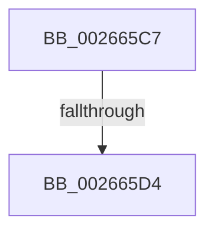

# sub_002665C7

- RVA: `0x002665C7`–`0x002665E6` (길이 `31` bytes)
- VA: `0x00000001402665C7`
- 실행 섹션: `.text`
- PDB 이름 있음: `아니요`; PDB Function 태그: `아니요`
- unwind 정보 RVA: `0x00064D70`
- 디코드: `8`개 명령, `31/31` bytes 표시
- 미해석 바이트: `0` (있으면 어셈블리에 `.byte`로 보존)

> 이 문서는 커널 이미지의 기계어와 PDB 기호를 분석해 생성했습니다. 4번과 5번은 함수 원형과 자료형을 바이너리 사용 방식에서 추정한 C 해석이며 원본 소스 복구 결과는 아닙니다.

## 1. Dependencies

- 직접 호출 지점: **0**; 고유 호출 대상: **0**
- 직접 호출자로 확인된 함수: **0**
- RIP 상대 이미지 참조: **0**

### Outgoing calls
- 직접 디코드된 call 명령이 없습니다.

### Direct callers
- 이 함수 시작 RVA로 연결되는 직접 call은 확인되지 않았습니다. 간접 호출은 완전히 역산할 수 없습니다.

### Static image references
- 디코드된 RIP-relative 메모리 참조가 없습니다.

## 2. Other-region calls and transfers

- 다른 실행 섹션으로 향하는 call: **0**
- call이 아닌 외부 분기/꼬리 이동: **1**
  - `0x002665CE` → [sub_0026675B](Unknown_function_0026675B.md) (`tail-transfer`)

## 3. Assembly (complete function range)

```asm
002665C7  48 89 7C 24 48                  mov qword ptr [rsp + 0x48], rdi
002665CC  85 DB                           test ebx, ebx
002665CE  0F 84 87 01 00 00               je 0x14026675b
002665D4  8D 7B FF                        lea edi, [rbx - 1]
002665D7  48 C1 E7 04                     shl rdi, 4
002665DB  48 03 3E                        add rdi, qword ptr [rsi]
002665DE  48 8B 1F                        mov rbx, qword ptr [rdi]
002665E1  B8 FF 00 00 00                  mov eax, 0xff
```

## 4. C-style interpretation (structured pseudocode)

```c
__int64 __fastcall sub_002665C7(void)
{
    __int64 v_rdi;
    unsigned __int64 v_stack_p48;

    v_stack_p48 = v_rdi;
    v_rdi = (v_rbx - 1) << (4);
    v_rdi = (v_rdi) + (*(unsigned __int64 *)(v_rsi));
    return 255;
}
```

## 5. (Beta) C Style

```c
void sub_002665C7(void)
{
    int64_t local_rdi;
    uint64_t v_stack_p48;

    v_stack_p48 = local_rdi;
    local_rdi = (local_rbx - 1) << (4);
    local_rdi = (local_rdi) + (*(uint64_t *)(local_rsi));
    return 255;
}
```

## 6. Execution-region graph

[열기: 2D/3D 그래프와 함수 탐색 컨트롤 패널](../../../control-panel.html?section=text&rva=0x002665C7&view=graph)

- 2D 그래프는 위에서 아래로 흐르고, 3D 그래프는 빈 공간을 드래그해 회전합니다. Shift+드래그는 이동, 휠은 확대·축소, 함수 노드 선택은 대상 보고서 이동입니다.

### Static fallback


