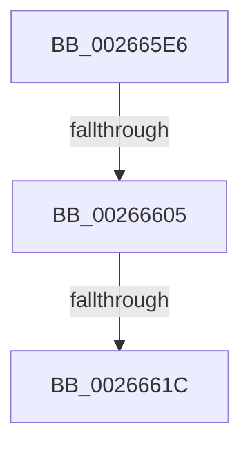

# sub_002665E6

- RVA: `0x002665E6`–`0x0026664C` (길이 `102` bytes)
- VA: `0x00000001402665E6`
- 실행 섹션: `.text`
- PDB 이름 있음: `아니요`; PDB Function 태그: `아니요`
- unwind 정보 RVA: `0x00064D84`
- 디코드: `27`개 명령, `102/102` bytes 표시
- 미해석 바이트: `0` (있으면 어셈블리에 `.byte`로 보존)

> 이 문서는 커널 이미지의 기계어와 PDB 기호를 분석해 생성했습니다. 4번과 5번은 함수 원형과 자료형을 바이너리 사용 방식에서 추정한 C 해석이며 원본 소스 복구 결과는 아닙니다.

## 1. Dependencies

- 직접 호출 지점: **1**; 고유 호출 대상: **1**
- 직접 호출자로 확인된 함수: **0**
- RIP 상대 이미지 참조: **0**

### Outgoing calls
- `0x0026662E` → [memcpy](../6C/memcpy_function_006C6840.md) (function, `0x006C6840`)

### Direct callers
- 이 함수 시작 RVA로 연결되는 직접 call은 확인되지 않았습니다. 간접 호출은 완전히 역산할 수 없습니다.

### Static image references
- 디코드된 RIP-relative 메모리 참조가 없습니다.

## 2. Other-region calls and transfers

- 다른 실행 섹션으로 향하는 call: **0**
- call이 아닌 외부 분기/꼬리 이동: **2**
  - `0x00266603` → [sub_00266668](Unknown_function_00266668.md) (`tail-transfer`)
  - `0x00266616` → [sub_002667A7 + 0xB](Unknown_function_002667A7.md) (`tail-transfer`)

## 3. Assembly (complete function range)

```asm
002665E6  48 89 6C 24 40                  mov qword ptr [rsp + 0x40], rbp
002665EB  BD FE 01 00 00                  mov ebp, 0x1fe
002665F0  4C 89 64 24 50                  mov qword ptr [rsp + 0x50], r12
002665F5  80 7B 03 00                     cmp byte ptr [rbx + 3], 0
002665F9  8B 0B                           mov ecx, dword ptr [rbx]
002665FB  0F 44 E8                        cmove ebp, eax
002665FE  0F B7 C1                        movzx eax, cx
00266601  3B C5                           cmp eax, ebp
00266603  73 63                           jae 0x140266668
00266605  80 7B 03 00                     cmp byte ptr [rbx + 3], 0
00266609  48 8B 7F 08                     mov rdi, qword ptr [rdi + 8]
0026660D  8B 03                           mov eax, dword ptr [rbx]
0026660F  48 8B D7                        mov rdx, rdi
00266612  44 0F B7 C0                     movzx r8d, ax
00266616  0F 84 96 01 00 00               je 0x1402667b2
0026661C  4E 8D 04 C5 10 00 00 00         lea r8, [r8*8 + 0x10]
00266624  4C 2B C7                        sub r8, rdi
00266627  48 8D 4F 08                     lea rcx, [rdi + 8]
0026662B  4C 03 C3                        add r8, rbx
0026662E  E8 0D 02 46 00                  call 0x1406c6840
00266633  49 8B 07                        mov rax, qword ptr [r15]
00266636  48 89 07                        mov qword ptr [rdi], rax
00266639  49 FF 46 08                     inc qword ptr [r14 + 8]
0026663D  66 FF 03                        inc word ptr [rbx]
00266640  33 C0                           xor eax, eax
00266642  48 8B 6C 24 40                  mov rbp, qword ptr [rsp + 0x40]
00266647  4C 8B 64 24 50                  mov r12, qword ptr [rsp + 0x50]
```

## 4. C-style interpretation (structured pseudocode)

```c
__int64 __fastcall sub_002665E6(__int64 a1, __int64 a2, __int64 a3, __int64 a4, __int64 a5, __int64 a6, __int64 a7, __int64 a8, __int64 a9, __int64 a10)
{
    __int64 result;
    __int64 v_rbp;
    unsigned __int64 v_stack_p40;
    unsigned __int64 v_stack_p50;

    v_stack_p40 = v_rbp;
    v_stack_p50 = v_r12;
    v_rbp = 510;
    if ((*(unsigned __int8 *)(v_rbx + 3)) == 0) { v_rbp = (unsigned int)(result); }
    a3 = ((unsigned __int16)((unsigned int)(*(unsigned int *)(v_rbx))) * 8 + 16) - (*(unsigned __int64 *)(v_rdi + 8));
    a3 = (a3) + (v_rbx);
    result = memcpy(*(unsigned __int64 *)(v_rdi + 8) + 8, *(unsigned __int64 *)(v_rdi + 8), a3, a4);
    *(unsigned __int64 *)(*(unsigned __int64 *)(v_rdi + 8)) = *(unsigned __int64 *)(v_r15);
    result = 0;
    return result;
}
```

## 5. (Beta) C Style

```c
int64_t sub_002665E6(int64_t Arg1, int64_t Arg2, int64_t Arg3, int64_t Arg4, uint64_t Arg5, uint64_t Arg6, uint64_t Arg7, int64_t Arg8, uint64_t Arg9, int64_t Arg10)
{
    int64_t result;
    int64_t local_rbp;
    uint64_t v_stack_p40;
    uint64_t v_stack_p50;

    v_stack_p40 = local_rbp;
    v_stack_p50 = local_r12;
    local_rbp = 510;
    if ((*(uint8_t *)(local_rbx + 0x3)) == 0) { local_rbp = (uint32_t)(result); }
    Arg3 = ((uint16_t)((uint32_t)(*(uint32_t *)(local_rbx))) * 8 + 16) - (*(uint64_t *)(local_rdi + 0x8));
    Arg3 = (Arg3) + (local_rbx);
    result = memcpy(*(uint64_t *)(local_rdi + 0x8) + 8, *(uint64_t *)(local_rdi + 0x8), Arg3, Arg4);
    *(uint64_t *)(*(uint64_t *)(local_rdi + 0x8)) = *(uint64_t *)(local_r15);
    result = 0;
    return result;
}
```

## 6. Execution-region graph

[열기: 2D/3D 그래프와 함수 탐색 컨트롤 패널](../../../control-panel.html?section=text&rva=0x002665E6&view=graph)

- 2D 그래프는 위에서 아래로 흐르고, 3D 그래프는 빈 공간을 드래그해 회전합니다. Shift+드래그는 이동, 휠은 확대·축소, 함수 노드 선택은 대상 보고서 이동입니다.

### Static fallback


