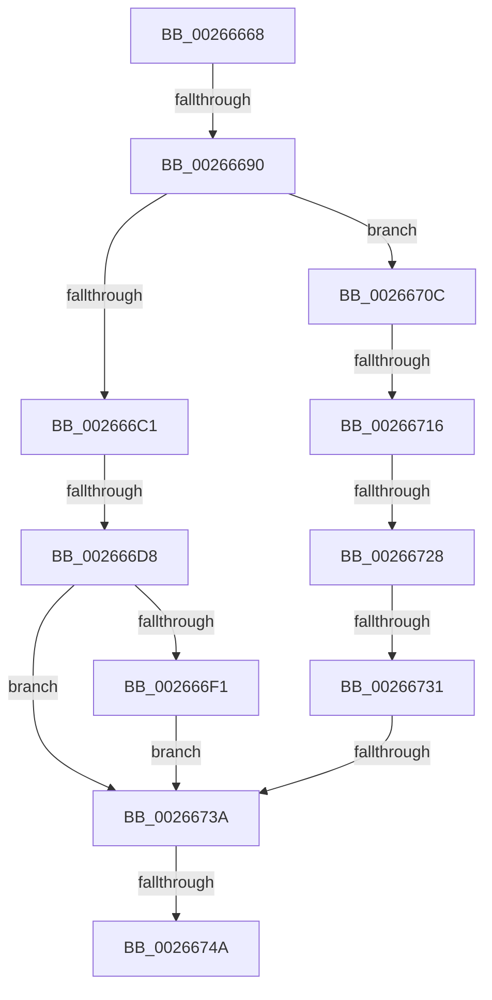

# sub_00266668

- RVA: `0x00266668`–`0x0026675B` (길이 `243` bytes)
- VA: `0x0000000140266668`
- 실행 섹션: `.text`
- PDB 이름 있음: `아니요`; PDB Function 태그: `아니요`
- unwind 정보 RVA: `0x00064DC0`
- 디코드: `69`개 명령, `243/243` bytes 표시
- 미해석 바이트: `0` (있으면 어셈블리에 `.byte`로 보존)

> 이 문서는 커널 이미지의 기계어와 PDB 기호를 분석해 생성했습니다. 4번과 5번은 함수 원형과 자료형을 바이너리 사용 방식에서 추정한 C 해석이며 원본 소스 복구 결과는 아닙니다.

## 1. Dependencies

- 직접 호출 지점: **2**; 고유 호출 대상: **2**
- 직접 호출자로 확인된 함수: **0**
- RIP 상대 이미지 참조: **0**

### Outgoing calls
- `0x00266693` → [B_TREE<_SM_PAGE_KEY,SMKM_STORE_MGR<SM_TRAITS>::SMKM_FRONTEND_ENTRY,4096,B_TREE_DUMMY_NODE_POOL,B_TREE_KEY_COMPARATOR<_SM_PAGE_KEY> >::BTreeRedistribute](B_TREE__SM_PAGE_KEY_SMKM_STORE_MGR_SM_TRAITS_SMKM_FRONTEND_ENTRY_4096_B_TREE_DUMMY_NODE_POOL_B_TREE__function_00267188.md) (function, `0x00267188`)
- `0x002666C7` → [B_TREE<_SM_PAGE_KEY,SMKM_STORE_MGR<SM_TRAITS>::SMKM_FRONTEND_ENTRY,4096,B_TREE_DUMMY_NODE_POOL,B_TREE_KEY_COMPARATOR<_SM_PAGE_KEY> >::BTreeSplitChild](B_TREE__SM_PAGE_KEY_SMKM_STORE_MGR_SM_TRAITS_SMKM_FRONTEND_ENTRY_4096_B_TREE_DUMMY_NODE_POOL_B_TREE__function_002675D4.md) (function, `0x002675D4`)

### Direct callers
- 이 함수 시작 RVA로 연결되는 직접 call은 확인되지 않았습니다. 간접 호출은 완전히 역산할 수 없습니다.

### Static image references
- 디코드된 RIP-relative 메모리 참조가 없습니다.

## 2. Other-region calls and transfers

- 다른 실행 섹션으로 향하는 call: **0**
- call이 아닌 외부 분기/꼬리 이동: **8**
  - `0x0026668A` → [sub_002667A7](Unknown_function_002667A7.md) (`tail-transfer`)
  - `0x002666D2` → [sub_002667A7 + 0x62](Unknown_function_002667A7.md) (`tail-transfer`)
  - `0x00266710` → [sub_002667A7 + 0x2D](Unknown_function_002667A7.md) (`tail-transfer`)
  - `0x00266722` → [sub_002667A7 + 0x6C](Unknown_function_002667A7.md) (`tail-transfer`)
  - `0x0026672B` → [sub_002667A7 + 0x86](Unknown_function_002667A7.md) (`tail-transfer`)
  - `0x00266734` → [sub_002667A7 + 0x92](Unknown_function_002667A7.md) (`tail-transfer`)
  - `0x00266744` → [sub_002667A7 + 0x53](Unknown_function_002667A7.md) (`tail-transfer`)
  - `0x00266756` → [sub_002665E6 + 0x1F](Unknown_function_002665E6.md) (`tail-transfer`)

## 3. Assembly (complete function range)

```asm
00266668  4C 8B 67 08                     mov r12, qword ptr [rdi + 8]
0026666C  4C 2B E3                        sub r12, rbx
0026666F  C1 E9 18                        shr ecx, 0x18
00266672  49 83 EC 10                     sub r12, 0x10
00266676  49 8B C4                        mov rax, r12
00266679  49 C1 FC 03                     sar r12, 3
0026667D  48 C1 F8 04                     sar rax, 4
00266681  84 C9                           test cl, cl
00266683  44 0F 44 E0                     cmove r12d, eax
00266687  49 3B 1E                        cmp rbx, qword ptr [r14]
0026668A  0F 84 17 01 00 00               je 0x1402667a7
00266690  48 8B D6                        mov rdx, rsi
00266693  E8 F0 0A 00 00                  call 0x140267188
00266698  4C 8B 57 F8                     mov r10, qword ptr [rdi - 8]
0026669C  48 8B D0                        mov rdx, rax
0026669F  48 F7 D2                        not rdx
002666A2  4C 8B C8                        mov r9, rax
002666A5  83 E2 01                        and edx, 1
002666A8  48 C1 E2 05                     shl rdx, 5
002666AC  48 83 C2 F0                     add rdx, -0x10
002666B0  4C 03 D2                        add r10, rdx
002666B3  8B 03                           mov eax, dword ptr [rbx]
002666B5  8B D0                           mov edx, eax
002666B7  C1 EA 18                        shr edx, 0x18
002666BA  0F B7 C8                        movzx ecx, ax
002666BD  3B CD                           cmp ecx, ebp
002666BF  72 4B                           jb 0x14026670c
002666C1  48 8B D6                        mov rdx, rsi
002666C4  49 8B CE                        mov rcx, r14
002666C7  E8 08 0F 00 00                  call 0x1402675d4
002666CC  48 8B C8                        mov rcx, rax
002666CF  48 85 C0                        test rax, rax
002666D2  0F 84 31 01 00 00               je 0x140266809
002666D8  8B 7E 18                        mov edi, dword ptr [rsi + 0x18]
002666DB  45 8B C4                        mov r8d, r12d
002666DE  8B 03                           mov eax, dword ptr [rbx]
002666E0  FF CF                           dec edi
002666E2  48 C1 E7 04                     shl rdi, 4
002666E6  48 03 3E                        add rdi, qword ptr [rsi]
002666E9  0F B7 D0                        movzx edx, ax
002666EC  44 3B E2                        cmp r12d, edx
002666EF  7E 49                           jle 0x14026673a
002666F1  48 83 47 F8 10                  add qword ptr [rdi - 8], 0x10
002666F6  44 2B E2                        sub r12d, edx
002666F9  C1 E8 18                        shr eax, 0x18
002666FC  48 8B D9                        mov rbx, rcx
002666FF  84 C0                           test al, al
00266701  45 8D 44 24 FF                  lea r8d, [r12 - 1]
00266706  45 0F 45 C4                     cmovne r8d, r12d
0026670A  EB 2E                           jmp 0x14026673a
0026670C  41 F6 C1 01                     test r9b, 1
00266710  0F 84 BE 00 00 00               je 0x1402667d4
00266716  2B CD                           sub ecx, ebp
00266718  49 83 E1 FE                     and r9, 0xfffffffffffffffe
0026671C  45 8D 04 0C                     lea r8d, [r12 + rcx]
00266720  84 D2                           test dl, dl
00266722  0F 84 EB 00 00 00               je 0x140266813
00266728  45 85 C0                        test r8d, r8d
0026672B  0F 8E FC 00 00 00               jle 0x14026682d
00266731  49 3B D9                        cmp rbx, r9
00266734  0F 84 FF 00 00 00               je 0x140266839
0026673A  48 89 1F                        mov qword ptr [rdi], rbx
0026673D  80 7B 03 00                     cmp byte ptr [rbx + 3], 0
00266741  49 63 C0                        movsxd rax, r8d
00266744  0F 84 B0 00 00 00               je 0x1402667fa
0026674A  48 83 C0 02                     add rax, 2
0026674E  48 8D 04 C3                     lea rax, [rbx + rax*8]
00266752  48 89 47 08                     mov qword ptr [rdi + 8], rax
00266756  E9 AA FE FF FF                  jmp 0x140266605
```

## 4. C-style interpretation (structured pseudocode)

```c
__int64 __fastcall sub_00266668(int a1)
{
    __int64 result;
    __int64 v_r10;
    __int64 v_r12;
    __int64 v_rdi;

    v_r12 = (*(unsigned __int64 *)(v_rdi + 8)) - (v_rbx);
    a1 = (unsigned int)((a1) >> (24));
    v_r12 = (v_r12) - (16);
    v_r12 = (v_r12) >> (3);
    result = (v_r12) >> (4);
    if ((unsigned __int8)(a1) == 0) { v_r12 = (unsigned int)(result); }
    result = B_TREE__SM_PAGE_KEY_SMKM_STORE_MGR_SM_TRAITS___SMKM_FRONTEND_ENTRY_4096_B_TREE_DUMMY_NODE_POOL_B_TRE(a1, v_rsi, a3, a4);
    a2 = ~(result);
    a2 = (unsigned int)((a2) & (1));
    a2 = (a2) << (5);
    a2 = (a2) + (-16);
    v_r10 = (*(unsigned __int64 *)(v_rdi - 8)) + (a2);
    a2 = (unsigned int)(((unsigned int)((unsigned int)((unsigned int)(*(unsigned int *)(v_rbx))))) >> (24));
    if (((unsigned int)((unsigned __int16)((unsigned int)(*(unsigned int *)(v_rbx))))) < ((unsigned int)(v_rbp))) goto loc_0026670C;
    result = B_TREE__SM_PAGE_KEY_SMKM_STORE_MGR_SM_TRAITS___SMKM_FRONTEND_ENTRY_4096_B_TREE_DUMMY_NODE_POOL_B_TRE(v_r14, v_rsi, a3, result);
    v_rdi = (unsigned int)(((unsigned int)(*(unsigned int *)(v_rsi + 24))) - 1);
    v_rdi = (v_rdi) << (4);
    v_rdi = (v_rdi) + (*(unsigned __int64 *)(v_rsi));
    if (((unsigned int)(v_r12)) <= ((unsigned int)((unsigned __int16)((unsigned int)(*(unsigned int *)(v_rbx)))))) goto loc_0026673A;
    v_r12 = (unsigned int)((v_r12) - ((unsigned int)((unsigned __int16)((unsigned int)(*(unsigned int *)(v_rbx))))));
    result = (unsigned int)(((unsigned int)(*(unsigned int *)(v_rbx))) >> (24));
    a3 = v_r12 - 1;
    if ((unsigned __int8)(result) != 0) { a3 = (unsigned int)(v_r12); }
    goto loc_0026673A;
loc_0026670C:
    a1 = (unsigned int)((result) - ((unsigned int)(v_rbp)));
    a4 = (result) & (-2);
loc_0026673A:
    *(unsigned __int64 *)(v_rdi) = result;
    result = ((int)((unsigned int)(v_r12 + a1 * 1))) + (2);
    *(unsigned __int64 *)(v_rdi + 8) = result + result * 8;
}
```

## 5. (Beta) C Style

```c
int64_t sub_00266668(int32_t Arg1)
{
    int64_t result;
    int64_t local_r10;
    int64_t local_r12;
    int64_t local_rdi;

    local_r12 = (*(uint64_t *)(local_rdi + 0x8)) - (local_rbx);
    Arg1 = (uint32_t)((Arg1) >> (24));
    local_r12 = (local_r12) - (16);
    local_r12 = (local_r12) >> (3);
    result = (local_r12) >> (4);
    if ((uint8_t)(Arg1) == 0) { local_r12 = (uint32_t)(result); }
    result = B_TREE__SM_PAGE_KEY_SMKM_STORE_MGR_SM_TRAITS___SMKM_FRONTEND_ENTRY_4096_B_TREE_DUMMY_NODE_POOL_B_TRE(Arg1, local_rsi, a3, a4);
    a2 = ~(result);
    a2 = (uint32_t)((a2) & (1));
    a2 = (a2) << (5);
    a2 = (a2) + (-16);
    local_r10 = (*(uint64_t *)(local_rdi - 0x8)) + (a2);
    a2 = (uint32_t)(((uint32_t)((uint32_t)((uint32_t)(*(uint32_t *)(local_rbx))))) >> (24));
    if (((uint32_t)((uint16_t)((uint32_t)(*(uint32_t *)(local_rbx))))) < ((uint32_t)(local_rbp))) goto loc_0026670C;
    result = B_TREE__SM_PAGE_KEY_SMKM_STORE_MGR_SM_TRAITS___SMKM_FRONTEND_ENTRY_4096_B_TREE_DUMMY_NODE_POOL_B_TRE(local_r14, local_rsi, a3, result);
    local_rdi = (uint32_t)(((uint32_t)(*(uint32_t *)(local_rsi + 0x18))) - 1);
    local_rdi = (local_rdi) << (4);
    local_rdi = (local_rdi) + (*(uint64_t *)(local_rsi));
    if (((uint32_t)(local_r12)) <= ((uint32_t)((uint16_t)((uint32_t)(*(uint32_t *)(local_rbx)))))) goto loc_0026673A;
    local_r12 = (uint32_t)((local_r12) - ((uint32_t)((uint16_t)((uint32_t)(*(uint32_t *)(local_rbx))))));
    result = (uint32_t)(((uint32_t)(*(uint32_t *)(local_rbx))) >> (24));
    a3 = local_r12 - 1;
    if ((uint8_t)(result) != 0) { a3 = (uint32_t)(local_r12); }
    goto loc_0026673A;
loc_0026670C:
    Arg1 = (uint32_t)((result) - ((uint32_t)(local_rbp)));
    a4 = (result) & (-2);
loc_0026673A:
    *(uint64_t *)(local_rdi) = result;
    result = ((int32_t)((uint32_t)(local_r12 + Arg1 * 1))) + (2);
    *(uint64_t *)(local_rdi + 0x8) = result + result * 8;
}
```

## 6. Execution-region graph

[열기: 2D/3D 그래프와 함수 탐색 컨트롤 패널](../../../control-panel.html?section=text&rva=0x00266668&view=graph)

- 2D 그래프는 위에서 아래로 흐르고, 3D 그래프는 빈 공간을 드래그해 회전합니다. Shift+드래그는 이동, 휠은 확대·축소, 함수 노드 선택은 대상 보고서 이동입니다.

### Static fallback


