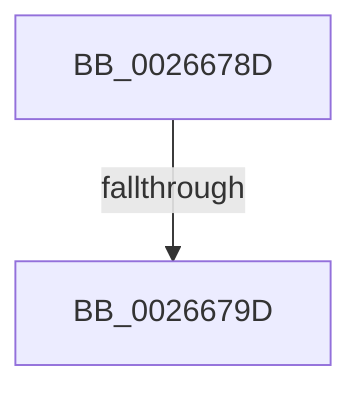

# sub_0026678D

- RVA: `0x0026678D`–`0x002667A7` (길이 `26` bytes)
- VA: `0x000000014026678D`
- 실행 섹션: `.text`
- PDB 이름 있음: `아니요`; PDB Function 태그: `아니요`
- unwind 정보 RVA: `0x00064DF0`
- 디코드: `6`개 명령, `26/26` bytes 표시
- 미해석 바이트: `0` (있으면 어셈블리에 `.byte`로 보존)

> 이 문서는 커널 이미지의 기계어와 PDB 기호를 분석해 생성했습니다. 4번과 5번은 함수 원형과 자료형을 바이너리 사용 방식에서 추정한 C 해석이며 원본 소스 복구 결과는 아닙니다.

## 1. Dependencies

- 직접 호출 지점: **1**; 고유 호출 대상: **1**
- 직접 호출자로 확인된 함수: **0**
- RIP 상대 이미지 참조: **0**

### Outgoing calls
- `0x00266790` → [SmArrayGrow](../3A/SmArrayGrow_function_003AC6C8.md) (function, `0x003AC6C8`)

### Direct callers
- 이 함수 시작 RVA로 연결되는 직접 call은 확인되지 않았습니다. 간접 호출은 완전히 역산할 수 없습니다.

### Static image references
- 디코드된 RIP-relative 메모리 참조가 없습니다.

## 2. Other-region calls and transfers

- 다른 실행 섹션으로 향하는 call: **0**
- call이 아닌 외부 분기/꼬리 이동: **2**
  - `0x00266797` → [sub_002665C7](Unknown_function_002665C7.md) (`tail-transfer`)
  - `0x002667A2` → [sub_00266651](Unknown_function_00266651.md) (`tail-transfer`)

## 3. Assembly (complete function range)

```asm
0026678D  4C 8B CE                        mov r9, rsi
00266790  E8 33 5F 14 00                  call 0x1403ac6c8
00266795  85 C0                           test eax, eax
00266797  0F 85 2A FE FF FF               jne 0x1402665c7
0026679D  B8 9A 00 00 C0                  mov eax, 0xc000009a
002667A2  E9 AA FE FF FF                  jmp 0x140266651
```

## 4. C-style interpretation (structured pseudocode)

```c
__int64 __fastcall sub_0026678D(void)
{
    __int64 result;

    result = SmArrayGrow(a1, a2, a3, v_rsi);
}
```

## 5. (Beta) C Style

```c
void sub_0026678D(void)
{
    int64_t result;

    result = SmArrayGrow(a1, a2, a3, local_rsi);
}
```

## 6. Execution-region graph

[열기: 2D/3D 그래프와 함수 탐색 컨트롤 패널](../../../control-panel.html?section=text&rva=0x0026678D&view=graph)

- 2D 그래프는 위에서 아래로 흐르고, 3D 그래프는 빈 공간을 드래그해 회전합니다. Shift+드래그는 이동, 휠은 확대·축소, 함수 노드 선택은 대상 보고서 이동입니다.

### Static fallback


