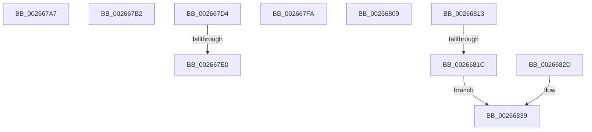

# sub_002667A7

- RVA: `0x002667A7`–`0x00266842` (길이 `155` bytes)
- VA: `0x00000001402667A7`
- 실행 섹션: `.text`
- PDB 이름 있음: `아니요`; PDB Function 태그: `아니요`
- unwind 정보 RVA: `0x00064E00`
- 디코드: `42`개 명령, `155/155` bytes 표시
- 미해석 바이트: `0` (있으면 어셈블리에 `.byte`로 보존)

> 이 문서는 커널 이미지의 기계어와 PDB 기호를 분석해 생성했습니다. 4번과 5번은 함수 원형과 자료형을 바이너리 사용 방식에서 추정한 C 해석이며 원본 소스 복구 결과는 아닙니다.

## 1. Dependencies

- 직접 호출 지점: **1**; 고유 호출 대상: **1**
- 직접 호출자로 확인된 함수: **0**
- RIP 상대 이미지 참조: **0**

### Outgoing calls
- `0x002667C3` → [memcpy](../6C/memcpy_function_006C6840.md) (function, `0x006C6840`)

### Direct callers
- 이 함수 시작 RVA로 연결되는 직접 call은 확인되지 않았습니다. 간접 호출은 완전히 역산할 수 없습니다.

### Static image references
- 디코드된 RIP-relative 메모리 참조가 없습니다.

## 2. Other-region calls and transfers

- 다른 실행 섹션으로 향하는 call: **0**
- call이 아닌 외부 분기/꼬리 이동: **8**
  - `0x002667AD` → [sub_00266668 + 0x4B](Unknown_function_00266668.md) (`tail-transfer`)
  - `0x002667CF` → [sub_002665E6 + 0x57](Unknown_function_002665E6.md) (`tail-transfer`)
  - `0x002667DA` → [sub_00266668 + 0xD2](Unknown_function_00266668.md) (`tail-transfer`)
  - `0x002667F5` → [sub_00266668 + 0xD2](Unknown_function_00266668.md) (`tail-transfer`)
  - `0x00266804` → [sub_00266668 + 0xEA](Unknown_function_00266668.md) (`tail-transfer`)
  - `0x0026680E` → [sub_002665E6 + 0x5C](Unknown_function_002665E6.md) (`tail-transfer`)
  - `0x00266816` → [sub_00266668 + 0xC9](Unknown_function_00266668.md) (`tail-transfer`)
  - `0x0026683D` → [sub_00266668 + 0xD2](Unknown_function_00266668.md) (`tail-transfer`)

## 3. Assembly (complete function range)

```asm
002667A7  45 33 D2                        xor r10d, r10d
002667AA  45 33 C9                        xor r9d, r9d
002667AD  E9 01 FF FF FF                  jmp 0x1402666b3
002667B2  49 FF C0                        inc r8
002667B5  48 8D 4F 10                     lea rcx, [rdi + 0x10]
002667B9  49 C1 E0 04                     shl r8, 4
002667BD  4C 2B C7                        sub r8, rdi
002667C0  4C 03 C3                        add r8, rbx
002667C3  E8 78 00 46 00                  call 0x1406c6840
002667C8  41 0F 10 07                     movups xmm0, xmmword ptr [r15]
002667CC  0F 11 07                        movups xmmword ptr [rdi], xmm0
002667CF  E9 69 FE FF FF                  jmp 0x14026663d
002667D4  45 8B C4                        mov r8d, r12d
002667D7  44 3B E1                        cmp r12d, ecx
002667DA  0F 8E 5A FF FF FF               jle 0x14026673a
002667E0  44 2B E1                        sub r12d, ecx
002667E3  4C 89 57 F8                     mov qword ptr [rdi - 8], r10
002667E7  84 D2                           test dl, dl
002667E9  49 8B D9                        mov rbx, r9
002667EC  45 8D 44 24 FF                  lea r8d, [r12 - 1]
002667F1  45 0F 45 C4                     cmovne r8d, r12d
002667F5  E9 40 FF FF FF                  jmp 0x14026673a
002667FA  48 FF C0                        inc rax
002667FD  48 C1 E0 04                     shl rax, 4
00266801  48 03 C3                        add rax, rbx
00266804  E9 49 FF FF FF                  jmp 0x140266752
00266809  B8 9A 00 00 C0                  mov eax, 0xc000009a
0026680E  E9 2F FE FF FF                  jmp 0x140266642
00266813  45 85 C0                        test r8d, r8d
00266816  0F 89 15 FF FF FF               jns 0x140266731
0026681C  41 8B 01                        mov eax, dword ptr [r9]
0026681F  41 FF C0                        inc r8d
00266822  0F B7 C8                        movzx ecx, ax
00266825  49 8B D9                        mov rbx, r9
00266828  44 03 C1                        add r8d, ecx
0026682B  EB 0C                           jmp 0x140266839
0026682D  41 8B 01                        mov eax, dword ptr [r9]
00266830  49 8B D9                        mov rbx, r9
00266833  0F B7 C8                        movzx ecx, ax
00266836  44 03 C1                        add r8d, ecx
00266839  4C 89 57 F8                     mov qword ptr [rdi - 8], r10
0026683D  E9 F8 FE FF FF                  jmp 0x14026673a
```

## 4. C-style interpretation (structured pseudocode)

```c
__int64 __fastcall sub_002667A7(__int64 a1, unsigned __int8 a2, __int64 a3, int a4)
{
    __int64 v_r10;

    v_r10 = 0;
    a4 = 0;
}
```

## 5. (Beta) C Style

```c
int64_t sub_002667A7(int64_t Arg1, uint8_t Arg2, int64_t Arg3, int32_t Arg4)
{
    int64_t local_r10;

    local_r10 = 0;
    Arg4 = 0;
}
```

## 6. Execution-region graph

[열기: 2D/3D 그래프와 함수 탐색 컨트롤 패널](../../../control-panel.html?section=text&rva=0x002667A7&view=graph)

- 2D 그래프는 위에서 아래로 흐르고, 3D 그래프는 빈 공간을 드래그해 회전합니다. Shift+드래그는 이동, 휠은 확대·축소, 함수 노드 선택은 대상 보고서 이동입니다.

### Static fallback


