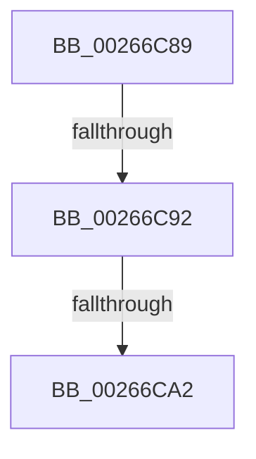

# sub_00266C89

- RVA: `0x00266C89`–`0x00266CA9` (길이 `32` bytes)
- VA: `0x0000000140266C89`
- 실행 섹션: `.text`
- PDB 이름 있음: `아니요`; PDB Function 태그: `아니요`
- unwind 정보 RVA: `0x00064EA8`
- 디코드: `10`개 명령, `32/32` bytes 표시
- 미해석 바이트: `0` (있으면 어셈블리에 `.byte`로 보존)

> 이 문서는 커널 이미지의 기계어와 PDB 기호를 분석해 생성했습니다. 4번과 5번은 함수 원형과 자료형을 바이너리 사용 방식에서 추정한 C 해석이며 원본 소스 복구 결과는 아닙니다.

## 1. Dependencies

- 직접 호출 지점: **0**; 고유 호출 대상: **0**
- 직접 호출자로 확인된 함수: **0**
- RIP 상대 이미지 참조: **0**

### Outgoing calls
- 직접 디코드된 call 명령이 없습니다.

### Direct callers
- 이 함수 시작 RVA로 연결되는 직접 call은 확인되지 않았습니다. 간접 호출은 완전히 역산할 수 없습니다.

### Static image references
- 디코드된 RIP-relative 메모리 참조가 없습니다.

## 2. Other-region calls and transfers

- 다른 실행 섹션으로 향하는 call: **0**
- call이 아닌 외부 분기/꼬리 이동: **2**
  - `0x00266C90` → [sub_00266CC3 + 0x39](Unknown_function_00266CC3.md) (`tail-transfer`)
  - `0x00266CA0` → [sub_00266CC3](Unknown_function_00266CC3.md) (`tail-transfer`)

## 3. Assembly (complete function range)

```asm
00266C89  4C 89 64 24 40                  mov qword ptr [rsp + 0x40], r12
00266C8E  3B C5                           cmp eax, ebp
00266C90  72 6A                           jb 0x140266cfc
00266C92  48 8B 0E                        mov rcx, qword ptr [rsi]
00266C95  48 8B 56 08                     mov rdx, qword ptr [rsi + 8]
00266C99  48 8D 41 10                     lea rax, [rcx + 0x10]
00266C9D  48 3B D0                        cmp rdx, rax
00266CA0  74 21                           je 0x140266cc3
00266CA2  33 C0                           xor eax, eax
00266CA4  4C 8B 64 24 40                  mov r12, qword ptr [rsp + 0x40]
```

## 4. C-style interpretation (structured pseudocode)

```c
__int64 __fastcall sub_00266C89(__int64 a1, __int64 a2, __int64 a3, __int64 a4, __int64 a5, __int64 a6, __int64 a7, __int64 a8)
{
    __int64 result;
    unsigned __int64 v_stack_p40;

    v_stack_p40 = v_r12;
    result = 0;
    return result;
}
```

## 5. (Beta) C Style

```c
int64_t sub_00266C89(int64_t Arg1, int64_t Arg2, int64_t Arg3, int64_t Arg4, uint64_t Arg5, uint64_t Arg6, uint64_t Arg7, int64_t Arg8)
{
    int64_t result;
    uint64_t v_stack_p40;

    v_stack_p40 = local_r12;
    result = 0;
    return result;
}
```

## 6. Execution-region graph

[열기: 2D/3D 그래프와 함수 탐색 컨트롤 패널](../../../control-panel.html?section=text&rva=0x00266C89&view=graph)

- 2D 그래프는 위에서 아래로 흐르고, 3D 그래프는 빈 공간을 드래그해 회전합니다. Shift+드래그는 이동, 휠은 확대·축소, 함수 노드 선택은 대상 보고서 이동입니다.

### Static fallback


