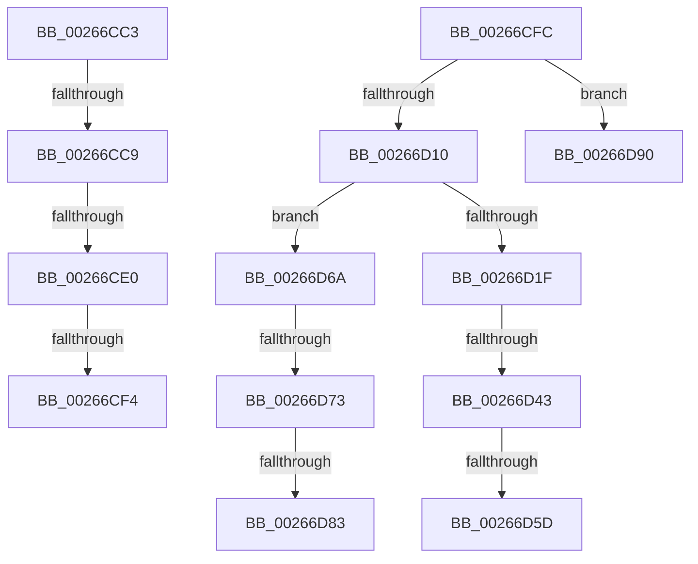

# sub_00266CC3

- RVA: `0x00266CC3`–`0x00266D9A` (길이 `215` bytes)
- VA: `0x0000000140266CC3`
- 실행 섹션: `.text`
- PDB 이름 있음: `아니요`; PDB Function 태그: `아니요`
- unwind 정보 RVA: `0x00064ED0`
- 디코드: `59`개 명령, `215/215` bytes 표시
- 미해석 바이트: `0` (있으면 어셈블리에 `.byte`로 보존)

> 이 문서는 커널 이미지의 기계어와 PDB 기호를 분석해 생성했습니다. 4번과 5번은 함수 원형과 자료형을 바이너리 사용 방식에서 추정한 C 해석이며 원본 소스 복구 결과는 아닙니다.

## 1. Dependencies

- 직접 호출 지점: **2**; 고유 호출 대상: **2**
- 직접 호출자로 확인된 함수: **0**
- RIP 상대 이미지 참조: **0**

### Outgoing calls
- `0x00266CFF` → [B_TREE<_SM_PAGE_KEY,SMKM_STORE_MGR<SM_TRAITS>::SMKM_FRONTEND_ENTRY,4096,B_TREE_DUMMY_NODE_POOL,B_TREE_KEY_COMPARATOR<_SM_PAGE_KEY> >::BTreeRedistribute](B_TREE__SM_PAGE_KEY_SMKM_STORE_MGR_SM_TRAITS_SMKM_FRONTEND_ENTRY_4096_B_TREE_DUMMY_NODE_POOL_B_TREE__function_00267188.md) (function, `0x00267188`)
- `0x00266D28` → [B_TREE<_SM_PAGE_KEY,SMKM_STORE_MGR<SM_TRAITS>::SMKM_FRONTEND_ENTRY,4096,B_TREE_DUMMY_NODE_POOL,B_TREE_KEY_COMPARATOR<_SM_PAGE_KEY> >::BTreeMergeNodes](B_TREE__SM_PAGE_KEY_SMKM_STORE_MGR_SM_TRAITS_SMKM_FRONTEND_ENTRY_4096_B_TREE_DUMMY_NODE_POOL_B_TREE__function_002674CC.md) (function, `0x002674CC`)

### Direct callers
- 이 함수 시작 RVA로 연결되는 직접 call은 확인되지 않았습니다. 간접 호출은 완전히 역산할 수 없습니다.

### Static image references
- 디코드된 RIP-relative 메모리 참조가 없습니다.

## 2. Other-region calls and transfers

- 다른 실행 섹션으로 향하는 call: **0**
- call이 아닌 외부 분기/꼬리 이동: **11**
  - `0x00266CC7` → [sub_00266C89 + 0x19](Unknown_function_00266C89.md) (`tail-transfer`)
  - `0x00266CDE` → [sub_00266C89 + 0x19](Unknown_function_00266C89.md) (`tail-transfer`)
  - `0x00266CEE` → [sub_00266DAB](Unknown_function_00266DAB.md) (`tail-transfer`)
  - `0x00266CFA` → [sub_00266C89 + 0x19](Unknown_function_00266C89.md) (`tail-transfer`)
  - `0x00266D3D` → [sub_00266C89 + 0x9](Unknown_function_00266C89.md) (`tail-transfer`)
  - `0x00266D57` → [sub_006D8F1E](../6D/Unknown_function_006D8F1E.md) (`tail-transfer`)
  - `0x00266D65` → [sub_006D8F1E + 0x7](../6D/Unknown_function_006D8F1E.md) (`tail-transfer`)
  - `0x00266D6D` → [sub_00266C89 + 0x9](Unknown_function_00266C89.md) (`tail-transfer`)
  - `0x00266D81` → [sub_00266DBF](Unknown_function_00266DBF.md) (`tail-transfer`)
  - `0x00266D8B` → [sub_00266C89 + 0x9](Unknown_function_00266C89.md) (`tail-transfer`)
  - `0x00266D95` → [sub_00266C89 + 0x1B](Unknown_function_00266C89.md) (`tail-transfer`)

## 3. Assembly (complete function range)

```asm
00266CC3  80 79 03 00                     cmp byte ptr [rcx + 3], 0
00266CC7  74 D9                           je 0x140266ca2
00266CC9  41 8B 4F 18                     mov ecx, dword ptr [r15 + 0x18]
00266CCD  4D 8B 07                        mov r8, qword ptr [r15]
00266CD0  48 83 E9 02                     sub rcx, 2
00266CD4  48 C1 E1 04                     shl rcx, 4
00266CD8  49 03 C8                        add rcx, r8
00266CDB  49 3B C8                        cmp rcx, r8
00266CDE  72 C2                           jb 0x140266ca2
00266CE0  48 8B 01                        mov rax, qword ptr [rcx]
00266CE3  4C 8B 49 08                     mov r9, qword ptr [rcx + 8]
00266CE7  48 83 C0 10                     add rax, 0x10
00266CEB  4C 3B C8                        cmp r9, rax
00266CEE  0F 86 B7 00 00 00               jbe 0x140266dab
00266CF4  8B 02                           mov eax, dword ptr [rdx]
00266CF6  41 89 41 F0                     mov dword ptr [r9 - 0x10], eax
00266CFA  EB A6                           jmp 0x140266ca2
00266CFC  49 8B D7                        mov rdx, r15
00266CFF  E8 84 04 00 00                  call 0x140267188
00266D04  4C 8B E0                        mov r12, rax
00266D07  48 85 C0                        test rax, rax
00266D0A  0F 84 80 00 00 00               je 0x140266d90
00266D10  8B 0B                           mov ecx, dword ptr [rbx]
00266D12  49 8B DC                        mov rbx, r12
00266D15  83 E3 01                        and ebx, 1
00266D18  0F B7 C1                        movzx eax, cx
00266D1B  3B C5                           cmp eax, ebp
00266D1D  73 4B                           jae 0x140266d6a
00266D1F  4D 8B C4                        mov r8, r12
00266D22  49 8B D7                        mov rdx, r15
00266D25  49 8B CE                        mov rcx, r14
00266D28  E8 9F 07 00 00                  call 0x1402674cc
00266D2D  41 8B 77 18                     mov esi, dword ptr [r15 + 0x18]
00266D31  FF CE                           dec esi
00266D33  48 C1 E6 04                     shl rsi, 4
00266D37  49 03 37                        add rsi, qword ptr [r15]
00266D3A  48 85 DB                        test rbx, rbx
00266D3D  0F 84 4F FF FF FF               je 0x140266c92
00266D43  49 83 E4 FE                     and r12, 0xfffffffffffffffe
00266D47  4C 89 26                        mov qword ptr [rsi], r12
00266D4A  41 80 7C 24 03 00               cmp byte ptr [r12 + 3], 0
00266D50  41 8B 04 24                     mov eax, dword ptr [r12]
00266D54  0F B7 C0                        movzx eax, ax
00266D57  0F 84 C1 21 47 00               je 0x1406d8f1e
00266D5D  48 8D 04 C5 10 00 00 00         lea rax, [rax*8 + 0x10]
00266D65  E9 BB 21 47 00                  jmp 0x1406d8f25
00266D6A  48 85 DB                        test rbx, rbx
00266D6D  0F 84 1F FF FF FF               je 0x140266c92
00266D73  2B C5                           sub eax, ebp
00266D75  C1 E9 18                        shr ecx, 0x18
00266D78  8D 50 01                        lea edx, [rax + 1]
00266D7B  48 8B 46 08                     mov rax, qword ptr [rsi + 8]
00266D7F  84 C9                           test cl, cl
00266D81  74 3C                           je 0x140266dbf
00266D83  48 8D 04 D0                     lea rax, [rax + rdx*8]
00266D87  48 89 46 08                     mov qword ptr [rsi + 8], rax
00266D8B  E9 02 FF FF FF                  jmp 0x140266c92
00266D90  B8 06 00 00 C0                  mov eax, 0xc0000006
00266D95  E9 0A FF FF FF                  jmp 0x140266ca4
```

## 4. C-style interpretation (structured pseudocode)

```c
__int64 __fastcall sub_00266CC3(__int64 a1, __int64 a2)
{
    __int64 result;

    a1 = ((unsigned int)(*(unsigned int *)(v_r15 + 24))) - (2);
    a1 = (a1) << (4);
    a1 = (a1) + (*(unsigned __int64 *)(v_r15));
    result = (*(unsigned __int64 *)(a1)) + (16);
    *(unsigned int *)(*(unsigned __int64 *)(a1 + 8) - 16) = (unsigned int)((unsigned int)(*(unsigned int *)(a2)));
}
```

## 5. (Beta) C Style

```c
int64_t sub_00266CC3(void *Arg1, void *Arg2)
{
    uint8_t *arg1 = (uint8_t *)Arg1;
    uint8_t *arg2 = (uint8_t *)Arg2;

    int64_t result;

    Arg1 = ((uint32_t)(*(uint32_t *)(local_r15 + 0x18))) - (2);
    Arg1 = (Arg1) << (4);
    Arg1 = (Arg1) + (*(uint64_t *)(local_r15));
    result = (*(uint64_t *)(arg1)) + (16);
    *(uint32_t *)(*(uint64_t *)(arg1 + 0x8) - 0x10) = (uint32_t)((uint32_t)(*(uint32_t *)(arg2)));
}
```

### 관측된 메모리 오프셋

구조체 형식이 확인되지 않은 접근은 인자 기준의 오프셋으로만 기록했습니다.

| 기준 인자 | 오프셋 표현 | 폭 (bit) | 접근 |
|---|---:|---:|---|
| `Arg1` | `+ 0x3` | `8` | `R` |
| `Arg2` | `+ 0x0` | `32` | `R` |

## 6. Execution-region graph

[열기: 2D/3D 그래프와 함수 탐색 컨트롤 패널](../../../control-panel.html?section=text&rva=0x00266CC3&view=graph)

- 2D 그래프는 위에서 아래로 흐르고, 3D 그래프는 빈 공간을 드래그해 회전합니다. Shift+드래그는 이동, 휠은 확대·축소, 함수 노드 선택은 대상 보고서 이동입니다.

### Static fallback


