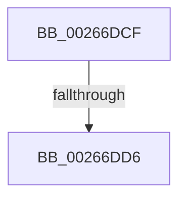

# sub_00266DCF

- RVA: `0x00266DCF`–`0x00266E04` (길이 `53` bytes)
- VA: `0x0000000140266DCF`
- 실행 섹션: `.text`
- PDB 이름 있음: `아니요`; PDB Function 태그: `아니요`
- unwind 정보 RVA: `0x00064F2C`
- 디코드: `16`개 명령, `53/53` bytes 표시
- 미해석 바이트: `0` (있으면 어셈블리에 `.byte`로 보존)

> 이 문서는 커널 이미지의 기계어와 PDB 기호를 분석해 생성했습니다. 4번과 5번은 함수 원형과 자료형을 바이너리 사용 방식에서 추정한 C 해석이며 원본 소스 복구 결과는 아닙니다.

## 1. Dependencies

- 직접 호출 지점: **2**; 고유 호출 대상: **2**
- 직접 호출자로 확인된 함수: **0**
- RIP 상대 이미지 참조: **0**

### Outgoing calls
- `0x00266DE8` → [memcpy](../6C/memcpy_function_006C6840.md) (function, `0x006C6840`)
- `0x00266DFD` → [ExFreePoolWithTag](../../poolcode/B8/ExFreePoolWithTag_function_00B82870.md) (function, `0x00B82870`)

### Direct callers
- 이 함수 시작 RVA로 연결되는 직접 call은 확인되지 않았습니다. 간접 호출은 완전히 역산할 수 없습니다.

### Static image references
- 디코드된 RIP-relative 메모리 참조가 없습니다.

## 2. Other-region calls and transfers

- 다른 실행 섹션으로 향하는 call: **1**
  - `0x00266DFD` → [ExFreePoolWithTag](../../poolcode/B8/ExFreePoolWithTag_function_00B82870.md) (`.text` → `POOLCODE`)
- call이 아닌 외부 분기/꼬리 이동: **2**
  - `0x00266DD4` → [sub_00266DB4 + 0x4](Unknown_function_00266DB4.md) (`tail-transfer`)
  - `0x00266E02` → [sub_00266DB4 + 0x4](Unknown_function_00266DB4.md) (`tail-transfer`)

## 3. Assembly (complete function range)

```asm
00266DCF  C1 E9 18                        shr ecx, 0x18
00266DD2  84 C9                           test cl, cl
00266DD4  75 E2                           jne 0x140266db8
00266DD6  45 8B 47 1C                     mov r8d, dword ptr [r15 + 0x1c]
00266DDA  48 8D 56 10                     lea rdx, [rsi + 0x10]
00266DDE  41 FF C8                        dec r8d
00266DE1  48 8B CE                        mov rcx, rsi
00266DE4  49 C1 E0 04                     shl r8, 4
00266DE8  E8 53 FA 45 00                  call 0x1406c6840
00266DED  41 FF 4F 18                     dec dword ptr [r15 + 0x18]
00266DF1  33 D2                           xor edx, edx
00266DF3  48 8B 43 08                     mov rax, qword ptr [rbx + 8]
00266DF7  48 8B CB                        mov rcx, rbx
00266DFA  49 89 06                        mov qword ptr [r14], rax
00266DFD  E8 6E BA 91 00                  call 0x140b82870
00266E02  EB B4                           jmp 0x140266db8
```

## 4. C-style interpretation (structured pseudocode)

```c
__int64 __fastcall sub_00266DCF(int a1)
{
    __int64 result;

    a1 = (unsigned int)((a1) >> (24));
    a3 = (unsigned int)(((unsigned int)(*(unsigned int *)(v_r15 + 28))) - 1);
    a3 = (a3) << (4);
    result = memcpy(v_rsi, v_rsi + 16, a3, a4);
    a2 = 0;
    *(unsigned __int64 *)(v_r14) = *(unsigned __int64 *)(v_rbx + 8);
    result = ExFreePoolWithTag(v_rbx, a2, a3, a4);
}
```

## 5. (Beta) C Style

```c
int64_t sub_00266DCF(int32_t Arg1)
{
    int64_t result;

    Arg1 = (uint32_t)((Arg1) >> (24));
    a3 = (uint32_t)(((uint32_t)(*(uint32_t *)(local_r15 + 0x1C))) - 1);
    a3 = (a3) << (4);
    result = memcpy(local_rsi, local_rsi + 16, a3, a4);
    a2 = 0;
    *(uint64_t *)(local_r14) = *(uint64_t *)(local_rbx + 0x8);
    result = ExFreePoolWithTag(local_rbx, a2, a3, a4);
}
```

## 6. Execution-region graph

[열기: 2D/3D 그래프와 함수 탐색 컨트롤 패널](../../../control-panel.html?section=text&rva=0x00266DCF&view=graph)

- 2D 그래프는 위에서 아래로 흐르고, 3D 그래프는 빈 공간을 드래그해 회전합니다. Shift+드래그는 이동, 휠은 확대·축소, 함수 노드 선택은 대상 보고서 이동입니다.

### Static fallback


