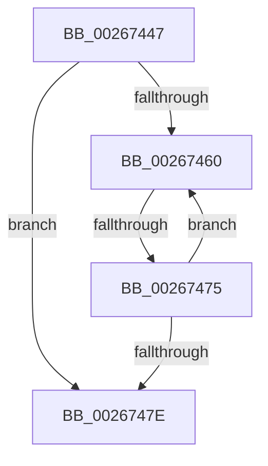

# sub_00267447

- RVA: `0x00267447`–`0x0026748E` (길이 `71` bytes)
- VA: `0x0000000140267447`
- 실행 섹션: `.text`
- PDB 이름 있음: `아니요`; PDB Function 태그: `아니요`
- unwind 정보 RVA: `0x00064FB0`
- 디코드: `19`개 명령, `71/71` bytes 표시
- 미해석 바이트: `0` (있으면 어셈블리에 `.byte`로 보존)

> 이 문서는 커널 이미지의 기계어와 PDB 기호를 분석해 생성했습니다. 4번과 5번은 함수 원형과 자료형을 바이너리 사용 방식에서 추정한 C 해석이며 원본 소스 복구 결과는 아닙니다.

## 1. Dependencies

- 직접 호출 지점: **0**; 고유 호출 대상: **0**
- 직접 호출자로 확인된 함수: **0**
- RIP 상대 이미지 참조: **0**

### Outgoing calls
- 직접 디코드된 call 명령이 없습니다.

### Direct callers
- 이 함수 시작 RVA로 연결되는 직접 call은 확인되지 않았습니다. 간접 호출은 완전히 역산할 수 없습니다.

### Static image references
- 디코드된 RIP-relative 메모리 참조가 없습니다.

## 2. Other-region calls and transfers

- 다른 실행 섹션으로 향하는 call: **0**
- call이 아닌 외부 분기/꼬리 이동: **2**
  - `0x00267473` → [sub_002674A2](Unknown_function_002674A2.md) (`tail-transfer`)
  - `0x0026748C` → [sub_0026748E + 0x8](Unknown_function_0026748E.md) (`tail-transfer`)

## 3. Assembly (complete function range)

```asm
00267447  48 89 5C 24 40                  mov qword ptr [rsp + 0x40], rbx
0026744C  48 8B D9                        mov rbx, rcx
0026744F  48 89 7C 24 48                  mov qword ptr [rsp + 0x48], rdi
00267454  48 8D B9 00 01 00 00            lea rdi, [rcx + 0x100]
0026745B  48 3B CF                        cmp rcx, rdi
0026745E  73 1E                           jae 0x14026747e
00267460  48 8B 0B                        mov rcx, qword ptr [rbx]
00267463  48 C7 C0 FF FF FF FF            mov rax, 0xffffffffffffffff
0026746A  F0 48 0F C1 01                  lock xadd qword ptr [rcx], rax
0026746F  24 06                           and al, 6
00267471  3C 02                           cmp al, 2
00267473  74 2D                           je 0x1402674a2
00267475  48 83 C3 08                     add rbx, 8
00267479  48 3B DF                        cmp rbx, rdi
0026747C  72 E2                           jb 0x140267460
0026747E  48 8B 7C 24 48                  mov rdi, qword ptr [rsp + 0x48]
00267483  48 8B 5C 24 40                  mov rbx, qword ptr [rsp + 0x40]
00267488  40 F6 C5 02                     test bpl, 2
0026748C  75 08                           jne 0x140267496
```

## 4. C-style interpretation (structured pseudocode)

```c
__int64 __fastcall sub_00267447(__int64 a1, __int64 a2, __int64 a3, __int64 a4, __int64 a5, __int64 a6, __int64 a7, __int64 a8, __int64 a9)
{
    __int64 result;
    __int64 v_rbx;
    unsigned __int64 v_stack_p40;
    unsigned __int64 v_stack_p48;

    v_stack_p40 = v_rbx;
    v_stack_p48 = v_rdi;
    if (a1 >= (a1 + 256)) goto loc_0026747E;
loc_00267460:
    result = (unsigned __int8)((-1) & (6));
    v_rbx = (a1) + (8);
    if (v_rbx < (a1 + 256)) goto loc_00267460;
loc_0026747E:
}
```

## 5. (Beta) C Style

```c
int64_t sub_00267447(void *Arg1, int64_t Arg2, int64_t Arg3, int64_t Arg4, uint64_t Arg5, uint64_t Arg6, uint64_t Arg7, int64_t Arg8, int64_t Arg9)
{
    uint8_t *arg1 = (uint8_t *)Arg1;

    int64_t result;
    int64_t local_rbx;
    uint64_t v_stack_p40;
    uint64_t v_stack_p48;

    v_stack_p40 = local_rbx;
    v_stack_p48 = local_rdi;
    if (Arg1 >= (Arg1 + 256)) goto loc_0026747E;
loc_00267460:
    result = (uint8_t)((-1) & (6));
    local_rbx = (Arg1) + (8);
    if (local_rbx < (Arg1 + 256)) goto loc_00267460;
loc_0026747E:
}
```

### 관측된 메모리 오프셋

구조체 형식이 확인되지 않은 접근은 인자 기준의 오프셋으로만 기록했습니다.

| 기준 인자 | 오프셋 표현 | 폭 (bit) | 접근 |
|---|---:|---:|---|
| `Arg1` | `+ 0x100` | `64` | `R` |

## 6. Execution-region graph

[열기: 2D/3D 그래프와 함수 탐색 컨트롤 패널](../../../control-panel.html?section=text&rva=0x00267447&view=graph)

- 2D 그래프는 위에서 아래로 흐르고, 3D 그래프는 빈 공간을 드래그해 회전합니다. Shift+드래그는 이동, 휠은 확대·축소, 함수 노드 선택은 대상 보고서 이동입니다.

### Static fallback


