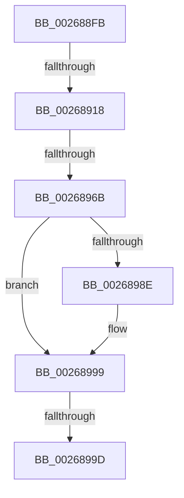

# sub_002688FB

- RVA: `0x002688FB`–`0x002689C6` (길이 `203` bytes)
- VA: `0x00000001402688FB`
- 실행 섹션: `.text`
- PDB 이름 있음: `아니요`; PDB Function 태그: `아니요`
- unwind 정보 RVA: `0x000651A8`
- 디코드: `52`개 명령, `203/203` bytes 표시
- 미해석 바이트: `0` (있으면 어셈블리에 `.byte`로 보존)

> 이 문서는 커널 이미지의 기계어와 PDB 기호를 분석해 생성했습니다. 4번과 5번은 함수 원형과 자료형을 바이너리 사용 방식에서 추정한 C 해석이며 원본 소스 복구 결과는 아닙니다.

## 1. Dependencies

- 직접 호출 지점: **0**; 고유 호출 대상: **0**
- 직접 호출자로 확인된 함수: **0**
- RIP 상대 이미지 참조: **0**

### Outgoing calls
- 직접 디코드된 call 명령이 없습니다.

### Direct callers
- 이 함수 시작 RVA로 연결되는 직접 call은 확인되지 않았습니다. 간접 호출은 완전히 역산할 수 없습니다.

### Static image references
- 디코드된 RIP-relative 메모리 참조가 없습니다.

## 2. Other-region calls and transfers

- 다른 실행 섹션으로 향하는 call: **0**
- call이 아닌 외부 분기/꼬리 이동: **3**
  - `0x00268912` → [sub_002689C7 + 0xE9](Unknown_function_002689C7.md) (`tail-transfer`)
  - `0x00268965` → [sub_002689C7 + 0xA3](Unknown_function_002689C7.md) (`tail-transfer`)
  - `0x0026899B` → [sub_002689C7](Unknown_function_002689C7.md) (`tail-transfer`)

## 3. Assembly (complete function range)

```asm
002688FB  4C 89 74 24 38                  mov qword ptr [rsp + 0x38], r14
00268900  4C 89 7C 24 30                  mov qword ptr [rsp + 0x30], r15
00268905  89 6C 24 60                     mov dword ptr [rsp + 0x60], ebp
00268909  8B 83 1C 01 00 00               mov eax, dword ptr [rbx + 0x11c]
0026890F  0F BC C8                        bsf ecx, eax
00268912  0F 84 98 01 00 00               je 0x140268ab0
00268918  8B C1                           mov eax, ecx
0026891A  41 BC 01 00 00 00               mov r12d, 1
00268920  48 83 C0 12                     add rax, 0x12
00268924  89 6C 24 60                     mov dword ptr [rsp + 0x60], ebp
00268928  48 03 C0                        add rax, rax
0026892B  45 8B F4                        mov r14d, r12d
0026892E  41 8D 7C 24 FE                  lea edi, [r12 - 2]
00268933  4C 8B 04 C3                     mov r8, qword ptr [rbx + rax*8]
00268937  41 8B 50 10                     mov edx, dword ptr [r8 + 0x10]
0026893B  0F BD CA                        bsr ecx, edx
0026893E  41 D3 E6                        shl r14d, cl
00268941  4C 33 F2                        xor r14, rdx
00268944  49 C1 E6 04                     shl r14, 4
00268948  4C 03 34 CB                     add r14, qword ptr [rbx + rcx*8]
0026894C  45 0F B7 7E 08                  movzx r15d, word ptr [r14 + 8]
00268951  4D 03 F8                        add r15, r8
00268954  41 0F B7 07                     movzx eax, word ptr [r15]
00268958  66 41 89 46 08                  mov word ptr [r14 + 8], ax
0026895D  41 0F B7 46 0A                  movzx eax, word ptr [r14 + 0xa]
00268962  66 85 C0                        test ax, ax
00268965  0F 84 FF 00 00 00               je 0x140268a6a
0026896B  0F B6 8B 28 02 00 00            movzx ecx, byte ptr [rbx + 0x228]
00268972  8B F0                           mov esi, eax
00268974  D3 EE                           shr esi, cl
00268976  66 FF C8                        dec ax
00268979  66 41 89 46 0A                  mov word ptr [r14 + 0xa], ax
0026897E  FF 8B 30 02 00 00               dec dword ptr [rbx + 0x230]
00268984  41 0F B7 46 0A                  movzx eax, word ptr [r14 + 0xa]
00268989  66 85 C0                        test ax, ax
0026898C  74 0B                           je 0x140268999
0026898E  0F B6 8B 28 02 00 00            movzx ecx, byte ptr [rbx + 0x228]
00268995  8B F8                           mov edi, eax
00268997  D3 EF                           shr edi, cl
00268999  3B F7                           cmp esi, edi
0026899B  75 2A                           jne 0x1402689c7
0026899D  FF 83 34 02 00 00               inc dword ptr [rbx + 0x234]
002689A3  4C 8B 74 24 38                  mov r14, qword ptr [rsp + 0x38]
002689A8  49 8B C7                        mov rax, r15
002689AB  4C 8B 7C 24 30                  mov r15, qword ptr [rsp + 0x30]
002689B0  4C 8B 64 24 40                  mov r12, qword ptr [rsp + 0x40]
002689B5  48 8B 7C 24 70                  mov rdi, qword ptr [rsp + 0x70]
002689BA  48 8B 74 24 68                  mov rsi, qword ptr [rsp + 0x68]
002689BF  48 83 C4 48                     add rsp, 0x48
002689C3  5D                              pop rbp
002689C4  5B                              pop rbx
002689C5  C3                              ret
```

## 4. C-style interpretation (structured pseudocode)

```c
__int64 __fastcall sub_002688FB(__int64 a1, __int64 a2, __int64 a3, __int64 a4, __int64 a5, __int64 a6, __int64 a7, __int64 a8, __int64 a9, __int64 a10, __int64 a11, __int64 a12, __int64 a13, __int64 a14)
{
    __int64 result;
    __int64 v_r14;
    __int64 v_r15;
    __int64 v_rdi;
    __int64 v_rsi;
    __int64 v_rsp;
    unsigned __int64 v_stack_p30;
    unsigned __int64 v_stack_p38;
    unsigned int v_stack_p60;

    v_stack_p38 = v_r14;
    v_stack_p30 = v_r15;
    v_stack_p60 = (unsigned int)(v_rbp);
    result = ((unsigned int)((unsigned int)(a1))) + (18);
    v_stack_p60 = (unsigned int)(v_rbp);
    result = (result) + (result);
    v_r14 = (unsigned int)((1) << ((unsigned __int8)(a1)));
    v_r14 = (v_r14) ^ ((unsigned int)(*(unsigned int *)(*(unsigned __int64 *)(v_rbx + result * 8) + 16)));
    v_r14 = (v_r14) << (4);
    v_r14 = (v_r14) + (*(unsigned __int64 *)(v_rbx + a1 * 8));
    v_r15 = (*(unsigned __int16 *)(v_r14 + 8)) + (*(unsigned __int64 *)(v_rbx + result * 8));
    *(unsigned __int16 *)(v_r14 + 8) = (unsigned __int16)(*(unsigned __int16 *)(v_r15));
    v_rsi = (unsigned int)(((unsigned int)((unsigned int)(*(unsigned __int16 *)(v_r14 + 10)))) >> ((unsigned __int8)(*(unsigned __int8 *)(v_rbx + 552))));
    result = (unsigned __int16)((*(unsigned __int16 *)(v_r14 + 10)) - 1);
    *(unsigned __int16 *)(v_r14 + 10) = (unsigned __int16)(result);
    v_rdi = 1 - 2;
    if ((unsigned __int16)(*(unsigned __int16 *)(v_r14 + 10)) != 0) {
        a1 = *(unsigned __int8 *)(v_rbx + 552);
        v_rdi = (unsigned int)(*(unsigned __int16 *)(v_r14 + 10));
        v_rdi = (unsigned int)((v_rdi) >> ((unsigned __int8)(a1)));
    }
    v_rsp = (v_rsp) + (72);
    return v_r15;
}
```

## 5. (Beta) C Style

```c
int64_t sub_002688FB(int64_t Arg1, int64_t Arg2, int64_t Arg3, int64_t Arg4, uint64_t Arg5, int64_t Arg6, int64_t Arg7, int64_t Arg8, uint64_t Arg9, uint64_t Arg10, uint64_t Arg11, uint64_t Arg12, int64_t Arg13, int64_t Arg14)
{
    int64_t result;
    int64_t local_r14;
    int64_t local_r15;
    int64_t local_rdi;
    int64_t local_rsi;
    int64_t local_rsp;
    uint64_t v_stack_p30;
    uint64_t v_stack_p38;
    uint32_t v_stack_p60;

    v_stack_p38 = local_r14;
    v_stack_p30 = local_r15;
    v_stack_p60 = (uint32_t)(local_rbp);
    result = ((uint32_t)((uint32_t)(Arg1))) + (18);
    v_stack_p60 = (uint32_t)(local_rbp);
    result = (result) + (result);
    local_r14 = (uint32_t)((1) << ((uint8_t)(Arg1)));
    local_r14 = (local_r14) ^ ((uint32_t)(*(uint32_t *)(*(uint64_t *)(local_rbx + result * 8) + 0x10)));
    local_r14 = (local_r14) << (4);
    local_r14 = (local_r14) + (*(uint64_t *)(local_rbx + Arg1 * 8));
    local_r15 = (*(uint16_t *)(local_r14 + 0x8)) + (*(uint64_t *)(local_rbx + result * 8));
    *(uint16_t *)(local_r14 + 0x8) = (uint16_t)(*(uint16_t *)(local_r15));
    local_rsi = (uint32_t)(((uint32_t)((uint32_t)(*(uint16_t *)(local_r14 + 0xA)))) >> ((uint8_t)(*(uint8_t *)(local_rbx + 0x228))));
    result = (uint16_t)((*(uint16_t *)(local_r14 + 0xA)) - 1);
    *(uint16_t *)(local_r14 + 0xA) = (uint16_t)(result);
    local_rdi = 1 - 2;
    if ((uint16_t)(*(uint16_t *)(local_r14 + 0xA)) != 0) {
        Arg1 = *(uint8_t *)(local_rbx + 0x228);
        local_rdi = (uint32_t)(*(uint16_t *)(local_r14 + 0xA));
        local_rdi = (uint32_t)((local_rdi) >> ((uint8_t)(Arg1)));
    }
    local_rsp = (local_rsp) + (72);
    return local_r15;
}
```

## 6. Execution-region graph

[열기: 2D/3D 그래프와 함수 탐색 컨트롤 패널](../../../control-panel.html?section=text&rva=0x002688FB&view=graph)

- 2D 그래프는 위에서 아래로 흐르고, 3D 그래프는 빈 공간을 드래그해 회전합니다. Shift+드래그는 이동, 휠은 확대·축소, 함수 노드 선택은 대상 보고서 이동입니다.

### Static fallback


