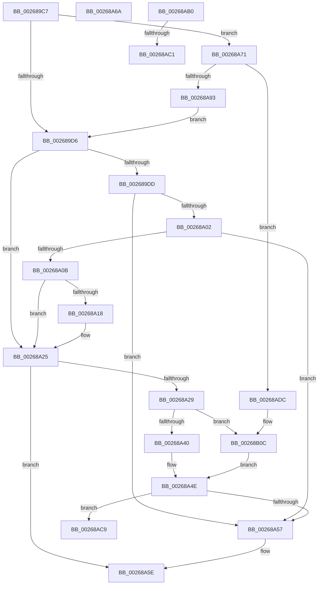

# sub_002689C7

- RVA: `0x002689C7`–`0x00268B1D` (길이 `342` bytes)
- VA: `0x00000001402689C7`
- 실행 섹션: `.text`
- PDB 이름 있음: `아니요`; PDB Function 태그: `아니요`
- unwind 정보 RVA: `0x000651D8`
- 디코드: `93`개 명령, `342/342` bytes 표시
- 미해석 바이트: `0` (있으면 어셈블리에 `.byte`로 보존)

> 이 문서는 커널 이미지의 기계어와 PDB 기호를 분석해 생성했습니다. 4번과 5번은 함수 원형과 자료형을 바이너리 사용 방식에서 추정한 C 해석이며 원본 소스 복구 결과는 아닙니다.

## 1. Dependencies

- 직접 호출 지점: **7**; 고유 호출 대상: **6**
- 직접 호출자로 확인된 함수: **0**
- RIP 상대 이미지 참조: **0**

### Outgoing calls
- `0x002689F4` → [SmHpUnprotectListNeighbors](SmHpUnprotectListNeighbors_function_002692A4.md) (function, `0x002692A4`)
- `0x00268A49` → [SmHpUnprotectListNeighbors](SmHpUnprotectListNeighbors_function_002692A4.md) (function, `0x002692A4`)
- `0x00268A7C` → [wyhash](wyhash_function_00269FE4.md) (function, `0x00269FE4`)
- `0x00268AA2` → [ExProtectPoolEx](ExProtectPoolEx_function_002695D8.md) (function, `0x002695D8`)
- `0x00268AB3` → [SmHpBufferAlloc](SmHpBufferAlloc_function_00268F7C.md) (function, `0x00268F7C`)
- `0x00268AE9` → [SmPrepareForFatalHeapCorruption](SmPrepareForFatalHeapCorruption_function_00267AC0.md) (function, `0x00267AC0`)
- `0x00268B06` → [KeBugCheckEx](../4F/KeBugCheckEx_function_004FD660.md) (function, `0x004FD660`)

### Direct callers
- 이 함수 시작 RVA로 연결되는 직접 call은 확인되지 않았습니다. 간접 호출은 완전히 역산할 수 없습니다.

### Static image references
- 디코드된 RIP-relative 메모리 참조가 없습니다.

## 2. Other-region calls and transfers

- 다른 실행 섹션으로 향하는 call: **0**
- call이 아닌 외부 분기/꼬리 이동: **5**
  - `0x00268A65` → [sub_002688FB + 0xA2](Unknown_function_002688FB.md) (`tail-transfer`)
  - `0x00268A6C` → [sub_002688FB + 0x7B](Unknown_function_002688FB.md) (`tail-transfer`)
  - `0x00268ABB` → [sub_002688FB + 0xE](Unknown_function_002688FB.md) (`tail-transfer`)
  - `0x00268AC4` → [sub_002688FB + 0xA8](Unknown_function_002688FB.md) (`tail-transfer`)
  - `0x00268AD7` → [sub_002688FB + 0xA2](Unknown_function_002688FB.md) (`tail-transfer`)

## 3. Assembly (complete function range)

```asm
002689C7  48 89 6C 24 60                  mov qword ptr [rsp + 0x60], rbp
002689CC  41 39 6E 0C                     cmp dword ptr [r14 + 0xc], ebp
002689D0  0F 85 9B 00 00 00               jne 0x140268a71
002689D6  4D 8B 36                        mov r14, qword ptr [r14]
002689D9  85 F6                           test esi, esi
002689DB  78 48                           js 0x140268a25
002689DD  48 63 EE                        movsxd rbp, esi
002689E0  4D 8B C6                        mov r8, r14
002689E3  48 83 C5 12                     add rbp, 0x12
002689E7  48 8B CB                        mov rcx, rbx
002689EA  48 C1 E5 04                     shl rbp, 4
002689EE  48 03 EB                        add rbp, rbx
002689F1  48 8B D5                        mov rdx, rbp
002689F4  E8 AB 08 00 00                  call 0x1402692a4
002689F9  49 8B 0E                        mov rcx, qword ptr [r14]
002689FC  4C 39 71 08                     cmp qword ptr [rcx + 8], r14
00268A00  75 55                           jne 0x140268a57
00268A02  49 8B 46 08                     mov rax, qword ptr [r14 + 8]
00268A06  4C 39 30                        cmp qword ptr [rax], r14
00268A09  75 4C                           jne 0x140268a57
00268A0B  48 89 08                        mov qword ptr [rax], rcx
00268A0E  48 89 41 08                     mov qword ptr [rcx + 8], rax
00268A12  48 39 6D 00                     cmp qword ptr [rbp], rbp
00268A16  75 0D                           jne 0x140268a25
00268A18  8B CE                           mov ecx, esi
00268A1A  41 8B C4                        mov eax, r12d
00268A1D  D3 E0                           shl eax, cl
00268A1F  31 83 1C 01 00 00               xor dword ptr [rbx + 0x11c], eax
00268A25  85 FF                           test edi, edi
00268A27  78 35                           js 0x140268a5e
00268A29  48 63 F7                        movsxd rsi, edi
00268A2C  48 83 C6 12                     add rsi, 0x12
00268A30  48 C1 E6 04                     shl rsi, 4
00268A34  48 03 F3                        add rsi, rbx
00268A37  48 39 36                        cmp qword ptr [rsi], rsi
00268A3A  0F 84 CC 00 00 00               je 0x140268b0c
00268A40  45 33 C0                        xor r8d, r8d
00268A43  48 8B D6                        mov rdx, rsi
00268A46  48 8B CB                        mov rcx, rbx
00268A49  E8 56 08 00 00                  call 0x1402692a4
00268A4E  48 8B 46 08                     mov rax, qword ptr [rsi + 8]
00268A52  48 39 30                        cmp qword ptr [rax], rsi
00268A55  74 72                           je 0x140268ac9
00268A57  B9 03 00 00 00                  mov ecx, 3
00268A5C  CD 29                           int 0x29
00268A5E  4D 89 76 08                     mov qword ptr [r14 + 8], r14
00268A62  4D 89 36                        mov qword ptr [r14], r14
00268A65  E9 33 FF FF FF                  jmp 0x14026899d
00268A6A  8B F7                           mov esi, edi
00268A6C  E9 05 FF FF FF                  jmp 0x140268976
00268A71  49 8B 0E                        mov rcx, qword ptr [r14]
00268A74  45 33 C0                        xor r8d, r8d
00268A77  BA 00 10 00 00                  mov edx, 0x1000
00268A7C  E8 63 15 00 00                  call 0x140269fe4
00268A81  45 8B 46 0C                     mov r8d, dword ptr [r14 + 0xc]
00268A85  85 C0                           test eax, eax
00268A87  49 8B 0E                        mov rcx, qword ptr [r14]
00268A8A  41 0F 44 C4                     cmove eax, r12d
00268A8E  41 3B C0                        cmp eax, r8d
00268A91  75 49                           jne 0x140268adc
00268A93  41 B9 04 00 00 00               mov r9d, 4
00268A99  41 B8 00 10 00 00               mov r8d, 0x1000
00268A9F  48 8B D1                        mov rdx, rcx
00268AA2  E8 31 0B 00 00                  call 0x1402695d8
00268AA7  41 89 6E 0C                     mov dword ptr [r14 + 0xc], ebp
00268AAB  E9 26 FF FF FF                  jmp 0x1402689d6
00268AB0  48 8B CB                        mov rcx, rbx
00268AB3  E8 C4 04 00 00                  call 0x140268f7c
00268AB8  48 85 C0                        test rax, rax
00268ABB  0F 85 48 FE FF FF               jne 0x140268909
00268AC1  4C 8B FD                        mov r15, rbp
00268AC4  E9 DA FE FF FF                  jmp 0x1402689a3
00268AC9  49 89 36                        mov qword ptr [r14], rsi
00268ACC  49 89 46 08                     mov qword ptr [r14 + 8], rax
00268AD0  4C 89 30                        mov qword ptr [rax], r14
00268AD3  4C 89 76 08                     mov qword ptr [rsi + 8], r14
00268AD7  E9 C1 FE FF FF                  jmp 0x14026899d
00268ADC  48 8D 54 24 60                  lea rdx, [rsp + 0x60]
00268AE1  44 8B C8                        mov r9d, eax
00268AE4  48 89 54 24 20                  mov qword ptr [rsp + 0x20], rdx
00268AE9  E8 D2 EF FF FF                  call 0x140267ac0
00268AEE  48 8B 44 24 60                  mov rax, qword ptr [rsp + 0x60]
00268AF3  33 D2                           xor edx, edx
00268AF5  45 8B 4E 0C                     mov r9d, dword ptr [r14 + 0xc]
00268AF9  B9 C7 01 00 00                  mov ecx, 0x1c7
00268AFE  4D 8B 06                        mov r8, qword ptr [r14]
00268B01  48 89 44 24 20                  mov qword ptr [rsp + 0x20], rax
00268B06  E8 55 4B 29 00                  call 0x1404fd660
00268B0B  CC                              int3
00268B0C  8B CF                           mov ecx, edi
00268B0E  41 D3 E4                        shl r12d, cl
00268B11  44 31 A3 1C 01 00 00            xor dword ptr [rbx + 0x11c], r12d
00268B18  E9 31 FF FF FF                  jmp 0x140268a4e
```

## 4. C-style interpretation (structured pseudocode)

```c
__int64 __fastcall sub_002689C7(__int64 a1, __int64 a2, __int64 a3, __int64 a4, __int64 a5, __int64 a6, __int64 a7, __int64 a8, __int64 a9, __int64 a10, __int64 a11, __int64 a12)
{
    __int64 result;
    __int64 v_r12;
    __int64 v_rbp;
    __int64 v_rsi;
    unsigned __int64 v_stack_p20;
    unsigned __int64 v_stack_p60;

    v_stack_p60 = v_rbp;
    if ((*(unsigned int *)(v_r14 + 12)) != ((unsigned int)(v_rbp))) goto loc_00268A71;
loc_002689D6:
    if (sign_flag) goto loc_00268A25;
    v_rbp = ((int)((unsigned int)(v_rsi))) + (18);
    v_rbp = (v_rbp) << (4);
    v_rbp = (v_rbp) + (v_rbx);
    result = SmHpUnprotectListNeighbors(v_rbx, v_rbp, *(unsigned __int64 *)(v_r14), a4);
    if ((*(unsigned __int64 *)(*(unsigned __int64 *)(*(unsigned __int64 *)(v_r14)) + 8)) != (*(unsigned __int64 *)(v_r14))) goto loc_00268A57;
    if ((*(unsigned __int64 *)(*(unsigned __int64 *)(*(unsigned __int64 *)(v_r14) + 8))) != (*(unsigned __int64 *)(v_r14))) goto loc_00268A57;
    *(unsigned __int64 *)(*(unsigned __int64 *)(*(unsigned __int64 *)(v_r14) + 8)) = *(unsigned __int64 *)(*(unsigned __int64 *)(v_r14));
    *(unsigned __int64 *)(*(unsigned __int64 *)(*(unsigned __int64 *)(v_r14)) + 8) = *(unsigned __int64 *)(*(unsigned __int64 *)(v_r14) + 8);
    result = *(unsigned __int64 *)(*(unsigned __int64 *)(v_r14) + 8);
    if ((*(unsigned __int64 *)(v_rbp)) == v_rbp) {
        a1 = (unsigned int)(v_rsi);
        result = (unsigned int)(v_r12);
        result = (unsigned int)((result) << ((unsigned __int8)(a1)));
    }
    if (sign_flag) goto loc_00268A5E;
    v_rsi = ((int)((unsigned int)(v_rdi))) + (18);
    v_rsi = (v_rsi) << (4);
    v_rsi = (v_rsi) + (v_rbx);
    if ((*(unsigned __int64 *)(v_rsi)) == v_rsi) goto loc_00268B0C;
    a3 = 0;
    result = SmHpUnprotectListNeighbors(v_rbx, v_rsi, a3, a4);
loc_00268A4E:
    if ((*(unsigned __int64 *)(*(unsigned __int64 *)(v_rsi + 8))) == v_rsi) goto loc_00268AC9;
loc_00268A57:
loc_00268A5E:
    *(unsigned __int64 *)(*(unsigned __int64 *)(v_r14) + 8) = *(unsigned __int64 *)(v_r14);
    *(unsigned __int64 *)(*(unsigned __int64 *)(v_r14)) = *(unsigned __int64 *)(v_r14);
loc_00268A71:
    a3 = 0;
    result = wyhash(*(unsigned __int64 *)(*(unsigned __int64 *)(v_r14)), (unsigned int)(0x1000ULL), a3, a4);
    if ((unsigned int)(result) == 0) { result = (unsigned int)(v_r12); }
    if (((unsigned int)(result)) != ((unsigned int)((unsigned int)(*(unsigned int *)(*(unsigned __int64 *)(v_r14) + 12))))) goto loc_00268ADC;
    result = ExProtectPoolEx(*(unsigned __int64 *)(*(unsigned __int64 *)(v_r14)), *(unsigned __int64 *)(*(unsigned __int64 *)(v_r14)), (unsigned int)(0x1000ULL), 4);
    *(unsigned int *)(*(unsigned __int64 *)(v_r14) + 12) = (unsigned int)(v_rbp);
    goto loc_002689D6;
loc_00268AC9:
    *(unsigned __int64 *)(*(unsigned __int64 *)(v_r14)) = v_rsi;
    *(unsigned __int64 *)(*(unsigned __int64 *)(v_r14) + 8) = result;
    *(unsigned __int64 *)(result) = *(unsigned __int64 *)(v_r14);
    *(unsigned __int64 *)(v_rsi + 8) = *(unsigned __int64 *)(v_r14);
loc_00268ADC:
    v_stack_p20 = a12;
    result = SmPrepareForFatalHeapCorruption(*(unsigned __int64 *)(*(unsigned __int64 *)(v_r14)), a12, (unsigned int)(0x1000ULL), (unsigned int)((unsigned int)(result)));
    a2 = 0;
    v_stack_p20 = a12;
    result = KeBugCheckEx(455, a2, *(unsigned __int64 *)(*(unsigned __int64 *)(v_r14)), (unsigned int)(*(unsigned int *)(*(unsigned __int64 *)(v_r14) + 12)));
loc_00268B0C:
    v_r12 = (unsigned int)((v_r12) << ((unsigned __int8)((unsigned int)((unsigned int)(v_rdi)))));
    goto loc_00268A4E;
}
```

## 5. (Beta) C Style

```c
int64_t sub_002689C7(int64_t Arg1, int64_t Arg2, int64_t Arg3, int64_t Arg4, uint64_t Arg5, uint64_t Arg6, uint64_t Arg7, uint64_t Arg8, uint64_t Arg9, uint64_t Arg10, uint64_t Arg11, int64_t Arg12)
{
    int64_t result;
    int64_t local_r12;
    int64_t local_rbp;
    int64_t local_rsi;
    uint64_t v_stack_p20;
    uint64_t v_stack_p60;

    v_stack_p60 = local_rbp;
    if ((*(uint32_t *)(local_r14 + 0xC)) != ((uint32_t)(local_rbp))) goto loc_00268A71;
loc_002689D6:
    if (sign_flag) goto loc_00268A25;
    local_rbp = ((int32_t)((uint32_t)(local_rsi))) + (18);
    local_rbp = (local_rbp) << (4);
    local_rbp = (local_rbp) + (local_rbx);
    result = SmHpUnprotectListNeighbors(local_rbx, local_rbp, *(uint64_t *)(local_r14), Arg4);
    if ((*(uint64_t *)(*(uint64_t *)(*(uint64_t *)(local_r14)) + 0x8)) != (*(uint64_t *)(local_r14))) goto loc_00268A57;
    if ((*(uint64_t *)(*(uint64_t *)(*(uint64_t *)(local_r14) + 0x8))) != (*(uint64_t *)(local_r14))) goto loc_00268A57;
    *(uint64_t *)(*(uint64_t *)(*(uint64_t *)(local_r14) + 0x8)) = *(uint64_t *)(*(uint64_t *)(local_r14));
    *(uint64_t *)(*(uint64_t *)(*(uint64_t *)(local_r14)) + 0x8) = *(uint64_t *)(*(uint64_t *)(local_r14) + 0x8);
    result = *(uint64_t *)(*(uint64_t *)(local_r14) + 0x8);
    if ((*(uint64_t *)(local_rbp)) == local_rbp) {
        Arg1 = (uint32_t)(local_rsi);
        result = (uint32_t)(local_r12);
        result = (uint32_t)((result) << ((uint8_t)(Arg1)));
    }
    if (sign_flag) goto loc_00268A5E;
    local_rsi = ((int32_t)((uint32_t)(local_rdi))) + (18);
    local_rsi = (local_rsi) << (4);
    local_rsi = (local_rsi) + (local_rbx);
    if ((*(uint64_t *)(local_rsi)) == local_rsi) goto loc_00268B0C;
    Arg3 = 0;
    result = SmHpUnprotectListNeighbors(local_rbx, local_rsi, Arg3, Arg4);
loc_00268A4E:
    if ((*(uint64_t *)(*(uint64_t *)(local_rsi + 0x8))) == local_rsi) goto loc_00268AC9;
loc_00268A57:
loc_00268A5E:
    *(uint64_t *)(*(uint64_t *)(local_r14) + 0x8) = *(uint64_t *)(local_r14);
    *(uint64_t *)(*(uint64_t *)(local_r14)) = *(uint64_t *)(local_r14);
loc_00268A71:
    Arg3 = 0;
    result = wyhash(*(uint64_t *)(*(uint64_t *)(local_r14)), (uint32_t)(0x1000ULL), Arg3, Arg4);
    if ((uint32_t)(result) == 0) { result = (uint32_t)(local_r12); }
    if (((uint32_t)(result)) != ((uint32_t)((uint32_t)(*(uint32_t *)(*(uint64_t *)(local_r14) + 0xC))))) goto loc_00268ADC;
    result = ExProtectPoolEx(*(uint64_t *)(*(uint64_t *)(local_r14)), *(uint64_t *)(*(uint64_t *)(local_r14)), (uint32_t)(0x1000ULL), 4);
    *(uint32_t *)(*(uint64_t *)(local_r14) + 0xC) = (uint32_t)(local_rbp);
    goto loc_002689D6;
loc_00268AC9:
    *(uint64_t *)(*(uint64_t *)(local_r14)) = local_rsi;
    *(uint64_t *)(*(uint64_t *)(local_r14) + 0x8) = result;
    *(uint64_t *)(result) = *(uint64_t *)(local_r14);
    *(uint64_t *)(local_rsi + 0x8) = *(uint64_t *)(local_r14);
loc_00268ADC:
    v_stack_p20 = Arg12;
    result = SmPrepareForFatalHeapCorruption(*(uint64_t *)(*(uint64_t *)(local_r14)), Arg12, (uint32_t)(0x1000ULL), (uint32_t)((uint32_t)(result)));
    Arg2 = 0;
    v_stack_p20 = Arg12;
    result = KeBugCheckEx(455, Arg2, *(uint64_t *)(*(uint64_t *)(local_r14)), (uint32_t)(*(uint32_t *)(*(uint64_t *)(local_r14) + 0xC)));
loc_00268B0C:
    local_r12 = (uint32_t)((local_r12) << ((uint8_t)((uint32_t)((uint32_t)(local_rdi)))));
    goto loc_00268A4E;
}
```

## 6. Execution-region graph

[열기: 2D/3D 그래프와 함수 탐색 컨트롤 패널](../../../control-panel.html?section=text&rva=0x002689C7&view=graph)

- 2D 그래프는 위에서 아래로 흐르고, 3D 그래프는 빈 공간을 드래그해 회전합니다. Shift+드래그는 이동, 휠은 확대·축소, 함수 노드 선택은 대상 보고서 이동입니다.

### Static fallback


