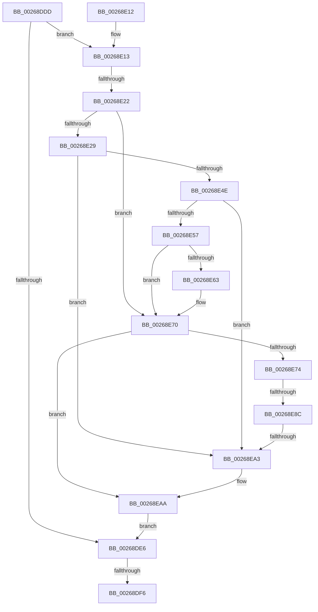

# sub_00268DDD

- RVA: `0x00268DDD`–`0x00268EB6` (길이 `217` bytes)
- VA: `0x0000000140268DDD`
- 실행 섹션: `.text`
- PDB 이름 있음: `아니요`; PDB Function 태그: `아니요`
- unwind 정보 RVA: `0x0006521C`
- 디코드: `65`개 명령, `217/217` bytes 표시
- 미해석 바이트: `0` (있으면 어셈블리에 `.byte`로 보존)

> 이 문서는 커널 이미지의 기계어와 PDB 기호를 분석해 생성했습니다. 4번과 5번은 함수 원형과 자료형을 바이너리 사용 방식에서 추정한 C 해석이며 원본 소스 복구 결과는 아닙니다.

## 1. Dependencies

- 직접 호출 지점: **2**; 고유 호출 대상: **1**
- 직접 호출자로 확인된 함수: **0**
- RIP 상대 이미지 참조: **0**

### Outgoing calls
- `0x00268E40` → [SmHpUnprotectListNeighbors](SmHpUnprotectListNeighbors_function_002692A4.md) (function, `0x002692A4`)
- `0x00268E95` → [SmHpUnprotectListNeighbors](SmHpUnprotectListNeighbors_function_002692A4.md) (function, `0x002692A4`)

### Direct callers
- 이 함수 시작 RVA로 연결되는 직접 call은 확인되지 않았습니다. 간접 호출은 완전히 역산할 수 없습니다.

### Static image references
- 디코드된 RIP-relative 메모리 참조가 없습니다.

## 2. Other-region calls and transfers

- 다른 실행 섹션으로 향하는 call: **0**
- call이 아닌 외부 분기/꼬리 이동: **4**
  - `0x00268DF0` → [sub_00268EBD + 0x3F](Unknown_function_00268EBD.md) (`tail-transfer`)
  - `0x00268E1C` → [sub_00268EBD](Unknown_function_00268EBD.md) (`tail-transfer`)
  - `0x00268E86` → [sub_00268EBD + 0xA6](Unknown_function_00268EBD.md) (`tail-transfer`)
  - `0x00268EA1` → [sub_00268EBD + 0x63](Unknown_function_00268EBD.md) (`tail-transfer`)

## 3. Assembly (complete function range)

```asm
00268DDD  4C 89 7C 24 68                  mov qword ptr [rsp + 0x68], r15
00268DE2  3B EE                           cmp ebp, esi
00268DE4  75 2D                           jne 0x140268e13
00268DE6  0F B7 4F 0A                     movzx ecx, word ptr [rdi + 0xa]
00268DEA  3B 8B 24 02 00 00               cmp ecx, dword ptr [rbx + 0x224]
00268DF0  0F 84 06 01 00 00               je 0x140268efc
00268DF6  FF 8B 34 02 00 00               dec dword ptr [rbx + 0x234]
00268DFC  48 8B 5C 24 70                  mov rbx, qword ptr [rsp + 0x70]
00268E01  4C 8B 7C 24 68                  mov r15, qword ptr [rsp + 0x68]
00268E06  48 83 C4 30                     add rsp, 0x30
00268E0A  41 5E                           pop r14
00268E0C  41 5C                           pop r12
00268E0E  5F                              pop rdi
00268E0F  5E                              pop rsi
00268E10  5D                              pop rbp
00268E11  C3                              ret
00268E12  CC                              int3
00268E13  4C 89 74 24 60                  mov qword ptr [rsp + 0x60], r14
00268E18  44 39 77 0C                     cmp dword ptr [rdi + 0xc], r14d
00268E1C  0F 85 9B 00 00 00               jne 0x140268ebd
00268E22  4C 8B 37                        mov r14, qword ptr [rdi]
00268E25  85 ED                           test ebp, ebp
00268E27  78 47                           js 0x140268e70
00268E29  4C 63 FD                        movsxd r15, ebp
00268E2C  4D 8B C6                        mov r8, r14
00268E2F  49 83 C7 12                     add r15, 0x12
00268E33  48 8B CB                        mov rcx, rbx
00268E36  49 C1 E7 04                     shl r15, 4
00268E3A  4C 03 FB                        add r15, rbx
00268E3D  49 8B D7                        mov rdx, r15
00268E40  E8 5F 04 00 00                  call 0x1402692a4
00268E45  49 8B 0E                        mov rcx, qword ptr [r14]
00268E48  4C 39 71 08                     cmp qword ptr [rcx + 8], r14
00268E4C  75 55                           jne 0x140268ea3
00268E4E  49 8B 46 08                     mov rax, qword ptr [r14 + 8]
00268E52  4C 39 30                        cmp qword ptr [rax], r14
00268E55  75 4C                           jne 0x140268ea3
00268E57  48 89 08                        mov qword ptr [rax], rcx
00268E5A  48 89 41 08                     mov qword ptr [rcx + 8], rax
00268E5E  4D 39 3F                        cmp qword ptr [r15], r15
00268E61  75 0D                           jne 0x140268e70
00268E63  8B CD                           mov ecx, ebp
00268E65  41 8B C4                        mov eax, r12d
00268E68  D3 E0                           shl eax, cl
00268E6A  31 83 1C 01 00 00               xor dword ptr [rbx + 0x11c], eax
00268E70  85 F6                           test esi, esi
00268E72  78 36                           js 0x140268eaa
00268E74  48 63 EE                        movsxd rbp, esi
00268E77  48 83 C5 12                     add rbp, 0x12
00268E7B  48 C1 E5 04                     shl rbp, 4
00268E7F  48 03 EB                        add rbp, rbx
00268E82  48 39 6D 00                     cmp qword ptr [rbp], rbp
00268E86  0F 84 D7 00 00 00               je 0x140268f63
00268E8C  45 33 C0                        xor r8d, r8d
00268E8F  48 8B D5                        mov rdx, rbp
00268E92  48 8B CB                        mov rcx, rbx
00268E95  E8 0A 04 00 00                  call 0x1402692a4
00268E9A  48 8B 45 08                     mov rax, qword ptr [rbp + 8]
00268E9E  48 39 28                        cmp qword ptr [rax], rbp
00268EA1  74 7D                           je 0x140268f20
00268EA3  B9 03 00 00 00                  mov ecx, 3
00268EA8  CD 29                           int 0x29
00268EAA  4D 89 76 08                     mov qword ptr [r14 + 8], r14
00268EAE  4D 89 36                        mov qword ptr [r14], r14
00268EB1  E9 30 FF FF FF                  jmp 0x140268de6
```

## 4. C-style interpretation (structured pseudocode)

```c
__int64 __fastcall sub_00268DDD(__int64 a1, __int64 a2, __int64 a3, __int64 a4, __int64 a5, __int64 a6, __int64 a7, __int64 a8, __int64 a9, __int64 a10, __int64 a11, __int64 a12, __int64 a13, __int64 a14)
{
    __int64 result;
    __int64 v_r15;
    __int64 v_rbp;
    __int64 v_rsp;
    unsigned __int64 v_stack_p68;
    unsigned __int64 v_stack_pB8;

    v_stack_p68 = v_r15;
    if (((unsigned int)(v_rbp)) != ((unsigned int)(v_rsi))) goto loc_00268E13;
loc_00268DE6:
    v_rsp = (v_rsp) + (48);
    return result;
loc_00268E13:
    v_stack_pB8 = v_r14;
    if (sign_flag) goto loc_00268E70;
    v_r15 = ((int)((unsigned int)(v_rbp))) + (18);
    v_r15 = (v_r15) << (4);
    v_r15 = (v_r15) + (a14);
    result = SmHpUnprotectListNeighbors(a14, v_r15, *(unsigned __int64 *)(v_rdi), a4);
    if ((*(unsigned __int64 *)(*(unsigned __int64 *)(*(unsigned __int64 *)(v_rdi)) + 8)) != (*(unsigned __int64 *)(v_rdi))) goto loc_00268EA3;
    if ((*(unsigned __int64 *)(*(unsigned __int64 *)(*(unsigned __int64 *)(v_rdi) + 8))) != (*(unsigned __int64 *)(v_rdi))) goto loc_00268EA3;
    *(unsigned __int64 *)(*(unsigned __int64 *)(*(unsigned __int64 *)(v_rdi) + 8)) = *(unsigned __int64 *)(*(unsigned __int64 *)(v_rdi));
    *(unsigned __int64 *)(*(unsigned __int64 *)(*(unsigned __int64 *)(v_rdi)) + 8) = *(unsigned __int64 *)(*(unsigned __int64 *)(v_rdi) + 8);
    result = *(unsigned __int64 *)(*(unsigned __int64 *)(v_rdi) + 8);
    if ((*(unsigned __int64 *)(v_r15)) == v_r15) {
        a1 = (unsigned int)(v_rbp);
        result = (unsigned int)(v_r12);
        result = (unsigned int)((result) << ((unsigned __int8)(a1)));
    }
    if (sign_flag) goto loc_00268EAA;
    v_rbp = ((int)((unsigned int)(v_rsi))) + (18);
    v_rbp = (v_rbp) << (4);
    v_rbp = (v_rbp) + (a14);
    a3 = 0;
    result = SmHpUnprotectListNeighbors(a14, v_rbp, a3, a4);
loc_00268EA3:
loc_00268EAA:
    *(unsigned __int64 *)(*(unsigned __int64 *)(v_rdi) + 8) = *(unsigned __int64 *)(v_rdi);
    *(unsigned __int64 *)(*(unsigned __int64 *)(v_rdi)) = *(unsigned __int64 *)(v_rdi);
    goto loc_00268DE6;
}
```

## 5. (Beta) C Style

```c
int64_t sub_00268DDD(int64_t Arg1, int64_t Arg2, int64_t Arg3, int64_t Arg4, uint64_t Arg5, uint64_t Arg6, uint64_t Arg7, uint64_t Arg8, uint64_t Arg9, uint64_t Arg10, uint64_t Arg11, uint64_t Arg12, int64_t Arg13, int64_t Arg14)
{
    int64_t result;
    int64_t local_r15;
    int64_t local_rbp;
    int64_t local_rsp;
    uint64_t v_stack_p68;
    uint64_t v_stack_pB8;

    v_stack_p68 = local_r15;
    if (((uint32_t)(local_rbp)) != ((uint32_t)(local_rsi))) goto loc_00268E13;
loc_00268DE6:
    local_rsp = (local_rsp) + (48);
    return result;
loc_00268E13:
    v_stack_pB8 = local_r14;
    if (sign_flag) goto loc_00268E70;
    local_r15 = ((int32_t)((uint32_t)(local_rbp))) + (18);
    local_r15 = (local_r15) << (4);
    local_r15 = (local_r15) + (Arg14);
    result = SmHpUnprotectListNeighbors(Arg14, local_r15, *(uint64_t *)(local_rdi), Arg4);
    if ((*(uint64_t *)(*(uint64_t *)(*(uint64_t *)(local_rdi)) + 0x8)) != (*(uint64_t *)(local_rdi))) goto loc_00268EA3;
    if ((*(uint64_t *)(*(uint64_t *)(*(uint64_t *)(local_rdi) + 0x8))) != (*(uint64_t *)(local_rdi))) goto loc_00268EA3;
    *(uint64_t *)(*(uint64_t *)(*(uint64_t *)(local_rdi) + 0x8)) = *(uint64_t *)(*(uint64_t *)(local_rdi));
    *(uint64_t *)(*(uint64_t *)(*(uint64_t *)(local_rdi)) + 0x8) = *(uint64_t *)(*(uint64_t *)(local_rdi) + 0x8);
    result = *(uint64_t *)(*(uint64_t *)(local_rdi) + 0x8);
    if ((*(uint64_t *)(local_r15)) == local_r15) {
        Arg1 = (uint32_t)(local_rbp);
        result = (uint32_t)(local_r12);
        result = (uint32_t)((result) << ((uint8_t)(Arg1)));
    }
    if (sign_flag) goto loc_00268EAA;
    local_rbp = ((int32_t)((uint32_t)(local_rsi))) + (18);
    local_rbp = (local_rbp) << (4);
    local_rbp = (local_rbp) + (Arg14);
    Arg3 = 0;
    result = SmHpUnprotectListNeighbors(Arg14, local_rbp, Arg3, Arg4);
loc_00268EA3:
loc_00268EAA:
    *(uint64_t *)(*(uint64_t *)(local_rdi) + 0x8) = *(uint64_t *)(local_rdi);
    *(uint64_t *)(*(uint64_t *)(local_rdi)) = *(uint64_t *)(local_rdi);
    goto loc_00268DE6;
}
```

## 6. Execution-region graph

[열기: 2D/3D 그래프와 함수 탐색 컨트롤 패널](../../../control-panel.html?section=text&rva=0x00268DDD&view=graph)

- 2D 그래프는 위에서 아래로 흐르고, 3D 그래프는 빈 공간을 드래그해 회전합니다. Shift+드래그는 이동, 휠은 확대·축소, 함수 노드 선택은 대상 보고서 이동입니다.

### Static fallback


