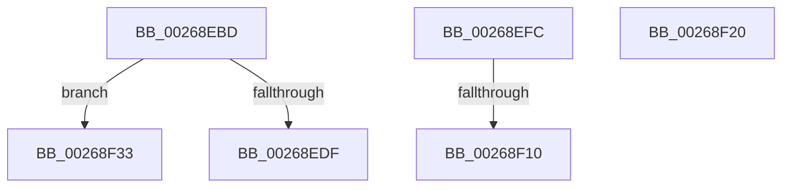

# sub_00268EBD

- RVA: `0x00268EBD`–`0x00268F74` (길이 `183` bytes)
- VA: `0x0000000140268EBD`
- 실행 섹션: `.text`
- PDB 이름 있음: `아니요`; PDB Function 태그: `아니요`
- unwind 정보 RVA: `0x00065244`
- 디코드: `45`개 명령, `183/183` bytes 표시
- 미해석 바이트: `0` (있으면 어셈블리에 `.byte`로 보존)

> 이 문서는 커널 이미지의 기계어와 PDB 기호를 분석해 생성했습니다. 4번과 5번은 함수 원형과 자료형을 바이너리 사용 방식에서 추정한 C 해석이며 원본 소스 복구 결과는 아닙니다.

## 1. Dependencies

- 직접 호출 지점: **5**; 고유 호출 대상: **5**
- 직접 호출자로 확인된 함수: **0**
- RIP 상대 이미지 참조: **0**

### Outgoing calls
- `0x00268EC8` → [wyhash](wyhash_function_00269FE4.md) (function, `0x00269FE4`)
- `0x00268EEE` → [ExProtectPoolEx](ExProtectPoolEx_function_002695D8.md) (function, `0x002695D8`)
- `0x00268F16` → [SmHpBufferCleanup](../3B/SmHpBufferCleanup_function_003B1480.md) (function, `0x003B1480`)
- `0x00268F40` → [SmPrepareForFatalHeapCorruption](SmPrepareForFatalHeapCorruption_function_00267AC0.md) (function, `0x00267AC0`)
- `0x00268F5D` → [KeBugCheckEx](../4F/KeBugCheckEx_function_004FD660.md) (function, `0x004FD660`)

### Direct callers
- 이 함수 시작 RVA로 연결되는 직접 call은 확인되지 않았습니다. 간접 호출은 완전히 역산할 수 없습니다.

### Static image references
- 디코드된 RIP-relative 메모리 참조가 없습니다.

## 2. Other-region calls and transfers

- 다른 실행 섹션으로 향하는 call: **0**
- call이 아닌 외부 분기/꼬리 이동: **5**
  - `0x00268EF7` → [sub_00268DDD + 0x45](Unknown_function_00268DDD.md) (`tail-transfer`)
  - `0x00268F0A` → [sub_00268DDD + 0x19](Unknown_function_00268DDD.md) (`tail-transfer`)
  - `0x00268F1B` → [sub_00268DDD + 0x19](Unknown_function_00268DDD.md) (`tail-transfer`)
  - `0x00268F2E` → [sub_00268DDD + 0x9](Unknown_function_00268DDD.md) (`tail-transfer`)
  - `0x00268F6F` → [sub_00268DDD + 0xBD](Unknown_function_00268DDD.md) (`tail-transfer`)

## 3. Assembly (complete function range)

```asm
00268EBD  48 8B 0F                        mov rcx, qword ptr [rdi]
00268EC0  45 33 C0                        xor r8d, r8d
00268EC3  BA 00 10 00 00                  mov edx, 0x1000
00268EC8  E8 17 11 00 00                  call 0x140269fe4
00268ECD  44 8B 47 0C                     mov r8d, dword ptr [rdi + 0xc]
00268ED1  85 C0                           test eax, eax
00268ED3  48 8B 0F                        mov rcx, qword ptr [rdi]
00268ED6  41 0F 44 C4                     cmove eax, r12d
00268EDA  41 3B C0                        cmp eax, r8d
00268EDD  75 54                           jne 0x140268f33
00268EDF  41 B9 04 00 00 00               mov r9d, 4
00268EE5  41 B8 00 10 00 00               mov r8d, 0x1000
00268EEB  48 8B D1                        mov rdx, rcx
00268EEE  E8 E5 06 00 00                  call 0x1402695d8
00268EF3  44 89 77 0C                     mov dword ptr [rdi + 0xc], r14d
00268EF7  E9 26 FF FF FF                  jmp 0x140268e22
00268EFC  8B 83 30 02 00 00               mov eax, dword ptr [rbx + 0x230]
00268F02  2B C1                           sub eax, ecx
00268F04  3B 83 2C 02 00 00               cmp eax, dword ptr [rbx + 0x22c]
00268F0A  0F 82 E6 FE FF FF               jb 0x140268df6
00268F10  48 8B D7                        mov rdx, rdi
00268F13  48 8B CB                        mov rcx, rbx
00268F16  E8 65 85 14 00                  call 0x1403b1480
00268F1B  E9 D6 FE FF FF                  jmp 0x140268df6
00268F20  49 89 2E                        mov qword ptr [r14], rbp
00268F23  49 89 46 08                     mov qword ptr [r14 + 8], rax
00268F27  4C 89 30                        mov qword ptr [rax], r14
00268F2A  4C 89 75 08                     mov qword ptr [rbp + 8], r14
00268F2E  E9 B3 FE FF FF                  jmp 0x140268de6
00268F33  48 8D 54 24 60                  lea rdx, [rsp + 0x60]
00268F38  44 8B C8                        mov r9d, eax
00268F3B  48 89 54 24 20                  mov qword ptr [rsp + 0x20], rdx
00268F40  E8 7B EB FF FF                  call 0x140267ac0
00268F45  48 8B 44 24 60                  mov rax, qword ptr [rsp + 0x60]
00268F4A  33 D2                           xor edx, edx
00268F4C  44 8B 4F 0C                     mov r9d, dword ptr [rdi + 0xc]
00268F50  B9 C7 01 00 00                  mov ecx, 0x1c7
00268F55  4C 8B 07                        mov r8, qword ptr [rdi]
00268F58  48 89 44 24 20                  mov qword ptr [rsp + 0x20], rax
00268F5D  E8 FE 46 29 00                  call 0x1404fd660
00268F62  CC                              int3
00268F63  8B CE                           mov ecx, esi
00268F65  41 D3 E4                        shl r12d, cl
00268F68  44 31 A3 1C 01 00 00            xor dword ptr [rbx + 0x11c], r12d
00268F6F  E9 26 FF FF FF                  jmp 0x140268e9a
```

## 4. C-style interpretation (structured pseudocode)

```c
__int64 __fastcall sub_00268EBD(__int64 a1, __int64 a2, int a3, __int64 a4, __int64 a5, __int64 a6, __int64 a7, __int64 a8, __int64 a9, __int64 a10, __int64 a11, __int64 a12)
{
    __int64 result;
    __int64 v_r12;
    unsigned __int64 v_stack_p20;

    a3 = 0;
    result = wyhash(*(unsigned __int64 *)(v_rdi), (unsigned int)(0x1000ULL), a3, a4);
    if ((unsigned int)(result) == 0) { result = (unsigned int)(v_r12); }
    if (((unsigned int)(result)) != ((unsigned int)((unsigned int)(*(unsigned int *)(v_rdi + 12))))) goto loc_00268F33;
    result = ExProtectPoolEx(*(unsigned __int64 *)(v_rdi), *(unsigned __int64 *)(v_rdi), (unsigned int)(0x1000ULL), 4);
    *(unsigned int *)(v_rdi + 12) = (unsigned int)(v_r14);
loc_00268F33:
    v_stack_p20 = a12;
    result = SmPrepareForFatalHeapCorruption(*(unsigned __int64 *)(v_rdi), a12, (unsigned int)(0x1000ULL), (unsigned int)((unsigned int)(result)));
    a2 = 0;
    v_stack_p20 = a12;
    result = KeBugCheckEx(455, a2, *(unsigned __int64 *)(v_rdi), (unsigned int)(*(unsigned int *)(v_rdi + 12)));
    v_r12 = (unsigned int)((v_r12) << ((unsigned __int8)((unsigned int)((unsigned int)(v_rsi)))));
}
```

## 5. (Beta) C Style

```c
int64_t sub_00268EBD(int64_t Arg1, int64_t Arg2, int32_t Arg3, int64_t Arg4, uint64_t Arg5, uint64_t Arg6, uint64_t Arg7, uint64_t Arg8, uint64_t Arg9, uint64_t Arg10, uint64_t Arg11, int64_t Arg12)
{
    int64_t result;
    int64_t local_r12;
    uint64_t v_stack_p20;

    Arg3 = 0;
    result = wyhash(*(uint64_t *)(local_rdi), (uint32_t)(0x1000ULL), Arg3, Arg4);
    if ((uint32_t)(result) == 0) { result = (uint32_t)(local_r12); }
    if (((uint32_t)(result)) != ((uint32_t)((uint32_t)(*(uint32_t *)(local_rdi + 0xC))))) goto loc_00268F33;
    result = ExProtectPoolEx(*(uint64_t *)(local_rdi), *(uint64_t *)(local_rdi), (uint32_t)(0x1000ULL), 4);
    *(uint32_t *)(local_rdi + 0xC) = (uint32_t)(local_r14);
loc_00268F33:
    v_stack_p20 = Arg12;
    result = SmPrepareForFatalHeapCorruption(*(uint64_t *)(local_rdi), Arg12, (uint32_t)(0x1000ULL), (uint32_t)((uint32_t)(result)));
    Arg2 = 0;
    v_stack_p20 = Arg12;
    result = KeBugCheckEx(455, Arg2, *(uint64_t *)(local_rdi), (uint32_t)(*(uint32_t *)(local_rdi + 0xC)));
    local_r12 = (uint32_t)((local_r12) << ((uint8_t)((uint32_t)((uint32_t)(local_rsi)))));
}
```

## 6. Execution-region graph

[열기: 2D/3D 그래프와 함수 탐색 컨트롤 패널](../../../control-panel.html?section=text&rva=0x00268EBD&view=graph)

- 2D 그래프는 위에서 아래로 흐르고, 3D 그래프는 빈 공간을 드래그해 회전합니다. Shift+드래그는 이동, 휠은 확대·축소, 함수 노드 선택은 대상 보고서 이동입니다.

### Static fallback


