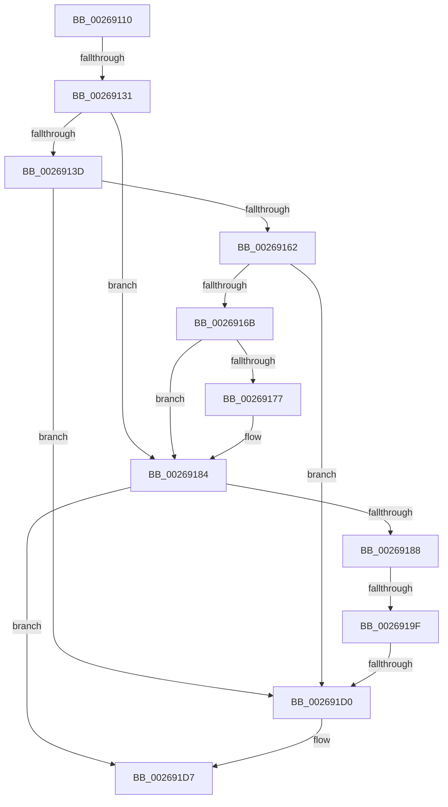

# sub_00269110

- RVA: `0x00269110`–`0x002691F2` (길이 `226` bytes)
- VA: `0x0000000140269110`
- 실행 섹션: `.text`
- PDB 이름 있음: `아니요`; PDB Function 태그: `아니요`
- unwind 정보 RVA: `0x00065284`
- 디코드: `63`개 명령, `226/226` bytes 표시
- 미해석 바이트: `0` (있으면 어셈블리에 `.byte`로 보존)

> 이 문서는 커널 이미지의 기계어와 PDB 기호를 분석해 생성했습니다. 4번과 5번은 함수 원형과 자료형을 바이너리 사용 방식에서 추정한 C 해석이며 원본 소스 복구 결과는 아닙니다.

## 1. Dependencies

- 직접 호출 지점: **2**; 고유 호출 대상: **2**
- 직접 호출자로 확인된 함수: **0**
- RIP 상대 이미지 참조: **0**

### Outgoing calls
- `0x00269154` → [SmHpUnprotectListNeighbors](SmHpUnprotectListNeighbors_function_002692A4.md) (function, `0x002692A4`)
- `0x002691C2` → [SmHpBufferProtectEx](SmHpBufferProtectEx_function_002694C0.md) (function, `0x002694C0`)

### Direct callers
- 이 함수 시작 RVA로 연결되는 직접 call은 확인되지 않았습니다. 간접 호출은 완전히 역산할 수 없습니다.

### Static image references
- 디코드된 RIP-relative 메모리 참조가 없습니다.

## 2. Other-region calls and transfers

- 다른 실행 섹션으로 향하는 call: **0**
- call이 아닌 외부 분기/꼬리 이동: **4**
  - `0x0026912B` → [sub_002691F9](Unknown_function_002691F9.md) (`tail-transfer`)
  - `0x00269199` → [sub_0026928A](Unknown_function_0026928A.md) (`tail-transfer`)
  - `0x002691CE` → [sub_00269238](Unknown_function_00269238.md) (`tail-transfer`)
  - `0x002691ED` → [SmHpBufferUpdateFullness + 0x56](SmHpBufferUpdateFullness_function_002690B0.md) (`tail-transfer`)

## 3. Assembly (complete function range)

```asm
00269110  4C 89 64 24 68                  mov qword ptr [rsp + 0x68], r12
00269115  45 33 E4                        xor r12d, r12d
00269118  4C 89 7C 24 30                  mov qword ptr [rsp + 0x30], r15
0026911D  4C 89 64 24 60                  mov qword ptr [rsp + 0x60], r12
00269122  45 8D 7C 24 01                  lea r15d, [r12 + 1]
00269127  44 39 62 0C                     cmp dword ptr [rdx + 0xc], r12d
0026912B  0F 85 C8 00 00 00               jne 0x1402691f9
00269131  48 8B 36                        mov rsi, qword ptr [rsi]
00269134  4C 89 74 24 78                  mov qword ptr [rsp + 0x78], r14
00269139  85 FF                           test edi, edi
0026913B  78 47                           js 0x140269184
0026913D  4C 63 F7                        movsxd r14, edi
00269140  4C 8B C6                        mov r8, rsi
00269143  49 83 C6 12                     add r14, 0x12
00269147  48 8B CD                        mov rcx, rbp
0026914A  49 C1 E6 04                     shl r14, 4
0026914E  4C 03 F5                        add r14, rbp
00269151  49 8B D6                        mov rdx, r14
00269154  E8 4B 01 00 00                  call 0x1402692a4
00269159  48 8B 0E                        mov rcx, qword ptr [rsi]
0026915C  48 39 71 08                     cmp qword ptr [rcx + 8], rsi
00269160  75 6E                           jne 0x1402691d0
00269162  48 8B 46 08                     mov rax, qword ptr [rsi + 8]
00269166  48 39 30                        cmp qword ptr [rax], rsi
00269169  75 65                           jne 0x1402691d0
0026916B  48 89 08                        mov qword ptr [rax], rcx
0026916E  48 89 41 08                     mov qword ptr [rcx + 8], rax
00269172  4D 39 36                        cmp qword ptr [r14], r14
00269175  75 0D                           jne 0x140269184
00269177  8B CF                           mov ecx, edi
00269179  41 8B C7                        mov eax, r15d
0026917C  D3 E0                           shl eax, cl
0026917E  31 85 1C 01 00 00               xor dword ptr [rbp + 0x11c], eax
00269184  85 DB                           test ebx, ebx
00269186  78 4F                           js 0x1402691d7
00269188  48 63 FB                        movsxd rdi, ebx
0026918B  48 83 C7 12                     add rdi, 0x12
0026918F  48 C1 E7 04                     shl rdi, 4
00269193  48 03 FD                        add rdi, rbp
00269196  48 39 3F                        cmp qword ptr [rdi], rdi
00269199  0F 84 EB 00 00 00               je 0x14026928a
0026919F  48 8B 47 08                     mov rax, qword ptr [rdi + 8]
002691A3  41 8B D7                        mov edx, r15d
002691A6  45 8B C7                        mov r8d, r15d
002691A9  44 8B 48 10                     mov r9d, dword ptr [rax + 0x10]
002691AD  41 0F BD C9                     bsr ecx, r9d
002691B1  D3 E2                           shl edx, cl
002691B3  49 33 D1                        xor rdx, r9
002691B6  45 33 C9                        xor r9d, r9d
002691B9  48 C1 E2 04                     shl rdx, 4
002691BD  48 03 54 CD 00                  add rdx, qword ptr [rbp + rcx*8]
002691C2  E8 F9 02 00 00                  call 0x1402694c0
002691C7  48 8B 47 08                     mov rax, qword ptr [rdi + 8]
002691CB  48 39 38                        cmp qword ptr [rax], rdi
002691CE  74 68                           je 0x140269238
002691D0  B9 03 00 00 00                  mov ecx, 3
002691D5  CD 29                           int 0x29
002691D7  4C 8B 74 24 78                  mov r14, qword ptr [rsp + 0x78]
002691DC  4C 8B 64 24 68                  mov r12, qword ptr [rsp + 0x68]
002691E1  4C 8B 7C 24 30                  mov r15, qword ptr [rsp + 0x30]
002691E6  48 89 76 08                     mov qword ptr [rsi + 8], rsi
002691EA  48 89 36                        mov qword ptr [rsi], rsi
002691ED  E9 14 FF FF FF                  jmp 0x140269106
```

## 4. C-style interpretation (structured pseudocode)

```c
__int64 __fastcall sub_00269110(__int64 a1, __int64 a2, __int64 a3, __int64 a4, __int64 a5, __int64 a6, __int64 a7, __int64 a8, __int64 a9, __int64 a10, __int64 a11, __int64 a12, __int64 a13, __int64 a14, __int64 a15)
{
    __int64 result;
    __int64 v_r12;
    __int64 v_r14;
    __int64 v_rdi;
    unsigned __int64 v_stack_p30;
    unsigned __int64 v_stack_p60;
    unsigned __int64 v_stack_p68;
    unsigned __int64 v_stack_p78;

    v_stack_p68 = v_r12;
    v_r12 = 0;
    v_stack_p30 = v_r15;
    v_stack_p60 = 0;
    v_stack_p78 = v_r14;
    if (sign_flag) goto loc_00269184;
    v_r14 = ((int)((unsigned int)(v_rdi))) + (18);
    v_r14 = (v_r14) << (4);
    v_r14 = (v_r14) + (v_rbp);
    result = SmHpUnprotectListNeighbors(v_rbp, v_r14, *(unsigned __int64 *)(v_rsi), a4);
    if ((*(unsigned __int64 *)(*(unsigned __int64 *)(*(unsigned __int64 *)(v_rsi)) + 8)) != (*(unsigned __int64 *)(v_rsi))) goto loc_002691D0;
    if ((*(unsigned __int64 *)(*(unsigned __int64 *)(*(unsigned __int64 *)(v_rsi) + 8))) != (*(unsigned __int64 *)(v_rsi))) goto loc_002691D0;
    *(unsigned __int64 *)(*(unsigned __int64 *)(*(unsigned __int64 *)(v_rsi) + 8)) = *(unsigned __int64 *)(*(unsigned __int64 *)(v_rsi));
    *(unsigned __int64 *)(*(unsigned __int64 *)(*(unsigned __int64 *)(v_rsi)) + 8) = *(unsigned __int64 *)(*(unsigned __int64 *)(v_rsi) + 8);
    result = *(unsigned __int64 *)(*(unsigned __int64 *)(v_rsi) + 8);
    if ((*(unsigned __int64 *)(v_r14)) == v_r14) {
        a1 = (unsigned int)(v_rdi);
        result = (unsigned int)(v_r12 + 1);
        result = (unsigned int)((result) << ((unsigned __int8)(a1)));
    }
    if (sign_flag) goto loc_002691D7;
    v_rdi = ((int)((unsigned int)(v_rbx))) + (18);
    v_rdi = (v_rdi) << (4);
    v_rdi = (v_rdi) + (v_rbp);
    a2 = (unsigned int)(((unsigned int)((unsigned int)(v_r12 + 1))) << ((unsigned __int8)(a1)));
    a2 = (a2) ^ ((unsigned int)(*(unsigned int *)(*(unsigned __int64 *)(v_rdi + 8) + 16)));
    a4 = 0;
    a2 = (a2) << (4);
    a2 = (a2) + (*(unsigned __int64 *)(v_rbp + a1 * 8));
    result = SmHpBufferProtectEx(a1, a2, (unsigned int)((unsigned int)(v_r12 + 1)), a4);
loc_002691D0:
loc_002691D7:
    *(unsigned __int64 *)(*(unsigned __int64 *)(v_rsi) + 8) = *(unsigned __int64 *)(v_rsi);
    *(unsigned __int64 *)(*(unsigned __int64 *)(v_rsi)) = *(unsigned __int64 *)(v_rsi);
}
```

## 5. (Beta) C Style

```c
int64_t sub_00269110(int64_t Arg1, void *Arg2, int64_t Arg3, int64_t Arg4, uint64_t Arg5, int64_t Arg6, uint64_t Arg7, uint64_t Arg8, uint64_t Arg9, uint64_t Arg10, uint64_t Arg11, uint64_t Arg12, int64_t Arg13, uint64_t Arg14, int64_t Arg15)
{
    uint8_t *arg2 = (uint8_t *)Arg2;

    int64_t result;
    int64_t local_r12;
    int64_t local_r14;
    int64_t local_rdi;
    uint64_t v_stack_p30;
    uint64_t v_stack_p60;
    uint64_t v_stack_p68;
    uint64_t v_stack_p78;

    v_stack_p68 = local_r12;
    local_r12 = 0;
    v_stack_p30 = local_r15;
    v_stack_p60 = 0;
    v_stack_p78 = local_r14;
    if (sign_flag) goto loc_00269184;
    local_r14 = ((int32_t)((uint32_t)(local_rdi))) + (18);
    local_r14 = (local_r14) << (4);
    local_r14 = (local_r14) + (local_rbp);
    result = SmHpUnprotectListNeighbors(local_rbp, local_r14, *(uint64_t *)(local_rsi), Arg4);
    if ((*(uint64_t *)(*(uint64_t *)(*(uint64_t *)(local_rsi)) + 0x8)) != (*(uint64_t *)(local_rsi))) goto loc_002691D0;
    if ((*(uint64_t *)(*(uint64_t *)(*(uint64_t *)(local_rsi) + 0x8))) != (*(uint64_t *)(local_rsi))) goto loc_002691D0;
    *(uint64_t *)(*(uint64_t *)(*(uint64_t *)(local_rsi) + 0x8)) = *(uint64_t *)(*(uint64_t *)(local_rsi));
    *(uint64_t *)(*(uint64_t *)(*(uint64_t *)(local_rsi)) + 0x8) = *(uint64_t *)(*(uint64_t *)(local_rsi) + 0x8);
    result = *(uint64_t *)(*(uint64_t *)(local_rsi) + 0x8);
    if ((*(uint64_t *)(local_r14)) == local_r14) {
        Arg1 = (uint32_t)(local_rdi);
        result = (uint32_t)(local_r12 + 1);
        result = (uint32_t)((result) << ((uint8_t)(Arg1)));
    }
    if (sign_flag) goto loc_002691D7;
    local_rdi = ((int32_t)((uint32_t)(local_rbx))) + (18);
    local_rdi = (local_rdi) << (4);
    local_rdi = (local_rdi) + (local_rbp);
    Arg2 = (uint32_t)(((uint32_t)((uint32_t)(local_r12 + 1))) << ((uint8_t)(Arg1)));
    Arg2 = (Arg2) ^ ((uint32_t)(*(uint32_t *)(*(uint64_t *)(local_rdi + 0x8) + 0x10)));
    Arg4 = 0;
    Arg2 = (Arg2) << (4);
    Arg2 = (Arg2) + (*(uint64_t *)(local_rbp + Arg1 * 8));
    result = SmHpBufferProtectEx(Arg1, Arg2, (uint32_t)((uint32_t)(local_r12 + 1)), Arg4);
loc_002691D0:
loc_002691D7:
    *(uint64_t *)(*(uint64_t *)(local_rsi) + 0x8) = *(uint64_t *)(local_rsi);
    *(uint64_t *)(*(uint64_t *)(local_rsi)) = *(uint64_t *)(local_rsi);
}
```

### 관측된 메모리 오프셋

구조체 형식이 확인되지 않은 접근은 인자 기준의 오프셋으로만 기록했습니다.

| 기준 인자 | 오프셋 표현 | 폭 (bit) | 접근 |
|---|---:|---:|---|
| `Arg2` | `+ 0xC` | `32` | `R` |

## 6. Execution-region graph

[열기: 2D/3D 그래프와 함수 탐색 컨트롤 패널](../../../control-panel.html?section=text&rva=0x00269110&view=graph)

- 2D 그래프는 위에서 아래로 흐르고, 3D 그래프는 빈 공간을 드래그해 회전합니다. Shift+드래그는 이동, 휠은 확대·축소, 함수 노드 선택은 대상 보고서 이동입니다.

### Static fallback


