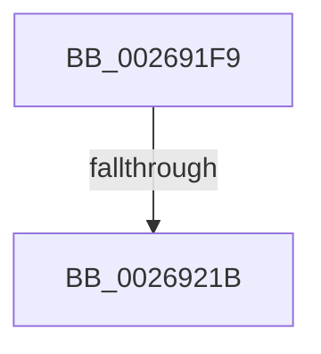

# sub_002691F9

- RVA: `0x002691F9`–`0x00269238` (길이 `63` bytes)
- VA: `0x00000001402691F9`
- 실행 섹션: `.text`
- PDB 이름 있음: `아니요`; PDB Function 태그: `아니요`
- unwind 정보 RVA: `0x000652B0`
- 디코드: `16`개 명령, `63/63` bytes 표시
- 미해석 바이트: `0` (있으면 어셈블리에 `.byte`로 보존)

> 이 문서는 커널 이미지의 기계어와 PDB 기호를 분석해 생성했습니다. 4번과 5번은 함수 원형과 자료형을 바이너리 사용 방식에서 추정한 C 해석이며 원본 소스 복구 결과는 아닙니다.

## 1. Dependencies

- 직접 호출 지점: **2**; 고유 호출 대상: **2**
- 직접 호출자로 확인된 함수: **0**
- RIP 상대 이미지 참조: **0**

### Outgoing calls
- `0x00269204` → [wyhash](wyhash_function_00269FE4.md) (function, `0x00269FE4`)
- `0x0026922A` → [ExProtectPoolEx](ExProtectPoolEx_function_002695D8.md) (function, `0x002695D8`)

### Direct callers
- 이 함수 시작 RVA로 연결되는 직접 call은 확인되지 않았습니다. 간접 호출은 완전히 역산할 수 없습니다.

### Static image references
- 디코드된 RIP-relative 메모리 참조가 없습니다.

## 2. Other-region calls and transfers

- 다른 실행 섹션으로 향하는 call: **0**
- call이 아닌 외부 분기/꼬리 이동: **2**
  - `0x00269219` → [sub_0026925A](Unknown_function_0026925A.md) (`tail-transfer`)
  - `0x00269233` → [sub_00269110 + 0x21](Unknown_function_00269110.md) (`tail-transfer`)

## 3. Assembly (complete function range)

```asm
002691F9  48 8B 0A                        mov rcx, qword ptr [rdx]
002691FC  45 33 C0                        xor r8d, r8d
002691FF  BA 00 10 00 00                  mov edx, 0x1000
00269204  E8 DB 0D 00 00                  call 0x140269fe4
00269209  44 8B 46 0C                     mov r8d, dword ptr [rsi + 0xc]
0026920D  85 C0                           test eax, eax
0026920F  48 8B 0E                        mov rcx, qword ptr [rsi]
00269212  41 0F 44 C7                     cmove eax, r15d
00269216  41 3B C0                        cmp eax, r8d
00269219  75 3F                           jne 0x14026925a
0026921B  41 B9 04 00 00 00               mov r9d, 4
00269221  41 B8 00 10 00 00               mov r8d, 0x1000
00269227  48 8B D1                        mov rdx, rcx
0026922A  E8 A9 03 00 00                  call 0x1402695d8
0026922F  44 89 66 0C                     mov dword ptr [rsi + 0xc], r12d
00269233  E9 F9 FE FF FF                  jmp 0x140269131
```

## 4. C-style interpretation (structured pseudocode)

```c
__int64 __fastcall sub_002691F9(__int64 a1, __int64 a2, int a3)
{
    __int64 result;

    a3 = 0;
    result = wyhash(*(unsigned __int64 *)(a2), (unsigned int)(0x1000ULL), a3, a4);
    if ((unsigned int)(result) == 0) { result = (unsigned int)(v_r15); }
    result = ExProtectPoolEx(*(unsigned __int64 *)(v_rsi), *(unsigned __int64 *)(v_rsi), (unsigned int)(0x1000ULL), 4);
    *(unsigned int *)(v_rsi + 12) = (unsigned int)(v_r12);
}
```

## 5. (Beta) C Style

```c
int64_t sub_002691F9(int64_t Arg1, void *Arg2, int32_t Arg3)
{
    uint8_t *arg2 = (uint8_t *)Arg2;

    int64_t result;

    Arg3 = 0;
    result = wyhash(*(uint64_t *)(arg2), (uint32_t)(0x1000ULL), Arg3, a4);
    if ((uint32_t)(result) == 0) { result = (uint32_t)(local_r15); }
    result = ExProtectPoolEx(*(uint64_t *)(local_rsi), *(uint64_t *)(local_rsi), (uint32_t)(0x1000ULL), 4);
    *(uint32_t *)(local_rsi + 0xC) = (uint32_t)(local_r12);
}
```

### 관측된 메모리 오프셋

구조체 형식이 확인되지 않은 접근은 인자 기준의 오프셋으로만 기록했습니다.

| 기준 인자 | 오프셋 표현 | 폭 (bit) | 접근 |
|---|---:|---:|---|
| `Arg2` | `+ 0x0` | `64` | `R` |

## 6. Execution-region graph

[열기: 2D/3D 그래프와 함수 탐색 컨트롤 패널](../../../control-panel.html?section=text&rva=0x002691F9&view=graph)

- 2D 그래프는 위에서 아래로 흐르고, 3D 그래프는 빈 공간을 드래그해 회전합니다. Shift+드래그는 이동, 휠은 확대·축소, 함수 노드 선택은 대상 보고서 이동입니다.

### Static fallback


