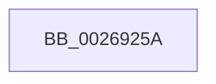

# sub_0026925A

- RVA: `0x0026925A`–`0x0026928A` (길이 `48` bytes)
- VA: `0x000000014026925A`
- 실행 섹션: `.text`
- PDB 이름 있음: `아니요`; PDB Function 태그: `아니요`
- unwind 정보 RVA: `0x000652E4`
- 디코드: `12`개 명령, `48/48` bytes 표시
- 미해석 바이트: `0` (있으면 어셈블리에 `.byte`로 보존)

> 이 문서는 커널 이미지의 기계어와 PDB 기호를 분석해 생성했습니다. 4번과 5번은 함수 원형과 자료형을 바이너리 사용 방식에서 추정한 C 해석이며 원본 소스 복구 결과는 아닙니다.

## 1. Dependencies

- 직접 호출 지점: **2**; 고유 호출 대상: **2**
- 직접 호출자로 확인된 함수: **0**
- RIP 상대 이미지 참조: **0**

### Outgoing calls
- `0x00269267` → [SmPrepareForFatalHeapCorruption](SmPrepareForFatalHeapCorruption_function_00267AC0.md) (function, `0x00267AC0`)
- `0x00269284` → [KeBugCheckEx](../4F/KeBugCheckEx_function_004FD660.md) (function, `0x004FD660`)

### Direct callers
- 이 함수 시작 RVA로 연결되는 직접 call은 확인되지 않았습니다. 간접 호출은 완전히 역산할 수 없습니다.

### Static image references
- 디코드된 RIP-relative 메모리 참조가 없습니다.

## 2. Other-region calls and transfers

- 다른 실행 섹션으로 향하는 call: **0**
- 별도 외부 분기/꼬리 이동을 확인하지 못했습니다.

## 3. Assembly (complete function range)

```asm
0026925A  48 8D 54 24 60                  lea rdx, [rsp + 0x60]
0026925F  44 8B C8                        mov r9d, eax
00269262  48 89 54 24 20                  mov qword ptr [rsp + 0x20], rdx
00269267  E8 54 E8 FF FF                  call 0x140267ac0
0026926C  48 8B 44 24 60                  mov rax, qword ptr [rsp + 0x60]
00269271  33 D2                           xor edx, edx
00269273  44 8B 4E 0C                     mov r9d, dword ptr [rsi + 0xc]
00269277  B9 C7 01 00 00                  mov ecx, 0x1c7
0026927C  4C 8B 06                        mov r8, qword ptr [rsi]
0026927F  48 89 44 24 20                  mov qword ptr [rsp + 0x20], rax
00269284  E8 D7 43 29 00                  call 0x1404fd660
00269289  CC                              int3
```

## 4. C-style interpretation (structured pseudocode)

```c
__int64 __fastcall sub_0026925A(__int64 a1, __int64 a2, __int64 a3, __int64 a4, __int64 a5, __int64 a6, __int64 a7, __int64 a8, __int64 a9, __int64 a10, __int64 a11, __int64 a12)
{
    __int64 result;
    unsigned __int64 v_stack_p20;

    v_stack_p20 = a12;
    result = SmPrepareForFatalHeapCorruption(a1, a12, a3, (unsigned int)((unsigned int)(result)));
    a2 = 0;
    v_stack_p20 = a12;
    result = KeBugCheckEx(455, a2, *(unsigned __int64 *)(v_rsi), (unsigned int)(*(unsigned int *)(v_rsi + 12)));
    return result;
}
```

## 5. (Beta) C Style

```c
int64_t sub_0026925A(int64_t Arg1, int64_t Arg2, int64_t Arg3, int64_t Arg4, uint64_t Arg5, uint64_t Arg6, uint64_t Arg7, uint64_t Arg8, uint64_t Arg9, uint64_t Arg10, uint64_t Arg11, int64_t Arg12)
{
    int64_t result;
    uint64_t v_stack_p20;

    v_stack_p20 = Arg12;
    result = SmPrepareForFatalHeapCorruption(Arg1, Arg12, Arg3, (uint32_t)((uint32_t)(result)));
    Arg2 = 0;
    v_stack_p20 = Arg12;
    result = KeBugCheckEx(455, Arg2, *(uint64_t *)(local_rsi), (uint32_t)(*(uint32_t *)(local_rsi + 0xC)));
    return result;
}
```

## 6. Execution-region graph

[열기: 2D/3D 그래프와 함수 탐색 컨트롤 패널](../../../control-panel.html?section=text&rva=0x0026925A&view=graph)

- 2D 그래프는 위에서 아래로 흐르고, 3D 그래프는 빈 공간을 드래그해 회전합니다. Shift+드래그는 이동, 휠은 확대·축소, 함수 노드 선택은 대상 보고서 이동입니다.

### Static fallback


