# sub_0026A4AD

- RVA: `0x0026A4AD`–`0x0026A9B4` (길이 `1,287` bytes)
- VA: `0x000000014026A4AD`
- 실행 섹션: `.text`
- PDB 이름 있음: `아니요`; PDB Function 태그: `아니요`
- unwind 정보 RVA: `0x00065434`
- 디코드: `306`개 명령, `1,287/1,287` bytes 표시
- 미해석 바이트: `0` (있으면 어셈블리에 `.byte`로 보존)

> 이 문서는 커널 이미지의 기계어와 PDB 기호를 분석해 생성했습니다. 4번과 5번은 함수 원형과 자료형을 바이너리 사용 방식에서 추정한 C 해석이며 원본 소스 복구 결과는 아닙니다.

## 1. Dependencies

- 직접 호출 지점: **2**; 고유 호출 대상: **2**
- 직접 호출자로 확인된 함수: **0**
- RIP 상대 이미지 참조: **0**

### Outgoing calls
- `0x0026A634` → [memcpy](../6C/memcpy_function_006C6840.md) (function, `0x006C6840`)
- `0x0026A700` → [memset](../6C/memset_function_006C6C40.md) (function, `0x006C6C40`)

### Direct callers
- 이 함수 시작 RVA로 연결되는 직접 call은 확인되지 않았습니다. 간접 호출은 완전히 역산할 수 없습니다.

### Static image references
- 디코드된 RIP-relative 메모리 참조가 없습니다.

## 2. Other-region calls and transfers

- 다른 실행 섹션으로 향하는 call: **0**
- call이 아닌 외부 분기/꼬리 이동: **12**
  - `0x0026A4DC` → [sub_0026A9FF](Unknown_function_0026A9FF.md) (`tail-transfer`)
  - `0x0026A4E8` → [sub_0026A9FF + 0x44B](Unknown_function_0026A9FF.md) (`tail-transfer`)
  - `0x0026A4F4` → [sub_0026B87F + 0x56](Unknown_function_0026B87F.md) (`tail-transfer`)
  - `0x0026A4FC` → [sub_0026A9FF + 0xD5B](Unknown_function_0026A9FF.md) (`tail-transfer`)
  - `0x0026A5FC` → [sub_0026B87F + 0x56](Unknown_function_0026B87F.md) (`tail-transfer`)
  - `0x0026A606` → [sub_0026A9BC + 0x2C](Unknown_function_0026A9BC.md) (`tail-transfer`)
  - `0x0026A61E` → [sub_0026A9BC](Unknown_function_0026A9BC.md) (`tail-transfer`)
  - `0x0026A645` → [sub_0026B87F + 0x56](Unknown_function_0026B87F.md) (`tail-transfer`)
  - `0x0026A674` → [sub_0026B87F + 0x1F](Unknown_function_0026B87F.md) (`tail-transfer`)
  - `0x0026A6C8` → [sub_0026B87F + 0x56](Unknown_function_0026B87F.md) (`tail-transfer`)
  - `0x0026A804` → [sub_0026B87F + 0x56](Unknown_function_0026B87F.md) (`tail-transfer`)
  - `0x0026A882` → [sub_0026B87F + 0x2C](Unknown_function_0026B87F.md) (`tail-transfer`)

## 3. Assembly (complete function range)

```asm
0026A4AD  48 89 AC 24 A0 00 00 00         mov qword ptr [rsp + 0xa0], rbp
0026A4B5  48 89 B4 24 98 00 00 00         mov qword ptr [rsp + 0x98], rsi
0026A4BD  4C 89 A4 24 90 00 00 00         mov qword ptr [rsp + 0x90], r12
0026A4C5  4C 89 AC 24 88 00 00 00         mov qword ptr [rsp + 0x88], r13
0026A4CD  4C 89 B4 24 80 00 00 00         mov qword ptr [rsp + 0x80], r14
0026A4D5  4C 89 7C 24 78                  mov qword ptr [rsp + 0x78], r15
0026A4DA  3B C8                           cmp ecx, eax
0026A4DC  0F 8D 1D 05 00 00               jge 0x14026a9ff
0026A4E2  81 FB 0B 00 01 00               cmp ebx, 0x1000b
0026A4E8  0F 8D 5C 09 00 00               jge 0x14026ae4a
0026A4EE  81 FB 00 00 00 7E               cmp ebx, 0x7e000000
0026A4F4  0F 87 DB 13 00 00               ja 0x14026b8d5
0026A4FA  85 DB                           test ebx, ebx
0026A4FC  0F 84 58 12 00 00               je 0x14026b75a
0026A502  8B 97 10 40 00 00               mov edx, dword ptr [rdi + 0x4010]
0026A508  49 8D 04 09                     lea rax, [r9 + rcx]
0026A50C  01 9F 18 40 00 00               add dword ptr [rdi + 0x4018], ebx
0026A512  4D 8D 2C 1A                     lea r13, [r10 + rbx]
0026A516  4D 8B C2                        mov r8, r10
0026A519  48 89 44 24 48                  mov qword ptr [rsp + 0x48], rax
0026A51E  4C 2B C2                        sub r8, rdx
0026A521  C7 87 14 40 00 00 03 00 00 00   mov dword ptr [rdi + 0x4014], 3
0026A52B  4C 89 44 24 28                  mov qword ptr [rsp + 0x28], r8
0026A530  8D 04 1A                        lea eax, [rdx + rbx]
0026A533  89 87 10 40 00 00               mov dword ptr [rdi + 0x4010], eax
0026A539  4D 8D 65 F5                     lea r12, [r13 - 0xb]
0026A53D  4D 8D 75 FB                     lea r14, [r13 - 5]
0026A541  49 8B F2                        mov rsi, r10
0026A544  49 8B EC                        mov rbp, r12
0026A547  4D 8B F9                        mov r15, r9
0026A54A  45 8B C3                        mov r8d, r11d
0026A54D  83 FB 0D                        cmp ebx, 0xd
0026A550  7C 7D                           jl 0x14026a5cf
0026A552  41 69 0A B1 79 37 9E            imul ecx, dword ptr [r10], 0x9e3779b1
0026A559  48 8B 9C 24 C0 00 00 00         mov rbx, qword ptr [rsp + 0xc0]
0026A561  48 C1 E9 13                     shr rcx, 0x13
0026A565  66 89 14 4B                     mov word ptr [rbx + rcx*2], dx
0026A569  49 8D 4A 01                     lea rcx, [r10 + 1]
0026A56D  44 69 11 B1 79 37 9E            imul r10d, dword ptr [rcx], 0x9e3779b1
0026A574  41 B9 01 00 00 00               mov r9d, 1
0026A57A  44 89 84 24 E0 00 00 00         mov dword ptr [rsp + 0xe0], r8d
0026A582  C7 84 24 D8 00 00 00 40 00 00 00  mov dword ptr [rsp + 0xd8], 0x40
0026A58D  41 C1 EA 13                     shr r10d, 0x13
0026A591  49 63 C1                        movsxd rax, r9d
0026A594  4A 8D 1C 53                     lea rbx, [rbx + r10*2]
0026A598  44 8B 8C 24 D8 00 00 00         mov r9d, dword ptr [rsp + 0xd8]
0026A5A0  44 8B C1                        mov r8d, ecx
0026A5A3  44 2B 44 24 28                  sub r8d, dword ptr [rsp + 0x28]
0026A5A8  48 8B F9                        mov rdi, rcx
0026A5AB  44 0F B7 13                     movzx r10d, word ptr [rbx]
0026A5AF  48 03 C8                        add rcx, rax
0026A5B2  41 8B C1                        mov eax, r9d
0026A5B5  41 FF C1                        inc r9d
0026A5B8  C1 F8 06                        sar eax, 6
0026A5BB  89 84 24 E8 00 00 00            mov dword ptr [rsp + 0xe8], eax
0026A5C2  44 89 8C 24 D8 00 00 00         mov dword ptr [rsp + 0xd8], r9d
0026A5CA  49 3B CC                        cmp rcx, r12
0026A5CD  76 7C                           jbe 0x14026a64b
0026A5CF  4C 2B EE                        sub r13, rsi
0026A5D2  49 B8 81 80 80 80 80 80 80 80   movabs r8, 0x8080808080808081
0026A5DC  49 8B C0                        mov rax, r8
0026A5DF  49 8D 8D F0 00 00 00            lea rcx, [r13 + 0xf0]
0026A5E6  48 F7 E1                        mul rcx
0026A5E9  49 8D 47 01                     lea rax, [r15 + 1]
0026A5ED  48 C1 EA 07                     shr rdx, 7
0026A5F1  49 03 D5                        add rdx, r13
0026A5F4  48 03 C2                        add rax, rdx
0026A5F7  48 3B 44 24 48                  cmp rax, qword ptr [rsp + 0x48]
0026A5FC  0F 87 D3 12 00 00               ja 0x14026b8d5
0026A602  49 83 FD 0F                     cmp r13, 0xf
0026A606  0F 82 DC 03 00 00               jb 0x14026a9e8
0026A60C  41 C6 07 F0                     mov byte ptr [r15], 0xf0
0026A610  49 8D 7D F1                     lea rdi, [r13 - 0xf]
0026A614  49 FF C7                        inc r15
0026A617  48 81 FF FF 00 00 00            cmp rdi, 0xff
0026A61E  0F 83 98 03 00 00               jae 0x14026a9bc
0026A624  41 88 3F                        mov byte ptr [r15], dil
0026A627  49 8D 5F 01                     lea rbx, [r15 + 1]
0026A62B  4D 8B C5                        mov r8, r13
0026A62E  48 8B CB                        mov rcx, rbx
0026A631  48 8B D6                        mov rdx, rsi
0026A634  E8 07 C2 45 00                  call 0x1406c6840
0026A639  46 8D 1C 2B                     lea r11d, [rbx + r13]
0026A63D  44 2B 9C 24 D0 00 00 00         sub r11d, dword ptr [rsp + 0xd0]
0026A645  E9 8B 12 00 00                  jmp 0x14026b8d5
0026A64A  CC                              int3
0026A64B  4C 8B 4C 24 28                  mov r9, qword ptr [rsp + 0x28]
0026A650  4D 03 CA                        add r9, r10
0026A653  44 69 11 B1 79 37 9E            imul r10d, dword ptr [rcx], 0x9e3779b1
0026A65A  66 44 89 03                     mov word ptr [rbx], r8w
0026A65E  8B 07                           mov eax, dword ptr [rdi]
0026A660  48 8B 9C 24 C0 00 00 00         mov rbx, qword ptr [rsp + 0xc0]
0026A668  4C 89 4C 24 20                  mov qword ptr [rsp + 0x20], r9
0026A66D  41 C1 EA 13                     shr r10d, 0x13
0026A671  41 39 01                        cmp dword ptr [r9], eax
0026A674  0F 85 24 12 00 00               jne 0x14026b89e
0026A67A  4C 8B 84 24 C8 00 00 00         mov r8, qword ptr [rsp + 0xc8]
0026A682  4D 3B C8                        cmp r9, r8
0026A685  76 0E                           jbe 0x14026a695
0026A687  41 0F B6 41 FF                  movzx eax, byte ptr [r9 - 1]
0026A68C  38 47 FF                        cmp byte ptr [rdi - 1], al
0026A68F  0F 84 EB 02 00 00               je 0x14026a980
0026A695  B8 81 80 80 80                  mov eax, 0x80808081
0026A69A  49 8D 4F 01                     lea rcx, [r15 + 1]
0026A69E  44 8B C7                        mov r8d, edi
0026A6A1  48 89 4C 24 38                  mov qword ptr [rsp + 0x38], rcx
0026A6A6  44 2B C6                        sub r8d, esi
0026A6A9  41 F7 E0                        mul r8d
0026A6AC  45 8B D0                        mov r10d, r8d
0026A6AF  C1 EA 07                        shr edx, 7
0026A6B2  8B C2                           mov eax, edx
0026A6B4  48 83 C0 08                     add rax, 8
0026A6B8  4C 89 54 24 58                  mov qword ptr [rsp + 0x58], r10
0026A6BD  48 03 C1                        add rax, rcx
0026A6C0  49 03 C2                        add rax, r10
0026A6C3  48 3B 44 24 48                  cmp rax, qword ptr [rsp + 0x48]
0026A6C8  0F 87 07 12 00 00               ja 0x14026b8d5
0026A6CE  41 83 F8 0F                     cmp r8d, 0xf
0026A6D2  0F 82 92 02 00 00               jb 0x14026a96a
0026A6D8  41 8D 50 F1                     lea edx, [r8 - 0xf]
0026A6DC  41 C6 07 F0                     mov byte ptr [r15], 0xf0
0026A6E0  89 94 24 D8 00 00 00            mov dword ptr [rsp + 0xd8], edx
0026A6E7  81 FA FF 00 00 00               cmp edx, 0xff
0026A6ED  7C 3A                           jl 0x14026a729
0026A6EF  B8 81 80 80 80                  mov eax, 0x80808081
0026A6F4  F7 E2                           mul edx
0026A6F6  C1 EA 07                        shr edx, 7
0026A6F9  8B DA                           mov ebx, edx
0026A6FB  44 8B C2                        mov r8d, edx
0026A6FE  B2 FF                           mov dl, 0xff
0026A700  E8 3B C5 45 00                  call 0x1406c6c40
0026A705  48 8B 4C 24 38                  mov rcx, qword ptr [rsp + 0x38]
0026A70A  8B 94 24 D8 00 00 00            mov edx, dword ptr [rsp + 0xd8]
0026A711  48 03 CB                        add rcx, rbx
0026A714  4C 8B 4C 24 20                  mov r9, qword ptr [rsp + 0x20]
0026A719  4C 8B 54 24 58                  mov r10, qword ptr [rsp + 0x58]
0026A71E  69 C3 01 FF FF FF               imul eax, ebx, 0xffffff01
0026A724  03 D0                           add edx, eax
0026A726  45 33 DB                        xor r11d, r11d
0026A729  88 11                           mov byte ptr [rcx], dl
0026A72B  48 FF C1                        inc rcx
0026A72E  4A 8D 14 11                     lea rdx, [rcx + r10]
0026A732  48 2B F1                        sub rsi, rcx
0026A735  48 8B 04 31                     mov rax, qword ptr [rcx + rsi]
0026A739  48 89 01                        mov qword ptr [rcx], rax
0026A73C  48 83 C1 08                     add rcx, 8
0026A740  48 3B CA                        cmp rcx, rdx
0026A743  72 F0                           jb 0x14026a735
0026A745  49 8D 76 F9                     lea rsi, [r14 - 7]
0026A749  48 89 74 24 20                  mov qword ptr [rsp + 0x20], rsi
0026A74E  66 0F 1F 84 00 00 00 00 00      nop word ptr [rax + rax]
0026A757  66 0F 1F 84 00 00 00 00 00      nop word ptr [rax + rax]
0026A760  8B 9C 24 E0 00 00 00            mov ebx, dword ptr [rsp + 0xe0]
0026A767  66 0F 1F 84 00 00 00 00 00      nop word ptr [rax + rax]
0026A770  0F B7 C7                        movzx eax, di
0026A773  4D 8D 51 04                     lea r10, [r9 + 4]
0026A777  66 41 2B C1                     sub ax, r9w
0026A77B  4D 8B C7                        mov r8, r15
0026A77E  4C 8D 4F 04                     lea r9, [rdi + 4]
0026A782  66 89 02                        mov word ptr [rdx], ax
0026A785  4C 8D 7A 02                     lea r15, [rdx + 2]
0026A789  49 8B D1                        mov rdx, r9
0026A78C  4C 3B CE                        cmp r9, rsi
0026A78F  73 1A                           jae 0x14026a7ab
0026A791  49 8B 09                        mov rcx, qword ptr [r9]
0026A794  49 33 0A                        xor rcx, qword ptr [r10]
0026A797  74 0A                           je 0x14026a7a3
0026A799  F3 48 0F BC C9                  tzcnt rcx, rcx
0026A79E  C1 E9 03                        shr ecx, 3
0026A7A1  EB 3C                           jmp 0x14026a7df
0026A7A3  49 8D 51 08                     lea rdx, [r9 + 8]
0026A7A7  49 83 C2 08                     add r10, 8
0026A7AB  8B B4 24 E0 00 00 00            mov esi, dword ptr [rsp + 0xe0]
0026A7B2  89 B4 24 E0 00 00 00            mov dword ptr [rsp + 0xe0], esi
0026A7B9  48 3B 54 24 20                  cmp rdx, qword ptr [rsp + 0x20]
0026A7BE  0F 83 DD 00 00 00               jae 0x14026a8a1
0026A7C4  48 8B 0A                        mov rcx, qword ptr [rdx]
0026A7C7  49 33 0A                        xor rcx, qword ptr [r10]
0026A7CA  0F 84 58 01 00 00               je 0x14026a928
0026A7D0  F3 48 0F BC C9                  tzcnt rcx, rcx
0026A7D5  C1 E9 03                        shr ecx, 3
0026A7D8  8B DE                           mov ebx, esi
0026A7DA  41 2B C9                        sub ecx, r9d
0026A7DD  03 CA                           add ecx, edx
0026A7DF  8B C1                           mov eax, ecx
0026A7E1  8D 91 F0 00 00 00               lea edx, [rcx + 0xf0]
0026A7E7  48 83 C7 04                     add rdi, 4
0026A7EB  48 03 F8                        add rdi, rax
0026A7EE  B8 81 80 80 80                  mov eax, 0x80808081
0026A7F3  F7 E2                           mul edx
0026A7F5  C1 EA 07                        shr edx, 7
0026A7F8  48 83 C2 06                     add rdx, 6
0026A7FC  49 03 D7                        add rdx, r15
0026A7FF  48 3B 54 24 48                  cmp rdx, qword ptr [rsp + 0x48]
0026A804  0F 87 CB 10 00 00               ja 0x14026b8d5
0026A80A  41 0F B6 00                     movzx eax, byte ptr [r8]
0026A80E  83 F9 0F                        cmp ecx, 0xf
0026A811  0F 83 DF 00 00 00               jae 0x14026a8f6
0026A817  02 C1                           add al, cl
0026A819  41 88 00                        mov byte ptr [r8], al
0026A81C  8B 84 24 E0 00 00 00            mov eax, dword ptr [rsp + 0xe0]
0026A823  8B D8                           mov ebx, eax
0026A825  89 84 24 E0 00 00 00            mov dword ptr [rsp + 0xe0], eax
0026A82C  48 8B F7                        mov rsi, rdi
0026A82F  48 3B FD                        cmp rdi, rbp
0026A832  0F 83 97 FD FF FF               jae 0x14026a5cf
0026A838  69 4F FE B1 79 37 9E            imul ecx, dword ptr [rdi - 2], 0x9e3779b1
0026A83F  0F B7 D7                        movzx edx, di
0026A842  4C 8B 54 24 28                  mov r10, qword ptr [rsp + 0x28]
0026A847  4C 8B 84 24 C0 00 00 00         mov r8, qword ptr [rsp + 0xc0]
0026A84F  66 41 2B D2                     sub dx, r10w
0026A853  66 83 EA 02                     sub dx, 2
0026A857  48 C1 E9 13                     shr rcx, 0x13
0026A85B  66 41 89 14 48                  mov word ptr [r8 + rcx*2], dx
0026A860  8B D7                           mov edx, edi
0026A862  69 07 B1 79 37 9E               imul eax, dword ptr [rdi], 0x9e3779b1
0026A868  41 2B D2                        sub edx, r10d
0026A86B  C1 E8 13                        shr eax, 0x13
0026A86E  45 0F B7 0C 40                  movzx r9d, word ptr [r8 + rax*2]
0026A873  49 8D 0C 40                     lea rcx, [r8 + rax*2]
0026A877  66 89 11                        mov word ptr [rcx], dx
0026A87A  4D 03 CA                        add r9, r10
0026A87D  8B 07                           mov eax, dword ptr [rdi]
0026A87F  41 39 01                        cmp dword ptr [r9], eax
0026A882  0F 85 23 10 00 00               jne 0x14026b8ab
0026A888  48 8B 74 24 20                  mov rsi, qword ptr [rsp + 0x20]
0026A88D  49 8D 57 01                     lea rdx, [r15 + 1]
0026A891  41 C6 07 00                     mov byte ptr [r15], 0
0026A895  89 9C 24 E0 00 00 00            mov dword ptr [rsp + 0xe0], ebx
0026A89C  E9 CF FE FF FF                  jmp 0x14026a770
0026A8A1  49 8D 46 FD                     lea rax, [r14 - 3]
0026A8A5  48 3B D0                        cmp rdx, rax
0026A8A8  73 0F                           jae 0x14026a8b9
0026A8AA  8B 02                           mov eax, dword ptr [rdx]
0026A8AC  41 39 02                        cmp dword ptr [r10], eax
0026A8AF  75 08                           jne 0x14026a8b9
0026A8B1  48 83 C2 04                     add rdx, 4
0026A8B5  49 83 C2 04                     add r10, 4
0026A8B9  49 8D 46 FF                     lea rax, [r14 - 1]
0026A8BD  48 3B D0                        cmp rdx, rax
0026A8C0  73 11                           jae 0x14026a8d3
0026A8C2  0F B7 02                        movzx eax, word ptr [rdx]
0026A8C5  66 41 39 02                     cmp word ptr [r10], ax
0026A8C9  75 08                           jne 0x14026a8d3
0026A8CB  48 83 C2 02                     add rdx, 2
0026A8CF  49 83 C2 02                     add r10, 2
0026A8D3  49 3B D6                        cmp rdx, r14
0026A8D6  73 0B                           jae 0x14026a8e3
0026A8D8  0F B6 02                        movzx eax, byte ptr [rdx]
0026A8DB  41 38 02                        cmp byte ptr [r10], al
0026A8DE  75 03                           jne 0x14026a8e3
0026A8E0  48 FF C2                        inc rdx
0026A8E3  41 2B D1                        sub edx, r9d
0026A8E6  89 B4 24 E0 00 00 00            mov dword ptr [rsp + 0xe0], esi
0026A8ED  8B CA                           mov ecx, edx
0026A8EF  8B DE                           mov ebx, esi
0026A8F1  E9 E9 FE FF FF                  jmp 0x14026a7df
0026A8F6  04 0F                           add al, 0xf
0026A8F8  83 C1 F1                        add ecx, -0xf
0026A8FB  41 88 00                        mov byte ptr [r8], al
0026A8FE  41 C7 07 FF FF FF FF            mov dword ptr [r15], 0xffffffff
0026A905  81 F9 FC 03 00 00               cmp ecx, 0x3fc
0026A90B  73 28                           jae 0x14026a935
0026A90D  B8 81 80 80 80                  mov eax, 0x80808081
0026A912  F7 E1                           mul ecx
0026A914  C1 EA 07                        shr edx, 7
0026A917  02 CA                           add cl, dl
0026A919  42 88 0C 3A                     mov byte ptr [rdx + r15], cl
0026A91D  49 FF C7                        inc r15
0026A920  4C 03 FA                        add r15, rdx
0026A923  E9 04 FF FF FF                  jmp 0x14026a82c
0026A928  48 83 C2 08                     add rdx, 8
0026A92C  49 83 C2 08                     add r10, 8
0026A930  E9 7D FE FF FF                  jmp 0x14026a7b2
0026A935  B8 81 80 80 80                  mov eax, 0x80808081
0026A93A  F7 E1                           mul ecx
0026A93C  C1 EA 09                        shr edx, 9
0026A93F  8B C2                           mov eax, edx
0026A941  8B 94 24 E0 00 00 00            mov edx, dword ptr [rsp + 0xe0]
0026A948  89 94 24 E0 00 00 00            mov dword ptr [rsp + 0xe0], edx
0026A94F  49 83 C7 04                     add r15, 4
0026A953  81 C1 04 FC FF FF               add ecx, 0xfffffc04
0026A959  41 C7 07 FF FF FF FF            mov dword ptr [r15], 0xffffffff
0026A960  48 83 E8 01                     sub rax, 1
0026A964  75 E9                           jne 0x14026a94f
0026A966  8B DA                           mov ebx, edx
0026A968  EB A3                           jmp 0x14026a90d
0026A96A  41 C0 E0 04                     shl r8b, 4
0026A96E  45 88 07                        mov byte ptr [r15], r8b
0026A971  E9 B8 FD FF FF                  jmp 0x14026a72e
0026A976  66 66 0F 1F 84 00 00 00 00 00   nop word ptr [rax + rax]
0026A980  48 FF CF                        dec rdi
0026A983  41 8B CB                        mov ecx, r11d
0026A986  49 FF C9                        dec r9
0026A989  41 8B C3                        mov eax, r11d
0026A98C  48 3B FE                        cmp rdi, rsi
0026A98F  4C 89 4C 24 20                  mov qword ptr [rsp + 0x20], r9
0026A994  0F 97 C1                        seta cl
0026A997  4D 3B C8                        cmp r9, r8
0026A99A  0F 97 C0                        seta al
0026A99D  85 C8                           test eax, ecx
0026A99F  0F 84 F0 FC FF FF               je 0x14026a695
0026A9A5  41 0F B6 41 FF                  movzx eax, byte ptr [r9 - 1]
0026A9AA  38 47 FF                        cmp byte ptr [rdi - 1], al
0026A9AD  74 D1                           je 0x14026a980
0026A9AF  E9 E1 FC FF FF                  jmp 0x14026a695
```

## 4. C-style interpretation (structured pseudocode)

```c
__int64 __fastcall sub_0026A4AD(__int64 a1, __int64 a2, __int64 a3, __int64 a4, unsigned int a5, __int64 a6, __int64 a7, __int64 a8, __int64 a9, __int64 a10, __int64 a11, __int64 a12, __int64 a13, __int64 a14, __int64 a15, __int64 a16, __int64 a17, __int64 a18, __int64 a19, __int64 a20, __int64 a21, __int64 a22, __int64 a23, __int64 a24, __int64 a25, unsigned int a26, unsigned int a27, unsigned int a28)
{
    __int64 result;
    __int64 v_r10;
    __int64 v_r11;
    __int64 v_r13;
    __int64 v_r15;
    __int64 v_rbx;
    __int64 v_rdi;
    __int64 v_rsi;
    unsigned __int64 v_stack_p20;
    unsigned __int64 v_stack_p28;
    unsigned __int64 v_stack_p38;
    unsigned __int64 v_stack_p48;
    unsigned __int64 v_stack_p58;
    unsigned __int64 v_stack_p78;
    unsigned __int64 v_stack_p80;
    unsigned __int64 v_stack_p88;
    unsigned __int64 v_stack_p90;
    unsigned __int64 v_stack_p98;
    unsigned __int64 v_stack_pA0;
    unsigned int v_stack_pD8;
    unsigned int v_stack_pE0;
    unsigned int v_stack_pE8;

    v_stack_pA0 = v_rbp;
    v_stack_p98 = v_rsi;
    v_stack_p90 = v_r12;
    v_stack_p88 = v_r13;
    v_stack_p80 = v_r14;
    v_stack_p78 = v_r15;
    v_stack_p48 = a4 + a1 * 1;
    a3 = (v_r10) - ((unsigned int)(*(unsigned int *)(v_rdi + 16400)));
    *(unsigned int *)(v_rdi + 16404) = 3;
    v_stack_p28 = a3;
    *(unsigned int *)(v_rdi + 16400) = (unsigned int)((unsigned int)(*(unsigned int *)(v_rdi + 16400)) + v_rbx * 1);
    if (((unsigned int)(v_rbx)) < 13) goto loc_0026A5CF;
    a1 = (unsigned int)((a1) * (*(unsigned int *)(v_r10)));
    a1 = (a1) >> (19);
    *(unsigned __int16 *)(a24 + a1 * 2) = (unsigned __int16)((unsigned int)(*(unsigned int *)(v_rdi + 16400)));
    v_r10 = (unsigned int)((v_r10) * (*(unsigned int *)(v_r10 + 1)));
    v_stack_pE0 = (unsigned int)((unsigned int)((unsigned int)(v_r11)));
    v_stack_pD8 = 64;
    v_r10 = (unsigned int)((v_r10) >> (19));
    a3 = (unsigned int)(((unsigned int)((unsigned int)(v_r10 + 1))) - (a5));
    a1 = (v_r10 + 1) + ((int)(1));
    a4 = (unsigned int)(((unsigned int)(a27)) + 1);
    result = (unsigned int)(((unsigned int)((unsigned int)((unsigned int)(a27)))) >> (6));
    v_stack_pE8 = (unsigned int)(result);
    v_stack_pD8 = (unsigned int)(a4);
    if (a1 <= (v_r10 + v_rbx * 1 - 11)) goto loc_0026A64B;
loc_0026A5CF:
    v_r13 = (v_r10 + v_rbx * 1) - (v_r10);
    a2 = ((unsigned int)(*(unsigned int *)(v_rdi + 16400))) >> (7);
    a2 = (a2) + (v_r13);
    result = (a4 + 1) + (a2);
    *(unsigned __int8 *)(a4) = 240;
    v_r15 = (a4) + 1;
    *(unsigned __int8 *)(v_r15) = (unsigned __int8)(v_r13 - 15);
    result = memcpy(v_r15 + 1, v_r10, v_r13, a4);
    v_r11 = (unsigned int)((v_r15 + 1 + v_r13 * 1) - (a26));
loc_0026A64B:
    a4 = (a5) + (*(unsigned __int16 *)(a24 + v_r10 * 2));
    v_r10 = (unsigned int)((*(unsigned __int16 *)(a24 + v_r10 * 2)) * (*(unsigned int *)(v_r15 + 1)));
    *(unsigned __int16 *)(v_r15 + 1) = (unsigned __int16)(v_r13);
    v_stack_p20 = a4;
    v_r10 = (unsigned int)((v_r10) >> (19));
    if (a4 <= a25) goto loc_0026A695;
    if ((*(unsigned __int8 *)(v_r13 - 15 - 1)) == ((unsigned __int8)(*(unsigned __int8 *)(a4 - 1)))) goto loc_0026A980;
loc_0026A695:
    v_stack_p38 = v_r15 + 1;
    a3 = (unsigned int)(((unsigned int)((unsigned int)(v_r13 - 15))) - ((unsigned int)(v_r10)));
    a2 = (unsigned int)((v_r10) >> (7));
    result = ((unsigned int)((unsigned int)(a2))) + (8);
    v_stack_p58 = (unsigned int)((unsigned int)(a3));
    result = (result) + (v_r15 + 1);
    result = (result) + ((unsigned int)((unsigned int)(a3)));
    if (((unsigned int)(a3)) < 15) goto loc_0026A96A;
    *(unsigned __int8 *)(v_r15) = 240;
    v_stack_pD8 = (unsigned int)(a3 - 15);
    v_rbx = a24;
    v_r10 = (unsigned int)((unsigned int)(a3));
    if (((unsigned int)(a3 - 15)) >= 255) {
        result = 0x80808081ULL;
        a2 = (unsigned int)((a3 - 15) >> (7));
        v_rbx = (unsigned int)(a2);
        a3 = (unsigned int)(a2);
        a2 = 255;
        result = memset(v_r15 + 1, a2, a3, a4);
        a1 = a7;
        a2 = a27;
        a1 = (a1) + (v_rbx);
        a4 = v_stack_p20;
        v_r10 = a11;
        result = (unsigned int)((result) * ((unsigned int)(v_rbx)));
        a2 = (unsigned int)((a2) + ((unsigned int)(result)));
        v_r11 = 0;
    }
    *(unsigned __int8 *)(a1) = (unsigned __int8)(a2);
    a1 = (a1) + 1;
loc_0026A72E:
    v_rsi = (v_r10) - (a1);
loc_0026A735:
    *(unsigned __int64 *)(a1) = *(unsigned __int64 *)(a1 + v_rsi * 1);
    a1 = (a1) + (8);
    if (a1 < (a1 + v_r10 * 1)) goto loc_0026A735;
    v_stack_p20 = v_r10 + v_rbx * 1 - 5 - 7;
loc_0026A770:
    result = (unsigned __int16)(((unsigned __int16)(v_r13 - 15)) - ((unsigned __int16)(a4)));
    *(unsigned __int16 *)(a1 + v_r10 * 1) = (unsigned __int16)(result);
    if ((v_r13 - 15 + 4) >= (v_r10 + v_rbx * 1 - 5 - 7)) goto loc_0026A7AB;
    a1 = (*(unsigned __int64 *)(v_r13 - 15 + 4)) ^ (*(unsigned __int64 *)(a4 + 4));
    if (condition_is_equal) goto loc_0026A7A3;
    a1 = (unsigned int)((a1) >> (3));
    goto loc_0026A7DF;
loc_0026A7A3:
    v_r10 = (a4 + 4) + (8);
loc_0026A7AB:
loc_0026A7B2:
    v_stack_pE0 = (unsigned int)((unsigned int)(a28));
    if ((v_r13 - 15 + 4 + 8) >= v_stack_p20) goto loc_0026A8A1;
    a1 = (*(unsigned __int64 *)(v_r13 - 15 + 4 + 8)) ^ (*(unsigned __int64 *)(v_r10));
    if (condition_is_equal) goto loc_0026A928;
    a1 = (unsigned int)((a1) >> (3));
    a1 = (unsigned int)((a1) - ((unsigned int)(v_r13 - 15 + 4)));
    a1 = (unsigned int)((a1) + ((unsigned int)(v_r13 - 15 + 4 + 8)));
loc_0026A7DF:
    v_rdi = (v_r13 - 15) + (4);
    v_rdi = (v_rdi) + ((unsigned int)((unsigned int)(a1)));
    a2 = (unsigned int)((a1 + 240) >> (7));
    a2 = (a2) + (6);
    a2 = (a2) + (a1 + v_r10 * 1 + 2);
    if (((unsigned int)(a1)) >= 15) goto loc_0026A8F6;
    result = (unsigned __int8)((*(unsigned __int8 *)(v_r15)) + ((unsigned __int8)(a1)));
    *(unsigned __int8 *)(v_r15) = (unsigned __int8)(result);
    v_stack_pE0 = (unsigned int)((unsigned int)(a28));
loc_0026A82C:
    if (v_rdi >= (v_r10 + v_rbx * 1 - 11)) goto loc_0026A5CF;
    a1 = (unsigned int)((a1) * (*(unsigned int *)(v_rdi - 2)));
    a2 = (unsigned __int16)(((unsigned __int16)(v_rdi)) - ((unsigned __int16)(a5)));
    a2 = (unsigned __int16)((a2) - (2));
    a1 = (a1) >> (19);
    *(unsigned __int16 *)(a24 + a1 * 2) = (unsigned __int16)(a2);
    result = (unsigned int)(((unsigned int)(a28)) * (*(unsigned int *)(v_rdi)));
    a2 = (unsigned int)(((unsigned int)((unsigned int)(v_rdi))) - (a5));
    result = (unsigned int)((result) >> (19));
    *(unsigned __int16 *)(a24 + result * 2) = (unsigned __int16)(a2);
    a4 = (*(unsigned __int16 *)(a24 + result * 2)) + (a5);
    *(unsigned __int8 *)(a1 + v_r10 * 1 + 2) = 0;
    v_stack_pE0 = (unsigned int)((unsigned int)((unsigned int)((unsigned int)(a28))));
    goto loc_0026A770;
loc_0026A8A1:
    if ((a1 + v_r10 * 1 + 2 + 1) >= (v_r10 + v_rbx * 1 - 5 - 3)) goto loc_0026A8B9;
    v_r10 = a5;
    if ((*(unsigned int *)(a5)) == ((unsigned int)((unsigned int)(*(unsigned int *)(a1 + v_r10 * 1 + 2 + 1))))) {
        a2 = (a1 + v_r10 * 1 + 2 + 1) + (4);
        v_r10 = (a5) + (4);
    }
    if (a2 >= (v_r10 + v_rbx * 1 - 5 - 1)) goto loc_0026A8D3;
    if ((*(unsigned __int16 *)(v_r10)) == ((unsigned __int16)(*(unsigned __int16 *)(a2)))) {
        a2 = (a2) + (2);
        v_r10 = (v_r10) + (2);
    }
    if (a2 >= (v_r10 + v_rbx * 1 - 5)) goto loc_0026A8E3;
    if ((*(unsigned __int8 *)(v_r10)) == ((unsigned __int8)(*(unsigned __int8 *)(a2)))) {
        a2 = (a2) + 1;
    }
    a2 = (unsigned int)((a2) - ((unsigned int)(a4)));
    v_stack_pE0 = (unsigned int)(v_stack_p20);
    goto loc_0026A7DF;
loc_0026A8F6:
    result = (unsigned __int8)((*(unsigned __int8 *)(a2)) + (15));
    a1 = (unsigned int)(((unsigned int)((unsigned int)(a2))) + (-15));
    *(unsigned __int8 *)(a24) = (unsigned __int8)(result);
    *(unsigned int *)(a1 + v_r10 * 1 + 2) = 0xFFFFFFFFULL;
    if (((unsigned int)(a1)) >= 0x3FCULL) goto loc_0026A935;
loc_0026A90D:
    a2 = (unsigned int)((a2) >> (7));
    a1 = (unsigned __int8)((a1) + ((unsigned __int8)(a2)));
    *(unsigned __int8 *)(a2 + a1 + v_r10 * 1 + 2 * 1) = (unsigned __int8)(a1);
    v_r15 = (a1 + v_r10 * 1 + 2) + 1;
    v_r15 = (v_r15) + (a2);
    goto loc_0026A82C;
loc_0026A928:
    a2 = (a2) + (8);
    v_r10 = (v_r10) + (8);
    goto loc_0026A7B2;
loc_0026A935:
    a2 = (unsigned int)((a2) >> (9));
    v_stack_pE0 = (unsigned int)((unsigned int)(a28));
loc_0026A94F:
    v_r15 = (v_r15) + (4);
    a1 = (unsigned int)((a1) + (0xFFFFFC04ULL));
    *(unsigned int *)(v_r15) = 0xFFFFFFFFULL;
    result = ((unsigned int)((unsigned int)(a2))) - (1);
    if (condition_is_not_equal) goto loc_0026A94F;
    goto loc_0026A90D;
loc_0026A96A:
    a3 = (unsigned __int8)((a24) << (4));
    *(unsigned __int8 *)(v_r15) = (unsigned __int8)(a3);
    goto loc_0026A72E;
loc_0026A980:
    v_rdi = (v_rdi) - 1;
    a4 = (a4) - 1;
    v_stack_p20 = a4;
    a1 = (v_rdi > v_stack_p20) ? 1 : 0;
    result = (a4 > a3) ? 1 : 0;
    if ((((unsigned int)(result)) & ((unsigned int)(a1))) == 0) goto loc_0026A695;
    if ((*(unsigned __int8 *)(v_rdi - 1)) == ((unsigned __int8)(*(unsigned __int8 *)(a4 - 1)))) goto loc_0026A980;
    goto loc_0026A695;
}
```

## 5. (Beta) C Style

```c
int64_t sub_0026A4AD(int64_t Arg1, int64_t Arg2, int64_t Arg3, void *Arg4, void *Arg5, uint64_t Arg6, int64_t Arg7, uint64_t Arg8, int64_t Arg9, uint64_t Arg10, int64_t Arg11, uint64_t Arg12, uint64_t Arg13, uint64_t Arg14, uint64_t Arg15, uint64_t Arg16, uint64_t Arg17, uint64_t Arg18, uint64_t Arg19, uint64_t Arg20, uint64_t Arg21, uint64_t Arg22, uint64_t Arg23, void *Arg24, int64_t Arg25, uint32_t Arg26, uint32_t Arg27, uint32_t Arg28)
{
    uint8_t *arg4 = (uint8_t *)Arg4;
    uint8_t *arg5 = (uint8_t *)Arg5;
    uint8_t *arg24 = (uint8_t *)Arg24;

    int64_t result;
    int64_t local_r10;
    int64_t local_r11;
    int64_t local_r13;
    int64_t local_r15;
    int64_t local_rbx;
    int64_t local_rdi;
    int64_t local_rsi;
    uint64_t v_stack_p20;
    uint64_t v_stack_p28;
    uint64_t v_stack_p38;
    uint64_t v_stack_p48;
    uint64_t v_stack_p58;
    uint64_t v_stack_p78;
    uint64_t v_stack_p80;
    uint64_t v_stack_p88;
    uint64_t v_stack_p90;
    uint64_t v_stack_p98;
    uint64_t v_stack_pA0;
    uint32_t v_stack_pD8;
    uint32_t v_stack_pE0;
    uint32_t v_stack_pE8;

    v_stack_pA0 = local_rbp;
    v_stack_p98 = local_rsi;
    v_stack_p90 = local_r12;
    v_stack_p88 = local_r13;
    v_stack_p80 = local_r14;
    v_stack_p78 = local_r15;
    v_stack_p48 = Arg4 + Arg1 * 1;
    Arg3 = (local_r10) - ((uint32_t)(*(uint32_t *)(local_rdi + 0x4010)));
    *(uint32_t *)(local_rdi + 0x4014) = 3;
    v_stack_p28 = Arg3;
    *(uint32_t *)(local_rdi + 0x4010) = (uint32_t)((uint32_t)(*(uint32_t *)(local_rdi + 0x4010)) + local_rbx * 1);
    if (((uint32_t)(local_rbx)) < 13) goto loc_0026A5CF;
    Arg1 = (uint32_t)((Arg1) * (*(uint32_t *)(local_r10)));
    Arg1 = (Arg1) >> (19);
    *(uint16_t *)(arg24 + Arg1 * 2) = (uint16_t)((uint32_t)(*(uint32_t *)(local_rdi + 0x4010)));
    local_r10 = (uint32_t)((local_r10) * (*(uint32_t *)(local_r10 + 0x1)));
    v_stack_pE0 = (uint32_t)((uint32_t)((uint32_t)(local_r11)));
    v_stack_pD8 = 64;
    local_r10 = (uint32_t)((local_r10) >> (19));
    Arg3 = (uint32_t)(((uint32_t)((uint32_t)(local_r10 + 1))) - (Arg5));
    Arg1 = (local_r10 + 1) + ((int32_t)(1));
    Arg4 = (uint32_t)(((uint32_t)(Arg27)) + 1);
    result = (uint32_t)(((uint32_t)((uint32_t)((uint32_t)(Arg27)))) >> (6));
    v_stack_pE8 = (uint32_t)(result);
    v_stack_pD8 = (uint32_t)(Arg4);
    if (Arg1 <= (local_r10 + local_rbx * 1 - 11)) goto loc_0026A64B;
loc_0026A5CF:
    local_r13 = (local_r10 + local_rbx * 1) - (local_r10);
    Arg2 = ((uint32_t)(*(uint32_t *)(local_rdi + 0x4010))) >> (7);
    Arg2 = (Arg2) + (local_r13);
    result = (Arg4 + 1) + (Arg2);
    *(uint8_t *)(arg4) = 240;
    local_r15 = (Arg4) + 1;
    *(uint8_t *)(local_r15) = (uint8_t)(local_r13 - 15);
    result = memcpy(local_r15 + 1, local_r10, local_r13, Arg4);
    local_r11 = (uint32_t)((local_r15 + 1 + local_r13 * 1) - (Arg26));
loc_0026A64B:
    Arg4 = (Arg5) + (*(uint16_t *)(arg24 + local_r10 * 2));
    local_r10 = (uint32_t)((*(uint16_t *)(arg24 + local_r10 * 2)) * (*(uint32_t *)(local_r15 + 0x1)));
    *(uint16_t *)(local_r15 + 0x1) = (uint16_t)(local_r13);
    v_stack_p20 = Arg4;
    local_r10 = (uint32_t)((local_r10) >> (19));
    if (Arg4 <= Arg25) goto loc_0026A695;
    if ((*(uint8_t *)(local_r13 - 0xF - 0x1)) == ((uint8_t)(*(uint8_t *)(arg4 - 0x1)))) goto loc_0026A980;
loc_0026A695:
    v_stack_p38 = local_r15 + 1;
    Arg3 = (uint32_t)(((uint32_t)((uint32_t)(local_r13 - 15))) - ((uint32_t)(local_r10)));
    Arg2 = (uint32_t)((local_r10) >> (7));
    result = ((uint32_t)((uint32_t)(Arg2))) + (8);
    v_stack_p58 = (uint32_t)((uint32_t)(Arg3));
    result = (result) + (local_r15 + 1);
    result = (result) + ((uint32_t)((uint32_t)(Arg3)));
    if (((uint32_t)(Arg3)) < 15) goto loc_0026A96A;
    *(uint8_t *)(local_r15) = 240;
    v_stack_pD8 = (uint32_t)(Arg3 - 15);
    local_rbx = Arg24;
    local_r10 = (uint32_t)((uint32_t)(Arg3));
    if (((uint32_t)(Arg3 - 15)) >= 255) {
        result = 0x80808081ULL;
        Arg2 = (uint32_t)((Arg3 - 15) >> (7));
        local_rbx = (uint32_t)(Arg2);
        Arg3 = (uint32_t)(Arg2);
        Arg2 = 255;
        result = memset(local_r15 + 1, Arg2, Arg3, Arg4);
        Arg1 = Arg7;
        Arg2 = Arg27;
        Arg1 = (Arg1) + (local_rbx);
        Arg4 = v_stack_p20;
        local_r10 = Arg11;
        result = (uint32_t)((result) * ((uint32_t)(local_rbx)));
        Arg2 = (uint32_t)((Arg2) + ((uint32_t)(result)));
        local_r11 = 0;
    }
    *(uint8_t *)(Arg1) = (uint8_t)(Arg2);
    Arg1 = (Arg1) + 1;
loc_0026A72E:
    local_rsi = (local_r10) - (Arg1);
loc_0026A735:
    *(uint64_t *)(Arg1) = *(uint64_t *)(Arg1 + local_rsi * 1);
    Arg1 = (Arg1) + (8);
    if (Arg1 < (Arg1 + local_r10 * 1)) goto loc_0026A735;
    v_stack_p20 = local_r10 + local_rbx * 1 - 5 - 7;
loc_0026A770:
    result = (uint16_t)(((uint16_t)(local_r13 - 15)) - ((uint16_t)(Arg4)));
    *(uint16_t *)(Arg1 + local_r10 * 1) = (uint16_t)(result);
    if ((local_r13 - 15 + 4) >= (local_r10 + local_rbx * 1 - 5 - 7)) goto loc_0026A7AB;
    Arg1 = (*(uint64_t *)(local_r13 - 0xF + 0x4)) ^ (*(uint64_t *)(arg4 + 0x4));
    if (condition_is_equal) goto loc_0026A7A3;
    Arg1 = (uint32_t)((Arg1) >> (3));
    goto loc_0026A7DF;
loc_0026A7A3:
    local_r10 = (Arg4 + 4) + (8);
loc_0026A7AB:
loc_0026A7B2:
    v_stack_pE0 = (uint32_t)((uint32_t)(Arg28));
    if ((local_r13 - 15 + 4 + 8) >= v_stack_p20) goto loc_0026A8A1;
    Arg1 = (*(uint64_t *)(local_r13 - 0xF + 0x4 + 0x8)) ^ (*(uint64_t *)(local_r10));
    if (condition_is_equal) goto loc_0026A928;
    Arg1 = (uint32_t)((Arg1) >> (3));
    Arg1 = (uint32_t)((Arg1) - ((uint32_t)(local_r13 - 15 + 4)));
    Arg1 = (uint32_t)((Arg1) + ((uint32_t)(local_r13 - 15 + 4 + 8)));
loc_0026A7DF:
    local_rdi = (local_r13 - 15) + (4);
    local_rdi = (local_rdi) + ((uint32_t)((uint32_t)(Arg1)));
    Arg2 = (uint32_t)((Arg1 + 240) >> (7));
    Arg2 = (Arg2) + (6);
    Arg2 = (Arg2) + (Arg1 + local_r10 * 1 + 2);
    if (((uint32_t)(Arg1)) >= 15) goto loc_0026A8F6;
    result = (uint8_t)((*(uint8_t *)(local_r15)) + ((uint8_t)(Arg1)));
    *(uint8_t *)(local_r15) = (uint8_t)(result);
    v_stack_pE0 = (uint32_t)((uint32_t)(Arg28));
loc_0026A82C:
    if (local_rdi >= (local_r10 + local_rbx * 1 - 11)) goto loc_0026A5CF;
    Arg1 = (uint32_t)((Arg1) * (*(uint32_t *)(local_rdi - 0x2)));
    Arg2 = (uint16_t)(((uint16_t)(local_rdi)) - ((uint16_t)(Arg5)));
    Arg2 = (uint16_t)((Arg2) - (2));
    Arg1 = (Arg1) >> (19);
    *(uint16_t *)(arg24 + Arg1 * 2) = (uint16_t)(Arg2);
    result = (uint32_t)(((uint32_t)(Arg28)) * (*(uint32_t *)(local_rdi)));
    Arg2 = (uint32_t)(((uint32_t)((uint32_t)(local_rdi))) - (Arg5));
    result = (uint32_t)((result) >> (19));
    *(uint16_t *)(arg24 + result * 2) = (uint16_t)(Arg2);
    Arg4 = (*(uint16_t *)(arg24 + result * 2)) + (Arg5);
    *(uint8_t *)(Arg1 + local_r10 * 1 + 0x2) = 0;
    v_stack_pE0 = (uint32_t)((uint32_t)((uint32_t)((uint32_t)(Arg28))));
    goto loc_0026A770;
loc_0026A8A1:
    if ((Arg1 + local_r10 * 1 + 2 + 1) >= (local_r10 + local_rbx * 1 - 5 - 3)) goto loc_0026A8B9;
    local_r10 = Arg5;
    if ((*(uint32_t *)(arg5)) == ((uint32_t)((uint32_t)(*(uint32_t *)(Arg1 + local_r10 * 1 + 0x2 + 0x1))))) {
        Arg2 = (Arg1 + local_r10 * 1 + 2 + 1) + (4);
        local_r10 = (Arg5) + (4);
    }
    if (Arg2 >= (local_r10 + local_rbx * 1 - 5 - 1)) goto loc_0026A8D3;
    if ((*(uint16_t *)(local_r10)) == ((uint16_t)(*(uint16_t *)(Arg2)))) {
        Arg2 = (Arg2) + (2);
        local_r10 = (local_r10) + (2);
    }
    if (Arg2 >= (local_r10 + local_rbx * 1 - 5)) goto loc_0026A8E3;
    if ((*(uint8_t *)(local_r10)) == ((uint8_t)(*(uint8_t *)(Arg2)))) {
        Arg2 = (Arg2) + 1;
    }
    Arg2 = (uint32_t)((Arg2) - ((uint32_t)(Arg4)));
    v_stack_pE0 = (uint32_t)(v_stack_p20);
    goto loc_0026A7DF;
loc_0026A8F6:
    result = (uint8_t)((*(uint8_t *)(Arg2)) + (15));
    Arg1 = (uint32_t)(((uint32_t)((uint32_t)(Arg2))) + (-15));
    *(uint8_t *)(arg24) = (uint8_t)(result);
    *(uint32_t *)(Arg1 + local_r10 * 1 + 0x2) = 0xFFFFFFFFULL;
    if (((uint32_t)(Arg1)) >= 0x3FCULL) goto loc_0026A935;
loc_0026A90D:
    Arg2 = (uint32_t)((Arg2) >> (7));
    Arg1 = (uint8_t)((Arg1) + ((uint8_t)(Arg2)));
    *(uint8_t *)(Arg2 + Arg1 + local_r10 * 1 + 0x2 * 1) = (uint8_t)(Arg1);
    local_r15 = (Arg1 + local_r10 * 1 + 2) + 1;
    local_r15 = (local_r15) + (Arg2);
    goto loc_0026A82C;
loc_0026A928:
    Arg2 = (Arg2) + (8);
    local_r10 = (local_r10) + (8);
    goto loc_0026A7B2;
loc_0026A935:
    Arg2 = (uint32_t)((Arg2) >> (9));
    v_stack_pE0 = (uint32_t)((uint32_t)(Arg28));
loc_0026A94F:
    local_r15 = (local_r15) + (4);
    Arg1 = (uint32_t)((Arg1) + (0xFFFFFC04ULL));
    *(uint32_t *)(local_r15) = 0xFFFFFFFFULL;
    result = ((uint32_t)((uint32_t)(Arg2))) - (1);
    if (condition_is_not_equal) goto loc_0026A94F;
    goto loc_0026A90D;
loc_0026A96A:
    Arg3 = (uint8_t)((Arg24) << (4));
    *(uint8_t *)(local_r15) = (uint8_t)(Arg3);
    goto loc_0026A72E;
loc_0026A980:
    local_rdi = (local_rdi) - 1;
    Arg4 = (Arg4) - 1;
    v_stack_p20 = Arg4;
    Arg1 = (local_rdi > v_stack_p20) ? 1 : 0;
    result = (Arg4 > Arg3) ? 1 : 0;
    if ((((uint32_t)(result)) & ((uint32_t)(Arg1))) == 0) goto loc_0026A695;
    if ((*(uint8_t *)(local_rdi - 0x1)) == ((uint8_t)(*(uint8_t *)(arg4 - 0x1)))) goto loc_0026A980;
    goto loc_0026A695;
}
```

### 관측된 메모리 오프셋

구조체 형식이 확인되지 않은 접근은 인자 기준의 오프셋으로만 기록했습니다.

| 기준 인자 | 오프셋 표현 | 폭 (bit) | 접근 |
|---|---:|---:|---|
| `Arg4` | `+ 0x0` | `8` | `W` |
| `Arg4` | `+ 0x0 + rcx*1` | `64` | `R` |
| `Arg4` | `+ 0x1` | `64` | `R` |
| `Arg5` | `+ 0x0` | `32` | `R` |
| `Arg24` | `+ 0x0` | `16` | `R` |
| `Arg24` | `+ 0x0` | `16` | `W` |
| `Arg24` | `+ 0x0 + r10*2` | `64` | `R` |
| `Arg24` | `+ 0x0 + rax*2` | `16` | `R` |
| `Arg24` | `+ 0x0 + rax*2` | `64` | `R` |
| `Arg24` | `+ 0x0 + rcx*2` | `16` | `W` |

## 6. Execution-region graph

[열기: 2D/3D 그래프와 함수 탐색 컨트롤 패널](../../../control-panel.html?section=text&rva=0x0026A4AD&view=graph)

- 2D 그래프는 위에서 아래로 흐르고, 3D 그래프는 빈 공간을 드래그해 회전합니다. Shift+드래그는 이동, 휠은 확대·축소, 함수 노드 선택은 대상 보고서 이동입니다.

### Static fallback

```mermaid
flowchart TD
  bb_0026A4AD[BB_0026A4AD]
  bb_0026A4E2[BB_0026A4E2]
  bb_0026A4EE[BB_0026A4EE]
  bb_0026A4FA[BB_0026A4FA]
  bb_0026A502[BB_0026A502]
  bb_0026A552[BB_0026A552]
  bb_0026A5CF[BB_0026A5CF]
  bb_0026A602[BB_0026A602]
  bb_0026A60C[BB_0026A60C]
  bb_0026A624[BB_0026A624]
  bb_0026A64A[BB_0026A64A]
  bb_0026A64B[BB_0026A64B]
  bb_0026A67A[BB_0026A67A]
  bb_0026A687[BB_0026A687]
  bb_0026A695[BB_0026A695]
  bb_0026A6CE[BB_0026A6CE]
  bb_0026A6D8[BB_0026A6D8]
  bb_0026A6EF[BB_0026A6EF]
  bb_0026A729[BB_0026A729]
  bb_0026A72E[BB_0026A72E]
  bb_0026A735[BB_0026A735]
  bb_0026A745[BB_0026A745]
  bb_0026A770[BB_0026A770]
  bb_0026A791[BB_0026A791]
  bb_0026A799[BB_0026A799]
  bb_0026A7A3[BB_0026A7A3]
  bb_0026A7AB[BB_0026A7AB]
  bb_0026A7B2[BB_0026A7B2]
  bb_0026A7C4[BB_0026A7C4]
  bb_0026A7D0[BB_0026A7D0]
  bb_0026A7DF[BB_0026A7DF]
  bb_0026A80A[BB_0026A80A]
  bb_0026A817[BB_0026A817]
  bb_0026A82C[BB_0026A82C]
  bb_0026A838[BB_0026A838]
  bb_0026A888[BB_0026A888]
  bb_0026A8A1[BB_0026A8A1]
  bb_0026A8AA[BB_0026A8AA]
  bb_0026A8B1[BB_0026A8B1]
  bb_0026A8B9[BB_0026A8B9]
  bb_0026A8C2[BB_0026A8C2]
  bb_0026A8CB[BB_0026A8CB]
  bb_0026A8D3[BB_0026A8D3]
  bb_0026A8D8[BB_0026A8D8]
  bb_0026A8E0[BB_0026A8E0]
  bb_0026A8E3[BB_0026A8E3]
  bb_0026A8F6[BB_0026A8F6]
  bb_0026A90D[BB_0026A90D]
  bb_0026A928[BB_0026A928]
  bb_0026A935[BB_0026A935]
  bb_0026A94F[BB_0026A94F]
  bb_0026A966[BB_0026A966]
  bb_0026A96A[BB_0026A96A]
  bb_0026A976[BB_0026A976]
  bb_0026A980[BB_0026A980]
  bb_0026A9A5[BB_0026A9A5]
  bb_0026A9AF[BB_0026A9AF]
  bb_0026A4AD -->|fallthrough| bb_0026A4E2
  bb_0026A4E2 -->|fallthrough| bb_0026A4EE
  bb_0026A4EE -->|fallthrough| bb_0026A4FA
  bb_0026A4FA -->|fallthrough| bb_0026A502
  bb_0026A502 -->|branch| bb_0026A5CF
  bb_0026A502 -->|fallthrough| bb_0026A552
  bb_0026A552 -->|branch| bb_0026A64B
  bb_0026A552 -->|fallthrough| bb_0026A5CF
  bb_0026A5CF -->|fallthrough| bb_0026A602
  bb_0026A602 -->|fallthrough| bb_0026A60C
  bb_0026A60C -->|fallthrough| bb_0026A624
  bb_0026A64A -->|flow| bb_0026A64B
  bb_0026A64B -->|fallthrough| bb_0026A67A
  bb_0026A67A -->|branch| bb_0026A695
  bb_0026A67A -->|fallthrough| bb_0026A687
  bb_0026A687 -->|branch| bb_0026A980
  bb_0026A687 -->|fallthrough| bb_0026A695
  bb_0026A695 -->|fallthrough| bb_0026A6CE
  bb_0026A6CE -->|branch| bb_0026A96A
  bb_0026A6CE -->|fallthrough| bb_0026A6D8
  bb_0026A6D8 -->|branch| bb_0026A729
  bb_0026A6D8 -->|fallthrough| bb_0026A6EF
  bb_0026A6EF -->|flow| bb_0026A729
  bb_0026A729 -->|flow| bb_0026A72E
  bb_0026A72E -->|flow| bb_0026A735
  bb_0026A735 -->|branch| bb_0026A735
  bb_0026A735 -->|fallthrough| bb_0026A745
  bb_0026A745 -->|flow| bb_0026A770
  bb_0026A770 -->|branch| bb_0026A7AB
  bb_0026A770 -->|fallthrough| bb_0026A791
  bb_0026A791 -->|branch| bb_0026A7A3
  bb_0026A791 -->|fallthrough| bb_0026A799
  bb_0026A799 -->|branch| bb_0026A7DF
  bb_0026A7A3 -->|flow| bb_0026A7AB
  bb_0026A7AB -->|flow| bb_0026A7B2
  bb_0026A7B2 -->|branch| bb_0026A8A1
  bb_0026A7B2 -->|fallthrough| bb_0026A7C4
  bb_0026A7C4 -->|branch| bb_0026A928
  bb_0026A7C4 -->|fallthrough| bb_0026A7D0
  bb_0026A7D0 -->|flow| bb_0026A7DF
  bb_0026A7DF -->|fallthrough| bb_0026A80A
  bb_0026A80A -->|branch| bb_0026A8F6
  bb_0026A80A -->|fallthrough| bb_0026A817
  bb_0026A817 -->|flow| bb_0026A82C
  bb_0026A82C -->|branch| bb_0026A5CF
  bb_0026A82C -->|fallthrough| bb_0026A838
  bb_0026A838 -->|fallthrough| bb_0026A888
  bb_0026A888 -->|branch| bb_0026A770
  bb_0026A8A1 -->|branch| bb_0026A8B9
  bb_0026A8A1 -->|fallthrough| bb_0026A8AA
  bb_0026A8AA -->|branch| bb_0026A8B9
  bb_0026A8AA -->|fallthrough| bb_0026A8B1
  bb_0026A8B1 -->|flow| bb_0026A8B9
  bb_0026A8B9 -->|branch| bb_0026A8D3
  bb_0026A8B9 -->|fallthrough| bb_0026A8C2
  bb_0026A8C2 -->|branch| bb_0026A8D3
  bb_0026A8C2 -->|fallthrough| bb_0026A8CB
  bb_0026A8CB -->|flow| bb_0026A8D3
  bb_0026A8D3 -->|branch| bb_0026A8E3
  bb_0026A8D3 -->|fallthrough| bb_0026A8D8
  bb_0026A8D8 -->|branch| bb_0026A8E3
  bb_0026A8D8 -->|fallthrough| bb_0026A8E0
  bb_0026A8E0 -->|flow| bb_0026A8E3
  bb_0026A8E3 -->|branch| bb_0026A7DF
  bb_0026A8F6 -->|branch| bb_0026A935
  bb_0026A8F6 -->|fallthrough| bb_0026A90D
  bb_0026A90D -->|branch| bb_0026A82C
  bb_0026A928 -->|branch| bb_0026A7B2
  bb_0026A935 -->|flow| bb_0026A94F
  bb_0026A94F -->|branch| bb_0026A94F
  bb_0026A94F -->|fallthrough| bb_0026A966
  bb_0026A966 -->|branch| bb_0026A90D
  bb_0026A96A -->|branch| bb_0026A72E
  bb_0026A976 -->|flow| bb_0026A980
  bb_0026A980 -->|branch| bb_0026A695
  bb_0026A980 -->|fallthrough| bb_0026A9A5
  bb_0026A9A5 -->|branch| bb_0026A980
  bb_0026A9A5 -->|fallthrough| bb_0026A9AF
  bb_0026A9AF -->|branch| bb_0026A695
```


