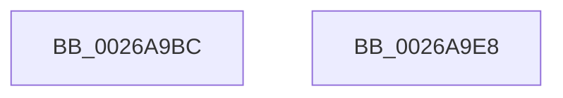

# sub_0026A9BC

- RVA: `0x0026A9BC`–`0x0026A9F7` (길이 `59` bytes)
- VA: `0x000000014026A9BC`
- 실행 섹션: `.text`
- PDB 이름 있음: `아니요`; PDB Function 태그: `아니요`
- unwind 정보 RVA: `0x0006546C`
- 디코드: `16`개 명령, `59/59` bytes 표시
- 미해석 바이트: `0` (있으면 어셈블리에 `.byte`로 보존)

> 이 문서는 커널 이미지의 기계어와 PDB 기호를 분석해 생성했습니다. 4번과 5번은 함수 원형과 자료형을 바이너리 사용 방식에서 추정한 C 해석이며 원본 소스 복구 결과는 아닙니다.

## 1. Dependencies

- 직접 호출 지점: **1**; 고유 호출 대상: **1**
- 직접 호출자로 확인된 함수: **0**
- RIP 상대 이미지 참조: **0**

### Outgoing calls
- `0x0026A9D1` → [memset](../6C/memset_function_006C6C40.md) (function, `0x006C6C40`)

### Direct callers
- 이 함수 시작 RVA로 연결되는 직접 call은 확인되지 않았습니다. 간접 호출은 완전히 역산할 수 없습니다.

### Static image references
- 디코드된 RIP-relative 메모리 참조가 없습니다.

## 2. Other-region calls and transfers

- 다른 실행 섹션으로 향하는 call: **0**
- call이 아닌 외부 분기/꼬리 이동: **2**
  - `0x0026A9E3` → [sub_0026A4AD + 0x177](Unknown_function_0026A4AD.md) (`tail-transfer`)
  - `0x0026A9F2` → [sub_0026A4AD + 0x17A](Unknown_function_0026A4AD.md) (`tail-transfer`)

## 3. Assembly (complete function range)

```asm
0026A9BC  49 8B C0                        mov rax, r8
0026A9BF  49 8B CF                        mov rcx, r15
0026A9C2  48 F7 E7                        mul rdi
0026A9C5  48 8B DA                        mov rbx, rdx
0026A9C8  B2 FF                           mov dl, 0xff
0026A9CA  48 C1 EB 07                     shr rbx, 7
0026A9CE  4C 8B C3                        mov r8, rbx
0026A9D1  E8 6A C2 45 00                  call 0x1406c6c40
0026A9D6  48 69 C3 01 FF FF FF            imul rax, rbx, -0xff
0026A9DD  4C 03 FB                        add r15, rbx
0026A9E0  48 03 F8                        add rdi, rax
0026A9E3  E9 3C FC FF FF                  jmp 0x14026a624
0026A9E8  41 0F B6 C5                     movzx eax, r13b
0026A9EC  C0 E0 04                        shl al, 4
0026A9EF  41 88 07                        mov byte ptr [r15], al
0026A9F2  E9 30 FC FF FF                  jmp 0x14026a627
```

## 4. C-style interpretation (structured pseudocode)

```c
__int64 __fastcall sub_0026A9BC(__int64 a1, __int64 a2, __int64 a3)
{
    __int64 result;
    __int64 v_r15;
    __int64 v_rbx;
    __int64 v_rdi;

    v_rbx = (a2) >> (7);
    result = memset(v_r15, 255, v_rbx, a4);
    result = (result) * (v_rbx);
    v_r15 = (v_r15) + (v_rbx);
    v_rdi = (v_rdi) + (result);
}
```

## 5. (Beta) C Style

```c
int64_t sub_0026A9BC(int64_t Arg1, int64_t Arg2, int64_t Arg3)
{
    int64_t result;
    int64_t local_r15;
    int64_t local_rbx;
    int64_t local_rdi;

    local_rbx = (Arg2) >> (7);
    result = memset(local_r15, 255, local_rbx, a4);
    result = (result) * (local_rbx);
    local_r15 = (local_r15) + (local_rbx);
    local_rdi = (local_rdi) + (result);
}
```

## 6. Execution-region graph

[열기: 2D/3D 그래프와 함수 탐색 컨트롤 패널](../../../control-panel.html?section=text&rva=0x0026A9BC&view=graph)

- 2D 그래프는 위에서 아래로 흐르고, 3D 그래프는 빈 공간을 드래그해 회전합니다. Shift+드래그는 이동, 휠은 확대·축소, 함수 노드 선택은 대상 보고서 이동입니다.

### Static fallback


