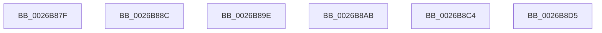

# sub_0026B87F

- RVA: `0x0026B87F`–`0x0026B90F` (길이 `144` bytes)
- VA: `0x000000014026B87F`
- 실행 섹션: `.text`
- PDB 이름 있음: `아니요`; PDB Function 태그: `아니요`
- unwind 정보 RVA: `0x000654DC`
- 디코드: `25`개 명령, `144/144` bytes 표시
- 미해석 바이트: `0` (있으면 어셈블리에 `.byte`로 보존)

> 이 문서는 커널 이미지의 기계어와 PDB 기호를 분석해 생성했습니다. 4번과 5번은 함수 원형과 자료형을 바이너리 사용 방식에서 추정한 C 해석이며 원본 소스 복구 결과는 아닙니다.

## 1. Dependencies

- 직접 호출 지점: **0**; 고유 호출 대상: **0**
- 직접 호출자로 확인된 함수: **0**
- RIP 상대 이미지 참조: **0**

### Outgoing calls
- 직접 디코드된 call 명령이 없습니다.

### Direct callers
- 이 함수 시작 RVA로 연결되는 직접 call은 확인되지 않았습니다. 간접 호출은 완전히 역산할 수 없습니다.

### Static image references
- 디코드된 RIP-relative 메모리 참조가 없습니다.

## 2. Other-region calls and transfers

- 다른 실행 섹션으로 향하는 call: **0**
- call이 아닌 외부 분기/꼬리 이동: **5**
  - `0x0026B887` → [sub_0026A9FF + 0xBA](Unknown_function_0026A9FF.md) (`tail-transfer`)
  - `0x0026B899` → [sub_0026A9FF + 0x9C1](Unknown_function_0026A9FF.md) (`tail-transfer`)
  - `0x0026B8A6` → [sub_0026A4AD + 0xE4](Unknown_function_0026A4AD.md) (`tail-transfer`)
  - `0x0026B8BF` → [sub_0026A4AD + 0xC0](Unknown_function_0026A4AD.md) (`tail-transfer`)
  - `0x0026B8D0` → [sub_0026A9FF + 0x501](Unknown_function_0026A9FF.md) (`tail-transfer`)

## 3. Assembly (complete function range)

```asm
0026B87F  44 8B 84 24 E8 00 00 00         mov r8d, dword ptr [rsp + 0xe8]
0026B887  E9 2D F2 FF FF                  jmp 0x14026aab9
0026B88C  44 8B 84 24 D8 00 00 00         mov r8d, dword ptr [rsp + 0xd8]
0026B894  4C 8B 4C 24 40                  mov r9, qword ptr [rsp + 0x40]
0026B899  E9 22 FB FF FF                  jmp 0x14026b3c0
0026B89E  44 8B 8C 24 E8 00 00 00         mov r9d, dword ptr [rsp + 0xe8]
0026B8A6  E9 E6 EC FF FF                  jmp 0x14026a591
0026B8AB  44 8B 84 24 E0 00 00 00         mov r8d, dword ptr [rsp + 0xe0]
0026B8B3  48 8D 4F 01                     lea rcx, [rdi + 1]
0026B8B7  48 8B 9C 24 C0 00 00 00         mov rbx, qword ptr [rsp + 0xc0]
0026B8BF  E9 A9 EC FF FF                  jmp 0x14026a56d
0026B8C4  8B 9C 24 E8 00 00 00            mov ebx, dword ptr [rsp + 0xe8]
0026B8CB  4C 8B 4C 24 28                  mov r9, qword ptr [rsp + 0x28]
0026B8D0  E9 2B F6 FF FF                  jmp 0x14026af00
0026B8D5  4C 8B 7C 24 78                  mov r15, qword ptr [rsp + 0x78]
0026B8DA  41 8B C3                        mov eax, r11d
0026B8DD  4C 8B B4 24 80 00 00 00         mov r14, qword ptr [rsp + 0x80]
0026B8E5  4C 8B AC 24 88 00 00 00         mov r13, qword ptr [rsp + 0x88]
0026B8ED  4C 8B A4 24 90 00 00 00         mov r12, qword ptr [rsp + 0x90]
0026B8F5  48 8B B4 24 98 00 00 00         mov rsi, qword ptr [rsp + 0x98]
0026B8FD  48 8B AC 24 A0 00 00 00         mov rbp, qword ptr [rsp + 0xa0]
0026B905  48 81 C4 A8 00 00 00            add rsp, 0xa8
0026B90C  5F                              pop rdi
0026B90D  5B                              pop rbx
0026B90E  C3                              ret
```

## 4. C-style interpretation (structured pseudocode)

```c
__int64 __fastcall sub_0026B87F(__int64 a1, __int64 a2, __int64 a3, __int64 a4, __int64 a5, __int64 a6, __int64 a7, __int64 a8, __int64 a9, __int64 a10, __int64 a11, __int64 a12, __int64 a13, __int64 a14, __int64 a15, __int64 a16, __int64 a17, __int64 a18, __int64 a19, __int64 a20, __int64 a21, __int64 a22, __int64 a23, __int64 a24, __int64 a25, __int64 a26, __int64 a27, __int64 a28, unsigned int a29)
{
    unsigned __int64 v_stack_p28;
    unsigned __int64 v_stack_p40;
    unsigned __int64 v_stack_p78;
    unsigned __int64 v_stack_p80;
    unsigned __int64 v_stack_p88;
    unsigned __int64 v_stack_p90;
    unsigned __int64 v_stack_p98;
    unsigned __int64 v_stack_pA0;
    unsigned __int64 v_stack_pC0;
    unsigned int v_stack_pD8;
    unsigned int v_stack_pE0;
    unsigned int v_stack_pE8;
}
```

## 5. (Beta) C Style

```c
int64_t sub_0026B87F(int64_t Arg1, int64_t Arg2, int64_t Arg3, int64_t Arg4, uint64_t Arg5, uint64_t Arg6, uint64_t Arg7, uint64_t Arg8, uint64_t Arg9, uint64_t Arg10, uint64_t Arg11, uint64_t Arg12, uint64_t Arg13, uint64_t Arg14, uint64_t Arg15, uint64_t Arg16, uint64_t Arg17, uint64_t Arg18, uint64_t Arg19, uint64_t Arg20, uint64_t Arg21, uint64_t Arg22, uint64_t Arg23, uint64_t Arg24, uint64_t Arg25, uint64_t Arg26, uint64_t Arg27, uint64_t Arg28, uint32_t Arg29)
{
    uint64_t v_stack_p28;
    uint64_t v_stack_p40;
    uint64_t v_stack_p78;
    uint64_t v_stack_p80;
    uint64_t v_stack_p88;
    uint64_t v_stack_p90;
    uint64_t v_stack_p98;
    uint64_t v_stack_pA0;
    uint64_t v_stack_pC0;
    uint32_t v_stack_pD8;
    uint32_t v_stack_pE0;
    uint32_t v_stack_pE8;
}
```

## 6. Execution-region graph

[열기: 2D/3D 그래프와 함수 탐색 컨트롤 패널](../../../control-panel.html?section=text&rva=0x0026B87F&view=graph)

- 2D 그래프는 위에서 아래로 흐르고, 3D 그래프는 빈 공간을 드래그해 회전합니다. Shift+드래그는 이동, 휠은 확대·축소, 함수 노드 선택은 대상 보고서 이동입니다.

### Static fallback


