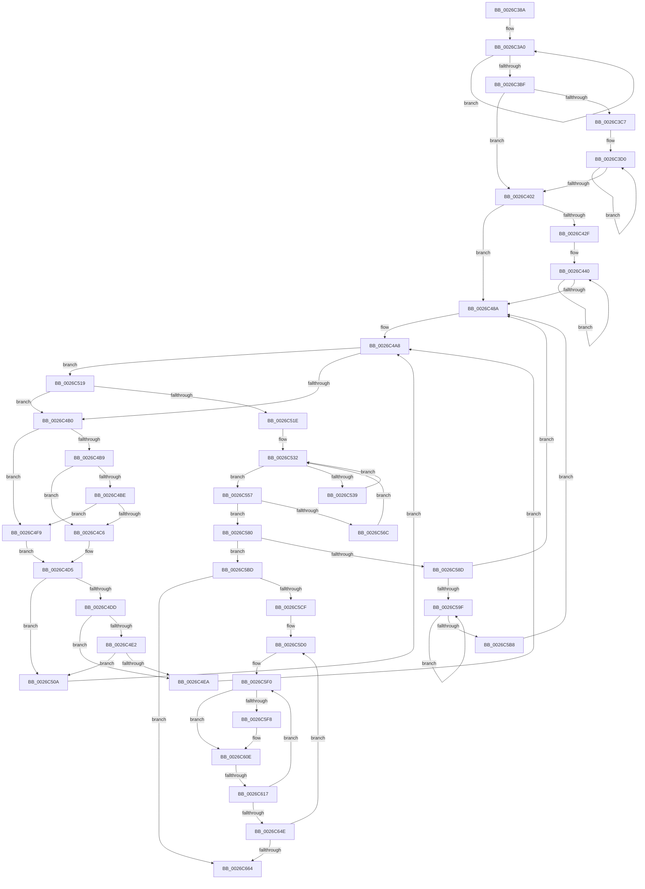

# sub_0026C38A

- RVA: `0x0026C38A`–`0x0026C671` (길이 `743` bytes)
- VA: `0x000000014026C38A`
- 실행 섹션: `.text`
- PDB 이름 있음: `아니요`; PDB Function 태그: `아니요`
- unwind 정보 RVA: `0x0006557C`
- 디코드: `192`개 명령, `743/743` bytes 표시
- 미해석 바이트: `0` (있으면 어셈블리에 `.byte`로 보존)

> 이 문서는 커널 이미지의 기계어와 PDB 기호를 분석해 생성했습니다. 4번과 5번은 함수 원형과 자료형을 바이너리 사용 방식에서 추정한 C 해석이며 원본 소스 복구 결과는 아닙니다.

## 1. Dependencies

- 직접 호출 지점: **0**; 고유 호출 대상: **0**
- 직접 호출자로 확인된 함수: **0**
- RIP 상대 이미지 참조: **0**

### Outgoing calls
- 직접 디코드된 call 명령이 없습니다.

### Direct callers
- 이 함수 시작 RVA로 연결되는 직접 call은 확인되지 않았습니다. 간접 호출은 완전히 역산할 수 없습니다.

### Static image references
- 디코드된 RIP-relative 메모리 참조가 없습니다.

## 2. Other-region calls and transfers

- 다른 실행 섹션으로 향하는 call: **0**
- call이 아닌 외부 분기/꼬리 이동: **1**
  - `0x0026C615` → [sub_0026C685](Unknown_function_0026C685.md) (`tail-transfer`)

## 3. Assembly (complete function range)

```asm
0026C38A  48 89 6C 24 50                  mov qword ptr [rsp + 0x50], rbp
0026C38F  48 8D 8E 1A 68 00 00            lea rcx, [rsi + 0x681a]
0026C396  48 89 7C 24 58                  mov qword ptr [rsp + 0x58], rdi
0026C39B  BA FF 00 00 00                  mov edx, 0xff
0026C3A0  0F B7 41 FE                     movzx eax, word ptr [rcx - 2]
0026C3A4  66 01 01                        add word ptr [rcx], ax
0026C3A7  0F B7 81 00 02 00 00            movzx eax, word ptr [rcx + 0x200]
0026C3AE  66 01 81 02 02 00 00            add word ptr [rcx + 0x202], ax
0026C3B5  48 8D 49 02                     lea rcx, [rcx + 2]
0026C3B9  48 83 EA 01                     sub rdx, 1
0026C3BD  75 E1                           jne 0x14026c3a0
0026C3BF  4D 8B C7                        mov r8, r15
0026C3C2  4C 3B FB                        cmp r15, rbx
0026C3C5  73 3B                           jae 0x14026c402
0026C3C7  66 0F 1F 84 00 00 00 00 00      nop word ptr [rax + rax]
0026C3D0  41 8B 00                        mov eax, dword ptr [r8]
0026C3D3  0F B6 C8                        movzx ecx, al
0026C3D6  41 0F B7 40 10                  movzx eax, word ptr [r8 + 0x10]
0026C3DB  0F B7 94 4E 18 68 00 00         movzx edx, word ptr [rsi + rcx*2 + 0x6818]
0026C3E3  66 89 84 56 1C 6C 00 00         mov word ptr [rsi + rdx*2 + 0x6c1c], ax
0026C3EB  41 8B 00                        mov eax, dword ptr [r8]
0026C3EE  49 83 C0 18                     add r8, 0x18
0026C3F2  0F B6 C8                        movzx ecx, al
0026C3F5  66 FF 84 4E 18 68 00 00         inc word ptr [rsi + rcx*2 + 0x6818]
0026C3FD  4C 3B C3                        cmp r8, rbx
0026C400  72 CE                           jb 0x14026c3d0
0026C402  48 8B CB                        mov rcx, rbx
0026C405  48 B8 AB AA AA AA AA AA AA 2A   movabs rax, 0x2aaaaaaaaaaaaaab
0026C40F  48 2B CE                        sub rcx, rsi
0026C412  48 81 E9 00 08 00 00            sub rcx, 0x800
0026C419  48 F7 E9                        imul rcx
0026C41C  4C 8B DA                        mov r11, rdx
0026C41F  49 C1 FB 02                     sar r11, 2
0026C423  49 8B C3                        mov rax, r11
0026C426  48 C1 E8 3F                     shr rax, 0x3f
0026C42A  4C 03 D8                        add r11, rax
0026C42D  74 5B                           je 0x14026c48a
0026C42F  4C 8D 96 1C 6C 00 00            lea r10, [rsi + 0x6c1c]
0026C436  66 66 0F 1F 84 00 00 00 00 00   nop word ptr [rax + rax]
0026C440  45 0F B7 02                     movzx r8d, word ptr [r10]
0026C444  4D 8D 52 02                     lea r10, [r10 + 2]
0026C448  46 8B 8C 86 20 72 00 00         mov r9d, dword ptr [rsi + r8*4 + 0x7220]
0026C450  41 8B C1                        mov eax, r9d
0026C453  48 C1 E8 08                     shr rax, 8
0026C457  48 8D 0C 46                     lea rcx, [rsi + rax*2]
0026C45B  0F B7 91 1A 6A 00 00            movzx edx, word ptr [rcx + 0x6a1a]
0026C462  8D 42 01                        lea eax, [rdx + 1]
0026C465  66 89 81 1A 6A 00 00            mov word ptr [rcx + 0x6a1a], ax
0026C46C  48 8D 04 52                     lea rax, [rdx + rdx*2]
0026C470  4C 89 84 C6 10 08 00 00         mov qword ptr [rsi + rax*8 + 0x810], r8
0026C478  48 8D 04 52                     lea rax, [rdx + rdx*2]
0026C47C  4C 89 8C C6 00 08 00 00         mov qword ptr [rsi + rax*8 + 0x800], r9
0026C484  49 83 EB 01                     sub r11, 1
0026C488  75 B6                           jne 0x14026c440
0026C48A  4C 89 7B 08                     mov qword ptr [rbx + 8], r15
0026C48E  48 8D 96 30 08 00 00            lea rdx, [rsi + 0x830]
0026C495  4C 89 73 10                     mov qword ptr [rbx + 0x10], r14
0026C499  48 8B CB                        mov rcx, rbx
0026C49C  49 8B 07                        mov rax, qword ptr [r15]
0026C49F  4C 8B C3                        mov r8, rbx
0026C4A2  49 03 06                        add rax, qword ptr [r14]
0026C4A5  48 89 03                        mov qword ptr [rbx], rax
0026C4A8  4C 8B C9                        mov r9, rcx
0026C4AB  48 3B D3                        cmp rdx, rbx
0026C4AE  74 69                           je 0x14026c519
0026C4B0  48 83 C1 18                     add rcx, 0x18
0026C4B4  48 3B D3                        cmp rdx, rbx
0026C4B7  74 40                           je 0x14026c4f9
0026C4B9  4C 3B C1                        cmp r8, rcx
0026C4BC  73 08                           jae 0x14026c4c6
0026C4BE  48 8B 02                        mov rax, qword ptr [rdx]
0026C4C1  49 39 00                        cmp qword ptr [r8], rax
0026C4C4  72 33                           jb 0x14026c4f9
0026C4C6  48 89 51 08                     mov qword ptr [rcx + 8], rdx
0026C4CA  4C 8D 49 10                     lea r9, [rcx + 0x10]
0026C4CE  48 8B 02                        mov rax, qword ptr [rdx]
0026C4D1  48 83 C2 18                     add rdx, 0x18
0026C4D5  48 89 01                        mov qword ptr [rcx], rax
0026C4D8  48 3B D3                        cmp rdx, rbx
0026C4DB  74 2D                           je 0x14026c50a
0026C4DD  4C 3B C1                        cmp r8, rcx
0026C4E0  73 08                           jae 0x14026c4ea
0026C4E2  48 8B 02                        mov rax, qword ptr [rdx]
0026C4E5  49 39 00                        cmp qword ptr [r8], rax
0026C4E8  72 20                           jb 0x14026c50a
0026C4EA  49 89 11                        mov qword ptr [r9], rdx
0026C4ED  48 8B 02                        mov rax, qword ptr [rdx]
0026C4F0  48 01 01                        add qword ptr [rcx], rax
0026C4F3  48 83 C2 18                     add rdx, 0x18
0026C4F7  EB AF                           jmp 0x14026c4a8
0026C4F9  49 83 C1 28                     add r9, 0x28
0026C4FD  4D 89 41 F8                     mov qword ptr [r9 - 8], r8
0026C501  49 8B 00                        mov rax, qword ptr [r8]
0026C504  49 83 C0 18                     add r8, 0x18
0026C508  EB CB                           jmp 0x14026c4d5
0026C50A  4D 89 01                        mov qword ptr [r9], r8
0026C50D  49 8B 00                        mov rax, qword ptr [r8]
0026C510  48 01 01                        add qword ptr [rcx], rax
0026C513  49 83 C0 18                     add r8, 0x18
0026C517  EB 8F                           jmp 0x14026c4a8
0026C519  4C 3B C1                        cmp r8, rcx
0026C51C  75 92                           jne 0x14026c4b0
0026C51E  4D 8B CD                        mov r9, r13
0026C521  48 8D 96 18 68 00 00            lea rdx, [rsi + 0x6818]
0026C528  4D 8B D5                        mov r10, r13
0026C52B  4C 8D 86 20 68 00 00            lea r8, [rsi + 0x6820]
0026C532  48 83 79 08 00                  cmp qword ptr [rcx + 8], 0
0026C537  74 1E                           je 0x14026c557
0026C539  49 FF C1                        inc r9
0026C53C  49 FF C2                        inc r10
0026C53F  4D 89 08                        mov qword ptr [r8], r9
0026C542  49 83 C0 10                     add r8, 0x10
0026C546  48 8B 41 08                     mov rax, qword ptr [rcx + 8]
0026C54A  48 89 02                        mov qword ptr [rdx], rax
0026C54D  48 83 C2 10                     add rdx, 0x10
0026C551  48 8B 49 10                     mov rcx, qword ptr [rcx + 0x10]
0026C555  EB DB                           jmp 0x14026c532
0026C557  48 8B 41 10                     mov rax, qword ptr [rcx + 0x10]
0026C55B  4C 89 49 08                     mov qword ptr [rcx + 8], r9
0026C55F  44 88 8C 06 20 70 00 00         mov byte ptr [rsi + rax + 0x7020], r9b
0026C567  4D 85 D2                        test r10, r10
0026C56A  74 14                           je 0x14026c580
0026C56C  48 8B 4A F0                     mov rcx, qword ptr [rdx - 0x10]
0026C570  49 83 E8 10                     sub r8, 0x10
0026C574  49 FF CA                        dec r10
0026C577  48 83 EA 10                     sub rdx, 0x10
0026C57B  4D 8B 08                        mov r9, qword ptr [r8]
0026C57E  EB B2                           jmp 0x14026c532
0026C580  4C 8B AE 08 08 00 00            mov r13, qword ptr [rsi + 0x808]
0026C587  49 83 FD 0F                     cmp r13, 0xf
0026C58B  76 30                           jbe 0x14026c5bd
0026C58D  49 8B CF                        mov rcx, r15
0026C590  41 BD 00 00 00 00               mov r13d, 0
0026C596  4C 3B FB                        cmp r15, rbx
0026C599  0F 83 EB FE FF FF               jae 0x14026c48a
0026C59F  48 8B 01                        mov rax, qword ptr [rcx]
0026C5A2  48 FF C0                        inc rax
0026C5A5  4C 89 69 08                     mov qword ptr [rcx + 8], r13
0026C5A9  48 D1 E8                        shr rax, 1
0026C5AC  48 89 01                        mov qword ptr [rcx], rax
0026C5AF  48 83 C1 18                     add rcx, 0x18
0026C5B3  48 3B CB                        cmp rcx, rbx
0026C5B6  72 E7                           jb 0x14026c59f
0026C5B8  E9 CD FE FF FF                  jmp 0x14026c48a
0026C5BD  4C 8B 4B F0                     mov r9, qword ptr [rbx - 0x10]
0026C5C1  45 33 DB                        xor r11d, r11d
0026C5C4  33 ED                           xor ebp, ebp
0026C5C6  4D 3B CD                        cmp r9, r13
0026C5C9  0F 87 95 00 00 00               ja 0x14026c664
0026C5CF  90                              nop
0026C5D0  33 FF                           xor edi, edi
0026C5D2  4C 8D 96 20 7A 00 00            lea r10, [rsi + 0x7a20]
0026C5D9  33 C0                           xor eax, eax
0026C5DB  48 8D 96 20 70 00 00            lea rdx, [rsi + 0x7020]
0026C5E2  4C 8D 86 20 72 00 00            lea r8, [rsi + 0x7220]
0026C5E9  48 8D 5E 02                     lea rbx, [rsi + 2]
0026C5ED  0F 1F 00                        nop dword ptr [rax]
0026C5F0  0F B6 0A                        movzx ecx, byte ptr [rdx]
0026C5F3  49 3B C9                        cmp rcx, r9
0026C5F6  75 16                           jne 0x14026c60e
0026C5F8  41 8B 08                        mov ecx, dword ptr [r8]
0026C5FB  45 08 0A                        or byte ptr [r10], r9b
0026C5FE  48 03 F9                        add rdi, rcx
0026C601  66 44 89 1C 83                  mov word ptr [rbx + rax*4], r11w
0026C606  49 FF C3                        inc r11
0026C609  66 44 89 0C 86                  mov word ptr [rsi + rax*4], r9w
0026C60E  0F B6 4A 01                     movzx ecx, byte ptr [rdx + 1]
0026C612  49 3B C9                        cmp rcx, r9
0026C615  75 6E                           jne 0x14026c685
0026C617  41 8B 48 04                     mov ecx, dword ptr [r8 + 4]
0026C61B  48 03 F9                        add rdi, rcx
0026C61E  41 0F B6 C9                     movzx ecx, r9b
0026C622  C0 E1 04                        shl cl, 4
0026C625  41 08 0A                        or byte ptr [r10], cl
0026C628  66 44 89 5C 83 04               mov word ptr [rbx + rax*4 + 4], r11w
0026C62E  49 FF C3                        inc r11
0026C631  66 44 89 4C 86 04               mov word ptr [rsi + rax*4 + 4], r9w
0026C637  49 FF C2                        inc r10
0026C63A  48 83 C0 02                     add rax, 2
0026C63E  48 83 C2 02                     add rdx, 2
0026C642  49 83 C0 08                     add r8, 8
0026C646  48 3D 00 02 00 00               cmp rax, 0x200
0026C64C  72 A2                           jb 0x14026c5f0
0026C64E  49 0F AF F9                     imul rdi, r9
0026C652  4D 03 DB                        add r11, r11
0026C655  49 FF C1                        inc r9
0026C658  48 03 EF                        add rbp, rdi
0026C65B  4D 3B CD                        cmp r9, r13
0026C65E  0F 86 6C FF FF FF               jbe 0x14026c5d0
0026C664  48 8B 7C 24 58                  mov rdi, qword ptr [rsp + 0x58]
0026C669  48 8B C5                        mov rax, rbp
0026C66C  48 8B 6C 24 50                  mov rbp, qword ptr [rsp + 0x50]
```

## 4. C-style interpretation (structured pseudocode)

```c
__int64 __fastcall sub_0026C38A(__int64 a1, __int64 a2, __int64 a3, __int64 a4, __int64 a5, __int64 a6, __int64 a7, __int64 a8, __int64 a9, __int64 a10, __int64 a11)
{
    __int64 result;
    __int64 v_r10;
    __int64 v_r11;
    __int64 v_rbp;
    __int64 v_rdi;
    unsigned __int64 v_stack_p50;
    unsigned __int64 v_stack_p58;

    v_stack_p50 = v_rbp;
    v_stack_p58 = v_rdi;
loc_0026C3A0:
    a2 = (255) - (1);
    if (condition_is_not_equal) goto loc_0026C3A0;
    if (v_r15 >= v_rbx) goto loc_0026C402;
loc_0026C3D0:
    *(unsigned __int16 *)(v_rsi + *(unsigned __int16 *)(v_rsi + (unsigned __int8)((unsigned int)(*(unsigned int *)(v_r15))) * 2 + 26648) * 2 + 27676) = (unsigned __int16)(*(unsigned __int16 *)(v_r15 + 16));
    a3 = (v_r15) + (24);
    if (a3 < v_rbx) goto loc_0026C3D0;
loc_0026C402:
    a1 = (v_rbx) - (v_rsi);
    a1 = (a1) - (0x800ULL);
    v_r11 = (*(unsigned __int16 *)(v_rsi + (unsigned __int8)((unsigned int)(*(unsigned int *)(v_r15))) * 2 + 26648)) >> (2);
    result = (v_r11) >> (63);
    v_r11 = (v_r11) + (result);
    if (condition_is_equal) goto loc_0026C48A;
loc_0026C440:
    result = ((unsigned int)((unsigned int)((unsigned int)(*(unsigned int *)(v_rsi + *(unsigned __int16 *)(v_rsi + 27676) * 4 + 29216))))) >> (8);
    *(unsigned __int16 *)(v_rsi + result * 2 + 27162) = (unsigned __int16)(*(unsigned __int16 *)(v_rsi + result * 2 + 27162) + 1);
    *(unsigned __int64 *)(v_rsi + *(unsigned __int16 *)(v_rsi + result * 2 + 27162) + *(unsigned __int16 *)(v_rsi + result * 2 + 27162) * 2 * 8 + 2064) = *(unsigned __int16 *)(v_rsi + 27676);
    *(unsigned __int64 *)(v_rsi + *(unsigned __int16 *)(v_rsi + result * 2 + 27162) + *(unsigned __int16 *)(v_rsi + result * 2 + 27162) * 2 * 8 + 2048) = (unsigned int)(*(unsigned int *)(v_rsi + *(unsigned __int16 *)(v_rsi + 27676) * 4 + 29216));
    v_r11 = (v_r11) - (1);
    if (condition_is_not_equal) goto loc_0026C440;
loc_0026C48A:
    *(unsigned __int64 *)(v_rbx + 8) = v_r15;
    *(unsigned __int64 *)(v_rbx + 16) = v_r14;
    result = (*(unsigned __int64 *)(v_r15)) + (*(unsigned __int64 *)(v_r14));
    *(unsigned __int64 *)(v_rbx) = result;
loc_0026C4A8:
    if ((v_rsi + 2096) == v_rbx) goto loc_0026C519;
loc_0026C4B0:
    a1 = (v_rbx) + (24);
    if ((v_rsi + 2096) == v_rbx) goto loc_0026C4F9;
    if (v_rbx >= a1) goto loc_0026C4C6;
    if ((*(unsigned __int64 *)(v_rbx)) < (*(unsigned __int64 *)(v_rsi + 2096))) goto loc_0026C4F9;
loc_0026C4C6:
    *(unsigned __int64 *)(a1 + 8) = v_rsi + 2096;
    a2 = (v_rsi + 2096) + (24);
loc_0026C4D5:
    *(unsigned __int64 *)(a1) = *(unsigned __int64 *)(v_rsi + 2096);
    if (a2 == v_rbx) goto loc_0026C50A;
    if (v_rbx >= a1) goto loc_0026C4EA;
    if ((*(unsigned __int64 *)(v_rbx)) < (*(unsigned __int64 *)(a2))) goto loc_0026C50A;
loc_0026C4EA:
    *(unsigned __int64 *)(a1 + 16) = a2;
    a2 = (a2) + (24);
    goto loc_0026C4A8;
loc_0026C4F9:
    a4 = (a1 + 16) + (40);
    *(unsigned __int64 *)(a4 - 8) = v_rbx;
    a3 = (v_rbx) + (24);
    goto loc_0026C4D5;
loc_0026C50A:
    *(unsigned __int64 *)(a4) = a3;
    a3 = (a3) + (24);
    goto loc_0026C4A8;
loc_0026C519:
    if (a3 != a1) goto loc_0026C4B0;
loc_0026C532:
    if ((*(unsigned __int64 *)(a1 + 8)) == 0) goto loc_0026C557;
    a4 = (v_r13) + 1;
    v_r10 = (v_r13) + 1;
    *(unsigned __int64 *)(v_rsi + 26656) = a4;
    a3 = (v_rsi + 26656) + (16);
    *(unsigned __int64 *)(v_rsi + 26648) = *(unsigned __int64 *)(a1 + 8);
    a2 = (v_rsi + 26648) + (16);
    goto loc_0026C532;
loc_0026C557:
    *(unsigned __int64 *)(*(unsigned __int64 *)(a1 + 16) + 8) = a4;
    *(unsigned __int8 *)(v_rsi + *(unsigned __int64 *)(*(unsigned __int64 *)(a1 + 16) + 16) * 1 + 28704) = (unsigned __int8)(a4);
    if (v_r10 == 0) goto loc_0026C580;
    a3 = (a3) - (16);
    v_r10 = (v_r10) - 1;
    a2 = (a2) - (16);
    goto loc_0026C532;
loc_0026C580:
    if ((*(unsigned __int64 *)(v_rsi + 2056)) <= 15) goto loc_0026C5BD;
    if (v_r15 >= v_rbx) goto loc_0026C48A;
loc_0026C59F:
    result = (*(unsigned __int64 *)(v_r15)) + 1;
    *(unsigned __int64 *)(v_r15 + 8) = 0;
    result = (result) >> (1);
    *(unsigned __int64 *)(v_r15) = result;
    a1 = (v_r15) + (24);
    if (a1 < v_rbx) goto loc_0026C59F;
    goto loc_0026C48A;
loc_0026C5BD:
    v_r11 = 0;
    v_rbp = 0;
    if ((*(unsigned __int64 *)(v_rbx - 16)) > 0) goto loc_0026C664;
loc_0026C5D0:
    v_rdi = 0;
    result = 0;
loc_0026C5F0:
    if ((*(unsigned __int8 *)(v_rsi + 28704)) == (*(unsigned __int64 *)(v_rbx - 16))) {
        a1 = *(unsigned int *)(v_rsi + 29216);
        v_rdi = (v_rdi) + (a1);
        *(unsigned __int16 *)(v_rsi + 2 + result * 4) = 0;
        v_r11 = (v_r11) + 1;
        *(unsigned __int16 *)(v_rsi + result * 4) = (unsigned __int16)(*(unsigned __int64 *)(v_rbx - 16));
    }
    v_rdi = (v_rdi) + ((unsigned int)(*(unsigned int *)(v_rsi + 29216 + 4)));
    a1 = (unsigned __int8)(((unsigned __int8)(*(unsigned __int64 *)(v_rbx - 16))) << (4));
    *(unsigned __int16 *)(v_rsi + 2 + result * 4 + 4) = (unsigned __int16)(v_r11);
    v_r11 = (v_r11) + 1;
    *(unsigned __int16 *)(v_rsi + result * 4 + 4) = (unsigned __int16)(*(unsigned __int64 *)(v_rbx - 16));
    v_r10 = (v_rsi + 31264) + 1;
    result = (result) + (2);
    a2 = (v_rsi + 28704) + (2);
    a3 = (v_rsi + 29216) + (8);
    if (result < 512) goto loc_0026C5F0;
    v_rdi = (v_rdi) * (*(unsigned __int64 *)(v_rbx - 16));
    v_r11 = (v_r11) + (v_r11);
    a4 = (*(unsigned __int64 *)(v_rbx - 16)) + 1;
    v_rbp = (v_rbp) + (v_rdi);
    if (a4 <= 0) goto loc_0026C5D0;
loc_0026C664:
    return v_rbp;
}
```

## 5. (Beta) C Style

```c
int64_t sub_0026C38A(int64_t Arg1, int64_t Arg2, int64_t Arg3, int64_t Arg4, uint64_t Arg5, uint64_t Arg6, uint64_t Arg7, uint64_t Arg8, uint64_t Arg9, int64_t Arg10, int64_t Arg11)
{
    int64_t result;
    int64_t local_r10;
    int64_t local_r11;
    int64_t local_rbp;
    int64_t local_rdi;
    uint64_t v_stack_p50;
    uint64_t v_stack_p58;

    v_stack_p50 = local_rbp;
    v_stack_p58 = local_rdi;
loc_0026C3A0:
    Arg2 = (255) - (1);
    if (condition_is_not_equal) goto loc_0026C3A0;
    if (local_r15 >= local_rbx) goto loc_0026C402;
loc_0026C3D0:
    *(uint16_t *)(local_rsi + *(uint16_t *)(local_rsi + (uint8_t)((uint32_t)(*(uint32_t *)(local_r15))) * 2 + 0x6818) * 2 + 0x6C1C) = (uint16_t)(*(uint16_t *)(local_r15 + 0x10));
    Arg3 = (local_r15) + (24);
    if (Arg3 < local_rbx) goto loc_0026C3D0;
loc_0026C402:
    Arg1 = (local_rbx) - (local_rsi);
    Arg1 = (Arg1) - (0x800ULL);
    local_r11 = (*(uint16_t *)(local_rsi + (uint8_t)((uint32_t)(*(uint32_t *)(local_r15))) * 2 + 0x6818)) >> (2);
    result = (local_r11) >> (63);
    local_r11 = (local_r11) + (result);
    if (condition_is_equal) goto loc_0026C48A;
loc_0026C440:
    result = ((uint32_t)((uint32_t)((uint32_t)(*(uint32_t *)(local_rsi + *(uint16_t *)(local_rsi + 0x6C1C) * 4 + 0x7220))))) >> (8);
    *(uint16_t *)(local_rsi + result * 2 + 0x6A1A) = (uint16_t)(*(uint16_t *)(local_rsi + result * 2 + 0x6A1A) + 1);
    *(uint64_t *)(local_rsi + *(uint16_t *)(local_rsi + result * 2 + 0x6A1A) + *(uint16_t *)(local_rsi + result * 2 + 0x6A1A) * 2 * 8 + 0x810) = *(uint16_t *)(local_rsi + 0x6C1C);
    *(uint64_t *)(local_rsi + *(uint16_t *)(local_rsi + result * 2 + 0x6A1A) + *(uint16_t *)(local_rsi + result * 2 + 0x6A1A) * 2 * 8 + 0x800) = (uint32_t)(*(uint32_t *)(local_rsi + *(uint16_t *)(local_rsi + 0x6C1C) * 4 + 0x7220));
    local_r11 = (local_r11) - (1);
    if (condition_is_not_equal) goto loc_0026C440;
loc_0026C48A:
    *(uint64_t *)(local_rbx + 0x8) = local_r15;
    *(uint64_t *)(local_rbx + 0x10) = local_r14;
    result = (*(uint64_t *)(local_r15)) + (*(uint64_t *)(local_r14));
    *(uint64_t *)(local_rbx) = result;
loc_0026C4A8:
    if ((local_rsi + 2096) == local_rbx) goto loc_0026C519;
loc_0026C4B0:
    Arg1 = (local_rbx) + (24);
    if ((local_rsi + 2096) == local_rbx) goto loc_0026C4F9;
    if (local_rbx >= Arg1) goto loc_0026C4C6;
    if ((*(uint64_t *)(local_rbx)) < (*(uint64_t *)(local_rsi + 0x830))) goto loc_0026C4F9;
loc_0026C4C6:
    *(uint64_t *)(Arg1 + 0x8) = local_rsi + 2096;
    Arg2 = (local_rsi + 2096) + (24);
loc_0026C4D5:
    *(uint64_t *)(Arg1) = *(uint64_t *)(local_rsi + 0x830);
    if (Arg2 == local_rbx) goto loc_0026C50A;
    if (local_rbx >= Arg1) goto loc_0026C4EA;
    if ((*(uint64_t *)(local_rbx)) < (*(uint64_t *)(Arg2))) goto loc_0026C50A;
loc_0026C4EA:
    *(uint64_t *)(Arg1 + 0x10) = Arg2;
    Arg2 = (Arg2) + (24);
    goto loc_0026C4A8;
loc_0026C4F9:
    Arg4 = (Arg1 + 16) + (40);
    *(uint64_t *)(Arg4 - 0x8) = local_rbx;
    Arg3 = (local_rbx) + (24);
    goto loc_0026C4D5;
loc_0026C50A:
    *(uint64_t *)(Arg4) = Arg3;
    Arg3 = (Arg3) + (24);
    goto loc_0026C4A8;
loc_0026C519:
    if (Arg3 != Arg1) goto loc_0026C4B0;
loc_0026C532:
    if ((*(uint64_t *)(Arg1 + 0x8)) == 0) goto loc_0026C557;
    Arg4 = (local_r13) + 1;
    local_r10 = (local_r13) + 1;
    *(uint64_t *)(local_rsi + 0x6820) = Arg4;
    Arg3 = (local_rsi + 26656) + (16);
    *(uint64_t *)(local_rsi + 0x6818) = *(uint64_t *)(Arg1 + 0x8);
    Arg2 = (local_rsi + 26648) + (16);
    goto loc_0026C532;
loc_0026C557:
    *(uint64_t *)(*(uint64_t *)(Arg1 + 0x10) + 0x8) = Arg4;
    *(uint8_t *)(local_rsi + *(uint64_t *)(*(uint64_t *)(Arg1 + 0x10) + 0x10) * 1 + 0x7020) = (uint8_t)(Arg4);
    if (local_r10 == 0) goto loc_0026C580;
    Arg3 = (Arg3) - (16);
    local_r10 = (local_r10) - 1;
    Arg2 = (Arg2) - (16);
    goto loc_0026C532;
loc_0026C580:
    if ((*(uint64_t *)(local_rsi + 0x808)) <= 15) goto loc_0026C5BD;
    if (local_r15 >= local_rbx) goto loc_0026C48A;
loc_0026C59F:
    result = (*(uint64_t *)(local_r15)) + 1;
    *(uint64_t *)(local_r15 + 0x8) = 0;
    result = (result) >> (1);
    *(uint64_t *)(local_r15) = result;
    Arg1 = (local_r15) + (24);
    if (Arg1 < local_rbx) goto loc_0026C59F;
    goto loc_0026C48A;
loc_0026C5BD:
    local_r11 = 0;
    local_rbp = 0;
    if ((*(uint64_t *)(local_rbx - 0x10)) > 0) goto loc_0026C664;
loc_0026C5D0:
    local_rdi = 0;
    result = 0;
loc_0026C5F0:
    if ((*(uint8_t *)(local_rsi + 0x7020)) == (*(uint64_t *)(local_rbx - 0x10))) {
        Arg1 = *(uint32_t *)(local_rsi + 0x7220);
        local_rdi = (local_rdi) + (Arg1);
        *(uint16_t *)(local_rsi + 0x2 + result * 4) = 0;
        local_r11 = (local_r11) + 1;
        *(uint16_t *)(local_rsi + result * 4) = (uint16_t)(*(uint64_t *)(local_rbx - 0x10));
    }
    local_rdi = (local_rdi) + ((uint32_t)(*(uint32_t *)(local_rsi + 0x7220 + 0x4)));
    Arg1 = (uint8_t)(((uint8_t)(*(uint64_t *)(local_rbx - 0x10))) << (4));
    *(uint16_t *)(local_rsi + 0x2 + result * 4 + 0x4) = (uint16_t)(local_r11);
    local_r11 = (local_r11) + 1;
    *(uint16_t *)(local_rsi + result * 4 + 0x4) = (uint16_t)(*(uint64_t *)(local_rbx - 0x10));
    local_r10 = (local_rsi + 31264) + 1;
    result = (result) + (2);
    Arg2 = (local_rsi + 28704) + (2);
    Arg3 = (local_rsi + 29216) + (8);
    if (result < 512) goto loc_0026C5F0;
    local_rdi = (local_rdi) * (*(uint64_t *)(local_rbx - 0x10));
    local_r11 = (local_r11) + (local_r11);
    Arg4 = (*(uint64_t *)(local_rbx - 0x10)) + 1;
    local_rbp = (local_rbp) + (local_rdi);
    if (Arg4 <= 0) goto loc_0026C5D0;
loc_0026C664:
    return local_rbp;
}
```

## 6. Execution-region graph

[열기: 2D/3D 그래프와 함수 탐색 컨트롤 패널](../../../control-panel.html?section=text&rva=0x0026C38A&view=graph)

- 2D 그래프는 위에서 아래로 흐르고, 3D 그래프는 빈 공간을 드래그해 회전합니다. Shift+드래그는 이동, 휠은 확대·축소, 함수 노드 선택은 대상 보고서 이동입니다.

### Static fallback


