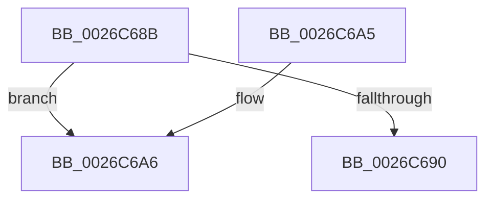

# sub_0026C68B

- RVA: `0x0026C68B`–`0x0026C6D4` (길이 `73` bytes)
- VA: `0x000000014026C68B`
- 실행 섹션: `.text`
- PDB 이름 있음: `아니요`; PDB Function 태그: `아니요`
- unwind 정보 RVA: `0x000655C0`
- 디코드: `23`개 명령, `73/73` bytes 표시
- 미해석 바이트: `0` (있으면 어셈블리에 `.byte`로 보존)

> 이 문서는 커널 이미지의 기계어와 PDB 기호를 분석해 생성했습니다. 4번과 5번은 함수 원형과 자료형을 바이너리 사용 방식에서 추정한 C 해석이며 원본 소스 복구 결과는 아닙니다.

## 1. Dependencies

- 직접 호출 지점: **0**; 고유 호출 대상: **0**
- 직접 호출자로 확인된 함수: **0**
- RIP 상대 이미지 참조: **0**

### Outgoing calls
- 직접 디코드된 call 명령이 없습니다.

### Direct callers
- 이 함수 시작 RVA로 연결되는 직접 call은 확인되지 않았습니다. 간접 호출은 완전히 역산할 수 없습니다.

### Static image references
- 디코드된 RIP-relative 메모리 참조가 없습니다.

## 2. Other-region calls and transfers

- 다른 실행 섹션으로 향하는 call: **0**
- call이 아닌 외부 분기/꼬리 이동: **1**
  - `0x0026C6D2` → [sub_0026C671](Unknown_function_0026C671.md) (`tail-transfer`)

## 3. Assembly (complete function range)

```asm
0026C68B  49 3B DF                        cmp rbx, r15
0026C68E  75 16                           jne 0x14026c6a6
0026C690  48 8B 5C 24 60                  mov rbx, qword ptr [rsp + 0x60]
0026C695  33 C0                           xor eax, eax
0026C697  48 83 C4 20                     add rsp, 0x20
0026C69B  41 5F                           pop r15
0026C69D  41 5E                           pop r14
0026C69F  41 5D                           pop r13
0026C6A1  41 5C                           pop r12
0026C6A3  5E                              pop rsi
0026C6A4  C3                              ret
0026C6A5  CC                              int3
0026C6A6  4C 8B 86 10 08 00 00            mov r8, qword ptr [rsi + 0x810]
0026C6AD  B8 01 00 00 00                  mov eax, 1
0026C6B2  41 F6 C0 01                     test r8b, 1
0026C6B6  BA 10 00 00 00                  mov edx, 0x10
0026C6BB  49 8B C8                        mov rcx, r8
0026C6BE  0F 44 D0                        cmove edx, eax
0026C6C1  48 D1 E9                        shr rcx, 1
0026C6C4  88 94 31 20 7A 00 00            mov byte ptr [rcx + rsi + 0x7a20], dl
0026C6CB  42 89 04 86                     mov dword ptr [rsi + r8*4], eax
0026C6CF  49 8B 07                        mov rax, qword ptr [r15]
0026C6D2  EB 9D                           jmp 0x14026c671
```

## 4. C-style interpretation (structured pseudocode)

```c
__int64 __fastcall sub_0026C68B(__int64 a1, __int64 a2, __int64 a3, __int64 a4, __int64 a5, __int64 a6, __int64 a7, __int64 a8, __int64 a9, __int64 a10, __int64 a11, __int64 a12)
{
    __int64 result;
    __int64 v_rsp;

    if (v_rbx != v_r15) goto loc_0026C6A6;
    result = 0;
    v_rsp = (v_rsp) + (32);
    return result;
loc_0026C6A6:
    a2 = 16;
    if ((((unsigned __int8)(*(unsigned __int64 *)(v_rsi + 2064))) & (1)) == 0) { a2 = 1; }
    a1 = (*(unsigned __int64 *)(v_rsi + 2064)) >> (1);
    *(unsigned __int8 *)(a1 + v_rsi * 1 + 31264) = (unsigned __int8)(a2);
    *(unsigned int *)(v_rsi + *(unsigned __int64 *)(v_rsi + 2064) * 4) = 1;
}
```

## 5. (Beta) C Style

```c
int64_t sub_0026C68B(int64_t Arg1, int64_t Arg2, int64_t Arg3, int64_t Arg4, uint64_t Arg5, uint64_t Arg6, uint64_t Arg7, uint64_t Arg8, uint64_t Arg9, uint64_t Arg10, uint64_t Arg11, int64_t Arg12)
{
    int64_t result;
    int64_t local_rsp;

    if (local_rbx != local_r15) goto loc_0026C6A6;
    result = 0;
    local_rsp = (local_rsp) + (32);
    return result;
loc_0026C6A6:
    Arg2 = 16;
    if ((((uint8_t)(*(uint64_t *)(local_rsi + 0x810))) & (1)) == 0) { Arg2 = 1; }
    Arg1 = (*(uint64_t *)(local_rsi + 0x810)) >> (1);
    *(uint8_t *)(Arg1 + local_rsi * 1 + 0x7A20) = (uint8_t)(Arg2);
    *(uint32_t *)(local_rsi + *(uint64_t *)(local_rsi + 0x810) * 4) = 1;
}
```

## 6. Execution-region graph

[열기: 2D/3D 그래프와 함수 탐색 컨트롤 패널](../../../control-panel.html?section=text&rva=0x0026C68B&view=graph)

- 2D 그래프는 위에서 아래로 흐르고, 3D 그래프는 빈 공간을 드래그해 회전합니다. Shift+드래그는 이동, 휠은 확대·축소, 함수 노드 선택은 대상 보고서 이동입니다.

### Static fallback


