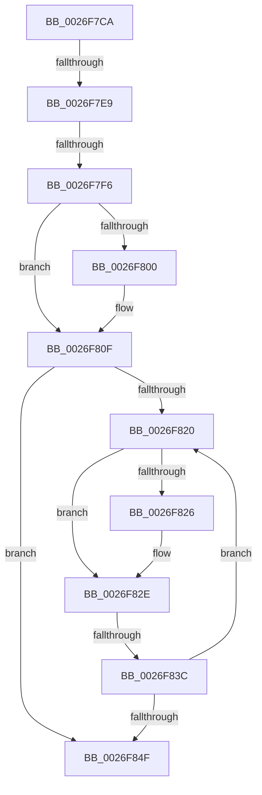

# sub_0026F7CA

- RVA: `0x0026F7CA`–`0x0026F86B` (길이 `161` bytes)
- VA: `0x000000014026F7CA`
- 실행 섹션: `.text`
- PDB 이름 있음: `아니요`; PDB Function 태그: `아니요`
- unwind 정보 RVA: `0x000658B0`
- 디코드: `42`개 명령, `161/161` bytes 표시
- 미해석 바이트: `0` (있으면 어셈블리에 `.byte`로 보존)

> 이 문서는 커널 이미지의 기계어와 PDB 기호를 분석해 생성했습니다. 4번과 5번은 함수 원형과 자료형을 바이너리 사용 방식에서 추정한 C 해석이며 원본 소스 복구 결과는 아닙니다.

## 1. Dependencies

- 직접 호출 지점: **1**; 고유 호출 대상: **1**
- 직접 호출자로 확인된 함수: **0**
- RIP 상대 이미지 참조: **3**

### Outgoing calls
- `0x0026F808` → [ExpWaitForSpinLockExclusiveAndAcquire](../32/ExpWaitForSpinLockExclusiveAndAcquire_function_003239A0.md) (function, `0x003239A0`)

### Direct callers
- 이 함수 시작 RVA로 연결되는 직접 call은 확인되지 않았습니다. 간접 호출은 완전히 역산할 수 없습니다.

### Static image references
- `0x0026F7DC` → RVA `0x00FC6D20` (`ALMOSTRO`; read)
- `0x0026F7E9` → RVA `0x00FC6B06` (`ALMOSTRO`; read)
- `0x0026F830` → RVA `0x00FC52AC` (`ALMOSTRO`; reference)

## 2. Other-region calls and transfers

- 다른 실행 섹션으로 향하는 call: **0**
- call이 아닌 외부 분기/꼬리 이동: **3**
  - `0x0026F7E3` → [sub_0026F901](Unknown_function_0026F901.md) (`tail-transfer`)
  - `0x0026F7F0` → [sub_0026F895](Unknown_function_0026F895.md) (`tail-transfer`)
  - `0x0026F836` → [sub_0026F901 + 0x11](Unknown_function_0026F901.md) (`tail-transfer`)

## 3. Assembly (complete function range)

```asm
0026F7CA  48 89 6C 24 40                  mov qword ptr [rsp + 0x40], rbp
0026F7CF  44 0F 20 C5                     mov rbp, cr8
0026F7D3  B8 02 00 00 00                  mov eax, 2
0026F7D8  44 0F 22 C0                     mov cr8, rax
0026F7DC  83 3D 3D 75 D5 00 00            cmp dword ptr [rip + 0xd5753d], 0
0026F7E3  0F 85 18 01 00 00               jne 0x14026f901
0026F7E9  F6 05 16 73 D5 00 21            test byte ptr [rip + 0xd57316], 0x21
0026F7F0  0F 85 9F 00 00 00               jne 0x14026f895
0026F7F6  33 F6                           xor esi, esi
0026F7F8  F0 0F BA 6F 40 1F               lock bts dword ptr [rdi + 0x40], 0x1f
0026F7FE  73 0F                           jae 0x14026f80f
0026F800  40 0F B6 D5                     movzx edx, bpl
0026F804  48 8D 4F 40                     lea rcx, [rdi + 0x40]
0026F808  E8 93 41 0B 00                  call 0x1403239a0
0026F80D  8B F0                           mov esi, eax
0026F80F  8B 47 40                        mov eax, dword ptr [rdi + 0x40]
0026F812  8B C8                           mov ecx, eax
0026F814  0F BA F1 1E                     btr ecx, 0x1e
0026F818  81 F9 00 00 00 80               cmp ecx, 0x80000000
0026F81E  74 2F                           je 0x14026f84f
0026F820  0F BA E0 1E                     bt eax, 0x1e
0026F824  72 08                           jb 0x14026f82e
0026F826  F0 81 4F 40 00 00 00 40         lock or dword ptr [rdi + 0x40], 0x40000000
0026F82E  FF C6                           inc esi
0026F830  85 35 76 5A D5 00               test dword ptr [rip + 0xd55a76], esi
0026F836  0F 84 D6 00 00 00               je 0x14026f912
0026F83C  F3 90                           pause
0026F83E  8B 47 40                        mov eax, dword ptr [rdi + 0x40]
0026F841  8B C8                           mov ecx, eax
0026F843  0F BA F1 1E                     btr ecx, 0x1e
0026F847  81 F9 00 00 00 80               cmp ecx, 0x80000000
0026F84D  75 D1                           jne 0x14026f820
0026F84F  41 88 2E                        mov byte ptr [r14], bpl
0026F852  B0 01                           mov al, 1
0026F854  48 8B 6C 24 40                  mov rbp, qword ptr [rsp + 0x40]
0026F859  C6 47 7D 01                     mov byte ptr [rdi + 0x7d], 1
0026F85D  48 8B 5C 24 50                  mov rbx, qword ptr [rsp + 0x50]
0026F862  48 83 C4 20                     add rsp, 0x20
0026F866  41 5E                           pop r14
0026F868  5F                              pop rdi
0026F869  5E                              pop rsi
0026F86A  C3                              ret
```

## 4. C-style interpretation (structured pseudocode)

```c
__int64 __fastcall sub_0026F7CA(__int64 a1, __int64 a2, __int64 a3, __int64 a4, __int64 a5, __int64 a6, __int64 a7, __int64 a8, __int64 a9, __int64 a10)
{
    __int64 result;
    __int64 v_rsi;
    __int64 v_rsp;
    unsigned __int64 v_stack_p40;

    v_stack_p40 = v_rbp;
    v_rsi = 0;
    result = 2;
    if (!(condition_is_above_or_equal)) {
        a2 = (unsigned __int8)(v_cr8);
        a1 = v_rdi + 64;
        result = ExpWaitForSpinLockExclusiveAndAcquire(a1, a2, a3, a4);
        v_rsi = (unsigned int)(result);
    }
    if (((unsigned int)((unsigned int)((unsigned int)((unsigned int)(*(unsigned int *)(v_rdi + 64)))))) == 0x80000000ULL) goto loc_0026F84F;
loc_0026F820:
    if (((unsigned int)((unsigned int)((unsigned int)((unsigned int)(*(unsigned int *)(v_rdi + 64)))))) >= 0x80000000ULL) {
    }
    v_rsi = (unsigned int)((v_rsi) + 1);
    if (((unsigned int)((unsigned int)((unsigned int)((unsigned int)(*(unsigned int *)(v_rdi + 64)))))) != 0x80000000ULL) goto loc_0026F820;
loc_0026F84F:
    *(unsigned __int8 *)(v_r14) = (unsigned __int8)(v_cr8);
    *(unsigned __int8 *)(v_rdi + 125) = 1;
    v_rsp = (v_rsp) + (32);
    return 1;
}
```

## 5. (Beta) C Style

```c
int64_t sub_0026F7CA(int64_t Arg1, int64_t Arg2, int64_t Arg3, int64_t Arg4, uint64_t Arg5, uint64_t Arg6, uint64_t Arg7, int64_t Arg8, uint64_t Arg9, int64_t Arg10)
{
    int64_t result;
    int64_t local_rsi;
    int64_t local_rsp;
    uint64_t v_stack_p40;

    v_stack_p40 = local_rbp;
    local_rsi = 0;
    result = 2;
    if (!(condition_is_above_or_equal)) {
        Arg2 = (uint8_t)(v_cr8);
        Arg1 = local_rdi + 64;
        result = ExpWaitForSpinLockExclusiveAndAcquire(Arg1, Arg2, Arg3, Arg4);
        local_rsi = (uint32_t)(result);
    }
    if (((uint32_t)((uint32_t)((uint32_t)((uint32_t)(*(uint32_t *)(local_rdi + 0x40)))))) == 0x80000000ULL) goto loc_0026F84F;
loc_0026F820:
    if (((uint32_t)((uint32_t)((uint32_t)((uint32_t)(*(uint32_t *)(local_rdi + 0x40)))))) >= 0x80000000ULL) {
    }
    local_rsi = (uint32_t)((local_rsi) + 1);
    if (((uint32_t)((uint32_t)((uint32_t)((uint32_t)(*(uint32_t *)(local_rdi + 0x40)))))) != 0x80000000ULL) goto loc_0026F820;
loc_0026F84F:
    *(uint8_t *)(local_r14) = (uint8_t)(v_cr8);
    *(uint8_t *)(local_rdi + 0x7D) = 1;
    local_rsp = (local_rsp) + (32);
    return 1;
}
```

## 6. Execution-region graph

[열기: 2D/3D 그래프와 함수 탐색 컨트롤 패널](../../../control-panel.html?section=text&rva=0x0026F7CA&view=graph)

- 2D 그래프는 위에서 아래로 흐르고, 3D 그래프는 빈 공간을 드래그해 회전합니다. Shift+드래그는 이동, 휠은 확대·축소, 함수 노드 선택은 대상 보고서 이동입니다.

### Static fallback


