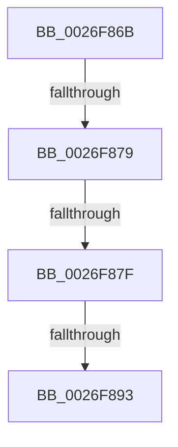

# sub_0026F86B

- RVA: `0x0026F86B`–`0x0026F895` (길이 `42` bytes)
- VA: `0x000000014026F86B`
- 실행 섹션: `.text`
- PDB 이름 있음: `아니요`; PDB Function 태그: `아니요`
- unwind 정보 RVA: `0x000658C8`
- 디코드: `11`개 명령, `42/42` bytes 표시
- 미해석 바이트: `0` (있으면 어셈블리에 `.byte`로 보존)

> 이 문서는 커널 이미지의 기계어와 PDB 기호를 분석해 생성했습니다. 4번과 5번은 함수 원형과 자료형을 바이너리 사용 방식에서 추정한 C 해석이며 원본 소스 복구 결과는 아닙니다.

## 1. Dependencies

- 직접 호출 지점: **0**; 고유 호출 대상: **0**
- 직접 호출자로 확인된 함수: **0**
- RIP 상대 이미지 참조: **1**

### Outgoing calls
- 직접 디코드된 call 명령이 없습니다.

### Direct callers
- 이 함수 시작 RVA로 연결되는 직접 call은 확인되지 않았습니다. 간접 호출은 완전히 역산할 수 없습니다.

### Static image references
- `0x0026F86C` → RVA `0x00001030` (`.rdata`; read)

## 2. Other-region calls and transfers

- 다른 실행 섹션으로 향하는 call: **0**
- call이 아닌 외부 분기/꼬리 이동: **4**
  - `0x0026F877` → [sub_0026F8B2](Unknown_function_0026F8B2.md) (`tail-transfer`)
  - `0x0026F87D` → [sub_0026F8B2 + 0xA](Unknown_function_0026F8B2.md) (`tail-transfer`)
  - `0x0026F88D` → [sub_0026F7CA](Unknown_function_0026F7CA.md) (`tail-transfer`)
  - `0x0026F893` → [sub_0026F8B2 + 0xA](Unknown_function_0026F8B2.md) (`tail-transfer`)

## 3. Assembly (complete function range)

```asm
0026F86B  CC                              int3
0026F86C  48 8D 15 BD 17 D9 FF            lea rdx, [rip - 0x26e843]
0026F873  41 83 F8 06                     cmp r8d, 6
0026F877  74 39                           je 0x14026f8b2
0026F879  41 83 F8 05                     cmp r8d, 5
0026F87D  77 3D                           ja 0x14026f8bc
0026F87F  49 63 C0                        movsxd rax, r8d
0026F882  48 69 C8 88 00 00 00            imul rcx, rax, 0x88
0026F889  80 3C 11 01                     cmp byte ptr [rcx + rdx], 1
0026F88D  0F 84 37 FF FF FF               je 0x14026f7ca
0026F893  EB 27                           jmp 0x14026f8bc
```

## 4. C-style interpretation (structured pseudocode)

```c
__int64 __fastcall sub_0026F86B(__int64 a1, __int64 a2, int a3)
{
    a1 = (a1) * ((int)(a3));
}
```

## 5. (Beta) C Style

```c
int64_t sub_0026F86B(void *Arg1, int64_t Arg2, int32_t Arg3)
{
    uint8_t *arg1 = (uint8_t *)Arg1;

    Arg1 = (Arg1) * ((int32_t)(Arg3));
}
```

### 관측된 메모리 오프셋

구조체 형식이 확인되지 않은 접근은 인자 기준의 오프셋으로만 기록했습니다.

| 기준 인자 | 오프셋 표현 | 폭 (bit) | 접근 |
|---|---:|---:|---|
| `Arg1` | `+ 0x0 + rdx*1` | `8` | `R` |

## 6. Execution-region graph

[열기: 2D/3D 그래프와 함수 탐색 컨트롤 패널](../../../control-panel.html?section=text&rva=0x0026F86B&view=graph)

- 2D 그래프는 위에서 아래로 흐르고, 3D 그래프는 빈 공간을 드래그해 회전합니다. Shift+드래그는 이동, 휠은 확대·축소, 함수 노드 선택은 대상 보고서 이동입니다.

### Static fallback


