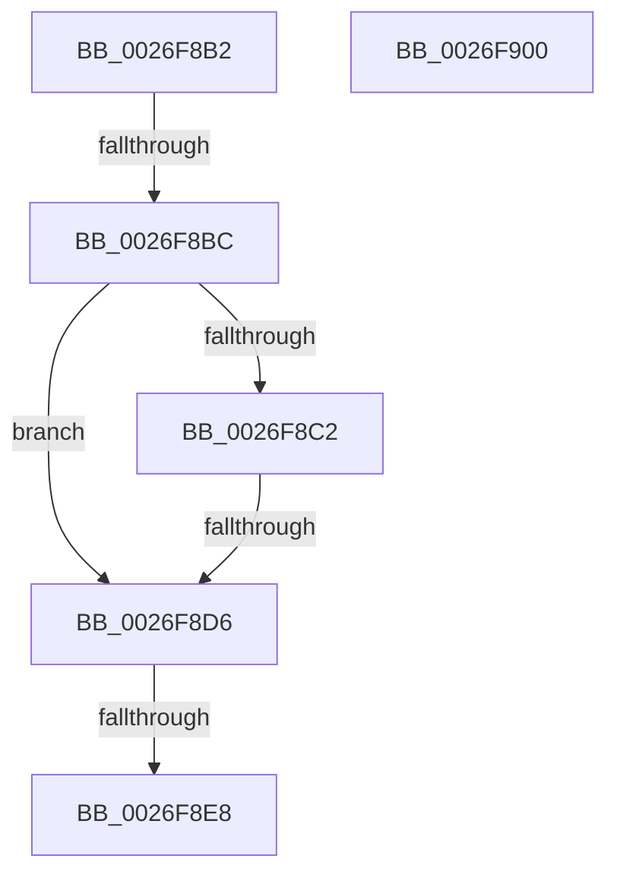

# sub_0026F8B2

- RVA: `0x0026F8B2`–`0x0026F901` (길이 `79` bytes)
- VA: `0x000000014026F8B2`
- 실행 섹션: `.text`
- PDB 이름 있음: `아니요`; PDB Function 태그: `아니요`
- unwind 정보 RVA: `0x000658EC`
- 디코드: `23`개 명령, `79/79` bytes 표시
- 미해석 바이트: `0` (있으면 어셈블리에 `.byte`로 보존)

> 이 문서는 커널 이미지의 기계어와 PDB 기호를 분석해 생성했습니다. 4번과 5번은 함수 원형과 자료형을 바이너리 사용 방식에서 추정한 C 해석이며 원본 소스 복구 결과는 아닙니다.

## 1. Dependencies

- 직접 호출 지점: **2**; 고유 호출 대상: **2**
- 직접 호출자로 확인된 함수: **0**
- RIP 상대 이미지 참조: **0**

### Outgoing calls
- `0x0026F8DA` → [ExAcquireSpinLockShared](../24/ExAcquireSpinLockShared_function_0024DCE0.md) (function, `0x0024DCE0`)
- `0x0026F8EB` → [ExAcquireSpinLockExclusiveAtDpcLevel](../24/ExAcquireSpinLockExclusiveAtDpcLevel_function_00248E80.md) (function, `0x00248E80`)

### Direct callers
- 이 함수 시작 RVA로 연결되는 직접 call은 확인되지 않았습니다. 간접 호출은 완전히 역산할 수 없습니다.

### Static image references
- 디코드된 RIP-relative 메모리 참조가 없습니다.

## 2. Other-region calls and transfers

- 다른 실행 섹션으로 향하는 call: **0**
- call이 아닌 외부 분기/꼬리 이동: **3**
  - `0x0026F8B6` → [sub_0026F7CA](Unknown_function_0026F7CA.md) (`tail-transfer`)
  - `0x0026F8D0` → [sub_0026F7CA](Unknown_function_0026F7CA.md) (`tail-transfer`)
  - `0x0026F8E6` → [sub_0026F939](Unknown_function_0026F939.md) (`tail-transfer`)

## 3. Assembly (complete function range)

```asm
0026F8B2  41 83 F9 06                     cmp r9d, 6
0026F8B6  0F 84 0E FF FF FF               je 0x14026f7ca
0026F8BC  41 83 F9 05                     cmp r9d, 5
0026F8C0  77 14                           ja 0x14026f8d6
0026F8C2  49 63 C1                        movsxd rax, r9d
0026F8C5  48 69 C8 88 00 00 00            imul rcx, rax, 0x88
0026F8CC  80 3C 11 01                     cmp byte ptr [rcx + rdx], 1
0026F8D0  0F 84 F4 FE FF FF               je 0x14026f7ca
0026F8D6  48 8D 4F 40                     lea rcx, [rdi + 0x40]
0026F8DA  E8 01 E4 FD FF                  call 0x14024dce0
0026F8DF  80 7F 7D 01                     cmp byte ptr [rdi + 0x7d], 1
0026F8E3  41 88 06                        mov byte ptr [r14], al
0026F8E6  74 51                           je 0x14026f939
0026F8E8  48 8B CB                        mov rcx, rbx
0026F8EB  E8 90 95 FD FF                  call 0x140248e80
0026F8F0  48 8B 5C 24 50                  mov rbx, qword ptr [rsp + 0x50]
0026F8F5  32 C0                           xor al, al
0026F8F7  48 83 C4 20                     add rsp, 0x20
0026F8FB  41 5E                           pop r14
0026F8FD  5F                              pop rdi
0026F8FE  5E                              pop rsi
0026F8FF  C3                              ret
0026F900  CC                              int3
```

## 4. C-style interpretation (structured pseudocode)

```c
__int64 __fastcall sub_0026F8B2(__int64 a1, __int64 a2, __int64 a3, int a4, __int64 a5, __int64 a6, __int64 a7, __int64 a8, __int64 a9, __int64 a10)
{
    __int64 result;
    __int64 v_rsp;

    if (a4 > 5) goto loc_0026F8D6;
    a1 = (a1) * ((int)(a4));
loc_0026F8D6:
    result = ExAcquireSpinLockShared(v_rdi + 64, a2, a3, a4);
    *(unsigned __int8 *)(v_r14) = (unsigned __int8)(result);
    result = ExAcquireSpinLockExclusiveAtDpcLevel(v_rbx, a2, a3, a4);
    result = 0;
    v_rsp = (v_rsp) + (32);
    return result;
}
```

## 5. (Beta) C Style

```c
int64_t sub_0026F8B2(void *Arg1, int64_t Arg2, int64_t Arg3, int32_t Arg4, uint64_t Arg5, uint64_t Arg6, uint64_t Arg7, uint64_t Arg8, uint64_t Arg9, int64_t Arg10)
{
    uint8_t *arg1 = (uint8_t *)Arg1;

    int64_t result;
    int64_t local_rsp;

    if (Arg4 > 5) goto loc_0026F8D6;
    Arg1 = (Arg1) * ((int32_t)(Arg4));
loc_0026F8D6:
    result = ExAcquireSpinLockShared(local_rdi + 64, Arg2, Arg3, Arg4);
    *(uint8_t *)(local_r14) = (uint8_t)(result);
    result = ExAcquireSpinLockExclusiveAtDpcLevel(local_rbx, Arg2, Arg3, Arg4);
    result = 0;
    local_rsp = (local_rsp) + (32);
    return result;
}
```

### 관측된 메모리 오프셋

구조체 형식이 확인되지 않은 접근은 인자 기준의 오프셋으로만 기록했습니다.

| 기준 인자 | 오프셋 표현 | 폭 (bit) | 접근 |
|---|---:|---:|---|
| `Arg1` | `+ 0x0 + rdx*1` | `8` | `R` |

## 6. Execution-region graph

[열기: 2D/3D 그래프와 함수 탐색 컨트롤 패널](../../../control-panel.html?section=text&rva=0x0026F8B2&view=graph)

- 2D 그래프는 위에서 아래로 흐르고, 3D 그래프는 빈 공간을 드래그해 회전합니다. Shift+드래그는 이동, 휠은 확대·축소, 함수 노드 선택은 대상 보고서 이동입니다.

### Static fallback


