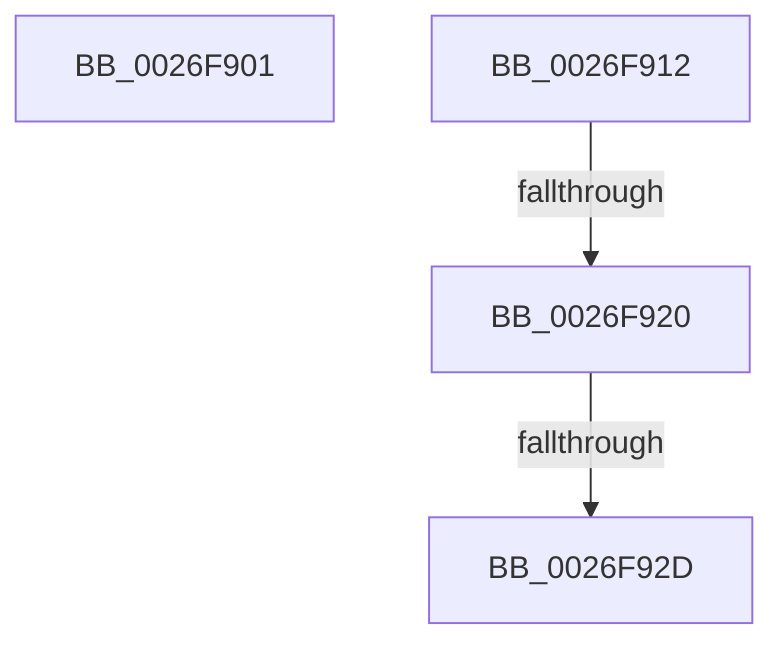

# sub_0026F901

- RVA: `0x0026F901`–`0x0026F939` (길이 `56` bytes)
- VA: `0x000000014026F901`
- 실행 섹션: `.text`
- PDB 이름 있음: `아니요`; PDB Function 태그: `아니요`
- unwind 정보 RVA: `0x00065900`
- 디코드: `13`개 명령, `56/56` bytes 표시
- 미해석 바이트: `0` (있으면 어셈블리에 `.byte`로 보존)

> 이 문서는 커널 이미지의 기계어와 PDB 기호를 분석해 생성했습니다. 4번과 5번은 함수 원형과 자료형을 바이너리 사용 방식에서 추정한 C 해석이며 원본 소스 복구 결과는 아닙니다.

## 1. Dependencies

- 직접 호출 지점: **3**; 고유 호출 대상: **3**
- 직접 호출자로 확인된 함수: **0**
- RIP 상대 이미지 참조: **1**

### Outgoing calls
- `0x0026F908` → [KiRaiseIrqlProcessIrqlFlags](../4F/KiRaiseIrqlProcessIrqlFlags_function_004F56FC.md) (function, `0x004F56FC`)
- `0x0026F920` → [KiCheckVpBackingLongSpinWaitHypercall](../30/KiCheckVpBackingLongSpinWaitHypercall_function_0030F490.md) (function, `0x0030F490`)
- `0x0026F92F` → [HvlNotifyLongSpinWait](../30/HvlNotifyLongSpinWait_function_0030F460.md) (function, `0x0030F460`)

### Direct callers
- 이 함수 시작 RVA로 연결되는 직접 call은 확인되지 않았습니다. 간접 호출은 완전히 역산할 수 없습니다.

### Static image references
- `0x0026F912` → RVA `0x00FC6AB8` (`ALMOSTRO`; read)

## 2. Other-region calls and transfers

- 다른 실행 섹션으로 향하는 call: **0**
- call이 아닌 외부 분기/꼬리 이동: **4**
  - `0x0026F90D` → [sub_0026F7CA + 0x1F](Unknown_function_0026F7CA.md) (`tail-transfer`)
  - `0x0026F91A` → [sub_0026F7CA + 0x72](Unknown_function_0026F7CA.md) (`tail-transfer`)
  - `0x0026F927` → [sub_0026F7CA + 0x72](Unknown_function_0026F7CA.md) (`tail-transfer`)
  - `0x0026F934` → [sub_0026F7CA + 0x74](Unknown_function_0026F7CA.md) (`tail-transfer`)

## 3. Assembly (complete function range)

```asm
0026F901  0F B6 D0                        movzx edx, al
0026F904  40 0F B6 CD                     movzx ecx, bpl
0026F908  E8 EF 5D 28 00                  call 0x1404f56fc
0026F90D  E9 D7 FE FF FF                  jmp 0x14026f7e9
0026F912  8B 05 A0 71 D5 00               mov eax, dword ptr [rip + 0xd571a0]
0026F918  A8 40                           test al, 0x40
0026F91A  0F 84 1C FF FF FF               je 0x14026f83c
0026F920  E8 6B FB 09 00                  call 0x14030f490
0026F925  84 C0                           test al, al
0026F927  0F 84 0F FF FF FF               je 0x14026f83c
0026F92D  8B CE                           mov ecx, esi
0026F92F  E8 2C FB 09 00                  call 0x14030f460
0026F934  E9 05 FF FF FF                  jmp 0x14026f83e
```

## 4. C-style interpretation (structured pseudocode)

```c
__int64 __fastcall sub_0026F901(void)
{
    __int64 result;

    result = KiRaiseIrqlProcessIrqlFlags((unsigned __int8)(v_rbp), (unsigned __int8)(result), a3, a4);
}
```

## 5. (Beta) C Style

```c
void sub_0026F901(void)
{
    int64_t result;

    result = KiRaiseIrqlProcessIrqlFlags((uint8_t)(local_rbp), (uint8_t)(result), a3, a4);
}
```

## 6. Execution-region graph

[열기: 2D/3D 그래프와 함수 탐색 컨트롤 패널](../../../control-panel.html?section=text&rva=0x0026F901&view=graph)

- 2D 그래프는 위에서 아래로 흐르고, 3D 그래프는 빈 공간을 드래그해 회전합니다. Shift+드래그는 이동, 휠은 확대·축소, 함수 노드 선택은 대상 보고서 이동입니다.

### Static fallback


