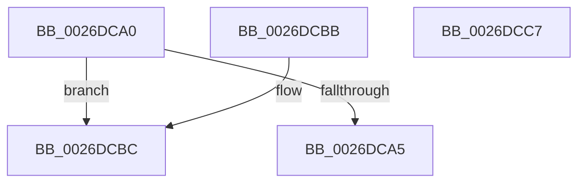

# VacbLevelReference

- RVA: `0x0026DCA0`–`0x0026DCC8` (길이 `40` bytes)
- VA: `0x000000014026DCA0`
- 실행 섹션: `.text`
- PDB 이름 있음: `예`; PDB Function 태그: `아니요`
- unwind 정보 RVA: `0x000DB714`
- 디코드: `13`개 명령, `40/40` bytes 표시
- 미해석 바이트: `0` (있으면 어셈블리에 `.byte`로 보존)

> 이 문서는 커널 이미지의 기계어와 PDB 기호를 분석해 생성했습니다. 4번과 5번은 함수 원형과 자료형을 바이너리 사용 방식에서 추정한 C 해석이며 원본 소스 복구 결과는 아닙니다.

## 1. Dependencies

- 직접 호출 지점: **0**; 고유 호출 대상: **0**
- 직접 호출자로 확인된 함수: **3**
- RIP 상대 이미지 참조: **0**

### Outgoing calls
- 직접 디코드된 call 명령이 없습니다.

### Direct callers
- [CcCalculateVacbLevelLockCount](CcCalculateVacbLevelLockCount_function_0026CFC8.md) at `0x0026D016`
- [CcExtendVacbArray](CcExtendVacbArray_function_0026DCD0.md) at `0x0026E014`
- [CcExtendVacbArray](CcExtendVacbArray_function_0026DCD0.md) at `0x0026E098`
- [CcSetVacbLargeOffset](../27/CcSetVacbLargeOffset_function_002733D0.md) at `0x0027367F`

### Static image references
- 디코드된 RIP-relative 메모리 참조가 없습니다.

## 2. Other-region calls and transfers

- 다른 실행 섹션으로 향하는 call: **0**
- 별도 외부 분기/꼬리 이동을 확인하지 못했습니다.

## 3. Assembly (complete function range)

```asm
0026DCA0  45 85 C0                        test r8d, r8d
0026DCA3  75 17                           jne 0x14026dcbc
0026DCA5  8B 81 98 00 00 00               mov eax, dword ptr [rcx + 0x98]
0026DCAB  25 00 02 00 00                  and eax, 0x200
0026DCB0  48 05 00 02 00 00               add rax, 0x200
0026DCB6  48 8D 04 42                     lea rax, [rdx + rax*2]
0026DCBA  C3                              ret
0026DCBB  CC                              int3
0026DCBC  33 C0                           xor eax, eax
0026DCBE  B8 00 04 00 00                  mov eax, 0x400
0026DCC3  48 03 C2                        add rax, rdx
0026DCC6  C3                              ret
0026DCC7  CC                              int3
```

## 4. C-style interpretation (structured pseudocode)

```c
__int64 __fastcall VacbLevelReference(__int64 a1, __int64 a2, int a3)
{
    __int64 result;

    if (a3 != 0) goto loc_0026DCBC;
    result = (unsigned int)(((unsigned int)(*(unsigned int *)(a1 + 152))) & (512));
    result = (result) + (512);
    return a2 + result * 2;
loc_0026DCBC:
    result = 0;
    result = ((unsigned int)(0x400ULL)) + (a2);
    return result;
}
```

## 5. (Beta) C Style

```c
int64_t VacbLevelReference(void *Arg1, void *Arg2, int32_t Arg3)
{
    uint8_t *arg1 = (uint8_t *)Arg1;
    uint8_t *arg2 = (uint8_t *)Arg2;

    int64_t result;

    if (Arg3 != 0) goto loc_0026DCBC;
    result = (uint32_t)(((uint32_t)(*(uint32_t *)(arg1 + 0x98))) & (512));
    result = (result) + (512);
    return Arg2 + result * 2;
loc_0026DCBC:
    result = 0;
    result = ((uint32_t)(0x400ULL)) + (Arg2);
    return result;
}
```

### 관측된 메모리 오프셋

구조체 형식이 확인되지 않은 접근은 인자 기준의 오프셋으로만 기록했습니다.

| 기준 인자 | 오프셋 표현 | 폭 (bit) | 접근 |
|---|---:|---:|---|
| `Arg1` | `+ 0x98` | `32` | `R` |
| `Arg2` | `+ 0x0 + rax*2` | `64` | `R` |

## 6. Execution-region graph

[열기: 2D/3D 그래프와 함수 탐색 컨트롤 패널](../../../control-panel.html?section=text&rva=0x0026DCA0&view=graph)

- 2D 그래프는 위에서 아래로 흐르고, 3D 그래프는 빈 공간을 드래그해 회전합니다. Shift+드래그는 이동, 휠은 확대·축소, 함수 노드 선택은 대상 보고서 이동입니다.

### Static fallback


