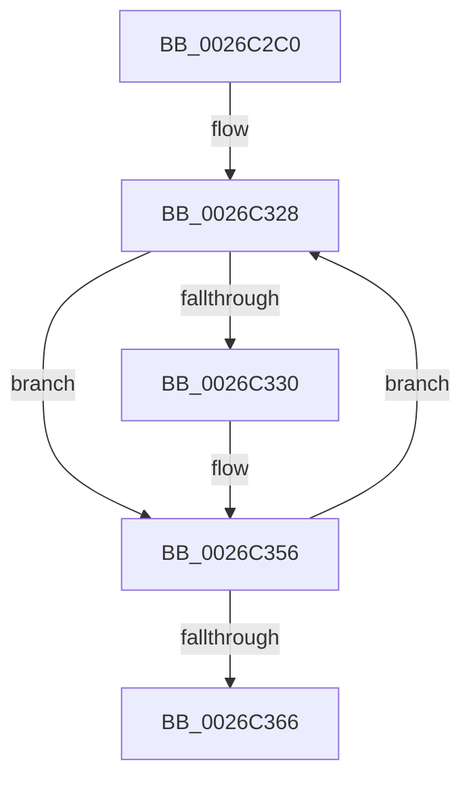

# XpressBuildHuffmanEncodings

- RVA: `0x0026C2C0`–`0x0026C38A` (길이 `202` bytes)
- VA: `0x000000014026C2C0`
- 실행 섹션: `.text`
- PDB 이름 있음: `예`; PDB Function 태그: `아니요`
- unwind 정보 RVA: `0x00065568`
- 디코드: `47`개 명령, `202/202` bytes 표시
- 미해석 바이트: `0` (있으면 어셈블리에 `.byte`로 보존)

> 이 문서는 커널 이미지의 기계어와 PDB 기호를 분석해 생성했습니다. 4번과 5번은 함수 원형과 자료형을 바이너리 사용 방식에서 추정한 C 해석이며 원본 소스 복구 결과는 아닙니다.

## 1. Dependencies

- 직접 호출 지점: **4**; 고유 호출 대상: **1**
- 직접 호출자로 확인된 함수: **2**
- RIP 상대 이미지 참조: **0**

### Outgoing calls
- `0x0026C2E4` → [memset](../6C/memset_function_006C6C40.md) (function, `0x006C6C40`)
- `0x0026C2F8` → [memset](../6C/memset_function_006C6C40.md) (function, `0x006C6C40`)
- `0x0026C316` → [memset](../6C/memset_function_006C6C40.md) (function, `0x006C6C40`)
- `0x0026C375` → [memset](../6C/memset_function_006C6C40.md) (function, `0x006C6C40`)

### Direct callers
- [RtlCompressBufferXpressHuffStandard](RtlCompressBufferXpressHuffStandard_function_0026BA60.md) at `0x0026BC2A`
- [RtlCompressBufferXpressHuffMax](RtlCompressBufferXpressHuffMax_function_0026CA10.md) at `0x0026CB7D`

### Static image references
- 디코드된 RIP-relative 메모리 참조가 없습니다.

## 2. Other-region calls and transfers

- 다른 실행 섹션으로 향하는 call: **0**
- call이 아닌 외부 분기/꼬리 이동: **1**
  - `0x0026C384` → [sub_0026C68B](Unknown_function_0026C68B.md) (`tail-transfer`)

## 3. Assembly (complete function range)

```asm
0026C2C0  48 89 5C 24 18                  mov qword ptr [rsp + 0x18], rbx
0026C2C5  56                              push rsi
0026C2C6  41 54                           push r12
0026C2C8  41 55                           push r13
0026C2CA  41 56                           push r14
0026C2CC  41 57                           push r15
0026C2CE  48 83 EC 20                     sub rsp, 0x20
0026C2D2  48 8B F1                        mov rsi, rcx
0026C2D5  33 D2                           xor edx, edx
0026C2D7  48 81 C1 18 68 00 00            add rcx, 0x6818
0026C2DE  41 B8 02 02 00 00               mov r8d, 0x202
0026C2E4  E8 57 A9 45 00                  call 0x1406c6c40
0026C2E9  48 8D 8E 1A 6A 00 00            lea rcx, [rsi + 0x6a1a]
0026C2F0  33 D2                           xor edx, edx
0026C2F2  41 B8 02 02 00 00               mov r8d, 0x202
0026C2F8  E8 43 A9 45 00                  call 0x1406c6c40
0026C2FD  4C 8D BE 00 08 00 00            lea r15, [rsi + 0x800]
0026C304  33 D2                           xor edx, edx
0026C306  48 8D 8E 20 70 00 00            lea rcx, [rsi + 0x7020]
0026C30D  41 B8 00 02 00 00               mov r8d, 0x200
0026C313  49 8B DF                        mov rbx, r15
0026C316  E8 25 A9 45 00                  call 0x1406c6c40
0026C31B  45 33 ED                        xor r13d, r13d
0026C31E  4C 8D 86 20 72 00 00            lea r8, [rsi + 0x7220]
0026C325  41 8B D5                        mov edx, r13d
0026C328  41 8B 08                        mov ecx, dword ptr [r8]
0026C32B  48 85 C9                        test rcx, rcx
0026C32E  74 26                           je 0x14026c356
0026C330  48 89 0B                        mov qword ptr [rbx], rcx
0026C333  0F B6 C1                        movzx eax, cl
0026C336  48 C1 E9 08                     shr rcx, 8
0026C33A  66 FF 84 46 1A 68 00 00         inc word ptr [rsi + rax*2 + 0x681a]
0026C342  66 FF 84 4E 1C 6A 00 00         inc word ptr [rsi + rcx*2 + 0x6a1c]
0026C34A  4C 89 6B 08                     mov qword ptr [rbx + 8], r13
0026C34E  48 89 53 10                     mov qword ptr [rbx + 0x10], rdx
0026C352  48 83 C3 18                     add rbx, 0x18
0026C356  48 FF C2                        inc rdx
0026C359  49 83 C0 04                     add r8, 4
0026C35D  48 81 FA 00 02 00 00            cmp rdx, 0x200
0026C364  72 C2                           jb 0x14026c328
0026C366  48 8D 8E 20 7A 00 00            lea rcx, [rsi + 0x7a20]
0026C36D  33 D2                           xor edx, edx
0026C36F  41 B8 00 01 00 00               mov r8d, 0x100
0026C375  E8 C6 A8 45 00                  call 0x1406c6c40
0026C37A  4C 8D B6 18 08 00 00            lea r14, [rsi + 0x818]
0026C381  49 3B DE                        cmp rbx, r14
0026C384  0F 86 01 03 00 00               jbe 0x14026c68b
```

## 4. C-style interpretation (structured pseudocode)

```c
__int64 __fastcall XpressBuildHuffmanEncodings(__int64 a1, int a2)
{
    __int64 result;
    __int64 v_r13;
    __int64 v_rbx;
    __int64 v_rsp;
    unsigned __int64 v_stack_p18;

    v_stack_p18 = v_rbx;
    v_rsp = (v_rsp) - (32);
    a2 = 0;
    a1 = (a1) + (0x6818ULL);
    result = memset(a1, a2, 514, a4);
    a2 = 0;
    result = memset(a1 + 27162, a2, 514, a4);
    a2 = 0;
    result = memset(a1 + 28704, a2, 512, a4);
    v_r13 = 0;
loc_0026C328:
    v_rbx = a1 + 2048;
    if ((unsigned int)(*(unsigned int *)(a1 + 29216)) != 0) {
        *(unsigned __int64 *)(a1 + 2048) = (unsigned int)(*(unsigned int *)(a1 + 29216));
        result = (unsigned __int8)((unsigned int)(*(unsigned int *)(a1 + 29216)));
        a1 = ((unsigned int)(*(unsigned int *)(a1 + 29216))) >> (8);
        *(unsigned __int64 *)(a1 + 2048 + 8) = 0;
        *(unsigned __int64 *)(a1 + 2048 + 16) = 0;
        v_rbx = (a1 + 2048) + (24);
    }
    a2 = (0) + 1;
    a3 = (a1 + 29216) + (4);
    if (a2 < 512) goto loc_0026C328;
    a2 = 0;
    result = memset(a1 + 31264, a2, 256, a4);
}
```

## 5. (Beta) C Style

```c
int64_t XpressBuildHuffmanEncodings(void *Arg1, int32_t Arg2)
{
    uint8_t *arg1 = (uint8_t *)Arg1;

    int64_t result;
    int64_t local_r13;
    int64_t local_rbx;
    int64_t local_rsp;
    uint64_t v_stack_p18;

    v_stack_p18 = local_rbx;
    local_rsp = (local_rsp) - (32);
    Arg2 = 0;
    Arg1 = (Arg1) + (0x6818ULL);
    result = memset(Arg1, Arg2, 514, a4);
    Arg2 = 0;
    result = memset(Arg1 + 27162, Arg2, 514, a4);
    Arg2 = 0;
    result = memset(Arg1 + 28704, Arg2, 512, a4);
    local_r13 = 0;
loc_0026C328:
    local_rbx = Arg1 + 2048;
    if ((uint32_t)(*(uint32_t *)(arg1 + 0x7220)) != 0) {
        *(uint64_t *)(arg1 + 0x800) = (uint32_t)(*(uint32_t *)(arg1 + 0x7220));
        result = (uint8_t)((uint32_t)(*(uint32_t *)(arg1 + 0x7220)));
        Arg1 = ((uint32_t)(*(uint32_t *)(arg1 + 0x7220))) >> (8);
        *(uint64_t *)(arg1 + 0x800 + 0x8) = 0;
        *(uint64_t *)(arg1 + 0x800 + 0x10) = 0;
        local_rbx = (Arg1 + 2048) + (24);
    }
    Arg2 = (0) + 1;
    a3 = (Arg1 + 29216) + (4);
    if (Arg2 < 512) goto loc_0026C328;
    Arg2 = 0;
    result = memset(Arg1 + 31264, Arg2, 256, a4);
}
```

### 관측된 메모리 오프셋

구조체 형식이 확인되지 않은 접근은 인자 기준의 오프셋으로만 기록했습니다.

| 기준 인자 | 오프셋 표현 | 폭 (bit) | 접근 |
|---|---:|---:|---|
| `Arg1` | `+ 0x0` | `32` | `R` |
| `Arg1` | `+ 0x0` | `64` | `W` |
| `Arg1` | `+ 0x8` | `64` | `W` |
| `Arg1` | `+ 0x10` | `64` | `W` |
| `Arg1` | `+ 0x800` | `64` | `R` |
| `Arg1` | `+ 0x818` | `64` | `R` |
| `Arg1` | `+ 0x681A + rax*2` | `16` | `R/W` |
| `Arg1` | `+ 0x6A1A` | `64` | `R` |
| `Arg1` | `+ 0x6A1C + rcx*2` | `16` | `R/W` |
| `Arg1` | `+ 0x7020` | `64` | `R` |
| `Arg1` | `+ 0x7220` | `64` | `R` |
| `Arg1` | `+ 0x7A20` | `64` | `R` |

## 6. Execution-region graph

[열기: 2D/3D 그래프와 함수 탐색 컨트롤 패널](../../../control-panel.html?section=text&rva=0x0026C2C0&view=graph)

- 2D 그래프는 위에서 아래로 흐르고, 3D 그래프는 빈 공간을 드래그해 회전합니다. Shift+드래그는 이동, 휠은 확대·축소, 함수 노드 선택은 대상 보고서 이동입니다.

### Static fallback


