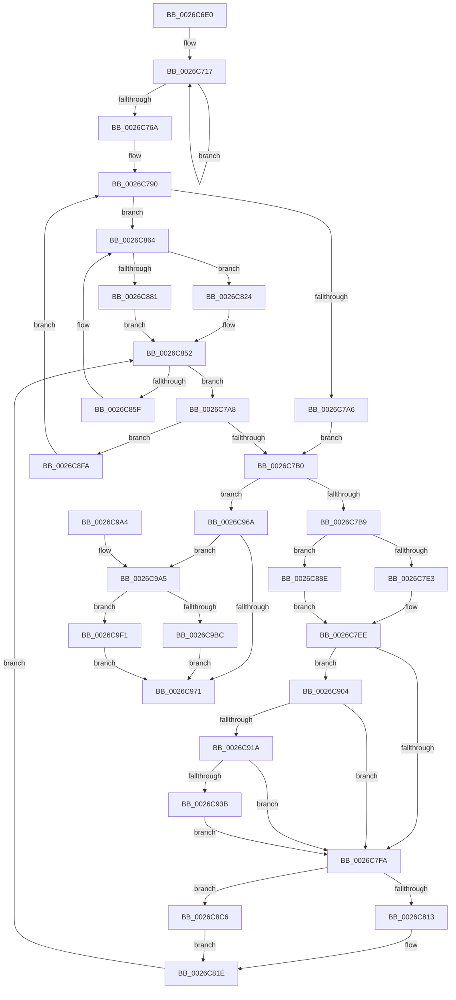

# XpressDoHuffmanPass

- RVA: `0x0026C6E0`–`0x0026CA01` (길이 `801` bytes)
- VA: `0x000000014026C6E0`
- 실행 섹션: `.text`
- PDB 이름 있음: `예`; PDB Function 태그: `아니요`
- unwind 정보 RVA: `0x000655D4`
- 디코드: `206`개 명령, `801/801` bytes 표시
- 미해석 바이트: `0` (있으면 어셈블리에 `.byte`로 보존)

> 이 문서는 커널 이미지의 기계어와 PDB 기호를 분석해 생성했습니다. 4번과 5번은 함수 원형과 자료형을 바이너리 사용 방식에서 추정한 C 해석이며 원본 소스 복구 결과는 아닙니다.

## 1. Dependencies

- 직접 호출 지점: **0**; 고유 호출 대상: **0**
- 직접 호출자로 확인된 함수: **2**
- RIP 상대 이미지 참조: **0**

### Outgoing calls
- 직접 디코드된 call 명령이 없습니다.

### Direct callers
- [RtlCompressBufferXpressHuffStandard](RtlCompressBufferXpressHuffStandard_function_0026BA60.md) at `0x0026C1A5`
- [RtlCompressBufferXpressHuffMax](RtlCompressBufferXpressHuffMax_function_0026CA10.md) at `0x0026CC2A`

### Static image references
- 디코드된 RIP-relative 메모리 참조가 없습니다.

## 2. Other-region calls and transfers

- 다른 실행 섹션으로 향하는 call: **0**
- 별도 외부 분기/꼬리 이동을 확인하지 못했습니다.

## 3. Assembly (complete function range)

```asm
0026C6E0  48 89 5C 24 08                  mov qword ptr [rsp + 8], rbx
0026C6E5  48 89 6C 24 10                  mov qword ptr [rsp + 0x10], rbp
0026C6EA  48 89 74 24 18                  mov qword ptr [rsp + 0x18], rsi
0026C6EF  48 89 7C 24 20                  mov qword ptr [rsp + 0x20], rdi
0026C6F4  41 54                           push r12
0026C6F6  41 55                           push r13
0026C6F8  41 56                           push r14
0026C6FA  41 57                           push r15
0026C6FC  4C 8B D2                        mov r10, rdx
0026C6FF  4C 8B F9                        mov r15, rcx
0026C702  48 8D 91 20 7A 00 00            lea rdx, [rcx + 0x7a20]
0026C709  4D 8B F1                        mov r14, r9
0026C70C  B9 02 00 00 00                  mov ecx, 2
0026C711  49 8B E8                        mov rbp, r8
0026C714  49 8B C1                        mov rax, r9
0026C717  48 8D 80 80 00 00 00            lea rax, [rax + 0x80]
0026C71E  0F 10 02                        movups xmm0, xmmword ptr [rdx]
0026C721  48 8D 92 80 00 00 00            lea rdx, [rdx + 0x80]
0026C728  0F 11 40 80                     movups xmmword ptr [rax - 0x80], xmm0
0026C72C  0F 10 4A 90                     movups xmm1, xmmword ptr [rdx - 0x70]
0026C730  0F 11 48 90                     movups xmmword ptr [rax - 0x70], xmm1
0026C734  0F 10 42 A0                     movups xmm0, xmmword ptr [rdx - 0x60]
0026C738  0F 11 40 A0                     movups xmmword ptr [rax - 0x60], xmm0
0026C73C  0F 10 4A B0                     movups xmm1, xmmword ptr [rdx - 0x50]
0026C740  0F 11 48 B0                     movups xmmword ptr [rax - 0x50], xmm1
0026C744  0F 10 42 C0                     movups xmm0, xmmword ptr [rdx - 0x40]
0026C748  0F 11 40 C0                     movups xmmword ptr [rax - 0x40], xmm0
0026C74C  0F 10 4A D0                     movups xmm1, xmmword ptr [rdx - 0x30]
0026C750  0F 11 48 D0                     movups xmmword ptr [rax - 0x30], xmm1
0026C754  0F 10 42 E0                     movups xmm0, xmmword ptr [rdx - 0x20]
0026C758  0F 11 40 E0                     movups xmmword ptr [rax - 0x20], xmm0
0026C75C  0F 10 4A F0                     movups xmm1, xmmword ptr [rdx - 0x10]
0026C760  0F 11 48 F0                     movups xmmword ptr [rax - 0x10], xmm1
0026C764  48 83 E9 01                     sub rcx, 1
0026C768  75 AD                           jne 0x14026c717
0026C76A  33 F6                           xor esi, esi
0026C76C  4D 8D A6 00 01 00 00            lea r12, [r14 + 0x100]
0026C773  BF 10 00 00 00                  mov edi, 0x10
0026C778  4D 8D AE 02 01 00 00            lea r13, [r14 + 0x102]
0026C77F  44 8B CF                        mov r9d, edi
0026C782  44 0F B7 C6                     movzx r8d, si
0026C786  49 81 C6 04 01 00 00            add r14, 0x104
0026C78D  0F 1F 00                        nop dword ptr [rax]
0026C790  41 8B 0A                        mov ecx, dword ptr [r10]
0026C793  49 83 C2 04                     add r10, 4
0026C797  8D 04 4D 01 00 00 00            lea eax, [rcx*2 + 1]
0026C79E  85 C9                           test ecx, ecx
0026C7A0  0F 89 BE 00 00 00               jns 0x14026c864
0026C7A6  EB 08                           jmp 0x14026c7b0
0026C7A8  85 C9                           test ecx, ecx
0026C7AA  0F 84 4A 01 00 00               je 0x14026c8fa
0026C7B0  4C 3B D5                        cmp r10, rbp
0026C7B3  0F 83 B1 01 00 00               jae 0x14026c96a
0026C7B9  0F AE E8                        lfence
0026C7BC  45 0F B6 1A                     movzx r11d, byte ptr [r10]
0026C7C0  49 FF C2                        inc r10
0026C7C3  41 8B D3                        mov edx, r11d
0026C7C6  4B 8D 1C 9F                     lea rbx, [r15 + r11*4]
0026C7CA  0F B7 8B 00 04 00 00            movzx ecx, word ptr [rbx + 0x400]
0026C7D1  0F B7 B3 02 04 00 00            movzx esi, word ptr [rbx + 0x402]
0026C7D8  8B F9                           mov edi, ecx
0026C7DA  4C 3B C9                        cmp r9, rcx
0026C7DD  0F 82 AB 00 00 00               jb 0x14026c88e
0026C7E3  4C 2B C9                        sub r9, rcx
0026C7E6  66 41 D3 E0                     shl r8w, cl
0026C7EA  66 44 0B C6                     or r8w, si
0026C7EE  83 E2 0F                        and edx, 0xf
0026C7F1  80 FA 0F                        cmp dl, 0xf
0026C7F4  0F 84 0A 01 00 00               je 0x14026c904
0026C7FA  41 0F B7 1A                     movzx ebx, word ptr [r10]
0026C7FE  41 C0 EB 04                     shr r11b, 4
0026C802  41 0F B6 D3                     movzx edx, r11b
0026C806  41 0F B6 CB                     movzx ecx, r11b
0026C80A  4C 3B CA                        cmp r9, rdx
0026C80D  0F 82 B3 00 00 00               jb 0x14026c8c6
0026C813  4C 2B CA                        sub r9, rdx
0026C816  66 41 D3 E0                     shl r8w, cl
0026C81A  66 44 0B C3                     or r8w, bx
0026C81E  49 83 C2 02                     add r10, 2
0026C822  EB 2E                           jmp 0x14026c852
0026C824  41 2A C9                        sub cl, r9b
0026C827  66 D3 EA                        shr dx, cl
0026C82A  49 8B C9                        mov rcx, r9
0026C82D  66 41 D3 E0                     shl r8w, cl
0026C831  48 8B CF                        mov rcx, rdi
0026C834  66 41 0B D0                     or dx, r8w
0026C838  48 2B CB                        sub rcx, rbx
0026C83B  66 41 89 14 24                  mov word ptr [r12], dx
0026C840  4D 8B E5                        mov r12, r13
0026C843  45 0F B7 43 02                  movzx r8d, word ptr [r11 + 2]
0026C848  4D 8B EE                        mov r13, r14
0026C84B  49 83 C6 02                     add r14, 2
0026C84F  4C 03 C9                        add r9, rcx
0026C852  8D 0C 00                        lea ecx, [rax + rax]
0026C855  85 C0                           test eax, eax
0026C857  8B C1                           mov eax, ecx
0026C859  0F 88 49 FF FF FF               js 0x14026c7a8
0026C85F  BF 10 00 00 00                  mov edi, 0x10
0026C864  41 0F B6 0A                     movzx ecx, byte ptr [r10]
0026C868  49 FF C2                        inc r10
0026C86B  41 0F B7 54 8F 02               movzx edx, word ptr [r15 + rcx*4 + 2]
0026C871  4D 8D 1C 8F                     lea r11, [r15 + rcx*4]
0026C875  41 0F B7 0C 8F                  movzx ecx, word ptr [r15 + rcx*4]
0026C87A  8B D9                           mov ebx, ecx
0026C87C  4C 3B C9                        cmp r9, rcx
0026C87F  72 A3                           jb 0x14026c824
0026C881  4C 2B C9                        sub r9, rcx
0026C884  66 41 D3 E0                     shl r8w, cl
0026C888  66 44 0B C2                     or r8w, dx
0026C88C  EB C4                           jmp 0x14026c852
0026C88E  41 2A C9                        sub cl, r9b
0026C891  66 D3 EE                        shr si, cl
0026C894  49 8B C9                        mov rcx, r9
0026C897  66 41 D3 E0                     shl r8w, cl
0026C89B  B9 10 00 00 00                  mov ecx, 0x10
0026C8A0  66 41 0B F0                     or si, r8w
0026C8A4  48 2B CF                        sub rcx, rdi
0026C8A7  66 41 89 34 24                  mov word ptr [r12], si
0026C8AC  4D 8B E5                        mov r12, r13
0026C8AF  44 0F B7 83 02 04 00 00         movzx r8d, word ptr [rbx + 0x402]
0026C8B7  4D 8B EE                        mov r13, r14
0026C8BA  49 83 C6 02                     add r14, 2
0026C8BE  4C 03 C9                        add r9, rcx
0026C8C1  E9 28 FF FF FF                  jmp 0x14026c7ee
0026C8C6  41 2A C9                        sub cl, r9b
0026C8C9  66 D3 EB                        shr bx, cl
0026C8CC  49 8B C9                        mov rcx, r9
0026C8CF  66 41 D3 E0                     shl r8w, cl
0026C8D3  B9 10 00 00 00                  mov ecx, 0x10
0026C8D8  66 41 0B D8                     or bx, r8w
0026C8DC  48 2B CA                        sub rcx, rdx
0026C8DF  66 41 89 1C 24                  mov word ptr [r12], bx
0026C8E4  4D 8B E5                        mov r12, r13
0026C8E7  45 0F B7 02                     movzx r8d, word ptr [r10]
0026C8EB  4D 8B EE                        mov r13, r14
0026C8EE  49 83 C6 02                     add r14, 2
0026C8F2  4C 03 C9                        add r9, rcx
0026C8F5  E9 24 FF FF FF                  jmp 0x14026c81e
0026C8FA  BF 10 00 00 00                  mov edi, 0x10
0026C8FF  E9 8C FE FF FF                  jmp 0x14026c790
0026C904  41 0F B6 0A                     movzx ecx, byte ptr [r10]
0026C908  49 FF C2                        inc r10
0026C90B  41 88 0E                        mov byte ptr [r14], cl
0026C90E  49 FF C6                        inc r14
0026C911  80 F9 FF                        cmp cl, 0xff
0026C914  0F 85 E0 FE FF FF               jne 0x14026c7fa
0026C91A  41 0F B7 12                     movzx edx, word ptr [r10]
0026C91E  41 88 16                        mov byte ptr [r14], dl
0026C921  41 0F B6 4A 01                  movzx ecx, byte ptr [r10 + 1]
0026C926  49 83 C2 02                     add r10, 2
0026C92A  41 88 4E 01                     mov byte ptr [r14 + 1], cl
0026C92E  49 83 C6 02                     add r14, 2
0026C932  66 85 D2                        test dx, dx
0026C935  0F 85 BF FE FF FF               jne 0x14026c7fa
0026C93B  41 0F B6 0A                     movzx ecx, byte ptr [r10]
0026C93F  41 88 0E                        mov byte ptr [r14], cl
0026C942  41 0F B6 4A 01                  movzx ecx, byte ptr [r10 + 1]
0026C947  41 88 4E 01                     mov byte ptr [r14 + 1], cl
0026C94B  41 0F B6 52 02                  movzx edx, byte ptr [r10 + 2]
0026C950  41 88 56 02                     mov byte ptr [r14 + 2], dl
0026C954  41 0F B6 52 03                  movzx edx, byte ptr [r10 + 3]
0026C959  41 88 56 03                     mov byte ptr [r14 + 3], dl
0026C95D  49 83 C6 04                     add r14, 4
0026C961  49 83 C2 04                     add r10, 4
0026C965  E9 90 FE FF FF                  jmp 0x14026c7fa
0026C96A  83 7C 24 48 00                  cmp dword ptr [rsp + 0x48], 0
0026C96F  75 34                           jne 0x14026c9a5
0026C971  48 8B 5C 24 28                  mov rbx, qword ptr [rsp + 0x28]
0026C976  49 8B C9                        mov rcx, r9
0026C979  48 8B 6C 24 30                  mov rbp, qword ptr [rsp + 0x30]
0026C97E  48 8B 74 24 38                  mov rsi, qword ptr [rsp + 0x38]
0026C983  48 8B 7C 24 40                  mov rdi, qword ptr [rsp + 0x40]
0026C988  66 41 D3 E0                     shl r8w, cl
0026C98C  33 C0                           xor eax, eax
0026C98E  66 45 89 04 24                  mov word ptr [r12], r8w
0026C993  66 41 89 45 00                  mov word ptr [r13], ax
0026C998  49 8B C6                        mov rax, r14
0026C99B  41 5F                           pop r15
0026C99D  41 5E                           pop r14
0026C99F  41 5D                           pop r13
0026C9A1  41 5C                           pop r12
0026C9A3  C3                              ret
0026C9A4  CC                              int3
0026C9A5  41 0F B7 8F 00 04 00 00         movzx ecx, word ptr [r15 + 0x400]
0026C9AD  41 0F B7 87 02 04 00 00         movzx eax, word ptr [r15 + 0x402]
0026C9B5  8B D1                           mov edx, ecx
0026C9B7  4C 3B C9                        cmp r9, rcx
0026C9BA  73 35                           jae 0x14026c9f1
0026C9BC  41 2A C9                        sub cl, r9b
0026C9BF  66 D3 E8                        shr ax, cl
0026C9C2  49 8B C9                        mov rcx, r9
0026C9C5  66 41 D3 E0                     shl r8w, cl
0026C9C9  66 41 0B C0                     or ax, r8w
0026C9CD  66 41 89 04 24                  mov word ptr [r12], ax
0026C9D2  4D 8B E5                        mov r12, r13
0026C9D5  45 0F B7 87 02 04 00 00         movzx r8d, word ptr [r15 + 0x402]
0026C9DD  B8 10 00 00 00                  mov eax, 0x10
0026C9E2  4D 8B EE                        mov r13, r14
0026C9E5  48 2B C2                        sub rax, rdx
0026C9E8  49 83 C6 02                     add r14, 2
0026C9EC  4C 03 C8                        add r9, rax
0026C9EF  EB 80                           jmp 0x14026c971
0026C9F1  4C 2B CA                        sub r9, rdx
0026C9F4  66 41 D3 E0                     shl r8w, cl
0026C9F8  66 44 0B C0                     or r8w, ax
0026C9FC  E9 70 FF FF FF                  jmp 0x14026c971
```

## 4. C-style interpretation (structured pseudocode)

```c
__int64 __fastcall XpressDoHuffmanPass(__int64 a1, __int64 a2, __int64 a3, __int64 a4, unsigned int a5)
{
    __int64 result;
    __int64 v_r10;
    __int64 v_r11;
    __int64 v_r14;
    __int64 v_rbx;
    __int64 v_rsi;
    unsigned __int64 v_stack_p10;
    unsigned __int64 v_stack_p18;
    unsigned __int64 v_stack_p20;
    unsigned __int64 v_stack_p8;

    v_stack_p8 = v_rbx;
    v_stack_p10 = v_rbp;
    v_stack_p18 = v_rsi;
    v_stack_p20 = v_rdi;
loc_0026C717:
    *(unsigned __int64 *)(a4 + 128 - 128) = v_xmm0;
    *(unsigned __int64 *)(a4 + 128 - 112) = v_xmm1;
    *(unsigned __int64 *)(a4 + 128 - 96) = v_xmm0;
    *(unsigned __int64 *)(a4 + 128 - 80) = v_xmm1;
    *(unsigned __int64 *)(a4 + 128 - 64) = v_xmm0;
    *(unsigned __int64 *)(a4 + 128 - 48) = v_xmm1;
    *(unsigned __int64 *)(a4 + 128 - 32) = v_xmm0;
    *(unsigned __int64 *)(a4 + 128 - 16) = v_xmm1;
    a1 = (2) - (1);
    if (condition_is_not_equal) goto loc_0026C717;
    v_rsi = 0;
    v_r14 = (a4) + (260);
loc_0026C790:
    v_r10 = (a2) + (4);
    if (!sign_flag) goto loc_0026C864;
    goto loc_0026C7B0;
loc_0026C7A8:
    if ((unsigned int)((unsigned int)(*(unsigned int *)(a2))) == 0) goto loc_0026C8FA;
loc_0026C7B0:
    if (v_r10 >= a3) goto loc_0026C96A;
    v_r10 = (v_r10) + 1;
    if (16 < (*(unsigned __int16 *)(a1 + *(unsigned __int8 *)(v_r10) * 4 + 1024))) goto loc_0026C88E;
    a4 = (16) - (*(unsigned __int16 *)(a1 + *(unsigned __int8 *)(v_r10) * 4 + 1024));
    a3 = (unsigned __int16)((0) << ((unsigned __int8)(*(unsigned __int16 *)(a1 + *(unsigned __int8 *)(v_r10) * 4 + 1024))));
    a3 = (unsigned __int16)((a3) | ((unsigned __int16)(*(unsigned __int16 *)(a1 + *(unsigned __int8 *)(v_r10) * 4 + 1026))));
loc_0026C7EE:
    a2 = (unsigned int)(((unsigned int)((unsigned int)(*(unsigned __int8 *)(v_r10)))) & (15));
    if (((unsigned __int8)(a2)) == 15) goto loc_0026C904;
loc_0026C7FA:
    v_r11 = (unsigned __int8)((*(unsigned __int8 *)(v_r10)) >> (4));
    if (a4 < ((unsigned __int8)(v_r11))) goto loc_0026C8C6;
    a4 = (a4) - ((unsigned __int8)(v_r11));
    a3 = (unsigned __int16)((a3) << ((unsigned __int8)((unsigned __int8)(v_r11))));
    a3 = (unsigned __int16)((a3) | ((unsigned __int16)(*(unsigned __int16 *)(v_r10))));
loc_0026C81E:
    v_r10 = (v_r10) + (2);
    goto loc_0026C852;
loc_0026C824:
    a1 = (unsigned __int8)(((unsigned __int8)(v_r11)) - ((unsigned __int8)(a4)));
    a2 = (unsigned __int16)(((unsigned __int8)(v_r11)) >> ((unsigned __int8)(a1)));
    a3 = (unsigned __int16)((a3) << ((unsigned __int8)(a4)));
    a2 = (unsigned __int16)((a2) | ((unsigned __int16)(a3)));
    a1 = ((unsigned int)((unsigned int)(*(unsigned __int16 *)(a1 + *(unsigned __int8 *)(v_r10) * 4 + 1024)))) - (*(unsigned __int16 *)(v_r10));
    *(unsigned __int16 *)(a4 + 256) = (unsigned __int16)(a2);
    v_r14 = (v_r14) + (2);
    a4 = (a4) + (a1);
loc_0026C852:
    if (sign_flag) goto loc_0026C7A8;
loc_0026C864:
    v_r10 = (v_r10) + 1;
    if (a4 < (*(unsigned __int16 *)(a1 + *(unsigned __int8 *)(v_r10) * 4))) goto loc_0026C824;
    a4 = (a4) - (*(unsigned __int16 *)(a1 + *(unsigned __int8 *)(v_r10) * 4));
    a3 = (unsigned __int16)((*(unsigned __int16 *)(v_r11 + 2)) << ((unsigned __int8)(*(unsigned __int16 *)(a1 + *(unsigned __int8 *)(v_r10) * 4))));
    a3 = (unsigned __int16)((a3) | ((unsigned __int16)(*(unsigned __int16 *)(a1 + *(unsigned __int8 *)(v_r10) * 4 + 2))));
    goto loc_0026C852;
loc_0026C88E:
    a1 = (unsigned __int8)((*(unsigned __int16 *)(a1 + *(unsigned __int8 *)(v_r10) * 4)) - ((unsigned __int8)(a4)));
    v_rsi = (unsigned __int16)((*(unsigned __int16 *)(a1 + *(unsigned __int8 *)(v_r10) * 4 + 1026)) >> ((unsigned __int8)(a1)));
    a3 = (unsigned __int16)((a3) << ((unsigned __int8)(a4)));
    v_rsi = (unsigned __int16)((v_rsi) | ((unsigned __int16)(a3)));
    a1 = (16) - (16);
    *(unsigned __int16 *)(a4 + 258) = (unsigned __int16)(v_rsi);
    v_r14 = (v_r14) + (2);
    a4 = (a4) + (a1);
    goto loc_0026C7EE;
loc_0026C8C6:
    a1 = (unsigned __int8)((a1) - ((unsigned __int8)(a4)));
    v_rbx = (unsigned __int16)(((unsigned int)((unsigned int)(*(unsigned __int16 *)(a1 + *(unsigned __int8 *)(v_r10) * 4)))) >> ((unsigned __int8)(a1)));
    a3 = (unsigned __int16)((*(unsigned __int16 *)((unsigned int)((unsigned int)(*(unsigned __int16 *)(a1 + *(unsigned __int8 *)(v_r10) * 4))) + 1026)) << ((unsigned __int8)(a4)));
    v_rbx = (unsigned __int16)((v_rbx) | ((unsigned __int16)(a3)));
    a1 = (16) - (*(unsigned __int16 *)(a1 + *(unsigned __int8 *)(v_r10) * 4 + 2));
    *(unsigned __int16 *)(v_r14) = (unsigned __int16)(v_rbx);
    v_r14 = (v_r14) + (2);
    a4 = (a4) + (a1);
    goto loc_0026C81E;
loc_0026C8FA:
    goto loc_0026C790;
loc_0026C904:
    v_r10 = (v_r10) + 1;
    *(unsigned __int8 *)(v_r14) = (unsigned __int8)(*(unsigned __int8 *)(v_r10));
    v_r14 = (v_r14) + 1;
    if (((unsigned __int8)(*(unsigned __int8 *)(v_r10))) != 255) goto loc_0026C7FA;
    *(unsigned __int8 *)(v_r14) = (unsigned __int8)(*(unsigned __int16 *)(v_r10));
    v_r10 = (v_r10) + (2);
    *(unsigned __int8 *)(v_r14 + 1) = (unsigned __int8)(*(unsigned __int8 *)(v_r10 + 1));
    v_r14 = (v_r14) + (2);
    if ((unsigned __int16)(*(unsigned __int16 *)(v_r10)) != 0) goto loc_0026C7FA;
    *(unsigned __int8 *)(v_r14) = (unsigned __int8)(*(unsigned __int8 *)(v_r10));
    *(unsigned __int8 *)(v_r14 + 1) = (unsigned __int8)(*(unsigned __int8 *)(v_r10 + 1));
    *(unsigned __int8 *)(v_r14 + 2) = (unsigned __int8)(*(unsigned __int8 *)(v_r10 + 2));
    *(unsigned __int8 *)(v_r14 + 3) = (unsigned __int8)(*(unsigned __int8 *)(v_r10 + 3));
    v_r14 = (v_r14) + (4);
    v_r10 = (v_r10) + (4);
    goto loc_0026C7FA;
loc_0026C96A:
    if (a5 != 0) goto loc_0026C9A5;
loc_0026C971:
    a3 = (unsigned __int16)((*(unsigned __int16 *)(v_r10)) << ((unsigned __int8)(a4)));
    result = 0;
    *(unsigned __int16 *)(v_r14) = (unsigned __int16)(a3);
    *(unsigned __int16 *)(v_r14) = 0;
    return v_r14;
loc_0026C9A5:
    if (a4 >= (*(unsigned __int16 *)(a1 + 1024))) goto loc_0026C9F1;
    a1 = (unsigned __int8)((*(unsigned __int16 *)(a1 + 1024)) - ((unsigned __int8)(a4)));
    result = (unsigned __int16)((*(unsigned __int16 *)(a1 + 1026)) >> ((unsigned __int8)(a1)));
    a3 = (unsigned __int16)((a3) << ((unsigned __int8)(a4)));
    result = (unsigned __int16)((result) | ((unsigned __int16)(a3)));
    *(unsigned __int16 *)(v_r14) = (unsigned __int16)(result);
    result = (16) - ((unsigned int)((unsigned int)(*(unsigned __int16 *)(a1 + 1024))));
    v_r14 = (v_r14) + (2);
    a4 = (a4) + (result);
    goto loc_0026C971;
loc_0026C9F1:
    a4 = (a4) - ((unsigned int)((unsigned int)(*(unsigned __int16 *)(a1 + 1024))));
    a3 = (unsigned __int16)((*(unsigned __int16 *)(a1 + 1026)) << ((unsigned __int8)(a4)));
    a3 = (unsigned __int16)((a3) | ((unsigned __int16)(result)));
    goto loc_0026C971;
}
```

## 5. (Beta) C Style

```c
int64_t XpressDoHuffmanPass(void *Arg1, int64_t Arg2, int64_t Arg3, void *Arg4, uint32_t Arg5)
{
    uint8_t *arg1 = (uint8_t *)Arg1;
    uint8_t *arg4 = (uint8_t *)Arg4;

    int64_t result;
    int64_t local_r10;
    int64_t local_r11;
    int64_t local_r14;
    int64_t local_rbx;
    int64_t local_rsi;
    uint64_t v_stack_p10;
    uint64_t v_stack_p18;
    uint64_t v_stack_p20;
    uint64_t v_stack_p8;

    v_stack_p8 = local_rbx;
    v_stack_p10 = local_rbp;
    v_stack_p18 = local_rsi;
    v_stack_p20 = local_rdi;
loc_0026C717:
    *(uint64_t *)(arg4 + 0x80 - 0x80) = v_xmm0;
    *(uint64_t *)(arg4 + 0x80 - 0x70) = v_xmm1;
    *(uint64_t *)(arg4 + 0x80 - 0x60) = v_xmm0;
    *(uint64_t *)(arg4 + 0x80 - 0x50) = v_xmm1;
    *(uint64_t *)(arg4 + 0x80 - 0x40) = v_xmm0;
    *(uint64_t *)(arg4 + 0x80 - 0x30) = v_xmm1;
    *(uint64_t *)(arg4 + 0x80 - 0x20) = v_xmm0;
    *(uint64_t *)(arg4 + 0x80 - 0x10) = v_xmm1;
    Arg1 = (2) - (1);
    if (condition_is_not_equal) goto loc_0026C717;
    local_rsi = 0;
    local_r14 = (Arg4) + (260);
loc_0026C790:
    local_r10 = (Arg2) + (4);
    if (!sign_flag) goto loc_0026C864;
    goto loc_0026C7B0;
loc_0026C7A8:
    if ((uint32_t)((uint32_t)(*(uint32_t *)(Arg2))) == 0) goto loc_0026C8FA;
loc_0026C7B0:
    if (local_r10 >= Arg3) goto loc_0026C96A;
    local_r10 = (local_r10) + 1;
    if (16 < (*(uint16_t *)(arg1 + *(uint8_t *)(local_r10) * 4 + 0x400))) goto loc_0026C88E;
    Arg4 = (16) - (*(uint16_t *)(arg1 + *(uint8_t *)(local_r10) * 4 + 0x400));
    Arg3 = (uint16_t)((0) << ((uint8_t)(*(uint16_t *)(arg1 + *(uint8_t *)(local_r10) * 4 + 0x400))));
    Arg3 = (uint16_t)((Arg3) | ((uint16_t)(*(uint16_t *)(arg1 + *(uint8_t *)(local_r10) * 4 + 0x402))));
loc_0026C7EE:
    Arg2 = (uint32_t)(((uint32_t)((uint32_t)(*(uint8_t *)(local_r10)))) & (15));
    if (((uint8_t)(Arg2)) == 15) goto loc_0026C904;
loc_0026C7FA:
    local_r11 = (uint8_t)((*(uint8_t *)(local_r10)) >> (4));
    if (Arg4 < ((uint8_t)(local_r11))) goto loc_0026C8C6;
    Arg4 = (Arg4) - ((uint8_t)(local_r11));
    Arg3 = (uint16_t)((Arg3) << ((uint8_t)((uint8_t)(local_r11))));
    Arg3 = (uint16_t)((Arg3) | ((uint16_t)(*(uint16_t *)(local_r10))));
loc_0026C81E:
    local_r10 = (local_r10) + (2);
    goto loc_0026C852;
loc_0026C824:
    Arg1 = (uint8_t)(((uint8_t)(local_r11)) - ((uint8_t)(Arg4)));
    Arg2 = (uint16_t)(((uint8_t)(local_r11)) >> ((uint8_t)(Arg1)));
    Arg3 = (uint16_t)((Arg3) << ((uint8_t)(Arg4)));
    Arg2 = (uint16_t)((Arg2) | ((uint16_t)(Arg3)));
    Arg1 = ((uint32_t)((uint32_t)(*(uint16_t *)(arg1 + *(uint8_t *)(local_r10) * 4 + 0x400)))) - (*(uint16_t *)(local_r10));
    *(uint16_t *)(arg4 + 0x100) = (uint16_t)(Arg2);
    local_r14 = (local_r14) + (2);
    Arg4 = (Arg4) + (Arg1);
loc_0026C852:
    if (sign_flag) goto loc_0026C7A8;
loc_0026C864:
    local_r10 = (local_r10) + 1;
    if (Arg4 < (*(uint16_t *)(arg1 + *(uint8_t *)(local_r10) * 4))) goto loc_0026C824;
    Arg4 = (Arg4) - (*(uint16_t *)(arg1 + *(uint8_t *)(local_r10) * 4));
    Arg3 = (uint16_t)((*(uint16_t *)(local_r11 + 0x2)) << ((uint8_t)(*(uint16_t *)(arg1 + *(uint8_t *)(local_r10) * 4))));
    Arg3 = (uint16_t)((Arg3) | ((uint16_t)(*(uint16_t *)(arg1 + *(uint8_t *)(local_r10) * 4 + 0x2))));
    goto loc_0026C852;
loc_0026C88E:
    Arg1 = (uint8_t)((*(uint16_t *)(arg1 + *(uint8_t *)(local_r10) * 4)) - ((uint8_t)(Arg4)));
    local_rsi = (uint16_t)((*(uint16_t *)(arg1 + *(uint8_t *)(local_r10) * 4 + 0x402)) >> ((uint8_t)(Arg1)));
    Arg3 = (uint16_t)((Arg3) << ((uint8_t)(Arg4)));
    local_rsi = (uint16_t)((local_rsi) | ((uint16_t)(Arg3)));
    Arg1 = (16) - (16);
    *(uint16_t *)(arg4 + 0x102) = (uint16_t)(local_rsi);
    local_r14 = (local_r14) + (2);
    Arg4 = (Arg4) + (Arg1);
    goto loc_0026C7EE;
loc_0026C8C6:
    Arg1 = (uint8_t)((Arg1) - ((uint8_t)(Arg4)));
    local_rbx = (uint16_t)(((uint32_t)((uint32_t)(*(uint16_t *)(arg1 + *(uint8_t *)(local_r10) * 4)))) >> ((uint8_t)(Arg1)));
    Arg3 = (uint16_t)((*(uint16_t *)((uint32_t)((uint32_t)(*(uint16_t *)(arg1 + *(uint8_t *)(local_r10) * 4))) + 0x402)) << ((uint8_t)(Arg4)));
    local_rbx = (uint16_t)((local_rbx) | ((uint16_t)(Arg3)));
    Arg1 = (16) - (*(uint16_t *)(arg1 + *(uint8_t *)(local_r10) * 4 + 0x2));
    *(uint16_t *)(local_r14) = (uint16_t)(local_rbx);
    local_r14 = (local_r14) + (2);
    Arg4 = (Arg4) + (Arg1);
    goto loc_0026C81E;
loc_0026C8FA:
    goto loc_0026C790;
loc_0026C904:
    local_r10 = (local_r10) + 1;
    *(uint8_t *)(local_r14) = (uint8_t)(*(uint8_t *)(local_r10));
    local_r14 = (local_r14) + 1;
    if (((uint8_t)(*(uint8_t *)(local_r10))) != 255) goto loc_0026C7FA;
    *(uint8_t *)(local_r14) = (uint8_t)(*(uint16_t *)(local_r10));
    local_r10 = (local_r10) + (2);
    *(uint8_t *)(local_r14 + 0x1) = (uint8_t)(*(uint8_t *)(local_r10 + 0x1));
    local_r14 = (local_r14) + (2);
    if ((uint16_t)(*(uint16_t *)(local_r10)) != 0) goto loc_0026C7FA;
    *(uint8_t *)(local_r14) = (uint8_t)(*(uint8_t *)(local_r10));
    *(uint8_t *)(local_r14 + 0x1) = (uint8_t)(*(uint8_t *)(local_r10 + 0x1));
    *(uint8_t *)(local_r14 + 0x2) = (uint8_t)(*(uint8_t *)(local_r10 + 0x2));
    *(uint8_t *)(local_r14 + 0x3) = (uint8_t)(*(uint8_t *)(local_r10 + 0x3));
    local_r14 = (local_r14) + (4);
    local_r10 = (local_r10) + (4);
    goto loc_0026C7FA;
loc_0026C96A:
    if (Arg5 != 0) goto loc_0026C9A5;
loc_0026C971:
    Arg3 = (uint16_t)((*(uint16_t *)(local_r10)) << ((uint8_t)(Arg4)));
    result = 0;
    *(uint16_t *)(local_r14) = (uint16_t)(Arg3);
    *(uint16_t *)(local_r14) = 0;
    return local_r14;
loc_0026C9A5:
    if (Arg4 >= (*(uint16_t *)(arg1 + 0x400))) goto loc_0026C9F1;
    Arg1 = (uint8_t)((*(uint16_t *)(arg1 + 0x400)) - ((uint8_t)(Arg4)));
    result = (uint16_t)((*(uint16_t *)(arg1 + 0x402)) >> ((uint8_t)(Arg1)));
    Arg3 = (uint16_t)((Arg3) << ((uint8_t)(Arg4)));
    result = (uint16_t)((result) | ((uint16_t)(Arg3)));
    *(uint16_t *)(local_r14) = (uint16_t)(result);
    result = (16) - ((uint32_t)((uint32_t)(*(uint16_t *)(arg1 + 0x400))));
    local_r14 = (local_r14) + (2);
    Arg4 = (Arg4) + (result);
    goto loc_0026C971;
loc_0026C9F1:
    Arg4 = (Arg4) - ((uint32_t)((uint32_t)(*(uint16_t *)(arg1 + 0x400))));
    Arg3 = (uint16_t)((*(uint16_t *)(arg1 + 0x402)) << ((uint8_t)(Arg4)));
    Arg3 = (uint16_t)((Arg3) | ((uint16_t)(result)));
    goto loc_0026C971;
}
```

### 관측된 메모리 오프셋

구조체 형식이 확인되지 않은 접근은 인자 기준의 오프셋으로만 기록했습니다.

| 기준 인자 | 오프셋 표현 | 폭 (bit) | 접근 |
|---|---:|---:|---|
| `Arg1` | `- 0x70` | `128` | `R` |
| `Arg1` | `- 0x60` | `128` | `R` |
| `Arg1` | `- 0x50` | `128` | `R` |
| `Arg1` | `- 0x40` | `128` | `R` |
| `Arg1` | `- 0x30` | `128` | `R` |
| `Arg1` | `- 0x20` | `128` | `R` |
| `Arg1` | `- 0x10` | `128` | `R` |
| `Arg1` | `+ 0x0` | `128` | `R` |
| `Arg1` | `+ 0x0 + r11*4` | `64` | `R` |
| `Arg1` | `+ 0x0 + rcx*4` | `16` | `R` |
| `Arg1` | `+ 0x0 + rcx*4` | `64` | `R` |
| `Arg1` | `+ 0x2` | `16` | `R` |
| `Arg1` | `+ 0x2 + rcx*4` | `16` | `R` |
| `Arg1` | `+ 0x80` | `64` | `R` |
| `Arg1` | `+ 0x400` | `16` | `R` |
| `Arg1` | `+ 0x402` | `16` | `R` |
| `Arg1` | `+ 0x7A20` | `64` | `R` |
| `Arg4` | `- 0x80` | `128` | `R` |
| `Arg4` | `- 0x70` | `128` | `R` |
| `Arg4` | `- 0x60` | `128` | `R` |
| `Arg4` | `- 0x50` | `128` | `R` |
| `Arg4` | `- 0x40` | `128` | `R` |
| `Arg4` | `- 0x30` | `128` | `R` |
| `Arg4` | `- 0x20` | `128` | `R` |
| `Arg4` | `- 0x10` | `128` | `R` |
| `Arg4` | `+ 0x0` | `32` | `R` |
| `Arg4` | `+ 0x80` | `64` | `R` |
| `Arg4` | `+ 0x100` | `64` | `R` |
| `Arg4` | `+ 0x102` | `64` | `R` |

## 6. Execution-region graph

[열기: 2D/3D 그래프와 함수 탐색 컨트롤 패널](../../../control-panel.html?section=text&rva=0x0026C6E0&view=graph)

- 2D 그래프는 위에서 아래로 흐르고, 3D 그래프는 빈 공간을 드래그해 회전합니다. Shift+드래그는 이동, 휠은 확대·축소, 함수 노드 선택은 대상 보고서 이동입니다.

### Static fallback


