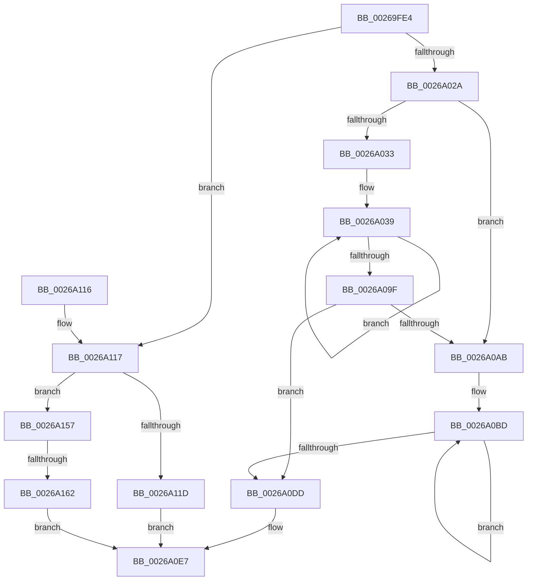

# wyhash

- RVA: `0x00269FE4`–`0x0026A18A` (길이 `422` bytes)
- VA: `0x0000000140269FE4`
- 실행 섹션: `.text`
- PDB 이름 있음: `예`; PDB Function 태그: `예`
- unwind 정보 RVA: `0x000653B0`
- 디코드: `115`개 명령, `422/422` bytes 표시
- 미해석 바이트: `0` (있으면 어셈블리에 `.byte`로 보존)

> 이 문서는 커널 이미지의 기계어와 PDB 기호를 분석해 생성했습니다. 4번과 5번은 함수 원형과 자료형을 바이너리 사용 방식에서 추정한 C 해석이며 원본 소스 복구 결과는 아닙니다.

## 1. Dependencies

- 직접 호출 지점: **0**; 고유 호출 대상: **0**
- 직접 호출자로 확인된 함수: **15**
- RIP 상대 이미지 참조: **0**

### Outgoing calls
- 직접 디코드된 call 명령이 없습니다.

### Direct callers
- [SMKM_STORE_MGR&lt;SM_TRAITS&gt;::SmCompressCtxCompleteEntry](SMKM_STORE_MGR_SM_TRAITS_SmCompressCtxCompleteEntry_function_002685C0.md) at `0x00268655`
- [SmHpChunkUnprotect](SmHpChunkUnprotect_function_002687A0.md) at `0x00268820`
- [SmHpChunkUnprotect](SmHpChunkUnprotect_function_002687A0.md) at `0x00268877`
- [sub_002689C7](Unknown_function_002689C7.md) at `0x00268A7C`
- [ST_STORE&lt;SM_TRAITS&gt;::StDmPageRecordUnprotect](ST_STORE_SM_TRAITS_StDmPageRecordUnprotect_function_00268B30.md) at `0x00268CA6`
- [sub_00268EBD](Unknown_function_00268EBD.md) at `0x00268EC8`
- [sub_002691F9](Unknown_function_002691F9.md) at `0x00269204`
- [SmHpUnprotectListNeighbors](SmHpUnprotectListNeighbors_function_002692A4.md) at `0x00269395`
- [SmHpUnprotectListNeighbors](SmHpUnprotectListNeighbors_function_002692A4.md) at `0x002693E3`
- [SmHpUnprotectListNeighbors](SmHpUnprotectListNeighbors_function_002692A4.md) at `0x00269421`
- [SmHpBufferProtectEx](SmHpBufferProtectEx_function_002694C0.md) at `0x00269521`
- [SmHpBufferProtectEx](SmHpBufferProtectEx_function_002694C0.md) at `0x00269578`
- [SmStoreCopyHashCompressedBuffer](SmStoreCopyHashCompressedBuffer_function_0026B918.md) at `0x0026B98E`
- [SmHpChunkHeapProtect](../3A/SmHpChunkHeapProtect_function_003AFD8C.md) at `0x003AFE26`
- [SmHpChunkHeapProtect](../3A/SmHpChunkHeapProtect_function_003AFD8C.md) at `0x003AFE73`
- [MiAddMdlTracker](../49/MiAddMdlTracker_function_0049A240.md) at `0x0049A2FF`
- [MiValidateMdlTracker](../4B/MiValidateMdlTracker_function_004B894C.md) at `0x004B89F2`
- [SmStoreHashCompressedData](../4F/SmStoreHashCompressedData_function_004F6910.md) at `0x004F697C`
- [SmStoreHashCompressedData](../4F/SmStoreHashCompressedData_function_004F6910.md) at `0x004F69B8`
- [SmStoreHashCompressedData](../4F/SmStoreHashCompressedData_function_004F6910.md) at `0x004F69E5`
- [sub_006D9154](../6D/Unknown_function_006D9154.md) at `0x006D919A`
- [sub_006D9154](../6D/Unknown_function_006D9154.md) at `0x006D91D9`
- [sub_006D99C0](../6D/Unknown_function_006D99C0.md) at `0x006D9A25`
- [sub_006D99C0](../6D/Unknown_function_006D99C0.md) at `0x006D9ABA`

### Static image references
- 디코드된 RIP-relative 메모리 참조가 없습니다.

## 2. Other-region calls and transfers

- 다른 실행 섹션으로 향하는 call: **0**
- call이 아닌 외부 분기/꼬리 이동: **1**
  - `0x0026A15C` → [sub_006D9694](../6D/Unknown_function_006D9694.md) (`tail-transfer`)

## 3. Assembly (complete function range)

```asm
00269FE4  48 89 5C 24 08                  mov qword ptr [rsp + 8], rbx
00269FE9  48 89 6C 24 10                  mov qword ptr [rsp + 0x10], rbp
00269FEE  48 89 74 24 18                  mov qword ptr [rsp + 0x18], rsi
00269FF3  57                              push rdi
00269FF4  4C 8B CA                        mov r9, rdx
00269FF7  48 BE C9 AC 2E 96 93 4B B8 8B   movabs rsi, 0x8bb84b93962eacc9
0026A001  49 8B D0                        mov rdx, r8
0026A004  48 BD A5 78 6C AA CC 8D 35 2D   movabs rbp, 0x2d358dccaa6c78a5
0026A00E  48 33 D5                        xor rdx, rbp
0026A011  48 8B C6                        mov rax, rsi
0026A014  48 F7 E2                        mul rdx
0026A017  4C 8B D1                        mov r10, rcx
0026A01A  48 33 C2                        xor rax, rdx
0026A01D  4C 33 C0                        xor r8, rax
0026A020  49 83 F9 10                     cmp r9, 0x10
0026A024  0F 86 ED 00 00 00               jbe 0x14026a117
0026A02A  49 8B D9                        mov rbx, r9
0026A02D  49 83 F9 30                     cmp r9, 0x30
0026A031  72 78                           jb 0x14026a0ab
0026A033  49 8B F8                        mov rdi, r8
0026A036  4D 8B D8                        mov r11, r8
0026A039  4D 33 42 08                     xor r8, qword ptr [r10 + 8]
0026A03D  48 83 EB 30                     sub rbx, 0x30
0026A041  49 33 7A 18                     xor rdi, qword ptr [r10 + 0x18]
0026A045  49 8B C0                        mov rax, r8
0026A048  4D 33 5A 28                     xor r11, qword ptr [r10 + 0x28]
0026A04C  49 8B 0A                        mov rcx, qword ptr [r10]
0026A04F  48 33 CE                        xor rcx, rsi
0026A052  48 F7 E1                        mul rcx
0026A055  49 8B 4A 10                     mov rcx, qword ptr [r10 + 0x10]
0026A059  4C 8B C0                        mov r8, rax
0026A05C  48 B8 A3 D4 33 D4 2E A6 33 4B   movabs rax, 0x4b33a62ed433d4a3
0026A066  48 33 C8                        xor rcx, rax
0026A069  4C 33 C2                        xor r8, rdx
0026A06C  48 8B C7                        mov rax, rdi
0026A06F  48 F7 E1                        mul rcx
0026A072  49 8B 4A 20                     mov rcx, qword ptr [r10 + 0x20]
0026A076  49 83 C2 30                     add r10, 0x30
0026A07A  48 8B F8                        mov rdi, rax
0026A07D  48 B8 47 AA E1 1D A5 2D 5A 4D   movabs rax, 0x4d5a2da51de1aa47
0026A087  48 33 C8                        xor rcx, rax
0026A08A  48 33 FA                        xor rdi, rdx
0026A08D  49 8B C3                        mov rax, r11
0026A090  48 F7 E1                        mul rcx
0026A093  4C 8B D8                        mov r11, rax
0026A096  4C 33 DA                        xor r11, rdx
0026A099  48 83 FB 30                     cmp rbx, 0x30
0026A09D  73 9A                           jae 0x14026a039
0026A09F  4C 33 DF                        xor r11, rdi
0026A0A2  4D 33 C3                        xor r8, r11
0026A0A5  48 83 FB 10                     cmp rbx, 0x10
0026A0A9  76 32                           jbe 0x14026a0dd
0026A0AB  4C 8D 5B EF                     lea r11, [rbx - 0x11]
0026A0AF  49 C1 EB 04                     shr r11, 4
0026A0B3  49 FF C3                        inc r11
0026A0B6  49 6B C3 F0                     imul rax, r11, -0x10
0026A0BA  48 03 D8                        add rbx, rax
0026A0BD  4D 33 42 08                     xor r8, qword ptr [r10 + 8]
0026A0C1  49 8B 0A                        mov rcx, qword ptr [r10]
0026A0C4  49 8B C0                        mov rax, r8
0026A0C7  48 33 CE                        xor rcx, rsi
0026A0CA  49 83 C2 10                     add r10, 0x10
0026A0CE  48 F7 E1                        mul rcx
0026A0D1  4C 8B C0                        mov r8, rax
0026A0D4  4C 33 C2                        xor r8, rdx
0026A0D7  49 83 EB 01                     sub r11, 1
0026A0DB  75 E0                           jne 0x14026a0bd
0026A0DD  4A 8B 54 13 F0                  mov rdx, qword ptr [rbx + r10 - 0x10]
0026A0E2  4A 8B 4C 13 F8                  mov rcx, qword ptr [rbx + r10 - 8]
0026A0E7  48 8B 5C 24 10                  mov rbx, qword ptr [rsp + 0x10]
0026A0EC  48 33 D6                        xor rdx, rsi
0026A0EF  49 33 C8                        xor rcx, r8
0026A0F2  48 8B C1                        mov rax, rcx
0026A0F5  48 F7 E2                        mul rdx
0026A0F8  48 33 D6                        xor rdx, rsi
0026A0FB  4C 33 C8                        xor r9, rax
0026A0FE  48 8B 74 24 20                  mov rsi, qword ptr [rsp + 0x20]
0026A103  4C 33 CD                        xor r9, rbp
0026A106  48 8B 6C 24 18                  mov rbp, qword ptr [rsp + 0x18]
0026A10B  48 8B C2                        mov rax, rdx
0026A10E  49 F7 E1                        mul r9
0026A111  48 33 C2                        xor rax, rdx
0026A114  5F                              pop rdi
0026A115  C3                              ret
0026A116  CC                              int3
0026A117  49 83 F9 04                     cmp r9, 4
0026A11B  72 3A                           jb 0x14026a157
0026A11D  48 B8 FC FF FF FF FF FF FF 7F   movabs rax, 0x7ffffffffffffffc
0026A127  49 8B C9                        mov rcx, r9
0026A12A  48 D1 E9                        shr rcx, 1
0026A12D  48 23 C8                        and rcx, rax
0026A130  41 8B 02                        mov eax, dword ptr [r10]
0026A133  48 C1 E0 20                     shl rax, 0x20
0026A137  42 8B 14 11                     mov edx, dword ptr [rcx + r10]
0026A13B  48 0B D0                        or rdx, rax
0026A13E  49 8B C2                        mov rax, r10
0026A141  48 2B C1                        sub rax, rcx
0026A144  42 8B 4C 08 FC                  mov ecx, dword ptr [rax + r9 - 4]
0026A149  43 8B 44 0A FC                  mov eax, dword ptr [r10 + r9 - 4]
0026A14E  48 C1 E0 20                     shl rax, 0x20
0026A152  48 0B C8                        or rcx, rax
0026A155  EB 90                           jmp 0x14026a0e7
0026A157  33 C9                           xor ecx, ecx
0026A159  4D 85 C9                        test r9, r9
0026A15C  0F 84 32 F5 46 00               je 0x1406d9694
0026A162  49 8B C1                        mov rax, r9
0026A165  48 D1 E8                        shr rax, 1
0026A168  42 0F B6 14 10                  movzx edx, byte ptr [rax + r10]
0026A16D  41 0F B6 02                     movzx eax, byte ptr [r10]
0026A171  48 C1 E0 08                     shl rax, 8
0026A175  48 0B D0                        or rdx, rax
0026A178  43 0F B6 44 0A FF               movzx eax, byte ptr [r10 + r9 - 1]
0026A17E  48 C1 E2 08                     shl rdx, 8
0026A182  48 0B D0                        or rdx, rax
0026A185  E9 5D FF FF FF                  jmp 0x14026a0e7
```

## 4. C-style interpretation (structured pseudocode)

```c
__int64 __fastcall wyhash(__int64 a1, __int64 a2, __int64 a3)
{
    __int64 result;
    __int64 v_r10;
    __int64 v_r11;
    __int64 v_rbx;
    __int64 v_rdi;
    unsigned __int64 v_stack_p10;
    unsigned __int64 v_stack_p18;
    unsigned __int64 v_stack_p8;

    v_stack_p8 = v_rbx;
    v_stack_p10 = v_rbp;
    v_stack_p18 = v_rsi;
    a2 = (a3) ^ (v_rbp);
    result = (v_rsi) ^ (a2);
    a3 = (a3) ^ (result);
    if (a2 <= 16) goto loc_0026A117;
    if (a2 < 48) goto loc_0026A0AB;
loc_0026A039:
    a3 = (a3) ^ (*(unsigned __int64 *)(a1 + 8));
    v_rbx = (a2) - (48);
    v_rdi = (a3) ^ (*(unsigned __int64 *)(a1 + 24));
    v_r11 = (a3) ^ (*(unsigned __int64 *)(a1 + 40));
    a1 = (*(unsigned __int64 *)(a1)) ^ (v_rsi);
    a1 = (*(unsigned __int64 *)(a1 + 16)) ^ (a3);
    a3 = (a3) ^ (a2);
    v_r10 = (a1) + (48);
    a1 = (*(unsigned __int64 *)(a1 + 32)) ^ (v_rdi);
    v_rdi = (v_rdi) ^ (a2);
    v_r11 = (v_r11) ^ (a2);
    if (v_rbx >= 48) goto loc_0026A039;
    v_r11 = (v_r11) ^ (v_rdi);
    a3 = (a3) ^ (v_r11);
    if (v_rbx <= 16) goto loc_0026A0DD;
loc_0026A0AB:
    v_r11 = (v_rbx - 17) >> (4);
    v_r11 = (v_r11) + 1;
    result = (v_r11) * (v_r11);
    v_rbx = (v_rbx) + (result);
loc_0026A0BD:
    a3 = (a3) ^ (*(unsigned __int64 *)(v_r10 + 8));
    a1 = (*(unsigned __int64 *)(v_r10)) ^ (v_rsi);
    v_r10 = (v_r10) + (16);
    a3 = (a3) ^ (a2);
    v_r11 = (v_r11) - (1);
    if (condition_is_not_equal) goto loc_0026A0BD;
loc_0026A0DD:
loc_0026A0E7:
    a2 = (*(unsigned __int64 *)(v_rbx + v_r10 * 1 - 16)) ^ (v_rsi);
    a1 = (*(unsigned __int64 *)(v_rbx + v_r10 * 1 - 8)) ^ (a3);
    a2 = (a2) ^ (v_rsi);
    a4 = (a2) ^ (a1);
    a4 = (a4) ^ (v_rbp);
    result = (a2) ^ (a2);
    return result;
loc_0026A117:
    if (a4 < 4) goto loc_0026A157;
    a1 = (a4) >> (1);
    a1 = (a1) & (result);
    result = ((unsigned int)(*(unsigned int *)(v_r10))) << (32);
    a2 = ((unsigned int)(*(unsigned int *)(a1 + v_r10 * 1))) | (result);
    result = (v_r10) - (a1);
    result = ((unsigned int)(*(unsigned int *)(v_r10 + a4 * 1 - 4))) << (32);
    a1 = ((unsigned int)(*(unsigned int *)(result + a4 * 1 - 4))) | (result);
    goto loc_0026A0E7;
loc_0026A157:
    a1 = 0;
    result = (a4) >> (1);
    result = (*(unsigned __int8 *)(v_r10)) << (8);
    a2 = (*(unsigned __int8 *)(result + v_r10 * 1)) | (result);
    a2 = (a2) << (8);
    a2 = (a2) | (*(unsigned __int8 *)(v_r10 + a4 * 1 - 1));
    goto loc_0026A0E7;
}
```

## 5. (Beta) C Style

```c
int64_t wyhash(void *Arg1, int64_t Arg2, int64_t Arg3)
{
    uint8_t *arg1 = (uint8_t *)Arg1;

    int64_t result;
    int64_t local_r10;
    int64_t local_r11;
    int64_t local_rbx;
    int64_t local_rdi;
    uint64_t v_stack_p10;
    uint64_t v_stack_p18;
    uint64_t v_stack_p8;

    v_stack_p8 = local_rbx;
    v_stack_p10 = local_rbp;
    v_stack_p18 = local_rsi;
    Arg2 = (Arg3) ^ (local_rbp);
    result = (local_rsi) ^ (Arg2);
    Arg3 = (Arg3) ^ (result);
    if (Arg2 <= 16) goto loc_0026A117;
    if (Arg2 < 48) goto loc_0026A0AB;
loc_0026A039:
    Arg3 = (Arg3) ^ (*(uint64_t *)(arg1 + 0x8));
    local_rbx = (Arg2) - (48);
    local_rdi = (Arg3) ^ (*(uint64_t *)(arg1 + 0x18));
    local_r11 = (Arg3) ^ (*(uint64_t *)(arg1 + 0x28));
    Arg1 = (*(uint64_t *)(arg1)) ^ (local_rsi);
    Arg1 = (*(uint64_t *)(arg1 + 0x10)) ^ (Arg3);
    Arg3 = (Arg3) ^ (Arg2);
    local_r10 = (Arg1) + (48);
    Arg1 = (*(uint64_t *)(arg1 + 0x20)) ^ (local_rdi);
    local_rdi = (local_rdi) ^ (Arg2);
    local_r11 = (local_r11) ^ (Arg2);
    if (local_rbx >= 48) goto loc_0026A039;
    local_r11 = (local_r11) ^ (local_rdi);
    Arg3 = (Arg3) ^ (local_r11);
    if (local_rbx <= 16) goto loc_0026A0DD;
loc_0026A0AB:
    local_r11 = (local_rbx - 17) >> (4);
    local_r11 = (local_r11) + 1;
    result = (local_r11) * (local_r11);
    local_rbx = (local_rbx) + (result);
loc_0026A0BD:
    Arg3 = (Arg3) ^ (*(uint64_t *)(local_r10 + 0x8));
    Arg1 = (*(uint64_t *)(local_r10)) ^ (local_rsi);
    local_r10 = (local_r10) + (16);
    Arg3 = (Arg3) ^ (Arg2);
    local_r11 = (local_r11) - (1);
    if (condition_is_not_equal) goto loc_0026A0BD;
loc_0026A0DD:
loc_0026A0E7:
    Arg2 = (*(uint64_t *)(local_rbx + local_r10 * 1 - 0x10)) ^ (local_rsi);
    Arg1 = (*(uint64_t *)(local_rbx + local_r10 * 1 - 0x8)) ^ (Arg3);
    Arg2 = (Arg2) ^ (local_rsi);
    a4 = (Arg2) ^ (Arg1);
    a4 = (a4) ^ (local_rbp);
    result = (Arg2) ^ (Arg2);
    return result;
loc_0026A117:
    if (a4 < 4) goto loc_0026A157;
    Arg1 = (a4) >> (1);
    Arg1 = (Arg1) & (result);
    result = ((uint32_t)(*(uint32_t *)(local_r10))) << (32);
    Arg2 = ((uint32_t)(*(uint32_t *)(arg1 + local_r10 * 1))) | (result);
    result = (local_r10) - (Arg1);
    result = ((uint32_t)(*(uint32_t *)(local_r10 + a4 * 1 - 0x4))) << (32);
    Arg1 = ((uint32_t)(*(uint32_t *)(result + a4 * 1 - 0x4))) | (result);
    goto loc_0026A0E7;
loc_0026A157:
    Arg1 = 0;
    result = (a4) >> (1);
    result = (*(uint8_t *)(local_r10)) << (8);
    Arg2 = (*(uint8_t *)(result + local_r10 * 1)) | (result);
    Arg2 = (Arg2) << (8);
    Arg2 = (Arg2) | (*(uint8_t *)(local_r10 + a4 * 1 - 0x1));
    goto loc_0026A0E7;
}
```

### 관측된 메모리 오프셋

구조체 형식이 확인되지 않은 접근은 인자 기준의 오프셋으로만 기록했습니다.

| 기준 인자 | 오프셋 표현 | 폭 (bit) | 접근 |
|---|---:|---:|---|
| `Arg1` | `- 0x4 + r9*1` | `32` | `R` |
| `Arg1` | `- 0x1 + r9*1` | `8` | `R` |
| `Arg1` | `+ 0x0` | `8` | `R` |
| `Arg1` | `+ 0x0` | `32` | `R` |
| `Arg1` | `+ 0x0` | `64` | `R` |
| `Arg1` | `+ 0x8` | `64` | `R` |
| `Arg1` | `+ 0x10` | `64` | `R` |
| `Arg1` | `+ 0x18` | `64` | `R` |
| `Arg1` | `+ 0x20` | `64` | `R` |
| `Arg1` | `+ 0x28` | `64` | `R` |

## 6. Execution-region graph

[열기: 2D/3D 그래프와 함수 탐색 컨트롤 패널](../../../control-panel.html?section=text&rva=0x00269FE4&view=graph)

- 2D 그래프는 위에서 아래로 흐르고, 3D 그래프는 빈 공간을 드래그해 회전합니다. Shift+드래그는 이동, 휠은 확대·축소, 함수 노드 선택은 대상 보고서 이동입니다.

### Static fallback


