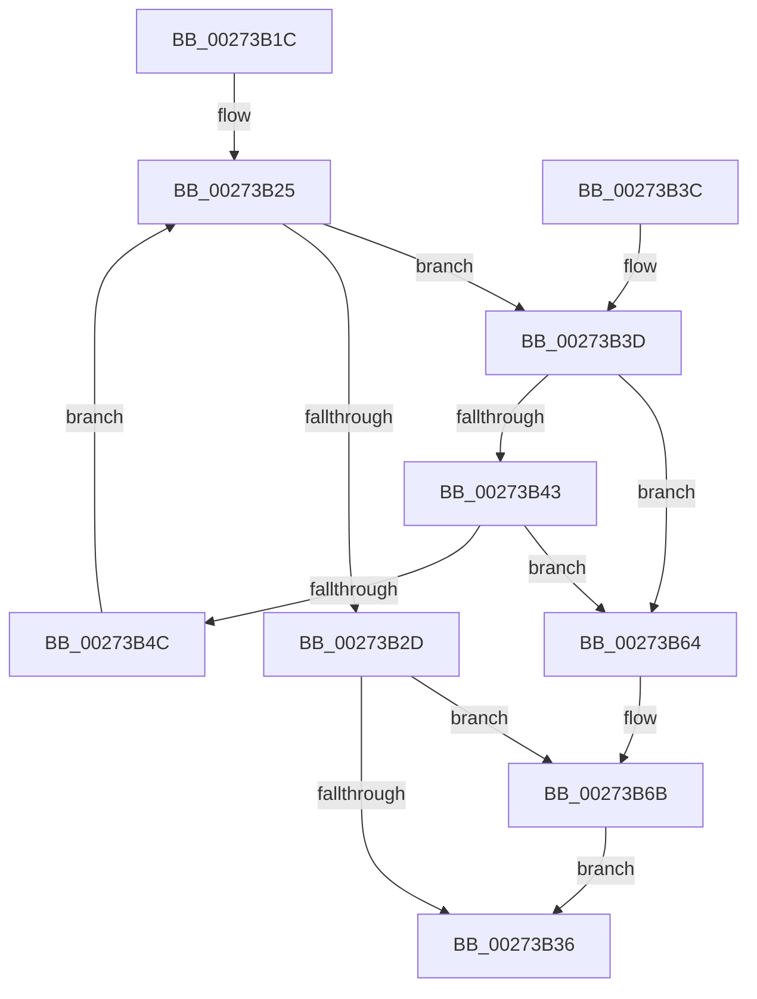

# CcFreeUnusedVacbLevels

- RVA: `0x00273B1C`–`0x00273B7E` (길이 `98` bytes)
- VA: `0x0000000140273B1C`
- 실행 섹션: `.text`
- PDB 이름 있음: `예`; PDB Function 태그: `아니요`
- unwind 정보 RVA: `0x00065D08`
- 디코드: `30`개 명령, `98/98` bytes 표시
- 미해석 바이트: `0` (있으면 어셈블리에 `.byte`로 보존)

> 이 문서는 커널 이미지의 기계어와 PDB 기호를 분석해 생성했습니다. 4번과 5번은 함수 원형과 자료형을 바이너리 사용 방식에서 추정한 C 해석이며 원본 소스 복구 결과는 아닙니다.

## 1. Dependencies

- 직접 호출 지점: **2**; 고유 호출 대상: **1**
- 직접 호출자로 확인된 함수: **4**
- RIP 상대 이미지 참조: **1**

### Outgoing calls
- `0x00273B5A` → [ExFreeToNPagedLookasideList](../38/ExFreeToNPagedLookasideList_function_0038D9D0.md) (function, `0x0038D9D0`)
- `0x00273B72` → [ExFreeToNPagedLookasideList](../38/ExFreeToNPagedLookasideList_function_0038D9D0.md) (function, `0x0038D9D0`)

### Direct callers
- [CcExtendVacbArray](../26/CcExtendVacbArray_function_0026DCD0.md) at `0x0026DE7D`
- [CcExtendVacbArray](../26/CcExtendVacbArray_function_0026DCD0.md) at `0x0026DFE8`
- [CcSetVacbLargeOffset](CcSetVacbLargeOffset_function_002733D0.md) at `0x00273502`
- [CcAllocateVacbLevels](../48/CcAllocateVacbLevels_function_00482050.md) at `0x00482087`
- [sub_006E2024](../6E/Unknown_function_006E2024.md) at `0x006E205F`

### Static image references
- `0x00273B4F` → RVA `0x00E11A80` (`.data`; read)

## 2. Other-region calls and transfers

- 다른 실행 섹션으로 향하는 call: **0**
- 별도 외부 분기/꼬리 이동을 확인하지 못했습니다.

## 3. Assembly (complete function range)

```asm
00273B1C  40 53                           push rbx
00273B1E  48 83 EC 20                     sub rsp, 0x20
00273B22  48 8B D9                        mov rbx, rcx
00273B25  48 8B 13                        mov rdx, qword ptr [rbx]
00273B28  48 3B D3                        cmp rdx, rbx
00273B2B  75 10                           jne 0x140273b3d
00273B2D  48 8B 53 10                     mov rdx, qword ptr [rbx + 0x10]
00273B31  48 85 D2                        test rdx, rdx
00273B34  75 35                           jne 0x140273b6b
00273B36  48 83 C4 20                     add rsp, 0x20
00273B3A  5B                              pop rbx
00273B3B  C3                              ret
00273B3C  CC                              int3
00273B3D  48 39 5A 08                     cmp qword ptr [rdx + 8], rbx
00273B41  75 21                           jne 0x140273b64
00273B43  48 8B 02                        mov rax, qword ptr [rdx]
00273B46  48 39 50 08                     cmp qword ptr [rax + 8], rdx
00273B4A  75 18                           jne 0x140273b64
00273B4C  48 89 03                        mov qword ptr [rbx], rax
00273B4F  48 8D 0D 2A DF B9 00            lea rcx, [rip + 0xb9df2a]
00273B56  48 89 58 08                     mov qword ptr [rax + 8], rbx
00273B5A  E8 71 9E 11 00                  call 0x14038d9d0
00273B5F  FF 4B 18                        dec dword ptr [rbx + 0x18]
00273B62  EB C1                           jmp 0x140273b25
00273B64  B9 03 00 00 00                  mov ecx, 3
00273B69  CD 29                           int 0x29
00273B6B  48 8D 0D 0E DF B9 00            lea rcx, [rip + 0xb9df0e]
00273B72  E8 59 9E 11 00                  call 0x14038d9d0
00273B77  48 83 63 10 00                  and qword ptr [rbx + 0x10], 0
00273B7C  EB B8                           jmp 0x140273b36
```

## 4. C-style interpretation (structured pseudocode)

```c
__int64 __fastcall CcFreeUnusedVacbLevels(__int64 a1)
{
    __int64 result;
    __int64 v_rsp;

    v_rsp = (v_rsp) - (32);
loc_00273B25:
    if ((*(unsigned __int64 *)(a1)) != a1) goto loc_00273B3D;
    if (*(unsigned __int64 *)(a1 + 16) != 0) goto loc_00273B6B;
loc_00273B36:
    v_rsp = (v_rsp) + (32);
    return result;
loc_00273B3D:
    if ((*(unsigned __int64 *)(*(unsigned __int64 *)(a1 + 16) + 8)) != a1) goto loc_00273B64;
    if ((*(unsigned __int64 *)(*(unsigned __int64 *)(*(unsigned __int64 *)(a1 + 16)) + 8)) != (*(unsigned __int64 *)(a1 + 16))) goto loc_00273B64;
    *(unsigned __int64 *)(a1) = *(unsigned __int64 *)(*(unsigned __int64 *)(a1 + 16));
    *(unsigned __int64 *)(*(unsigned __int64 *)(*(unsigned __int64 *)(a1 + 16)) + 8) = a1;
    result = ExFreeToNPagedLookasideList(v_rip + 12181290, *(unsigned __int64 *)(a1 + 16), a3, a4);
    goto loc_00273B25;
loc_00273B64:
loc_00273B6B:
    result = ExFreeToNPagedLookasideList(v_rip + 12181262, *(unsigned __int64 *)(a1 + 16), a3, a4);
    goto loc_00273B36;
}
```

## 5. (Beta) C Style

```c
int64_t CcFreeUnusedVacbLevels(void *Arg1)
{
    uint8_t *arg1 = (uint8_t *)Arg1;

    int64_t result;
    int64_t local_rsp;

    local_rsp = (local_rsp) - (32);
loc_00273B25:
    if ((*(uint64_t *)(arg1)) != Arg1) goto loc_00273B3D;
    if (*(uint64_t *)(arg1 + 0x10) != 0) goto loc_00273B6B;
loc_00273B36:
    local_rsp = (local_rsp) + (32);
    return result;
loc_00273B3D:
    if ((*(uint64_t *)(*(uint64_t *)(arg1 + 0x10) + 0x8)) != Arg1) goto loc_00273B64;
    if ((*(uint64_t *)(*(uint64_t *)(*(uint64_t *)(arg1 + 0x10)) + 0x8)) != (*(uint64_t *)(arg1 + 0x10))) goto loc_00273B64;
    *(uint64_t *)(arg1) = *(uint64_t *)(*(uint64_t *)(arg1 + 0x10));
    *(void **)(*(uint64_t *)(*(uint64_t *)(arg1 + 0x10)) + 0x8) = Arg1;
    result = ExFreeToNPagedLookasideList(v_rip + 12181290, *(uint64_t *)(arg1 + 0x10), a3, a4);
    goto loc_00273B25;
loc_00273B64:
loc_00273B6B:
    result = ExFreeToNPagedLookasideList(v_rip + 12181262, *(uint64_t *)(arg1 + 0x10), a3, a4);
    goto loc_00273B36;
}
```

### 관측된 메모리 오프셋

구조체 형식이 확인되지 않은 접근은 인자 기준의 오프셋으로만 기록했습니다.

| 기준 인자 | 오프셋 표현 | 폭 (bit) | 접근 |
|---|---:|---:|---|
| `Arg1` | `+ 0x0` | `64` | `R` |
| `Arg1` | `+ 0x0` | `64` | `W` |
| `Arg1` | `+ 0x10` | `64` | `R` |
| `Arg1` | `+ 0x10` | `64` | `R/W` |
| `Arg1` | `+ 0x18` | `32` | `R/W` |

## 6. Execution-region graph

[열기: 2D/3D 그래프와 함수 탐색 컨트롤 패널](../../../control-panel.html?section=text&rva=0x00273B1C&view=graph)

- 2D 그래프는 위에서 아래로 흐르고, 3D 그래프는 빈 공간을 드래그해 회전합니다. Shift+드래그는 이동, 휠은 확대·축소, 함수 노드 선택은 대상 보고서 이동입니다.

### Static fallback


