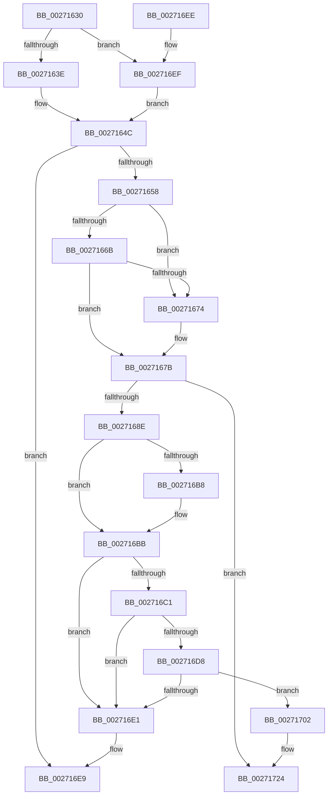

# CcGetVacbFromFreeList

- RVA: `0x00271630`–`0x00271746` (길이 `278` bytes)
- VA: `0x0000000140271630`
- 실행 섹션: `.text`
- PDB 이름 있음: `예`; PDB Function 태그: `아니요`
- unwind 정보 RVA: `0x00065AD4`
- 디코드: `68`개 명령, `278/278` bytes 표시
- 미해석 바이트: `0` (있으면 어셈블리에 `.byte`로 보존)

> 이 문서는 커널 이미지의 기계어와 PDB 기호를 분석해 생성했습니다. 4번과 5번은 함수 원형과 자료형을 바이너리 사용 방식에서 추정한 C 해석이며 원본 소스 복구 결과는 아닙니다.

## 1. Dependencies

- 직접 호출 지점: **2**; 고유 호출 대상: **1**
- 직접 호출자로 확인된 함수: **2**
- RIP 상대 이미지 참조: **4**

### Outgoing calls
- `0x0027171E` → [KeBugCheckEx](../4F/KeBugCheckEx_function_004FD660.md) (function, `0x004FD660`)
- `0x00271740` → [KeBugCheckEx](../4F/KeBugCheckEx_function_004FD660.md) (function, `0x004FD660`)

### Direct callers
- [CcGetVacbMiss](CcGetVacbMiss_function_00272900.md) at `0x00272DB3`
- [CcInitializePartitionVacbs](../57/CcInitializePartitionVacbs_function_0057EB60.md) at `0x0057EBA5`

### Static image references
- `0x0027163E` → RVA `0x00F8F4C0` (`.data`; read)
- `0x00271645` → RVA `0x00F8F4A8` (`.data`; read)
- `0x0027165F` → RVA `0x00E65B8C` (`.data`; read/write)
- `0x002716C8` → RVA `0x00F8F4A0` (`.data`; read)

## 2. Other-region calls and transfers

- 다른 실행 섹션으로 향하는 call: **0**
- 별도 외부 분기/꼬리 이동을 확인하지 못했습니다.

## 3. Assembly (complete function range)

```asm
00271630  48 83 EC 38                     sub rsp, 0x38
00271634  33 C0                           xor eax, eax
00271636  84 D2                           test dl, dl
00271638  0F 85 B1 00 00 00               jne 0x1402716ef
0027163E  48 8D 15 7B DE D1 00            lea rdx, [rip + 0xd1de7b]
00271645  4C 8D 0D 5C DE D1 00            lea r9, [rip + 0xd1de5c]
0027164C  48 8B 0A                        mov rcx, qword ptr [rdx]
0027164F  48 3B CA                        cmp rcx, rdx
00271652  0F 84 91 00 00 00               je 0x1402716e9
00271658  4C 8B 01                        mov r8, qword ptr [rcx]
0027165B  48 8D 41 F0                     lea rax, [rcx - 0x10]
0027165F  FF 05 27 45 BF 00               inc dword ptr [rip + 0xbf4527]
00271665  49 39 48 08                     cmp qword ptr [r8 + 8], rcx
00271669  75 09                           jne 0x140271674
0027166B  48 8B 51 08                     mov rdx, qword ptr [rcx + 8]
0027166F  48 39 0A                        cmp qword ptr [rdx], rcx
00271672  74 07                           je 0x14027167b
00271674  B9 03 00 00 00                  mov ecx, 3
00271679  CD 29                           int 0x29
0027167B  4C 89 02                        mov qword ptr [rdx], r8
0027167E  49 89 50 08                     mov qword ptr [r8 + 8], rdx
00271682  41 8B 09                        mov ecx, dword ptr [r9]
00271685  83 F9 01                        cmp ecx, 1
00271688  0F 82 96 00 00 00               jb 0x140271724
0027168E  FF C9                           dec ecx
00271690  49 B8 CD CC CC CC CC CC CC CC   movabs r8, 0xcccccccccccccccd
0027169A  41 89 09                        mov dword ptr [r9], ecx
0027169D  48 8B C8                        mov rcx, rax
002716A0  48 8B 50 20                     mov rdx, qword ptr [rax + 0x20]
002716A4  48 2B CA                        sub rcx, rdx
002716A7  48 83 E9 10                     sub rcx, 0x10
002716AB  48 C1 F9 03                     sar rcx, 3
002716AF  49 0F AF C8                     imul rcx, r8
002716B3  3B 4A 08                        cmp ecx, dword ptr [rdx + 8]
002716B6  76 03                           jbe 0x1402716bb
002716B8  89 4A 08                        mov dword ptr [rdx + 8], ecx
002716BB  48 83 38 00                     cmp qword ptr [rax], 0
002716BF  75 20                           jne 0x1402716e1
002716C1  48 8B 48 20                     mov rcx, qword ptr [rax + 0x20]
002716C5  44 8B 09                        mov r9d, dword ptr [rcx]
002716C8  48 8B 0D D1 DD D1 00            mov rcx, qword ptr [rip + 0xd1ddd1]
002716CF  4E 8B 04 C9                     mov r8, qword ptr [rcx + r9*8]
002716D3  4D 85 C0                        test r8, r8
002716D6  74 09                           je 0x1402716e1
002716D8  41 FF 40 04                     inc dword ptr [r8 + 4]
002716DC  45 39 08                        cmp dword ptr [r8], r9d
002716DF  75 21                           jne 0x140271702
002716E1  48 C7 40 08 FF FF FF FF         mov qword ptr [rax + 8], 0xffffffffffffffff
002716E9  48 83 C4 38                     add rsp, 0x38
002716ED  C3                              ret
002716EE  CC                              int3
002716EF  48 8D 91 D0 04 00 00            lea rdx, [rcx + 0x4d0]
002716F6  4C 8D 89 E0 04 00 00            lea r9, [rcx + 0x4e0]
002716FD  E9 4A FF FF FF                  jmp 0x14027164c
00271702  45 33 C9                        xor r9d, r9d
00271705  48 C7 44 24 20 00 00 00 00      mov qword ptr [rsp + 0x20], 0
0027170E  BA 76 01 00 00                  mov edx, 0x176
00271713  49 C7 C0 20 04 00 C0            mov r8, 0xffffffffc0000420
0027171A  41 8D 49 34                     lea ecx, [r9 + 0x34]
0027171E  E8 3D BF 28 00                  call 0x1404fd660
00271723  CC                              int3
00271724  45 33 C9                        xor r9d, r9d
00271727  48 C7 44 24 20 00 00 00 00      mov qword ptr [rsp + 0x20], 0
00271730  BA 94 03 00 00                  mov edx, 0x394
00271735  49 C7 C0 20 04 00 C0            mov r8, 0xffffffffc0000420
0027173C  41 8D 49 34                     lea ecx, [r9 + 0x34]
00271740  E8 1B BF 28 00                  call 0x1404fd660
00271745  CC                              int3
```

## 4. C-style interpretation (structured pseudocode)

```c
__int64 __fastcall CcGetVacbFromFreeList(__int64 a1, unsigned __int8 a2)
{
    __int64 result;
    __int64 v_rsp;
    unsigned __int64 v_stack_p20;

    v_rsp = (v_rsp) - (56);
    result = 0;
    if (a2 != 0) goto loc_002716EF;
loc_0027164C:
    if ((*(unsigned __int64 *)(v_rip + 13753979)) == (v_rip + 13753979)) goto loc_002716E9;
    if ((*(unsigned __int64 *)(*(unsigned __int64 *)(*(unsigned __int64 *)(v_rip + 13753979)) + 8)) != (*(unsigned __int64 *)(v_rip + 13753979))) goto loc_00271674;
    if ((*(unsigned __int64 *)(*(unsigned __int64 *)(*(unsigned __int64 *)(v_rip + 13753979) + 8))) != (*(unsigned __int64 *)(v_rip + 13753979))) {
        a1 = 3;
    }
    *(unsigned __int64 *)(*(unsigned __int64 *)(*(unsigned __int64 *)(v_rip + 13753979) + 8)) = *(unsigned __int64 *)(*(unsigned __int64 *)(v_rip + 13753979));
    *(unsigned __int64 *)(*(unsigned __int64 *)(*(unsigned __int64 *)(v_rip + 13753979)) + 8) = *(unsigned __int64 *)(*(unsigned __int64 *)(v_rip + 13753979) + 8);
    if (((unsigned int)((unsigned int)(*(unsigned int *)(v_rip + 13753948)))) < 1) goto loc_00271724;
    a1 = (unsigned int)(((unsigned int)(*(unsigned int *)(v_rip + 13753948))) - 1);
    *(unsigned int *)(v_rip + 13753948) = (unsigned int)(a1);
    a1 = (*(unsigned __int64 *)(v_rip + 13753979) - 16) - (*(unsigned __int64 *)(*(unsigned __int64 *)(v_rip + 13753979) - 16 + 32));
    a1 = (a1) - (16);
    a1 = (a1) >> (3);
    a1 = (a1) * (*(unsigned __int64 *)(*(unsigned __int64 *)(v_rip + 13753979)));
    if (((unsigned int)(a1)) >= = (*(unsigned int *)(*(unsigned __int64 *)(*(unsigned __int64 *)(v_rip + 13753979) - 16 + 32) + 8))) {
        *(unsigned int *)(*(unsigned __int64 *)(*(unsigned __int64 *)(v_rip + 13753979) - 16 + 32) + 8) = (unsigned int)(a1);
    }
    if ((*(unsigned __int64 *)(*(unsigned __int64 *)(v_rip + 13753979) - 16)) != 0) goto loc_002716E1;
    if (*(unsigned __int64 *)(*(unsigned __int64 *)(v_rip + 13753809) + (unsigned int)(*(unsigned int *)(*(unsigned __int64 *)(*(unsigned __int64 *)(v_rip + 13753979) - 16 + 32))) * 8) == 0) goto loc_002716E1;
    if ((*(unsigned int *)(*(unsigned __int64 *)(*(unsigned __int64 *)(v_rip + 13753809) + (unsigned int)(*(unsigned int *)(*(unsigned __int64 *)(*(unsigned __int64 *)(v_rip + 13753979) - 16 + 32))) * 8))) != ((unsigned int)((unsigned int)(*(unsigned int *)(*(unsigned __int64 *)(*(unsigned __int64 *)(v_rip + 13753979) - 16 + 32)))))) goto loc_00271702;
loc_002716E1:
    *(unsigned __int64 *)(*(unsigned __int64 *)(v_rip + 13753979) - 16 + 8) = -1;
loc_002716E9:
    v_rsp = (v_rsp) + (56);
    return *(unsigned __int64 *)(v_rip + 13753979) - 16;
loc_002716EF:
    goto loc_0027164C;
loc_00271702:
    a4 = 0;
    v_stack_p20 = 0;
    result = KeBugCheckEx(a4 + 52, 374, 0xFFFFFFFFC0000420ULL, a4);
loc_00271724:
    a4 = 0;
    v_stack_p20 = 0;
    result = KeBugCheckEx(a4 + 52, 916, 0xFFFFFFFFC0000420ULL, a4);
    return result;
}
```

## 5. (Beta) C Style

```c
int64_t CcGetVacbFromFreeList(void *Arg1, uint8_t Arg2)
{
    uint8_t *arg1 = (uint8_t *)Arg1;

    int64_t result;
    int64_t local_rsp;
    uint64_t v_stack_p20;

    local_rsp = (local_rsp) - (56);
    result = 0;
    if (Arg2 != 0) goto loc_002716EF;
loc_0027164C:
    if ((*(uint64_t *)(v_rip + 0xD1DE7B)) == (v_rip + 13753979)) goto loc_002716E9;
    if ((*(uint64_t *)(*(uint64_t *)(*(uint64_t *)(v_rip + 0xD1DE7B)) + 0x8)) != (*(uint64_t *)(v_rip + 0xD1DE7B))) goto loc_00271674;
    if ((*(uint64_t *)(*(uint64_t *)(*(uint64_t *)(v_rip + 0xD1DE7B) + 0x8))) != (*(uint64_t *)(v_rip + 0xD1DE7B))) {
        Arg1 = 3;
    }
    *(uint64_t *)(*(uint64_t *)(*(uint64_t *)(v_rip + 0xD1DE7B) + 0x8)) = *(uint64_t *)(*(uint64_t *)(v_rip + 0xD1DE7B));
    *(uint64_t *)(*(uint64_t *)(*(uint64_t *)(v_rip + 0xD1DE7B)) + 0x8) = *(uint64_t *)(*(uint64_t *)(v_rip + 0xD1DE7B) + 0x8);
    if (((uint32_t)((uint32_t)(*(uint32_t *)(v_rip + 0xD1DE5C)))) < 1) goto loc_00271724;
    Arg1 = (uint32_t)(((uint32_t)(*(uint32_t *)(v_rip + 0xD1DE5C))) - 1);
    *(uint32_t *)(v_rip + 0xD1DE5C) = (uint32_t)(Arg1);
    Arg1 = (*(uint64_t *)(v_rip + 0xD1DE7B) - 16) - (*(uint64_t *)(*(uint64_t *)(v_rip + 0xD1DE7B) - 0x10 + 0x20));
    Arg1 = (Arg1) - (16);
    Arg1 = (Arg1) >> (3);
    Arg1 = (Arg1) * (*(uint64_t *)(*(uint64_t *)(v_rip + 0xD1DE7B)));
    if (((uint32_t)(Arg1)) >= = (*(uint32_t *)(*(uint64_t *)(*(uint64_t *)(v_rip + 0xD1DE7B) - 0x10 + 0x20) + 0x8))) {
        *(uint32_t *)(*(uint64_t *)(*(uint64_t *)(v_rip + 0xD1DE7B) - 0x10 + 0x20) + 0x8) = (uint32_t)(Arg1);
    }
    if ((*(uint64_t *)(*(uint64_t *)(v_rip + 0xD1DE7B) - 0x10)) != 0) goto loc_002716E1;
    if (*(uint64_t *)(*(uint64_t *)(v_rip + 0xD1DDD1) + (uint32_t)(*(uint32_t *)(*(uint64_t *)(*(uint64_t *)(v_rip + 0xD1DE7B) - 0x10 + 0x20))) * 8) == 0) goto loc_002716E1;
    if ((*(uint32_t *)(*(uint64_t *)(*(uint64_t *)(v_rip + 0xD1DDD1) + (uint32_t)(*(uint32_t *)(*(uint64_t *)(*(uint64_t *)(v_rip + 0xD1DE7B) - 0x10 + 0x20))) * 8))) != ((uint32_t)((uint32_t)(*(uint32_t *)(*(uint64_t *)(*(uint64_t *)(v_rip + 0xD1DE7B) - 0x10 + 0x20)))))) goto loc_00271702;
loc_002716E1:
    *(uint64_t *)(*(uint64_t *)(v_rip + 0xD1DE7B) - 0x10 + 0x8) = -1;
loc_002716E9:
    local_rsp = (local_rsp) + (56);
    return *(uint64_t *)(v_rip + 0xD1DE7B) - 16;
loc_002716EF:
    goto loc_0027164C;
loc_00271702:
    a4 = 0;
    v_stack_p20 = 0;
    result = KeBugCheckEx(a4 + 52, 374, 0xFFFFFFFFC0000420ULL, a4);
loc_00271724:
    a4 = 0;
    v_stack_p20 = 0;
    result = KeBugCheckEx(a4 + 52, 916, 0xFFFFFFFFC0000420ULL, a4);
    return result;
}
```

### 관측된 메모리 오프셋

구조체 형식이 확인되지 않은 접근은 인자 기준의 오프셋으로만 기록했습니다.

| 기준 인자 | 오프셋 표현 | 폭 (bit) | 접근 |
|---|---:|---:|---|
| `Arg1` | `+ 0x4D0` | `64` | `R` |
| `Arg1` | `+ 0x4E0` | `64` | `R` |

## 6. Execution-region graph

[열기: 2D/3D 그래프와 함수 탐색 컨트롤 패널](../../../control-panel.html?section=text&rva=0x00271630&view=graph)

- 2D 그래프는 위에서 아래로 흐르고, 3D 그래프는 빈 공간을 드래그해 회전합니다. Shift+드래그는 이동, 휠은 확대·축소, 함수 노드 선택은 대상 보고서 이동입니다.

### Static fallback


