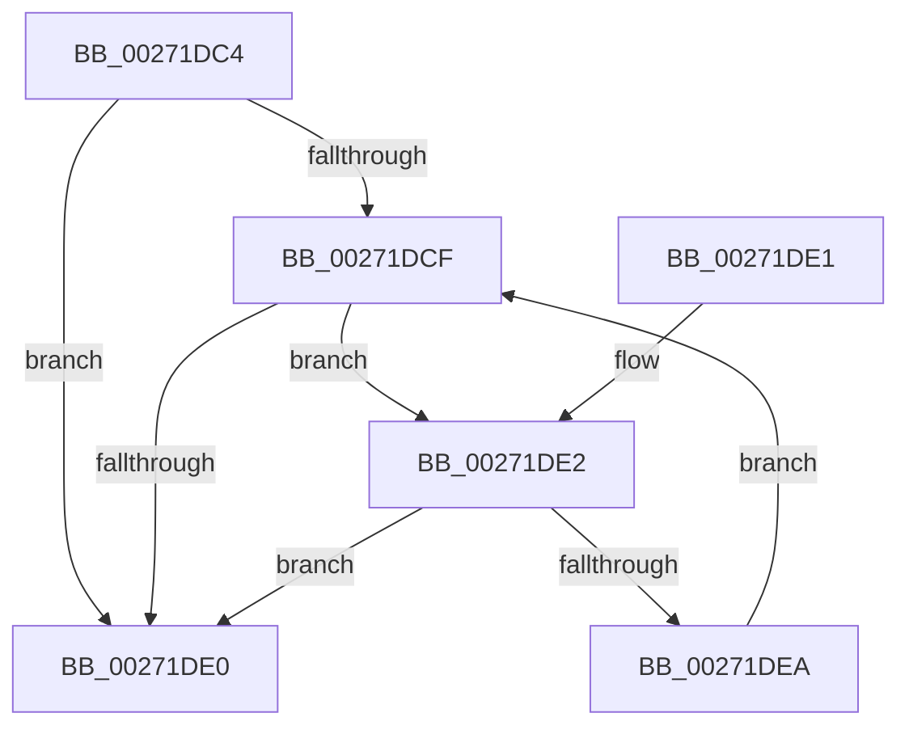

# CcRecalculateVacbArrayHighwaterMark

- RVA: `0x00271DC4`–`0x00271DEC` (길이 `40` bytes)
- VA: `0x0000000140271DC4`
- 실행 섹션: `.text`
- PDB 이름 있음: `예`; PDB Function 태그: `아니요`
- unwind 정보 RVA: `0x000DB714`
- 디코드: `15`개 명령, `40/40` bytes 표시
- 미해석 바이트: `0` (있으면 어셈블리에 `.byte`로 보존)

> 이 문서는 커널 이미지의 기계어와 PDB 기호를 분석해 생성했습니다. 4번과 5번은 함수 원형과 자료형을 바이너리 사용 방식에서 추정한 C 해석이며 원본 소스 복구 결과는 아닙니다.

## 1. Dependencies

- 직접 호출 지점: **0**; 고유 호출 대상: **0**
- 직접 호출자로 확인된 함수: **2**
- RIP 상대 이미지 참조: **0**

### Outgoing calls
- 직접 디코드된 call 명령이 없습니다.

### Direct callers
- [CcUnmapInactiveViewsInternal](CcUnmapInactiveViewsInternal_function_0027174C.md) at `0x00271830`
- [CcGetRandomVacbArrayWithReference](../4A/CcGetRandomVacbArrayWithReference_function_004A98AC.md) at `0x004A9915`

### Static image references
- 디코드된 RIP-relative 메모리 참조가 없습니다.

## 2. Other-region calls and transfers

- 다른 실행 섹션으로 향하는 call: **0**
- 별도 외부 분기/꼬리 이동을 확인하지 못했습니다.

## 3. Assembly (complete function range)

```asm
00271DC4  8B 51 08                        mov edx, dword ptr [rcx + 8]
00271DC7  4C 8B C1                        mov r8, rcx
00271DCA  83 C2 01                        add edx, 1
00271DCD  74 11                           je 0x140271de0
00271DCF  8D 42 FF                        lea eax, [rdx - 1]
00271DD2  48 8D 0C 80                     lea rcx, [rax + rax*4]
00271DD6  8B D0                           mov edx, eax
00271DD8  49 83 7C C8 18 00               cmp qword ptr [r8 + rcx*8 + 0x18], 0
00271DDE  74 02                           je 0x140271de2
00271DE0  C3                              ret
00271DE1  CC                              int3
00271DE2  41 89 40 08                     mov dword ptr [r8 + 8], eax
00271DE6  85 C0                           test eax, eax
00271DE8  74 F6                           je 0x140271de0
00271DEA  EB E3                           jmp 0x140271dcf
```

## 4. C-style interpretation (structured pseudocode)

```c
__int64 __fastcall CcRecalculateVacbArrayHighwaterMark(__int64 a1)
{
    a2 = (unsigned int)(((unsigned int)(*(unsigned int *)(a1 + 8))) + (1));
    if (condition_is_equal) goto loc_00271DE0;
loc_00271DCF:
    if ((*(unsigned __int64 *)(a1 + a2 - 1 + a2 - 1 * 4 * 8 + 24)) == 0) goto loc_00271DE2;
loc_00271DE0:
    return a2 - 1;
loc_00271DE2:
    *(unsigned int *)(a1 + 8) = (unsigned int)(a2 - 1);
    if ((unsigned int)(a2 - 1) == 0) goto loc_00271DE0;
    goto loc_00271DCF;
}
```

## 5. (Beta) C Style

```c
int64_t CcRecalculateVacbArrayHighwaterMark(void *Arg1)
{
    uint8_t *arg1 = (uint8_t *)Arg1;

    a2 = (uint32_t)(((uint32_t)(*(uint32_t *)(arg1 + 0x8))) + (1));
    if (condition_is_equal) goto loc_00271DE0;
loc_00271DCF:
    if ((*(uint64_t *)(arg1 + a2 - 0x1 + a2 - 0x1 * 4 * 8 + 0x18)) == 0) goto loc_00271DE2;
loc_00271DE0:
    return a2 - 1;
loc_00271DE2:
    *(uint32_t *)(arg1 + 0x8) = (uint32_t)(a2 - 1);
    if ((uint32_t)(a2 - 1) == 0) goto loc_00271DE0;
    goto loc_00271DCF;
}
```

### 관측된 메모리 오프셋

구조체 형식이 확인되지 않은 접근은 인자 기준의 오프셋으로만 기록했습니다.

| 기준 인자 | 오프셋 표현 | 폭 (bit) | 접근 |
|---|---:|---:|---|
| `Arg1` | `+ 0x8` | `32` | `R` |
| `Arg1` | `+ 0x8` | `32` | `W` |
| `Arg1` | `+ 0x18 + rcx*8` | `64` | `R` |

## 6. Execution-region graph

[열기: 2D/3D 그래프와 함수 탐색 컨트롤 패널](../../../control-panel.html?section=text&rva=0x00271DC4&view=graph)

- 2D 그래프는 위에서 아래로 흐르고, 3D 그래프는 빈 공간을 드래그해 회전합니다. Shift+드래그는 이동, 휠은 확대·축소, 함수 노드 선택은 대상 보고서 이동입니다.

### Static fallback


