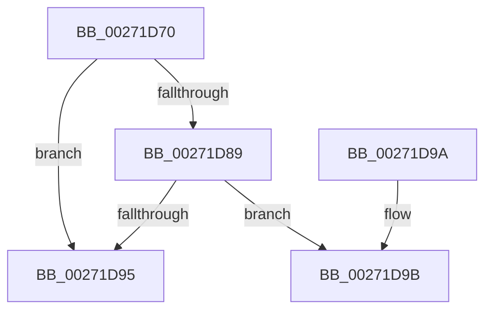

# CcReferenceVacbArray

- RVA: `0x00271D70`–`0x00271DBD` (길이 `77` bytes)
- VA: `0x0000000140271D70`
- 실행 섹션: `.text`
- PDB 이름 있음: `예`; PDB Function 태그: `아니요`
- unwind 정보 RVA: `0x00065B0C`
- 디코드: `21`개 명령, `77/77` bytes 표시
- 미해석 바이트: `0` (있으면 어셈블리에 `.byte`로 보존)

> 이 문서는 커널 이미지의 기계어와 PDB 기호를 분석해 생성했습니다. 4번과 5번은 함수 원형과 자료형을 바이너리 사용 방식에서 추정한 C 해석이며 원본 소스 복구 결과는 아닙니다.

## 1. Dependencies

- 직접 호출 지점: **1**; 고유 호출 대상: **1**
- 직접 호출자로 확인된 함수: **2**
- RIP 상대 이미지 참조: **1**

### Outgoing calls
- `0x00271DB7` → [KeBugCheckEx](../4F/KeBugCheckEx_function_004FD660.md) (function, `0x004FD660`)

### Direct callers
- [CcUnmapInactiveViewsInternal](CcUnmapInactiveViewsInternal_function_0027174C.md) at `0x00271810`
- [CcGetRandomVacbArrayWithReference](../4A/CcGetRandomVacbArrayWithReference_function_004A98AC.md) at `0x004A9905`

### Static image references
- `0x00271D74` → RVA `0x00F8F4A0` (`.data`; read)

## 2. Other-region calls and transfers

- 다른 실행 섹션으로 향하는 call: **0**
- 별도 외부 분기/꼬리 이동을 확인하지 못했습니다.

## 3. Assembly (complete function range)

```asm
00271D70  48 83 EC 38                     sub rsp, 0x38
00271D74  48 8B 15 25 D7 D1 00            mov rdx, qword ptr [rip + 0xd1d725]
00271D7B  33 C0                           xor eax, eax
00271D7D  44 8B C1                        mov r8d, ecx
00271D80  4E 8B 0C C2                     mov r9, qword ptr [rdx + r8*8]
00271D84  4D 85 C9                        test r9, r9
00271D87  74 0C                           je 0x140271d95
00271D89  41 FF 41 04                     inc dword ptr [r9 + 4]
00271D8D  49 8B C1                        mov rax, r9
00271D90  41 39 09                        cmp dword ptr [r9], ecx
00271D93  75 06                           jne 0x140271d9b
00271D95  48 83 C4 38                     add rsp, 0x38
00271D99  C3                              ret
00271D9A  CC                              int3
00271D9B  45 33 C9                        xor r9d, r9d
00271D9E  48 C7 44 24 20 00 00 00 00      mov qword ptr [rsp + 0x20], 0
00271DA7  BA 76 01 00 00                  mov edx, 0x176
00271DAC  49 C7 C0 20 04 00 C0            mov r8, 0xffffffffc0000420
00271DB3  41 8D 49 34                     lea ecx, [r9 + 0x34]
00271DB7  E8 A4 B8 28 00                  call 0x1404fd660
00271DBC  CC                              int3
```

## 4. C-style interpretation (structured pseudocode)

```c
__int64 __fastcall CcReferenceVacbArray(int a1)
{
    __int64 result;
    __int64 v_rsp;
    unsigned __int64 v_stack_p20;

    v_rsp = (v_rsp) - (56);
    result = 0;
    if (*(unsigned __int64 *)(*(unsigned __int64 *)(v_rip + 13752101) + (unsigned int)(a1) * 8) == 0) goto loc_00271D95;
    if ((*(unsigned int *)(*(unsigned __int64 *)(*(unsigned __int64 *)(v_rip + 13752101) + (unsigned int)(a1) * 8))) != a1) goto loc_00271D9B;
loc_00271D95:
    v_rsp = (v_rsp) + (56);
    return *(unsigned __int64 *)(*(unsigned __int64 *)(v_rip + 13752101) + (unsigned int)(a1) * 8);
loc_00271D9B:
    a4 = 0;
    v_stack_p20 = 0;
    result = KeBugCheckEx(a4 + 52, 374, 0xFFFFFFFFC0000420ULL, a4);
    return result;
}
```

## 5. (Beta) C Style

```c
int64_t CcReferenceVacbArray(int32_t Arg1)
{
    int64_t result;
    int64_t local_rsp;
    uint64_t v_stack_p20;

    local_rsp = (local_rsp) - (56);
    result = 0;
    if (*(uint64_t *)(*(uint64_t *)(v_rip + 0xD1D725) + (uint32_t)(Arg1) * 8) == 0) goto loc_00271D95;
    if ((*(uint32_t *)(*(uint64_t *)(*(uint64_t *)(v_rip + 0xD1D725) + (uint32_t)(Arg1) * 8))) != Arg1) goto loc_00271D9B;
loc_00271D95:
    local_rsp = (local_rsp) + (56);
    return *(uint64_t *)(*(uint64_t *)(v_rip + 0xD1D725) + (uint32_t)(Arg1) * 8);
loc_00271D9B:
    a4 = 0;
    v_stack_p20 = 0;
    result = KeBugCheckEx(a4 + 52, 374, 0xFFFFFFFFC0000420ULL, a4);
    return result;
}
```

## 6. Execution-region graph

[열기: 2D/3D 그래프와 함수 탐색 컨트롤 패널](../../../control-panel.html?section=text&rva=0x00271D70&view=graph)

- 2D 그래프는 위에서 아래로 흐르고, 3D 그래프는 빈 공간을 드래그해 회전합니다. Shift+드래그는 이동, 휠은 확대·축소, 함수 노드 선택은 대상 보고서 이동입니다.

### Static fallback


