# CcSetVacbLargeOffset

- RVA: `0x002733D0`–`0x00273B16` (길이 `1,862` bytes)
- VA: `0x00000001402733D0`
- 실행 섹션: `.text`
- PDB 이름 있음: `예`; PDB Function 태그: `아니요`
- unwind 정보 RVA: `0x00065CE0`
- 디코드: `406`개 명령, `1,862/1,862` bytes 표시
- 미해석 바이트: `0` (있으면 어셈블리에 `.byte`로 보존)

> 이 문서는 커널 이미지의 기계어와 PDB 기호를 분석해 생성했습니다. 4번과 5번은 함수 원형과 자료형을 바이너리 사용 방식에서 추정한 C 해석이며 원본 소스 복구 결과는 아닙니다.

## 1. Dependencies

- 직접 호출 지점: **7**; 고유 호출 대상: **7**
- 직접 호출자로 확인된 함수: **5**
- RIP 상대 이미지 참조: **1**

### Outgoing calls
- `0x00273502` → [CcFreeUnusedVacbLevels](CcFreeUnusedVacbLevels_function_00273B1C.md) (function, `0x00273B1C`)
- `0x0027351C` → [_security_check_cookie](../6A/_security_check_cookie_function_006AC640.md) (function, `0x006AC640`)
- `0x002735D8` → [CcDeallocateVacbLevel](../38/CcDeallocateVacbLevel_function_0038C058.md) (function, `0x0038C058`)
- `0x0027363F` → [CcAllocateVacbLevels](../48/CcAllocateVacbLevels_function_00482050.md) (function, `0x00482050`)
- `0x0027365C` → [CcAllocateVacbLevel](../48/CcAllocateVacbLevel_function_004885C4.md) (function, `0x004885C4`)
- `0x0027367F` → [VacbLevelReference](../26/VacbLevelReference_function_0026DCA0.md) (function, `0x0026DCA0`)
- `0x0027369E` → [CcGetBcbListHeadLargeOffset](../34/CcGetBcbListHeadLargeOffset_function_00341990.md) (function, `0x00341990`)

### Direct callers
- [CcUnmapInactiveViewsInternal](CcUnmapInactiveViewsInternal_function_0027174C.md) at `0x00271B44`
- [CcGetVacbMiss](CcGetVacbMiss_function_00272900.md) at `0x00272BA6`
- [SetVacb](SetVacb_function_00273340.md) at `0x00273376`
- [CcUnmapVacbArray](../38/CcUnmapVacbArray_function_0038AEAC.md) at `0x0038B06F`
- [CcAdjustVacbLevelLockCount](../41/CcAdjustVacbLevelLockCount_function_0041F8A4.md) at `0x0041F98A`

### Static image references
- `0x002733E4` → RVA `0x00E0A740` (`.data`; read)

## 2. Other-region calls and transfers

- 다른 실행 섹션으로 향하는 call: **0**
- 별도 외부 분기/꼬리 이동을 확인하지 못했습니다.

## 3. Assembly (complete function range)

```asm
002733D0  4C 8B DC                        mov r11, rsp
002733D3  53                              push rbx
002733D4  55                              push rbp
002733D5  56                              push rsi
002733D6  57                              push rdi
002733D7  41 54                           push r12
002733D9  41 55                           push r13
002733DB  41 56                           push r14
002733DD  48 81 EC C0 00 00 00            sub rsp, 0xc0
002733E4  48 8B 05 55 73 B9 00            mov rax, qword ptr [rip + 0xb97355]
002733EB  48 33 C4                        xor rax, rsp
002733EE  48 89 84 24 B8 00 00 00         mov qword ptr [rsp + 0xb8], rax
002733F6  0F 57 C0                        xorps xmm0, xmm0
002733F9  48 89 54 24 50                  mov qword ptr [rsp + 0x50], rdx
002733FE  4C 8B E9                        mov r13, rcx
00273401  4C 89 4C 24 28                  mov qword ptr [rsp + 0x28], r9
00273406  33 C0                           xor eax, eax
00273408  4D 8B E0                        mov r12, r8
0027340B  45 33 C0                        xor r8d, r8d
0027340E  48 8B DA                        mov rbx, rdx
00273411  0F 11 44 24 60                  movups xmmword ptr [rsp + 0x60], xmm0
00273416  4D 8B 75 58                     mov r14, qword ptr [r13 + 0x58]
0027341A  41 8B E8                        mov ebp, r8d
0027341D  49 8B 55 20                     mov rdx, qword ptr [r13 + 0x20]
00273421  41 8B F8                        mov edi, r8d
00273424  0F 11 44 24 70                  movups xmmword ptr [rsp + 0x70], xmm0
00273429  49 89 43 98                     mov qword ptr [r11 - 0x68], rax
0027342D  B9 19 00 00 00                  mov ecx, 0x19
00273432  41 0F 11 43 88                  movups xmmword ptr [r11 - 0x78], xmm0
00273437  0F 11 44 24 30                  movups xmmword ptr [rsp + 0x30], xmm0
0027343C  0F 11 44 24 40                  movups xmmword ptr [rsp + 0x40], xmm0
00273441  8B F1                           mov esi, ecx
00273443  B8 01 00 00 00                  mov eax, 1
00273448  83 C1 07                        add ecx, 7
0027344B  FF C7                           inc edi
0027344D  48 D3 E0                        shl rax, cl
00273450  48 3B D0                        cmp rdx, rax
00273453  7F EC                           jg 0x140273441
00273455  4C 89 BC 24 10 01 00 00         mov qword ptr [rsp + 0x110], r15
0027345D  48 8B D3                        mov rdx, rbx
00273460  89 7C 24 24                     mov dword ptr [rsp + 0x24], edi
00273464  8B CE                           mov ecx, esi
00273466  44 8B D7                        mov r10d, edi
00273469  48 D3 FA                        sar rdx, cl
0027346C  FF CF                           dec edi
0027346E  83 FD 07                        cmp ebp, 7
00273471  0F 83 21 01 00 00               jae 0x140273598
00273477  8B C5                           mov eax, ebp
00273479  FF C5                           inc ebp
0027347B  89 94 84 98 00 00 00            mov dword ptr [rsp + rax*4 + 0x98], edx
00273482  4C 89 74 C4 60                  mov qword ptr [rsp + rax*8 + 0x60], r14
00273487  8B C2                           mov eax, edx
00273489  48 89 44 24 58                  mov qword ptr [rsp + 0x58], rax
0027348E  4D 8B 3C C6                     mov r15, qword ptr [r14 + rax*8]
00273492  4D 85 FF                        test r15, r15
00273495  0F 84 5A 01 00 00               je 0x1402735f5
0027349B  8B CE                           mov ecx, esi
0027349D  B8 01 00 00 00                  mov eax, 1
002734A2  48 D3 E0                        shl rax, cl
002734A5  83 C6 F9                        add esi, -7
002734A8  48 FF C8                        dec rax
002734AB  4D 8B F7                        mov r14, r15
002734AE  48 23 D8                        and rbx, rax
002734B1  85 FF                           test edi, edi
002734B3  75 A8                           jne 0x14027345d
002734B5  49 83 FC FE                     cmp r12, -2
002734B9  73 79                           jae 0x140273534
002734BB  8B CE                           mov ecx, esi
002734BD  41 8B F0                        mov esi, r8d
002734C0  48 D3 FB                        sar rbx, cl
002734C3  8B C3                           mov eax, ebx
002734C5  4D 89 24 C7                     mov qword ptr [r15 + rax*8], r12
002734C9  4D 85 E4                        test r12, r12
002734CC  74 6D                           je 0x14027353b
002734CE  41 F7 85 98 00 00 00 00 02 00 00  test dword ptr [r13 + 0x98], 0x200
002734D9  BB 00 08 00 00                  mov ebx, 0x800
002734DE  41 BC 00 04 00 00               mov r12d, 0x400
002734E4  41 0F 44 DC                     cmove ebx, r12d
002734E8  49 03 DF                        add rbx, r15
002734EB  85 F6                           test esi, esi
002734ED  0F 85 11 06 00 00               jne 0x140273b04
002734F3  FF 03                           inc dword ptr [rbx]
002734F5  48 8D 44 24 30                  lea rax, [rsp + 0x30]
002734FA  4C 3B C8                        cmp r9, rax
002734FD  75 08                           jne 0x140273507
002734FF  49 8B C9                        mov rcx, r9
00273502  E8 15 06 00 00                  call 0x140273b1c
00273507  B0 01                           mov al, 1
00273509  4C 8B BC 24 10 01 00 00         mov r15, qword ptr [rsp + 0x110]
00273511  48 8B 8C 24 B8 00 00 00         mov rcx, qword ptr [rsp + 0xb8]
00273519  48 33 CC                        xor rcx, rsp
0027351C  E8 1F 91 43 00                  call 0x1406ac640
00273521  48 81 C4 C0 00 00 00            add rsp, 0xc0
00273528  41 5E                           pop r14
0027352A  41 5D                           pop r13
0027352C  41 5C                           pop r12
0027352E  5F                              pop rdi
0027352F  5E                              pop rsi
00273530  5D                              pop rbp
00273531  5B                              pop rbx
00273532  C3                              ret
00273533  CC                              int3
00273534  BE 01 00 00 00                  mov esi, 1
00273539  75 93                           jne 0x1402734ce
0027353B  BB 00 08 00 00                  mov ebx, 0x800
00273540  41 BC 00 04 00 00               mov r12d, 0x400
00273546  49 8B C4                        mov rax, r12
00273549  85 FF                           test edi, edi
0027354B  75 0F                           jne 0x14027355c
0027354D  41 F7 85 98 00 00 00 00 02 00 00  test dword ptr [r13 + 0x98], 0x200
00273558  48 0F 45 C3                     cmovne rax, rbx
0027355C  85 F6                           test esi, esi
0027355E  0F 85 A8 05 00 00               jne 0x140273b0c
00273564  42 FF 0C 30                     dec dword ptr [rax + r14]
00273568  41 8B F0                        mov esi, r8d
0027356B  49 8B C4                        mov rax, r12
0027356E  85 FF                           test edi, edi
00273570  75 0F                           jne 0x140273581
00273572  41 F7 85 98 00 00 00 00 02 00 00  test dword ptr [r13 + 0x98], 0x200
0027357D  48 0F 45 C3                     cmovne rax, rbx
00273581  42 8B 0C 30                     mov ecx, dword ptr [rax + r14]
00273585  42 8B 44 30 04                  mov eax, dword ptr [rax + r14 + 4]
0027358A  0B C1                           or eax, ecx
0027358C  74 11                           je 0x14027359f
0027358E  4C 8B 4C 24 28                  mov r9, qword ptr [rsp + 0x28]
00273593  E9 5D FF FF FF                  jmp 0x1402734f5
00273598  32 C0                           xor al, al
0027359A  E9 6A FF FF FF                  jmp 0x140273509
0027359F  85 ED                           test ebp, ebp
002735A1  74 EB                           je 0x14027358e
002735A3  8B C7                           mov eax, edi
002735A5  FF CD                           dec ebp
002735A7  FF C7                           inc edi
002735A9  41 8B D0                        mov edx, r8d
002735AC  85 C0                           test eax, eax
002735AE  75 25                           jne 0x1402735d5
002735B0  41 F7 85 98 00 00 00 00 02 00 00  test dword ptr [r13 + 0x98], 0x200
002735BB  74 18                           je 0x1402735d5
002735BD  49 8B 8E 00 04 00 00            mov rcx, qword ptr [r14 + 0x400]
002735C4  8D 50 01                        lea edx, [rax + 1]
002735C7  49 8B 86 F8 07 00 00            mov rax, qword ptr [r14 + 0x7f8]
002735CE  48 89 41 08                     mov qword ptr [rcx + 8], rax
002735D2  48 89 08                        mov qword ptr [rax], rcx
002735D5  49 8B CE                        mov rcx, r14
002735D8  E8 7B 8A 11 00                  call 0x14038c058
002735DD  8B 84 AC 98 00 00 00            mov eax, dword ptr [rsp + rbp*4 + 0x98]
002735E4  45 33 C0                        xor r8d, r8d
002735E7  4C 8B 74 EC 60                  mov r14, qword ptr [rsp + rbp*8 + 0x60]
002735EC  4D 89 04 C6                     mov qword ptr [r14 + rax*8], r8
002735F0  E9 51 FF FF FF                  jmp 0x140273546
002735F5  41 8B 85 98 00 00 00            mov eax, dword ptr [r13 + 0x98]
002735FC  25 00 02 00 00                  and eax, 0x200
00273601  0F 85 D1 04 00 00               jne 0x140273ad8
00273607  45 8B F8                        mov r15d, r8d
0027360A  44 89 7C 24 20                  mov dword ptr [rsp + 0x20], r15d
0027360F  4D 85 C9                        test r9, r9
00273612  75 42                           jne 0x140273656
00273614  48 8D 4C 24 30                  lea rcx, [rsp + 0x30]
00273619  4C 89 44 24 40                  mov qword ptr [rsp + 0x40], r8
0027361E  48 89 4C 24 38                  mov qword ptr [rsp + 0x38], rcx
00273623  85 C0                           test eax, eax
00273625  48 8D 4C 24 30                  lea rcx, [rsp + 0x30]
0027362A  44 89 44 24 48                  mov dword ptr [rsp + 0x48], r8d
0027362F  48 89 4C 24 30                  mov qword ptr [rsp + 0x30], rcx
00273634  4C 8D 44 24 30                  lea r8, [rsp + 0x30]
00273639  41 8B CA                        mov ecx, r10d
0027363C  0F 95 C2                        setne dl
0027363F  E8 0C EA 20 00                  call 0x140482050
00273644  84 C0                           test al, al
00273646  0F 84 4C FF FF FF               je 0x140273598
0027364C  4C 8D 4C 24 30                  lea r9, [rsp + 0x30]
00273651  4C 89 4C 24 28                  mov qword ptr [rsp + 0x28], r9
00273656  41 8B D7                        mov edx, r15d
00273659  49 8B C9                        mov rcx, r9
0027365C  E8 63 4F 21 00                  call 0x1404885c4
00273661  83 7C 24 20 00                  cmp dword ptr [rsp + 0x20], 0
00273666  4C 8B F8                        mov r15, rax
00273669  75 28                           jne 0x140273693
0027366B  48 8B 44 24 58                  mov rax, qword ptr [rsp + 0x58]
00273670  49 8B D6                        mov rdx, r14
00273673  44 8B 44 24 24                  mov r8d, dword ptr [rsp + 0x24]
00273678  49 8B CD                        mov rcx, r13
0027367B  4D 89 3C C6                     mov qword ptr [r14 + rax*8], r15
0027367F  E8 1C A6 FF FF                  call 0x14026dca0
00273684  4C 8B 4C 24 28                  mov r9, qword ptr [rsp + 0x28]
00273689  FF 00                           inc dword ptr [rax]
0027368B  45 33 C0                        xor r8d, r8d
0027368E  E9 08 FE FF FF                  jmp 0x14027349b
00273693  48 8B 54 24 50                  mov rdx, qword ptr [rsp + 0x50]
00273698  45 33 C0                        xor r8d, r8d
0027369B  49 8B CD                        mov rcx, r13
0027369E  E8 ED E2 0C 00                  call 0x140341990
002736A3  41 BB FD 02 00 00               mov r11d, 0x2fd
002736A9  48 8B 48 08                     mov rcx, qword ptr [rax + 8]
002736AD  66 44 39 59 F0                  cmp word ptr [rcx - 0x10], r11w
002736B2  0F 84 38 04 00 00               je 0x140273af0
002736B8  4C 8B 50 08                     mov r10, qword ptr [rax + 8]
002736BC  4D 8D 8F 00 04 00 00            lea r9, [r15 + 0x400]
002736C3  4C 89 48 08                     mov qword ptr [rax + 8], r9
002736C7  49 8D 49 20                     lea rcx, [r9 + 0x20]
002736CB  49 89 01                        mov qword ptr [r9], rax
002736CE  49 8D 41 10                     lea rax, [r9 + 0x10]
002736D2  49 89 41 08                     mov qword ptr [r9 + 8], rax
002736D6  4C 89 08                        mov qword ptr [rax], r9
002736D9  49 89 49 18                     mov qword ptr [r9 + 0x18], rcx
002736DD  48 89 01                        mov qword ptr [rcx], rax
002736E0  49 8D 41 30                     lea rax, [r9 + 0x30]
002736E4  49 89 41 28                     mov qword ptr [r9 + 0x28], rax
002736E8  48 89 08                        mov qword ptr [rax], rcx
002736EB  49 8D 49 40                     lea rcx, [r9 + 0x40]
002736EF  49 89 49 38                     mov qword ptr [r9 + 0x38], rcx
002736F3  48 89 01                        mov qword ptr [rcx], rax
002736F6  49 8D 41 50                     lea rax, [r9 + 0x50]
002736FA  49 89 41 48                     mov qword ptr [r9 + 0x48], rax
002736FE  48 89 08                        mov qword ptr [rax], rcx
00273701  49 8D 49 60                     lea rcx, [r9 + 0x60]
00273705  49 89 49 58                     mov qword ptr [r9 + 0x58], rcx
00273709  48 89 01                        mov qword ptr [rcx], rax
0027370C  49 8D 41 70                     lea rax, [r9 + 0x70]
00273710  49 89 41 68                     mov qword ptr [r9 + 0x68], rax
00273714  48 89 08                        mov qword ptr [rax], rcx
00273717  49 8D 89 80 00 00 00            lea rcx, [r9 + 0x80]
0027371E  49 89 49 78                     mov qword ptr [r9 + 0x78], rcx
00273722  48 89 01                        mov qword ptr [rcx], rax
00273725  49 8D 81 90 00 00 00            lea rax, [r9 + 0x90]
0027372C  49 89 81 88 00 00 00            mov qword ptr [r9 + 0x88], rax
00273733  48 89 08                        mov qword ptr [rax], rcx
00273736  49 8D 89 A0 00 00 00            lea rcx, [r9 + 0xa0]
0027373D  49 89 89 98 00 00 00            mov qword ptr [r9 + 0x98], rcx
00273744  48 89 01                        mov qword ptr [rcx], rax
00273747  49 8D 81 B0 00 00 00            lea rax, [r9 + 0xb0]
0027374E  49 89 81 A8 00 00 00            mov qword ptr [r9 + 0xa8], rax
00273755  48 89 08                        mov qword ptr [rax], rcx
00273758  49 8D 89 C0 00 00 00            lea rcx, [r9 + 0xc0]
0027375F  49 89 89 B8 00 00 00            mov qword ptr [r9 + 0xb8], rcx
00273766  48 89 01                        mov qword ptr [rcx], rax
00273769  49 8D 81 D0 00 00 00            lea rax, [r9 + 0xd0]
00273770  49 89 81 C8 00 00 00            mov qword ptr [r9 + 0xc8], rax
00273777  48 89 08                        mov qword ptr [rax], rcx
0027377A  49 8D 89 E0 00 00 00            lea rcx, [r9 + 0xe0]
00273781  49 89 89 D8 00 00 00            mov qword ptr [r9 + 0xd8], rcx
00273788  48 89 01                        mov qword ptr [rcx], rax
0027378B  49 8D 81 F0 00 00 00            lea rax, [r9 + 0xf0]
00273792  49 89 81 E8 00 00 00            mov qword ptr [r9 + 0xe8], rax
00273799  48 89 08                        mov qword ptr [rax], rcx
0027379C  49 8D 89 00 01 00 00            lea rcx, [r9 + 0x100]
002737A3  49 89 89 F8 00 00 00            mov qword ptr [r9 + 0xf8], rcx
002737AA  48 89 01                        mov qword ptr [rcx], rax
002737AD  49 8D 81 10 01 00 00            lea rax, [r9 + 0x110]
002737B4  49 89 81 08 01 00 00            mov qword ptr [r9 + 0x108], rax
002737BB  48 89 08                        mov qword ptr [rax], rcx
002737BE  49 8D 89 20 01 00 00            lea rcx, [r9 + 0x120]
002737C5  49 89 89 18 01 00 00            mov qword ptr [r9 + 0x118], rcx
002737CC  48 89 01                        mov qword ptr [rcx], rax
002737CF  49 8D 81 30 01 00 00            lea rax, [r9 + 0x130]
002737D6  49 89 81 28 01 00 00            mov qword ptr [r9 + 0x128], rax
002737DD  48 89 08                        mov qword ptr [rax], rcx
002737E0  49 8D 89 40 01 00 00            lea rcx, [r9 + 0x140]
002737E7  49 89 89 38 01 00 00            mov qword ptr [r9 + 0x138], rcx
002737EE  48 89 01                        mov qword ptr [rcx], rax
002737F1  49 8D 81 50 01 00 00            lea rax, [r9 + 0x150]
002737F8  49 89 81 48 01 00 00            mov qword ptr [r9 + 0x148], rax
002737FF  48 89 08                        mov qword ptr [rax], rcx
00273802  49 8D 89 60 01 00 00            lea rcx, [r9 + 0x160]
00273809  49 89 89 58 01 00 00            mov qword ptr [r9 + 0x158], rcx
00273810  48 89 01                        mov qword ptr [rcx], rax
00273813  49 8D 81 70 01 00 00            lea rax, [r9 + 0x170]
0027381A  49 89 81 68 01 00 00            mov qword ptr [r9 + 0x168], rax
00273821  48 89 08                        mov qword ptr [rax], rcx
00273824  49 8D 89 80 01 00 00            lea rcx, [r9 + 0x180]
0027382B  49 89 89 78 01 00 00            mov qword ptr [r9 + 0x178], rcx
00273832  48 89 01                        mov qword ptr [rcx], rax
00273835  49 8D 81 90 01 00 00            lea rax, [r9 + 0x190]
0027383C  49 89 81 88 01 00 00            mov qword ptr [r9 + 0x188], rax
00273843  48 89 08                        mov qword ptr [rax], rcx
00273846  49 8D 89 A0 01 00 00            lea rcx, [r9 + 0x1a0]
0027384D  49 89 89 98 01 00 00            mov qword ptr [r9 + 0x198], rcx
00273854  48 89 01                        mov qword ptr [rcx], rax
00273857  49 8D 81 B0 01 00 00            lea rax, [r9 + 0x1b0]
0027385E  49 89 81 A8 01 00 00            mov qword ptr [r9 + 0x1a8], rax
00273865  48 89 08                        mov qword ptr [rax], rcx
00273868  49 8D 89 C0 01 00 00            lea rcx, [r9 + 0x1c0]
0027386F  49 89 89 B8 01 00 00            mov qword ptr [r9 + 0x1b8], rcx
00273876  48 89 01                        mov qword ptr [rcx], rax
00273879  49 8D 81 D0 01 00 00            lea rax, [r9 + 0x1d0]
00273880  49 89 81 C8 01 00 00            mov qword ptr [r9 + 0x1c8], rax
00273887  48 89 08                        mov qword ptr [rax], rcx
0027388A  49 8D 89 E0 01 00 00            lea rcx, [r9 + 0x1e0]
00273891  49 89 89 D8 01 00 00            mov qword ptr [r9 + 0x1d8], rcx
00273898  48 89 01                        mov qword ptr [rcx], rax
0027389B  49 8D 81 F0 01 00 00            lea rax, [r9 + 0x1f0]
002738A2  49 89 81 E8 01 00 00            mov qword ptr [r9 + 0x1e8], rax
002738A9  48 89 08                        mov qword ptr [rax], rcx
002738AC  49 8D 89 00 02 00 00            lea rcx, [r9 + 0x200]
002738B3  49 89 89 F8 01 00 00            mov qword ptr [r9 + 0x1f8], rcx
002738BA  48 89 01                        mov qword ptr [rcx], rax
002738BD  49 8D 81 10 02 00 00            lea rax, [r9 + 0x210]
002738C4  49 89 81 08 02 00 00            mov qword ptr [r9 + 0x208], rax
002738CB  48 89 08                        mov qword ptr [rax], rcx
002738CE  49 8D 89 20 02 00 00            lea rcx, [r9 + 0x220]
002738D5  49 89 89 18 02 00 00            mov qword ptr [r9 + 0x218], rcx
002738DC  48 89 01                        mov qword ptr [rcx], rax
002738DF  49 8D 81 30 02 00 00            lea rax, [r9 + 0x230]
002738E6  49 89 81 28 02 00 00            mov qword ptr [r9 + 0x228], rax
002738ED  48 89 08                        mov qword ptr [rax], rcx
002738F0  49 8D 89 40 02 00 00            lea rcx, [r9 + 0x240]
002738F7  49 89 89 38 02 00 00            mov qword ptr [r9 + 0x238], rcx
002738FE  48 89 01                        mov qword ptr [rcx], rax
00273901  49 8D 81 50 02 00 00            lea rax, [r9 + 0x250]
00273908  49 89 81 48 02 00 00            mov qword ptr [r9 + 0x248], rax
0027390F  48 89 08                        mov qword ptr [rax], rcx
00273912  49 8D 89 60 02 00 00            lea rcx, [r9 + 0x260]
00273919  49 89 89 58 02 00 00            mov qword ptr [r9 + 0x258], rcx
00273920  48 89 01                        mov qword ptr [rcx], rax
00273923  49 8D 81 70 02 00 00            lea rax, [r9 + 0x270]
0027392A  49 89 81 68 02 00 00            mov qword ptr [r9 + 0x268], rax
00273931  48 89 08                        mov qword ptr [rax], rcx
00273934  49 8D 89 80 02 00 00            lea rcx, [r9 + 0x280]
0027393B  49 89 89 78 02 00 00            mov qword ptr [r9 + 0x278], rcx
00273942  48 89 01                        mov qword ptr [rcx], rax
00273945  49 8D 81 90 02 00 00            lea rax, [r9 + 0x290]
0027394C  49 89 81 88 02 00 00            mov qword ptr [r9 + 0x288], rax
00273953  48 89 08                        mov qword ptr [rax], rcx
00273956  49 8D 89 A0 02 00 00            lea rcx, [r9 + 0x2a0]
0027395D  49 89 89 98 02 00 00            mov qword ptr [r9 + 0x298], rcx
00273964  48 89 01                        mov qword ptr [rcx], rax
00273967  49 8D 81 B0 02 00 00            lea rax, [r9 + 0x2b0]
0027396E  49 89 81 A8 02 00 00            mov qword ptr [r9 + 0x2a8], rax
00273975  48 89 08                        mov qword ptr [rax], rcx
00273978  49 8D 89 C0 02 00 00            lea rcx, [r9 + 0x2c0]
0027397F  49 89 89 B8 02 00 00            mov qword ptr [r9 + 0x2b8], rcx
00273986  48 89 01                        mov qword ptr [rcx], rax
00273989  49 8D 81 D0 02 00 00            lea rax, [r9 + 0x2d0]
00273990  49 89 81 C8 02 00 00            mov qword ptr [r9 + 0x2c8], rax
00273997  48 89 08                        mov qword ptr [rax], rcx
0027399A  49 8D 89 E0 02 00 00            lea rcx, [r9 + 0x2e0]
002739A1  49 89 89 D8 02 00 00            mov qword ptr [r9 + 0x2d8], rcx
002739A8  48 89 01                        mov qword ptr [rcx], rax
002739AB  49 8D 81 F0 02 00 00            lea rax, [r9 + 0x2f0]
002739B2  49 89 81 E8 02 00 00            mov qword ptr [r9 + 0x2e8], rax
002739B9  48 89 08                        mov qword ptr [rax], rcx
002739BC  49 8D 89 00 03 00 00            lea rcx, [r9 + 0x300]
002739C3  49 89 89 F8 02 00 00            mov qword ptr [r9 + 0x2f8], rcx
002739CA  48 89 01                        mov qword ptr [rcx], rax
002739CD  49 8D 81 10 03 00 00            lea rax, [r9 + 0x310]
002739D4  49 89 81 08 03 00 00            mov qword ptr [r9 + 0x308], rax
002739DB  48 89 08                        mov qword ptr [rax], rcx
002739DE  49 8D 89 20 03 00 00            lea rcx, [r9 + 0x320]
002739E5  49 89 89 18 03 00 00            mov qword ptr [r9 + 0x318], rcx
002739EC  48 89 01                        mov qword ptr [rcx], rax
002739EF  49 8D 81 30 03 00 00            lea rax, [r9 + 0x330]
002739F6  49 89 81 28 03 00 00            mov qword ptr [r9 + 0x328], rax
002739FD  48 89 08                        mov qword ptr [rax], rcx
00273A00  49 8D 89 40 03 00 00            lea rcx, [r9 + 0x340]
00273A07  49 89 89 38 03 00 00            mov qword ptr [r9 + 0x338], rcx
00273A0E  48 89 01                        mov qword ptr [rcx], rax
00273A11  49 8D 81 50 03 00 00            lea rax, [r9 + 0x350]
00273A18  49 89 81 48 03 00 00            mov qword ptr [r9 + 0x348], rax
00273A1F  48 89 08                        mov qword ptr [rax], rcx
00273A22  49 8D 89 60 03 00 00            lea rcx, [r9 + 0x360]
00273A29  49 89 89 58 03 00 00            mov qword ptr [r9 + 0x358], rcx
00273A30  48 89 01                        mov qword ptr [rcx], rax
00273A33  49 8D 81 70 03 00 00            lea rax, [r9 + 0x370]
00273A3A  49 89 81 68 03 00 00            mov qword ptr [r9 + 0x368], rax
00273A41  48 89 08                        mov qword ptr [rax], rcx
00273A44  49 8D 89 80 03 00 00            lea rcx, [r9 + 0x380]
00273A4B  49 89 89 78 03 00 00            mov qword ptr [r9 + 0x378], rcx
00273A52  48 89 01                        mov qword ptr [rcx], rax
00273A55  49 8D 81 90 03 00 00            lea rax, [r9 + 0x390]
00273A5C  49 89 81 88 03 00 00            mov qword ptr [r9 + 0x388], rax
00273A63  48 89 08                        mov qword ptr [rax], rcx
00273A66  49 8D 89 A0 03 00 00            lea rcx, [r9 + 0x3a0]
00273A6D  49 89 89 98 03 00 00            mov qword ptr [r9 + 0x398], rcx
00273A74  48 89 01                        mov qword ptr [rcx], rax
00273A77  49 8D 81 B0 03 00 00            lea rax, [r9 + 0x3b0]
00273A7E  49 89 81 A8 03 00 00            mov qword ptr [r9 + 0x3a8], rax
00273A85  48 89 08                        mov qword ptr [rax], rcx
00273A88  49 8D 89 C0 03 00 00            lea rcx, [r9 + 0x3c0]
00273A8F  49 89 89 B8 03 00 00            mov qword ptr [r9 + 0x3b8], rcx
00273A96  48 89 01                        mov qword ptr [rcx], rax
00273A99  49 8D 81 D0 03 00 00            lea rax, [r9 + 0x3d0]
00273AA0  49 89 81 C8 03 00 00            mov qword ptr [r9 + 0x3c8], rax
00273AA7  48 89 08                        mov qword ptr [rax], rcx
00273AAA  49 8D 89 E0 03 00 00            lea rcx, [r9 + 0x3e0]
00273AB1  49 89 89 D8 03 00 00            mov qword ptr [r9 + 0x3d8], rcx
00273AB8  48 89 01                        mov qword ptr [rcx], rax
00273ABB  49 8D 81 F0 03 00 00            lea rax, [r9 + 0x3f0]
00273AC2  49 89 81 E8 03 00 00            mov qword ptr [r9 + 0x3e8], rax
00273AC9  48 89 08                        mov qword ptr [rax], rcx
00273ACC  4C 89 50 08                     mov qword ptr [rax + 8], r10
00273AD0  49 89 02                        mov qword ptr [r10], rax
00273AD3  E9 93 FB FF FF                  jmp 0x14027366b
00273AD8  85 FF                           test edi, edi
00273ADA  0F 85 27 FB FF FF               jne 0x140273607
00273AE0  44 8D 7F 01                     lea r15d, [rdi + 1]
00273AE4  E9 21 FB FF FF                  jmp 0x14027360a
00273AE9  0F 1F 80 00 00 00 00            nop dword ptr [rax]
00273AF0  48 8B C1                        mov rax, rcx
00273AF3  48 8B 49 08                     mov rcx, qword ptr [rcx + 8]
00273AF7  66 44 39 59 F0                  cmp word ptr [rcx - 0x10], r11w
00273AFC  0F 85 B6 FB FF FF               jne 0x1402736b8
00273B02  EB EC                           jmp 0x140273af0
00273B04  FF 43 04                        inc dword ptr [rbx + 4]
00273B07  E9 E9 F9 FF FF                  jmp 0x1402734f5
00273B0C  42 FF 4C 30 04                  dec dword ptr [rax + r14 + 4]
00273B11  E9 52 FA FF FF                  jmp 0x140273568
```

## 4. C-style interpretation (structured pseudocode)

```c
__int64 __fastcall CcSetVacbLargeOffset(__int64 a1, __int64 a2, __int64 a3, __int64 a4)
{
    __int64 result;
    __int64 v_rbp;
    __int64 v_rbx;
    __int64 v_rdi;
    __int64 v_rsi;
    __int64 v_rsp;
    unsigned __int64 v_stack_m40;
    unsigned __int64 v_stack_m88;
    unsigned __int64 v_stack_m98;
    unsigned __int64 v_stack_mA0;
    unsigned __int64 v_stack_mA8;
    unsigned __int64 v_stack_mB8;
    unsigned __int64 v_stack_mC8;
    unsigned __int64 v_stack_mD0;
    unsigned int v_stack_mD4;
    unsigned __int64 v_stack_p18;
    unsigned int v_stack_p20;
    unsigned int v_stack_p24;
    unsigned __int64 v_stack_p28;
    unsigned __int64 v_stack_p30;
    unsigned __int64 v_stack_p38;
    unsigned __int64 v_stack_p40;
    unsigned int v_stack_p48;
    unsigned __int64 v_stack_p50;
    unsigned __int64 v_stack_p58;

    v_rsp = (v_rsp) - (192);
    result = (*(unsigned __int64 *)(v_rip + 12153685)) ^ (v_rsp);
    v_stack_m40 = result;
    v_stack_mA8 = a2;
    v_stack_mD0 = a4;
    result = 0;
    a3 = 0;
    v_stack_m98 = v_xmm0;
    v_stack_m88 = v_xmm0;
    *(unsigned __int64 *)(v_rsp - 104) = 0;
    *(unsigned __int64 *)(v_rsp - 120) = v_xmm0;
    v_stack_mC8 = v_xmm0;
    v_stack_mB8 = v_xmm0;
loc_00273441:
    a1 = (unsigned int)((25) + (7));
    v_rdi = (unsigned int)((0) + 1);
    result = (1) << ((unsigned __int8)(a1));
    if ((*(unsigned __int64 *)(a1 + 32)) > result) goto loc_00273441;
    v_stack_p18 = v_r15;
loc_0027345D:
    v_stack_mD4 = (unsigned int)(v_rdi);
    a2 = (a2) >> (25);
    v_rdi = (unsigned int)((v_rdi) - 1);
    if (0 >= 7) goto loc_00273598;
    v_rbp = (unsigned int)((0) + 1);
    *(unsigned int *)(v_rsp + 0 * 4 + 152) = (unsigned int)(a2);
    *(unsigned __int64 *)(v_rsp + 0 * 8 + 96) = *(unsigned __int64 *)(a1 + 88);
    v_stack_mA0 = (unsigned int)((unsigned int)(a2));
    if (*(unsigned __int64 *)(*(unsigned __int64 *)(a1 + 88) + (unsigned int)((unsigned int)(a2)) * 8) == 0) goto loc_002735F5;
loc_0027349B:
    result = (1) << (25);
    v_rsi = (unsigned int)((25) + (-7));
    result = (result) - 1;
    v_rbx = (a2) & (result);
    if ((unsigned int)(v_rdi) != 0) goto loc_0027345D;
    if (0 >= -2) goto loc_00273534;
    v_rbx = (v_rbx) >> ((unsigned __int8)((unsigned int)((unsigned int)(v_rsi))));
    *(unsigned __int64 *)(*(unsigned __int64 *)(*(unsigned __int64 *)(a1 + 88) + (unsigned int)((unsigned int)(a2)) * 8) + (unsigned int)((unsigned int)(v_rbx)) * 8) = 0;
    if (0 == 0) goto loc_0027353B;
loc_002734CE:
    v_rbx = (unsigned int)(0x800ULL);
    if (((*(unsigned int *)(a1 + 152)) & (512)) == 0) { v_rbx = (unsigned int)((unsigned int)(0x400ULL)); }
    v_rbx = (v_rbx) + (*(unsigned __int64 *)(*(unsigned __int64 *)(a1 + 88) + (unsigned int)((unsigned int)(a2)) * 8));
    if (0 != 0) goto loc_00273B04;
loc_002734F5:
    result = v_stack_mC8;
    if (a4 == v_stack_mC8) {
        a1 = a4;
        result = CcFreeUnusedVacbLevels(a1, a2, a3, a4);
    }
loc_00273509:
    a1 = (v_stack_m40) ^ (v_rsp);
    result = _security_check_cookie(a1, a2, a3, a4);
    v_rsp = (v_rsp) + (192);
    return result;
loc_00273534:
    if (condition_is_not_equal) goto loc_002734CE;
loc_0027353B:
loc_00273546:
    result = (unsigned int)(0x400ULL);
    if ((unsigned int)(v_rdi) == 0) {
        result = (unsigned int)(0x400ULL);
        if (((*(unsigned int *)(a1 + 152)) & (512)) != 0) { result = (unsigned int)(0x800ULL); }
    }
    if (1 != 0) goto loc_00273B0C;
loc_00273568:
    result = (unsigned int)(0x400ULL);
    if ((unsigned int)(v_rdi) == 0) {
        result = (unsigned int)(0x400ULL);
        if (((*(unsigned int *)(a1 + 152)) & (512)) != 0) { result = (unsigned int)(0x800ULL); }
    }
    result = (unsigned int)(((unsigned int)(*(unsigned int *)(result + *(unsigned __int64 *)(*(unsigned __int64 *)(a1 + 88) + (unsigned int)((unsigned int)(a2)) * 8) * 1 + 4))) | ((unsigned int)((unsigned int)(*(unsigned int *)(result + *(unsigned __int64 *)(*(unsigned __int64 *)(a1 + 88) + (unsigned int)((unsigned int)(a2)) * 8) * 1)))));
    if (condition_is_equal) goto loc_0027359F;
loc_0027358E:
    goto loc_002734F5;
loc_00273598:
    result = 0;
    goto loc_00273509;
loc_0027359F:
    if ((unsigned int)(v_rbp) == 0) goto loc_0027358E;
    v_rbp = (unsigned int)((v_rbp) - 1);
    v_rdi = (unsigned int)((v_rdi) + 1);
    if ((unsigned int)((unsigned int)((unsigned int)(v_rdi))) != 0) goto loc_002735D5;
    result = (unsigned int)((unsigned int)(v_rdi));
    if (((*(unsigned int *)(a1 + 152)) & (512)) != 0) {
        a1 = *(unsigned __int64 *)(*(unsigned __int64 *)(*(unsigned __int64 *)(a1 + 88) + (unsigned int)((unsigned int)(a2)) * 8) + 1024);
        a2 = (unsigned int)((unsigned int)(v_rdi)) + 1;
        result = *(unsigned __int64 *)(*(unsigned __int64 *)(*(unsigned __int64 *)(a1 + 88) + (unsigned int)((unsigned int)(a2)) * 8) + 2040);
        *(unsigned __int64 *)(a1 + 8) = result;
        *(unsigned __int64 *)(result) = a1;
    }
    result = CcDeallocateVacbLevel(*(unsigned __int64 *)(*(unsigned __int64 *)(a1 + 88) + (unsigned int)((unsigned int)(a2)) * 8), a2, a3, v_stack_p28);
    a3 = 0;
    *(unsigned __int64 *)(*(unsigned __int64 *)(v_rsp + v_rbp * 8 + 96) + (unsigned int)(*(unsigned int *)(v_rsp + v_rbp * 4 + 152)) * 8) = 0;
    goto loc_00273546;
loc_002735F5:
    result = (unsigned int)(((unsigned int)(*(unsigned int *)(a1 + 152))) & (512));
    if (condition_is_not_equal) goto loc_00273AD8;
loc_00273607:
loc_0027360A:
    v_stack_p20 = 0;
    if (v_stack_p28 != 0) goto loc_00273656;
    v_stack_p40 = 0;
    v_stack_p38 = v_stack_p30;
    v_stack_p48 = 0;
    v_stack_p30 = v_stack_p30;
    a2 = ((unsigned int)(result) != 0) ? 1 : 0;
    result = CcAllocateVacbLevels((unsigned int)((unsigned int)((unsigned int)((unsigned int)(v_rdi)))), a2, v_stack_p30, v_stack_p28);
    if ((unsigned __int8)(result) == 0) goto loc_00273598;
    v_stack_p28 = v_stack_p30;
loc_00273656:
    result = CcAllocateVacbLevel(v_stack_p30, 0, v_stack_p30, v_stack_p30);
    if (v_stack_p20 != 0) goto loc_00273693;
loc_0027366B:
    *(unsigned __int64 *)(*(unsigned __int64 *)(v_rsp + v_rbp * 8 + 96) + v_stack_p58 * 8) = result;
    result = VacbLevelReference(a1, *(unsigned __int64 *)(v_rsp + v_rbp * 8 + 96), (unsigned int)(v_stack_p24), v_stack_p30);
    a3 = 0;
    goto loc_0027349B;
loc_00273693:
    a3 = 0;
    result = CcGetBcbListHeadLargeOffset(a1, v_stack_p50, a3, v_stack_p28);
    if ((*(unsigned __int16 *)(*(unsigned __int64 *)(result + 8) - 16)) == 765) goto loc_00273AF0;
loc_002736B8:
    *(unsigned __int64 *)(result + 8) = result + 1024;
    *(unsigned __int64 *)(result + 1024) = result;
    *(unsigned __int64 *)(result + 1024 + 8) = result + 1024 + 16;
    *(unsigned __int64 *)(result + 1024 + 16) = result + 1024;
    *(unsigned __int64 *)(result + 1024 + 24) = result + 1024 + 32;
    *(unsigned __int64 *)(result + 1024 + 32) = result + 1024 + 16;
    *(unsigned __int64 *)(result + 1024 + 40) = result + 1024 + 48;
    *(unsigned __int64 *)(result + 1024 + 48) = result + 1024 + 32;
    *(unsigned __int64 *)(result + 1024 + 56) = result + 1024 + 64;
    *(unsigned __int64 *)(result + 1024 + 64) = result + 1024 + 48;
    *(unsigned __int64 *)(result + 1024 + 72) = result + 1024 + 80;
    *(unsigned __int64 *)(result + 1024 + 80) = result + 1024 + 64;
    *(unsigned __int64 *)(result + 1024 + 88) = result + 1024 + 96;
    *(unsigned __int64 *)(result + 1024 + 96) = result + 1024 + 80;
    *(unsigned __int64 *)(result + 1024 + 104) = result + 1024 + 112;
    *(unsigned __int64 *)(result + 1024 + 112) = result + 1024 + 96;
    *(unsigned __int64 *)(result + 1024 + 120) = result + 1024 + 128;
    *(unsigned __int64 *)(result + 1024 + 128) = result + 1024 + 112;
    *(unsigned __int64 *)(result + 1024 + 136) = result + 1024 + 144;
    *(unsigned __int64 *)(result + 1024 + 144) = result + 1024 + 128;
    *(unsigned __int64 *)(result + 1024 + 152) = result + 1024 + 160;
    *(unsigned __int64 *)(result + 1024 + 160) = result + 1024 + 144;
    *(unsigned __int64 *)(result + 1024 + 168) = result + 1024 + 176;
    *(unsigned __int64 *)(result + 1024 + 176) = result + 1024 + 160;
    *(unsigned __int64 *)(result + 1024 + 184) = result + 1024 + 192;
    *(unsigned __int64 *)(result + 1024 + 192) = result + 1024 + 176;
    *(unsigned __int64 *)(result + 1024 + 200) = result + 1024 + 208;
    *(unsigned __int64 *)(result + 1024 + 208) = result + 1024 + 192;
    *(unsigned __int64 *)(result + 1024 + 216) = result + 1024 + 224;
    *(unsigned __int64 *)(result + 1024 + 224) = result + 1024 + 208;
    *(unsigned __int64 *)(result + 1024 + 232) = result + 1024 + 240;
    *(unsigned __int64 *)(result + 1024 + 240) = result + 1024 + 224;
    *(unsigned __int64 *)(result + 1024 + 248) = result + 1024 + 256;
    *(unsigned __int64 *)(result + 1024 + 256) = result + 1024 + 240;
    *(unsigned __int64 *)(result + 1024 + 264) = result + 1024 + 272;
    *(unsigned __int64 *)(result + 1024 + 272) = result + 1024 + 256;
    *(unsigned __int64 *)(result + 1024 + 280) = result + 1024 + 288;
    *(unsigned __int64 *)(result + 1024 + 288) = result + 1024 + 272;
    *(unsigned __int64 *)(result + 1024 + 296) = result + 1024 + 304;
    *(unsigned __int64 *)(result + 1024 + 304) = result + 1024 + 288;
    *(unsigned __int64 *)(result + 1024 + 312) = result + 1024 + 320;
    *(unsigned __int64 *)(result + 1024 + 320) = result + 1024 + 304;
    *(unsigned __int64 *)(result + 1024 + 328) = result + 1024 + 336;
    *(unsigned __int64 *)(result + 1024 + 336) = result + 1024 + 320;
    *(unsigned __int64 *)(result + 1024 + 344) = result + 1024 + 352;
    *(unsigned __int64 *)(result + 1024 + 352) = result + 1024 + 336;
    *(unsigned __int64 *)(result + 1024 + 360) = result + 1024 + 368;
    *(unsigned __int64 *)(result + 1024 + 368) = result + 1024 + 352;
    *(unsigned __int64 *)(result + 1024 + 376) = result + 1024 + 384;
    *(unsigned __int64 *)(result + 1024 + 384) = result + 1024 + 368;
    *(unsigned __int64 *)(result + 1024 + 392) = result + 1024 + 400;
    *(unsigned __int64 *)(result + 1024 + 400) = result + 1024 + 384;
    *(unsigned __int64 *)(result + 1024 + 408) = result + 1024 + 416;
    *(unsigned __int64 *)(result + 1024 + 416) = result + 1024 + 400;
    *(unsigned __int64 *)(result + 1024 + 424) = result + 1024 + 432;
    *(unsigned __int64 *)(result + 1024 + 432) = result + 1024 + 416;
    *(unsigned __int64 *)(result + 1024 + 440) = result + 1024 + 448;
    *(unsigned __int64 *)(result + 1024 + 448) = result + 1024 + 432;
    *(unsigned __int64 *)(result + 1024 + 456) = result + 1024 + 464;
    *(unsigned __int64 *)(result + 1024 + 464) = result + 1024 + 448;
    *(unsigned __int64 *)(result + 1024 + 472) = result + 1024 + 480;
    *(unsigned __int64 *)(result + 1024 + 480) = result + 1024 + 464;
    *(unsigned __int64 *)(result + 1024 + 488) = result + 1024 + 496;
    *(unsigned __int64 *)(result + 1024 + 496) = result + 1024 + 480;
    *(unsigned __int64 *)(result + 1024 + 504) = result + 1024 + 512;
    *(unsigned __int64 *)(result + 1024 + 512) = result + 1024 + 496;
    *(unsigned __int64 *)(result + 1024 + 520) = result + 1024 + 528;
    *(unsigned __int64 *)(result + 1024 + 528) = result + 1024 + 512;
    *(unsigned __int64 *)(result + 1024 + 536) = result + 1024 + 544;
    *(unsigned __int64 *)(result + 1024 + 544) = result + 1024 + 528;
    *(unsigned __int64 *)(result + 1024 + 552) = result + 1024 + 560;
    *(unsigned __int64 *)(result + 1024 + 560) = result + 1024 + 544;
    *(unsigned __int64 *)(result + 1024 + 568) = result + 1024 + 576;
    *(unsigned __int64 *)(result + 1024 + 576) = result + 1024 + 560;
    *(unsigned __int64 *)(result + 1024 + 584) = result + 1024 + 592;
    *(unsigned __int64 *)(result + 1024 + 592) = result + 1024 + 576;
    *(unsigned __int64 *)(result + 1024 + 600) = result + 1024 + 608;
    *(unsigned __int64 *)(result + 1024 + 608) = result + 1024 + 592;
    *(unsigned __int64 *)(result + 1024 + 616) = result + 1024 + 624;
    *(unsigned __int64 *)(result + 1024 + 624) = result + 1024 + 608;
    *(unsigned __int64 *)(result + 1024 + 632) = result + 1024 + 640;
    *(unsigned __int64 *)(result + 1024 + 640) = result + 1024 + 624;
    *(unsigned __int64 *)(result + 1024 + 648) = result + 1024 + 656;
    *(unsigned __int64 *)(result + 1024 + 656) = result + 1024 + 640;
    *(unsigned __int64 *)(result + 1024 + 664) = result + 1024 + 672;
    *(unsigned __int64 *)(result + 1024 + 672) = result + 1024 + 656;
    *(unsigned __int64 *)(result + 1024 + 680) = result + 1024 + 688;
    *(unsigned __int64 *)(result + 1024 + 688) = result + 1024 + 672;
    *(unsigned __int64 *)(result + 1024 + 696) = result + 1024 + 704;
    *(unsigned __int64 *)(result + 1024 + 704) = result + 1024 + 688;
    *(unsigned __int64 *)(result + 1024 + 712) = result + 1024 + 720;
    *(unsigned __int64 *)(result + 1024 + 720) = result + 1024 + 704;
    *(unsigned __int64 *)(result + 1024 + 728) = result + 1024 + 736;
    *(unsigned __int64 *)(result + 1024 + 736) = result + 1024 + 720;
    *(unsigned __int64 *)(result + 1024 + 744) = result + 1024 + 752;
    *(unsigned __int64 *)(result + 1024 + 752) = result + 1024 + 736;
    *(unsigned __int64 *)(result + 1024 + 760) = result + 1024 + 768;
    *(unsigned __int64 *)(result + 1024 + 768) = result + 1024 + 752;
    *(unsigned __int64 *)(result + 1024 + 776) = result + 1024 + 784;
    *(unsigned __int64 *)(result + 1024 + 784) = result + 1024 + 768;
    *(unsigned __int64 *)(result + 1024 + 792) = result + 1024 + 800;
    *(unsigned __int64 *)(result + 1024 + 800) = result + 1024 + 784;
    *(unsigned __int64 *)(result + 1024 + 808) = result + 1024 + 816;
    *(unsigned __int64 *)(result + 1024 + 816) = result + 1024 + 800;
    *(unsigned __int64 *)(result + 1024 + 824) = result + 1024 + 832;
    *(unsigned __int64 *)(result + 1024 + 832) = result + 1024 + 816;
    *(unsigned __int64 *)(result + 1024 + 840) = result + 1024 + 848;
    *(unsigned __int64 *)(result + 1024 + 848) = result + 1024 + 832;
    *(unsigned __int64 *)(result + 1024 + 856) = result + 1024 + 864;
    *(unsigned __int64 *)(result + 1024 + 864) = result + 1024 + 848;
    *(unsigned __int64 *)(result + 1024 + 872) = result + 1024 + 880;
    *(unsigned __int64 *)(result + 1024 + 880) = result + 1024 + 864;
    *(unsigned __int64 *)(result + 1024 + 888) = result + 1024 + 896;
    *(unsigned __int64 *)(result + 1024 + 896) = result + 1024 + 880;
    *(unsigned __int64 *)(result + 1024 + 904) = result + 1024 + 912;
    *(unsigned __int64 *)(result + 1024 + 912) = result + 1024 + 896;
    *(unsigned __int64 *)(result + 1024 + 920) = result + 1024 + 928;
    *(unsigned __int64 *)(result + 1024 + 928) = result + 1024 + 912;
    *(unsigned __int64 *)(result + 1024 + 936) = result + 1024 + 944;
    *(unsigned __int64 *)(result + 1024 + 944) = result + 1024 + 928;
    *(unsigned __int64 *)(result + 1024 + 952) = result + 1024 + 960;
    *(unsigned __int64 *)(result + 1024 + 960) = result + 1024 + 944;
    *(unsigned __int64 *)(result + 1024 + 968) = result + 1024 + 976;
    *(unsigned __int64 *)(result + 1024 + 976) = result + 1024 + 960;
    *(unsigned __int64 *)(result + 1024 + 984) = result + 1024 + 992;
    *(unsigned __int64 *)(result + 1024 + 992) = result + 1024 + 976;
    *(unsigned __int64 *)(result + 1024 + 1000) = result + 1024 + 1008;
    *(unsigned __int64 *)(result + 1024 + 1008) = result + 1024 + 992;
    *(unsigned __int64 *)(result + 1024 + 1008 + 8) = *(unsigned __int64 *)(result + 8);
    *(unsigned __int64 *)(*(unsigned __int64 *)(result + 8)) = result + 1024 + 1008;
    goto loc_0027366B;
loc_00273AD8:
    if ((unsigned int)(v_rdi) != 0) goto loc_00273607;
    goto loc_0027360A;
loc_00273AF0:
    if ((*(unsigned __int16 *)(*(unsigned __int64 *)(result + 1024 + 992 + 8) - 16)) != 765) goto loc_002736B8;
    goto loc_00273AF0;
loc_00273B04:
    goto loc_002734F5;
loc_00273B0C:
    goto loc_00273568;
}
```

## 5. (Beta) C Style

```c
int64_t CcSetVacbLargeOffset(void *Arg1, int64_t Arg2, int64_t Arg3, int64_t Arg4)
{
    uint8_t *arg1 = (uint8_t *)Arg1;

    int64_t result;
    int64_t local_rbp;
    int64_t local_rbx;
    int64_t local_rdi;
    int64_t local_rsi;
    int64_t local_rsp;
    uint64_t v_stack_m40;
    uint64_t v_stack_m88;
    uint64_t v_stack_m98;
    uint64_t v_stack_mA0;
    uint64_t v_stack_mA8;
    uint64_t v_stack_mB8;
    uint64_t v_stack_mC8;
    uint64_t v_stack_mD0;
    uint32_t v_stack_mD4;
    uint64_t v_stack_p18;
    uint32_t v_stack_p20;
    uint32_t v_stack_p24;
    uint64_t v_stack_p28;
    uint64_t v_stack_p30;
    uint64_t v_stack_p38;
    uint64_t v_stack_p40;
    uint32_t v_stack_p48;
    uint64_t v_stack_p50;
    uint64_t v_stack_p58;

    local_rsp = (local_rsp) - (192);
    result = (*(uint64_t *)(v_rip + 0xB97355)) ^ (local_rsp);
    v_stack_m40 = result;
    v_stack_mA8 = Arg2;
    v_stack_mD0 = Arg4;
    result = 0;
    Arg3 = 0;
    v_stack_m98 = v_xmm0;
    v_stack_m88 = v_xmm0;
    *(uint64_t *)(local_rsp - 0x68) = 0;
    *(uint64_t *)(local_rsp - 0x78) = v_xmm0;
    v_stack_mC8 = v_xmm0;
    v_stack_mB8 = v_xmm0;
loc_00273441:
    Arg1 = (uint32_t)((25) + (7));
    local_rdi = (uint32_t)((0) + 1);
    result = (1) << ((uint8_t)(Arg1));
    if ((*(uint64_t *)(arg1 + 0x20)) > result) goto loc_00273441;
    v_stack_p18 = local_r15;
loc_0027345D:
    v_stack_mD4 = (uint32_t)(local_rdi);
    Arg2 = (Arg2) >> (25);
    local_rdi = (uint32_t)((local_rdi) - 1);
    if (0 >= 7) goto loc_00273598;
    local_rbp = (uint32_t)((0) + 1);
    *(uint32_t *)(local_rsp + 0x0 * 4 + 0x98) = (uint32_t)(Arg2);
    *(uint64_t *)(local_rsp + 0x0 * 8 + 0x60) = *(uint64_t *)(arg1 + 0x58);
    v_stack_mA0 = (uint32_t)((uint32_t)(Arg2));
    if (*(uint64_t *)(*(uint64_t *)(arg1 + 0x58) + (uint32_t)((uint32_t)(Arg2)) * 8) == 0) goto loc_002735F5;
loc_0027349B:
    result = (1) << (25);
    local_rsi = (uint32_t)((25) + (-7));
    result = (result) - 1;
    local_rbx = (Arg2) & (result);
    if ((uint32_t)(local_rdi) != 0) goto loc_0027345D;
    if (0 >= -2) goto loc_00273534;
    local_rbx = (local_rbx) >> ((uint8_t)((uint32_t)((uint32_t)(local_rsi))));
    *(uint64_t *)(*(uint64_t *)(*(uint64_t *)(arg1 + 0x58) + (uint32_t)((uint32_t)(Arg2)) * 8) + (uint32_t)((uint32_t)(local_rbx)) * 8) = 0;
    if (0 == 0) goto loc_0027353B;
loc_002734CE:
    local_rbx = (uint32_t)(0x800ULL);
    if (((*(uint32_t *)(arg1 + 0x98)) & (512)) == 0) { local_rbx = (uint32_t)((uint32_t)(0x400ULL)); }
    local_rbx = (local_rbx) + (*(uint64_t *)(*(uint64_t *)(arg1 + 0x58) + (uint32_t)((uint32_t)(Arg2)) * 8));
    if (0 != 0) goto loc_00273B04;
loc_002734F5:
    result = v_stack_mC8;
    if (Arg4 == v_stack_mC8) {
        Arg1 = Arg4;
        result = CcFreeUnusedVacbLevels(Arg1, Arg2, Arg3, Arg4);
    }
loc_00273509:
    Arg1 = (v_stack_m40) ^ (local_rsp);
    result = _security_check_cookie(Arg1, Arg2, Arg3, Arg4);
    local_rsp = (local_rsp) + (192);
    return result;
loc_00273534:
    if (condition_is_not_equal) goto loc_002734CE;
loc_0027353B:
loc_00273546:
    result = (uint32_t)(0x400ULL);
    if ((uint32_t)(local_rdi) == 0) {
        result = (uint32_t)(0x400ULL);
        if (((*(uint32_t *)(arg1 + 0x98)) & (512)) != 0) { result = (uint32_t)(0x800ULL); }
    }
    if (1 != 0) goto loc_00273B0C;
loc_00273568:
    result = (uint32_t)(0x400ULL);
    if ((uint32_t)(local_rdi) == 0) {
        result = (uint32_t)(0x400ULL);
        if (((*(uint32_t *)(arg1 + 0x98)) & (512)) != 0) { result = (uint32_t)(0x800ULL); }
    }
    result = (uint32_t)(((uint32_t)(*(uint32_t *)(result + *(uint64_t *)(*(uint64_t *)(arg1 + 0x58) + (uint32_t)((uint32_t)(Arg2)) * 8) * 1 + 0x4))) | ((uint32_t)((uint32_t)(*(uint32_t *)(result + *(uint64_t *)(*(uint64_t *)(arg1 + 0x58) + (uint32_t)((uint32_t)(Arg2)) * 8) * 1)))));
    if (condition_is_equal) goto loc_0027359F;
loc_0027358E:
    goto loc_002734F5;
loc_00273598:
    result = 0;
    goto loc_00273509;
loc_0027359F:
    if ((uint32_t)(local_rbp) == 0) goto loc_0027358E;
    local_rbp = (uint32_t)((local_rbp) - 1);
    local_rdi = (uint32_t)((local_rdi) + 1);
    if ((uint32_t)((uint32_t)((uint32_t)(local_rdi))) != 0) goto loc_002735D5;
    result = (uint32_t)((uint32_t)(local_rdi));
    if (((*(uint32_t *)(arg1 + 0x98)) & (512)) != 0) {
        Arg1 = *(uint64_t *)(*(uint64_t *)(*(uint64_t *)(arg1 + 0x58) + (uint32_t)((uint32_t)(Arg2)) * 8) + 0x400);
        Arg2 = (uint32_t)((uint32_t)(local_rdi)) + 1;
        result = *(uint64_t *)(*(uint64_t *)(*(uint64_t *)(arg1 + 0x58) + (uint32_t)((uint32_t)(Arg2)) * 8) + 0x7F8);
        *(uint64_t *)(arg1 + 0x8) = result;
        *(void **)(result) = Arg1;
    }
    result = CcDeallocateVacbLevel(*(uint64_t *)(*(uint64_t *)(arg1 + 0x58) + (uint32_t)((uint32_t)(Arg2)) * 8), Arg2, Arg3, v_stack_p28);
    Arg3 = 0;
    *(uint64_t *)(*(uint64_t *)(local_rsp + local_rbp * 8 + 0x60) + (uint32_t)(*(uint32_t *)(local_rsp + local_rbp * 4 + 0x98)) * 8) = 0;
    goto loc_00273546;
loc_002735F5:
    result = (uint32_t)(((uint32_t)(*(uint32_t *)(arg1 + 0x98))) & (512));
    if (condition_is_not_equal) goto loc_00273AD8;
loc_00273607:
loc_0027360A:
    v_stack_p20 = 0;
    if (v_stack_p28 != 0) goto loc_00273656;
    v_stack_p40 = 0;
    v_stack_p38 = v_stack_p30;
    v_stack_p48 = 0;
    v_stack_p30 = v_stack_p30;
    Arg2 = ((uint32_t)(result) != 0) ? 1 : 0;
    result = CcAllocateVacbLevels((uint32_t)((uint32_t)((uint32_t)((uint32_t)(local_rdi)))), Arg2, v_stack_p30, v_stack_p28);
    if ((uint8_t)(result) == 0) goto loc_00273598;
    v_stack_p28 = v_stack_p30;
loc_00273656:
    result = CcAllocateVacbLevel(v_stack_p30, 0, v_stack_p30, v_stack_p30);
    if (v_stack_p20 != 0) goto loc_00273693;
loc_0027366B:
    *(uint64_t *)(*(uint64_t *)(local_rsp + local_rbp * 8 + 0x60) + v_stack_p58 * 8) = result;
    result = VacbLevelReference(Arg1, *(uint64_t *)(local_rsp + local_rbp * 8 + 0x60), (uint32_t)(v_stack_p24), v_stack_p30);
    Arg3 = 0;
    goto loc_0027349B;
loc_00273693:
    Arg3 = 0;
    result = CcGetBcbListHeadLargeOffset(Arg1, v_stack_p50, Arg3, v_stack_p28);
    if ((*(uint16_t *)(*(uint64_t *)(result + 0x8) - 0x10)) == 765) goto loc_00273AF0;
loc_002736B8:
    *(uint64_t *)(result + 0x8) = result + 1024;
    *(uint64_t *)(result + 0x400) = result;
    *(uint64_t *)(result + 0x400 + 0x8) = result + 1024 + 16;
    *(uint64_t *)(result + 0x400 + 0x10) = result + 1024;
    *(uint64_t *)(result + 0x400 + 0x18) = result + 1024 + 32;
    *(uint64_t *)(result + 0x400 + 0x20) = result + 1024 + 16;
    *(uint64_t *)(result + 0x400 + 0x28) = result + 1024 + 48;
    *(uint64_t *)(result + 0x400 + 0x30) = result + 1024 + 32;
    *(uint64_t *)(result + 0x400 + 0x38) = result + 1024 + 64;
    *(uint64_t *)(result + 0x400 + 0x40) = result + 1024 + 48;
    *(uint64_t *)(result + 0x400 + 0x48) = result + 1024 + 80;
    *(uint64_t *)(result + 0x400 + 0x50) = result + 1024 + 64;
    *(uint64_t *)(result + 0x400 + 0x58) = result + 1024 + 96;
    *(uint64_t *)(result + 0x400 + 0x60) = result + 1024 + 80;
    *(uint64_t *)(result + 0x400 + 0x68) = result + 1024 + 112;
    *(uint64_t *)(result + 0x400 + 0x70) = result + 1024 + 96;
    *(uint64_t *)(result + 0x400 + 0x78) = result + 1024 + 128;
    *(uint64_t *)(result + 0x400 + 0x80) = result + 1024 + 112;
    *(uint64_t *)(result + 0x400 + 0x88) = result + 1024 + 144;
    *(uint64_t *)(result + 0x400 + 0x90) = result + 1024 + 128;
    *(uint64_t *)(result + 0x400 + 0x98) = result + 1024 + 160;
    *(uint64_t *)(result + 0x400 + 0xA0) = result + 1024 + 144;
    *(uint64_t *)(result + 0x400 + 0xA8) = result + 1024 + 176;
    *(uint64_t *)(result + 0x400 + 0xB0) = result + 1024 + 160;
    *(uint64_t *)(result + 0x400 + 0xB8) = result + 1024 + 192;
    *(uint64_t *)(result + 0x400 + 0xC0) = result + 1024 + 176;
    *(uint64_t *)(result + 0x400 + 0xC8) = result + 1024 + 208;
    *(uint64_t *)(result + 0x400 + 0xD0) = result + 1024 + 192;
    *(uint64_t *)(result + 0x400 + 0xD8) = result + 1024 + 224;
    *(uint64_t *)(result + 0x400 + 0xE0) = result + 1024 + 208;
    *(uint64_t *)(result + 0x400 + 0xE8) = result + 1024 + 240;
    *(uint64_t *)(result + 0x400 + 0xF0) = result + 1024 + 224;
    *(uint64_t *)(result + 0x400 + 0xF8) = result + 1024 + 256;
    *(uint64_t *)(result + 0x400 + 0x100) = result + 1024 + 240;
    *(uint64_t *)(result + 0x400 + 0x108) = result + 1024 + 272;
    *(uint64_t *)(result + 0x400 + 0x110) = result + 1024 + 256;
    *(uint64_t *)(result + 0x400 + 0x118) = result + 1024 + 288;
    *(uint64_t *)(result + 0x400 + 0x120) = result + 1024 + 272;
    *(uint64_t *)(result + 0x400 + 0x128) = result + 1024 + 304;
    *(uint64_t *)(result + 0x400 + 0x130) = result + 1024 + 288;
    *(uint64_t *)(result + 0x400 + 0x138) = result + 1024 + 320;
    *(uint64_t *)(result + 0x400 + 0x140) = result + 1024 + 304;
    *(uint64_t *)(result + 0x400 + 0x148) = result + 1024 + 336;
    *(uint64_t *)(result + 0x400 + 0x150) = result + 1024 + 320;
    *(uint64_t *)(result + 0x400 + 0x158) = result + 1024 + 352;
    *(uint64_t *)(result + 0x400 + 0x160) = result + 1024 + 336;
    *(uint64_t *)(result + 0x400 + 0x168) = result + 1024 + 368;
    *(uint64_t *)(result + 0x400 + 0x170) = result + 1024 + 352;
    *(uint64_t *)(result + 0x400 + 0x178) = result + 1024 + 384;
    *(uint64_t *)(result + 0x400 + 0x180) = result + 1024 + 368;
    *(uint64_t *)(result + 0x400 + 0x188) = result + 1024 + 400;
    *(uint64_t *)(result + 0x400 + 0x190) = result + 1024 + 384;
    *(uint64_t *)(result + 0x400 + 0x198) = result + 1024 + 416;
    *(uint64_t *)(result + 0x400 + 0x1A0) = result + 1024 + 400;
    *(uint64_t *)(result + 0x400 + 0x1A8) = result + 1024 + 432;
    *(uint64_t *)(result + 0x400 + 0x1B0) = result + 1024 + 416;
    *(uint64_t *)(result + 0x400 + 0x1B8) = result + 1024 + 448;
    *(uint64_t *)(result + 0x400 + 0x1C0) = result + 1024 + 432;
    *(uint64_t *)(result + 0x400 + 0x1C8) = result + 1024 + 464;
    *(uint64_t *)(result + 0x400 + 0x1D0) = result + 1024 + 448;
    *(uint64_t *)(result + 0x400 + 0x1D8) = result + 1024 + 480;
    *(uint64_t *)(result + 0x400 + 0x1E0) = result + 1024 + 464;
    *(uint64_t *)(result + 0x400 + 0x1E8) = result + 1024 + 496;
    *(uint64_t *)(result + 0x400 + 0x1F0) = result + 1024 + 480;
    *(uint64_t *)(result + 0x400 + 0x1F8) = result + 1024 + 512;
    *(uint64_t *)(result + 0x400 + 0x200) = result + 1024 + 496;
    *(uint64_t *)(result + 0x400 + 0x208) = result + 1024 + 528;
    *(uint64_t *)(result + 0x400 + 0x210) = result + 1024 + 512;
    *(uint64_t *)(result + 0x400 + 0x218) = result + 1024 + 544;
    *(uint64_t *)(result + 0x400 + 0x220) = result + 1024 + 528;
    *(uint64_t *)(result + 0x400 + 0x228) = result + 1024 + 560;
    *(uint64_t *)(result + 0x400 + 0x230) = result + 1024 + 544;
    *(uint64_t *)(result + 0x400 + 0x238) = result + 1024 + 576;
    *(uint64_t *)(result + 0x400 + 0x240) = result + 1024 + 560;
    *(uint64_t *)(result + 0x400 + 0x248) = result + 1024 + 592;
    *(uint64_t *)(result + 0x400 + 0x250) = result + 1024 + 576;
    *(uint64_t *)(result + 0x400 + 0x258) = result + 1024 + 608;
    *(uint64_t *)(result + 0x400 + 0x260) = result + 1024 + 592;
    *(uint64_t *)(result + 0x400 + 0x268) = result + 1024 + 624;
    *(uint64_t *)(result + 0x400 + 0x270) = result + 1024 + 608;
    *(uint64_t *)(result + 0x400 + 0x278) = result + 1024 + 640;
    *(uint64_t *)(result + 0x400 + 0x280) = result + 1024 + 624;
    *(uint64_t *)(result + 0x400 + 0x288) = result + 1024 + 656;
    *(uint64_t *)(result + 0x400 + 0x290) = result + 1024 + 640;
    *(uint64_t *)(result + 0x400 + 0x298) = result + 1024 + 672;
    *(uint64_t *)(result + 0x400 + 0x2A0) = result + 1024 + 656;
    *(uint64_t *)(result + 0x400 + 0x2A8) = result + 1024 + 688;
    *(uint64_t *)(result + 0x400 + 0x2B0) = result + 1024 + 672;
    *(uint64_t *)(result + 0x400 + 0x2B8) = result + 1024 + 704;
    *(uint64_t *)(result + 0x400 + 0x2C0) = result + 1024 + 688;
    *(uint64_t *)(result + 0x400 + 0x2C8) = result + 1024 + 720;
    *(uint64_t *)(result + 0x400 + 0x2D0) = result + 1024 + 704;
    *(uint64_t *)(result + 0x400 + 0x2D8) = result + 1024 + 736;
    *(uint64_t *)(result + 0x400 + 0x2E0) = result + 1024 + 720;
    *(uint64_t *)(result + 0x400 + 0x2E8) = result + 1024 + 752;
    *(uint64_t *)(result + 0x400 + 0x2F0) = result + 1024 + 736;
    *(uint64_t *)(result + 0x400 + 0x2F8) = result + 1024 + 768;
    *(uint64_t *)(result + 0x400 + 0x300) = result + 1024 + 752;
    *(uint64_t *)(result + 0x400 + 0x308) = result + 1024 + 784;
    *(uint64_t *)(result + 0x400 + 0x310) = result + 1024 + 768;
    *(uint64_t *)(result + 0x400 + 0x318) = result + 1024 + 800;
    *(uint64_t *)(result + 0x400 + 0x320) = result + 1024 + 784;
    *(uint64_t *)(result + 0x400 + 0x328) = result + 1024 + 816;
    *(uint64_t *)(result + 0x400 + 0x330) = result + 1024 + 800;
    *(uint64_t *)(result + 0x400 + 0x338) = result + 1024 + 832;
    *(uint64_t *)(result + 0x400 + 0x340) = result + 1024 + 816;
    *(uint64_t *)(result + 0x400 + 0x348) = result + 1024 + 848;
    *(uint64_t *)(result + 0x400 + 0x350) = result + 1024 + 832;
    *(uint64_t *)(result + 0x400 + 0x358) = result + 1024 + 864;
    *(uint64_t *)(result + 0x400 + 0x360) = result + 1024 + 848;
    *(uint64_t *)(result + 0x400 + 0x368) = result + 1024 + 880;
    *(uint64_t *)(result + 0x400 + 0x370) = result + 1024 + 864;
    *(uint64_t *)(result + 0x400 + 0x378) = result + 1024 + 896;
    *(uint64_t *)(result + 0x400 + 0x380) = result + 1024 + 880;
    *(uint64_t *)(result + 0x400 + 0x388) = result + 1024 + 912;
    *(uint64_t *)(result + 0x400 + 0x390) = result + 1024 + 896;
    *(uint64_t *)(result + 0x400 + 0x398) = result + 1024 + 928;
    *(uint64_t *)(result + 0x400 + 0x3A0) = result + 1024 + 912;
    *(uint64_t *)(result + 0x400 + 0x3A8) = result + 1024 + 944;
    *(uint64_t *)(result + 0x400 + 0x3B0) = result + 1024 + 928;
    *(uint64_t *)(result + 0x400 + 0x3B8) = result + 1024 + 960;
    *(uint64_t *)(result + 0x400 + 0x3C0) = result + 1024 + 944;
    *(uint64_t *)(result + 0x400 + 0x3C8) = result + 1024 + 976;
    *(uint64_t *)(result + 0x400 + 0x3D0) = result + 1024 + 960;
    *(uint64_t *)(result + 0x400 + 0x3D8) = result + 1024 + 992;
    *(uint64_t *)(result + 0x400 + 0x3E0) = result + 1024 + 976;
    *(uint64_t *)(result + 0x400 + 0x3E8) = result + 1024 + 1008;
    *(uint64_t *)(result + 0x400 + 0x3F0) = result + 1024 + 992;
    *(uint64_t *)(result + 0x400 + 0x3F0 + 0x8) = *(uint64_t *)(result + 0x8);
    *(uint64_t *)(*(uint64_t *)(result + 0x8)) = result + 1024 + 1008;
    goto loc_0027366B;
loc_00273AD8:
    if ((uint32_t)(local_rdi) != 0) goto loc_00273607;
    goto loc_0027360A;
loc_00273AF0:
    if ((*(uint16_t *)(*(uint64_t *)(result + 0x400 + 0x3E0 + 0x8) - 0x10)) != 765) goto loc_002736B8;
    goto loc_00273AF0;
loc_00273B04:
    goto loc_002734F5;
loc_00273B0C:
    goto loc_00273568;
}
```

### 관측된 메모리 오프셋

구조체 형식이 확인되지 않은 접근은 인자 기준의 오프셋으로만 기록했습니다.

| 기준 인자 | 오프셋 표현 | 폭 (bit) | 접근 |
|---|---:|---:|---|
| `Arg1` | `+ 0x20` | `64` | `R` |
| `Arg1` | `+ 0x58` | `64` | `R` |
| `Arg1` | `+ 0x98` | `32` | `R` |

## 6. Execution-region graph

[열기: 2D/3D 그래프와 함수 탐색 컨트롤 패널](../../../control-panel.html?section=text&rva=0x002733D0&view=graph)

- 2D 그래프는 위에서 아래로 흐르고, 3D 그래프는 빈 공간을 드래그해 회전합니다. Shift+드래그는 이동, 휠은 확대·축소, 함수 노드 선택은 대상 보고서 이동입니다.

### Static fallback

```mermaid
flowchart TD
  bb_002733D0[BB_002733D0]
  bb_00273441[BB_00273441]
  bb_00273455[BB_00273455]
  bb_0027345D[BB_0027345D]
  bb_00273477[BB_00273477]
  bb_0027349B[BB_0027349B]
  bb_002734B5[BB_002734B5]
  bb_002734BB[BB_002734BB]
  bb_002734CE[BB_002734CE]
  bb_002734F3[BB_002734F3]
  bb_002734F5[BB_002734F5]
  bb_002734FF[BB_002734FF]
  bb_00273507[BB_00273507]
  bb_00273509[BB_00273509]
  bb_00273533[BB_00273533]
  bb_00273534[BB_00273534]
  bb_0027353B[BB_0027353B]
  bb_00273546[BB_00273546]
  bb_0027354D[BB_0027354D]
  bb_0027355C[BB_0027355C]
  bb_00273564[BB_00273564]
  bb_00273568[BB_00273568]
  bb_00273572[BB_00273572]
  bb_00273581[BB_00273581]
  bb_0027358E[BB_0027358E]
  bb_00273598[BB_00273598]
  bb_0027359F[BB_0027359F]
  bb_002735A3[BB_002735A3]
  bb_002735B0[BB_002735B0]
  bb_002735BD[BB_002735BD]
  bb_002735D5[BB_002735D5]
  bb_002735F5[BB_002735F5]
  bb_00273607[BB_00273607]
  bb_0027360A[BB_0027360A]
  bb_00273614[BB_00273614]
  bb_0027364C[BB_0027364C]
  bb_00273656[BB_00273656]
  bb_0027366B[BB_0027366B]
  bb_00273693[BB_00273693]
  bb_002736B8[BB_002736B8]
  bb_00273AD8[BB_00273AD8]
  bb_00273AE0[BB_00273AE0]
  bb_00273AE9[BB_00273AE9]
  bb_00273AF0[BB_00273AF0]
  bb_00273B02[BB_00273B02]
  bb_00273B04[BB_00273B04]
  bb_00273B0C[BB_00273B0C]
  bb_002733D0 -->|flow| bb_00273441
  bb_00273441 -->|branch| bb_00273441
  bb_00273441 -->|fallthrough| bb_00273455
  bb_00273455 -->|flow| bb_0027345D
  bb_0027345D -->|branch| bb_00273598
  bb_0027345D -->|fallthrough| bb_00273477
  bb_00273477 -->|branch| bb_002735F5
  bb_00273477 -->|fallthrough| bb_0027349B
  bb_0027349B -->|branch| bb_0027345D
  bb_0027349B -->|fallthrough| bb_002734B5
  bb_002734B5 -->|branch| bb_00273534
  bb_002734B5 -->|fallthrough| bb_002734BB
  bb_002734BB -->|branch| bb_0027353B
  bb_002734BB -->|fallthrough| bb_002734CE
  bb_002734CE -->|branch| bb_00273B04
  bb_002734CE -->|fallthrough| bb_002734F3
  bb_002734F3 -->|flow| bb_002734F5
  bb_002734F5 -->|branch| bb_00273507
  bb_002734F5 -->|fallthrough| bb_002734FF
  bb_002734FF -->|flow| bb_00273507
  bb_00273507 -->|flow| bb_00273509
  bb_00273533 -->|flow| bb_00273534
  bb_00273534 -->|branch| bb_002734CE
  bb_00273534 -->|fallthrough| bb_0027353B
  bb_0027353B -->|flow| bb_00273546
  bb_00273546 -->|branch| bb_0027355C
  bb_00273546 -->|fallthrough| bb_0027354D
  bb_0027354D -->|flow| bb_0027355C
  bb_0027355C -->|branch| bb_00273B0C
  bb_0027355C -->|fallthrough| bb_00273564
  bb_00273564 -->|flow| bb_00273568
  bb_00273568 -->|branch| bb_00273581
  bb_00273568 -->|fallthrough| bb_00273572
  bb_00273572 -->|flow| bb_00273581
  bb_00273581 -->|branch| bb_0027359F
  bb_00273581 -->|fallthrough| bb_0027358E
  bb_0027358E -->|branch| bb_002734F5
  bb_00273598 -->|branch| bb_00273509
  bb_0027359F -->|branch| bb_0027358E
  bb_0027359F -->|fallthrough| bb_002735A3
  bb_002735A3 -->|branch| bb_002735D5
  bb_002735A3 -->|fallthrough| bb_002735B0
  bb_002735B0 -->|branch| bb_002735D5
  bb_002735B0 -->|fallthrough| bb_002735BD
  bb_002735BD -->|flow| bb_002735D5
  bb_002735D5 -->|branch| bb_00273546
  bb_002735F5 -->|branch| bb_00273AD8
  bb_002735F5 -->|fallthrough| bb_00273607
  bb_00273607 -->|flow| bb_0027360A
  bb_0027360A -->|branch| bb_00273656
  bb_0027360A -->|fallthrough| bb_00273614
  bb_00273614 -->|branch| bb_00273598
  bb_00273614 -->|fallthrough| bb_0027364C
  bb_0027364C -->|flow| bb_00273656
  bb_00273656 -->|branch| bb_00273693
  bb_00273656 -->|fallthrough| bb_0027366B
  bb_0027366B -->|branch| bb_0027349B
  bb_00273693 -->|branch| bb_00273AF0
  bb_00273693 -->|fallthrough| bb_002736B8
  bb_002736B8 -->|branch| bb_0027366B
  bb_00273AD8 -->|branch| bb_00273607
  bb_00273AD8 -->|fallthrough| bb_00273AE0
  bb_00273AE0 -->|branch| bb_0027360A
  bb_00273AE9 -->|flow| bb_00273AF0
  bb_00273AF0 -->|branch| bb_002736B8
  bb_00273AF0 -->|fallthrough| bb_00273B02
  bb_00273B02 -->|branch| bb_00273AF0
  bb_00273B04 -->|branch| bb_002734F5
  bb_00273B0C -->|branch| bb_00273568
```


