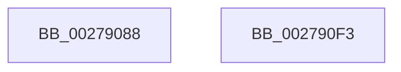

# EtwTraceShouldYieldProcessor

- RVA: `0x00279088`–`0x002790F4` (길이 `108` bytes)
- VA: `0x0000000140279088`
- 실행 섹션: `.text`
- PDB 이름 있음: `예`; PDB Function 태그: `아니요`
- unwind 정보 RVA: `0x00065FB8`
- 디코드: `24`개 명령, `108/108` bytes 표시
- 미해석 바이트: `0` (있으면 어셈블리에 `.byte`로 보존)

> 이 문서는 커널 이미지의 기계어와 PDB 기호를 분석해 생성했습니다. 4번과 5번은 함수 원형과 자료형을 바이너리 사용 방식에서 추정한 C 해석이며 원본 소스 복구 결과는 아닙니다.

## 1. Dependencies

- 직접 호출 지점: **2**; 고유 호출 대상: **2**
- 직접 호출자로 확인된 함수: **7**
- RIP 상대 이미지 참조: **1**

### Outgoing calls
- `0x002790DC` → [EtwTraceKernelEvent](../23/EtwTraceKernelEvent_function_00235350.md) (function, `0x00235350`)
- `0x002790E9` → [_security_check_cookie](../6A/_security_check_cookie_function_006AC640.md) (function, `0x006AC640`)

### Direct callers
- [sub_00241C55](../24/Unknown_function_00241C55.md) at `0x00241E2D`
- [MiWalkVaRange](../24/MiWalkVaRange_function_00243BF0.md) at `0x0024448E`
- [KeShouldYieldProcessor](KeShouldYieldProcessor_function_002773E0.md) at `0x00277463`
- [MiDeleteVaDirect](MiDeleteVaDirect_function_00277560.md) at `0x00277B77`
- [MiPeriodicGoodCitizen](MiPeriodicGoodCitizen_function_00279250.md) at `0x00279563`
- [MiWalkPageTablesRecursively](MiWalkPageTablesRecursively_function_002796C0.md) at `0x0027A64C`
- [MiQueryAddressState](../32/MiQueryAddressState_function_0032C380.md) at `0x0032CD2F`

### Static image references
- `0x0027908F` → RVA `0x00E0A740` (`.data`; read)

## 2. Other-region calls and transfers

- 다른 실행 섹션으로 향하는 call: **0**
- 별도 외부 분기/꼬리 이동을 확인하지 못했습니다.

## 3. Assembly (complete function range)

```asm
00279088  4C 8B DC                        mov r11, rsp
0027908B  48 83 EC 68                     sub rsp, 0x68
0027908F  48 8B 05 AA 16 B9 00            mov rax, qword ptr [rip + 0xb916aa]
00279096  48 33 C4                        xor rax, rsp
00279099  48 89 44 24 50                  mov qword ptr [rsp + 0x50], rax
0027909E  89 4C 24 30                     mov dword ptr [rsp + 0x30], ecx
002790A2  49 8D 43 C8                     lea rax, [r11 - 0x38]
002790A6  89 54 24 34                     mov dword ptr [rsp + 0x34], edx
002790AA  49 8D 4B D8                     lea rcx, [r11 - 0x28]
002790AE  49 89 43 D8                     mov qword ptr [r11 - 0x28], rax
002790B2  41 B9 6D 0F 00 00               mov r9d, 0xf6d
002790B8  83 64 24 4C 00                  and dword ptr [rsp + 0x4c], 0
002790BD  BA 01 00 00 00                  mov edx, 1
002790C2  45 89 43 D0                     mov dword ptr [r11 - 0x30], r8d
002790C6  41 B8 00 00 00 24               mov r8d, 0x24000000
002790CC  C7 44 24 48 0C 00 00 00         mov dword ptr [rsp + 0x48], 0xc
002790D4  C7 44 24 20 02 0A 50 00         mov dword ptr [rsp + 0x20], 0x500a02
002790DC  E8 6F C2 FB FF                  call 0x140235350
002790E1  48 8B 4C 24 50                  mov rcx, qword ptr [rsp + 0x50]
002790E6  48 33 CC                        xor rcx, rsp
002790E9  E8 52 35 43 00                  call 0x1406ac640
002790EE  48 83 C4 68                     add rsp, 0x68
002790F2  C3                              ret
002790F3  CC                              int3
```

## 4. C-style interpretation (structured pseudocode)

```c
__int64 __fastcall EtwTraceShouldYieldProcessor(int a1, int a2, int a3)
{
    __int64 result;
    __int64 v_rsp;
    unsigned __int64 v_stack_m18;
    unsigned int v_stack_m1C;
    unsigned int v_stack_m20;
    unsigned int v_stack_m34;
    unsigned int v_stack_m38;
    unsigned int v_stack_m48;

    v_rsp = (v_rsp) - (104);
    result = (*(unsigned __int64 *)(v_rip + 12129962)) ^ (v_rsp);
    v_stack_m18 = result;
    v_stack_m38 = a1;
    v_stack_m34 = a2;
    *(unsigned __int64 *)(v_rsp - 40) = v_rsp - 56;
    *(unsigned int *)(v_rsp - 48) = a3;
    v_stack_m20 = 12;
    v_stack_m48 = 0x500A02ULL;
    result = EtwTraceKernelEvent(v_rsp - 40, 1, (unsigned int)(0x24000000ULL), (unsigned int)(0xF6DULL));
    a1 = (v_stack_m18) ^ (v_rsp);
    result = _security_check_cookie(a1, 1, (unsigned int)(0x24000000ULL), (unsigned int)(0xF6DULL));
    v_rsp = (v_rsp) + (104);
    return result;
}
```

## 5. (Beta) C Style

```c
int64_t EtwTraceShouldYieldProcessor(int32_t Arg1, int32_t Arg2, int32_t Arg3)
{
    int64_t result;
    int64_t local_rsp;
    uint64_t v_stack_m18;
    uint32_t v_stack_m1C;
    uint32_t v_stack_m20;
    uint32_t v_stack_m34;
    uint32_t v_stack_m38;
    uint32_t v_stack_m48;

    local_rsp = (local_rsp) - (104);
    result = (*(uint64_t *)(v_rip + 0xB916AA)) ^ (local_rsp);
    v_stack_m18 = result;
    v_stack_m38 = Arg1;
    v_stack_m34 = Arg2;
    *(uint64_t *)(local_rsp - 0x28) = local_rsp - 56;
    *(uint32_t *)(local_rsp - 0x30) = Arg3;
    v_stack_m20 = 12;
    v_stack_m48 = 0x500A02ULL;
    result = EtwTraceKernelEvent(local_rsp - 40, 1, (uint32_t)(0x24000000ULL), (uint32_t)(0xF6DULL));
    Arg1 = (v_stack_m18) ^ (local_rsp);
    result = _security_check_cookie(Arg1, 1, (uint32_t)(0x24000000ULL), (uint32_t)(0xF6DULL));
    local_rsp = (local_rsp) + (104);
    return result;
}
```

## 6. Execution-region graph

[열기: 2D/3D 그래프와 함수 탐색 컨트롤 패널](../../../control-panel.html?section=text&rva=0x00279088&view=graph)

- 2D 그래프는 위에서 아래로 흐르고, 3D 그래프는 빈 공간을 드래그해 회전합니다. Shift+드래그는 이동, 휠은 확대·축소, 함수 노드 선택은 대상 보고서 이동입니다.

### Static fallback


