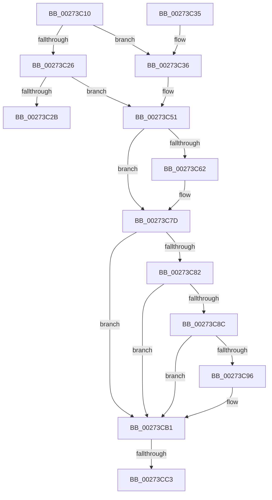

# ExReleaseResourceForThreadLite

- RVA: `0x00273C10`–`0x00273CDF` (길이 `207` bytes)
- VA: `0x0000000140273C10`
- 실행 섹션: `.text`
- PDB 이름 있음: `예`; PDB Function 태그: `예`
- unwind 정보 RVA: `0x00065D14`
- 디코드: `54`개 명령, `207/207` bytes 표시
- 미해석 바이트: `0` (있으면 어셈블리에 `.byte`로 보존)

> 이 문서는 커널 이미지의 기계어와 PDB 기호를 분석해 생성했습니다. 4번과 5번은 함수 원형과 자료형을 바이너리 사용 방식에서 추정한 C 해석이며 원본 소스 복구 결과는 아닙니다.

## 1. Dependencies

- 직접 호출 지점: **5**; 고유 호출 대상: **2**
- 직접 호출자로 확인된 함수: **2**
- RIP 상대 이미지 참조: **0**

### Outgoing calls
- `0x00273C2B` → [ExpReleaseResourceForThreadLite](ExpReleaseResourceForThreadLite_function_00273E70.md) (function, `0x00273E70`)
- `0x00273C4B` → [KeBugCheckEx](../4F/KeBugCheckEx_function_004FD660.md) (function, `0x004FD660`)
- `0x00273C77` → [KeBugCheckEx](../4F/KeBugCheckEx_function_004FD660.md) (function, `0x004FD660`)
- `0x00273CAB` → [KeBugCheckEx](../4F/KeBugCheckEx_function_004FD660.md) (function, `0x004FD660`)
- `0x00273CD9` → [KeBugCheckEx](../4F/KeBugCheckEx_function_004FD660.md) (function, `0x004FD660`)

### Direct callers
- [DifExReleaseResourceForThreadLiteWrapper](../62/DifExReleaseResourceForThreadLiteWrapper_function_00622E10.md) at `0x00622EE7`
- [CcUnpinDataForThread](../../page/71/CcUnpinDataForThread_function_00710410.md) at `0x0071045C`

### Static image references
- 디코드된 RIP-relative 메모리 참조가 없습니다.

## 2. Other-region calls and transfers

- 다른 실행 섹션으로 향하는 call: **0**
- call이 아닌 외부 분기/꼬리 이동: **1**
  - `0x00273CBD` → [sub_006DA0BC](../6D/Unknown_function_006DA0BC.md) (`tail-transfer`)

## 3. Assembly (complete function range)

```asm
00273C10  48 83 EC 38                     sub rsp, 0x38
00273C14  44 0F B7 41 1A                  movzx r8d, word ptr [rcx + 0x1a]
00273C19  41 B1 01                        mov r9b, 1
00273C1C  41 8A C0                        mov al, r8b
00273C1F  24 41                           and al, 0x41
00273C21  41 3A C1                        cmp al, r9b
00273C24  74 10                           je 0x140273c36
00273C26  45 84 C1                        test r9b, r8b
00273C29  75 26                           jne 0x140273c51
00273C2B  E8 40 02 00 00                  call 0x140273e70
00273C30  48 83 C4 38                     add rsp, 0x38
00273C34  C3                              ret
00273C35  CC                              int3
00273C36  48 83 64 24 20 00               and qword ptr [rsp + 0x20], 0
00273C3C  45 33 C9                        xor r9d, r9d
00273C3F  4C 8B C1                        mov r8, rcx
00273C42  B9 C6 01 00 00                  mov ecx, 0x1c6
00273C47  41 8D 51 0F                     lea edx, [r9 + 0xf]
00273C4B  E8 10 9A 28 00                  call 0x1404fd660
00273C50  CC                              int3
00273C51  44 0F 20 C0                     mov rax, cr8
00273C55  65 4C 8B 04 25 88 01 00 00      mov r8, qword ptr gs:[0x188]
00273C5E  3C 02                           cmp al, 2
00273C60  76 1B                           jbe 0x140273c7d
00273C62  48 83 64 24 20 00               and qword ptr [rsp + 0x20], 0
00273C68  33 D2                           xor edx, edx
00273C6A  44 0F B6 C0                     movzx r8d, al
00273C6E  B9 C6 01 00 00                  mov ecx, 0x1c6
00273C73  44 8D 4A 02                     lea r9d, [rdx + 2]
00273C77  E8 E4 99 28 00                  call 0x1404fd660
00273C7C  CC                              int3
00273C7D  41 3A C1                        cmp al, r9b
00273C80  73 2F                           jae 0x140273cb1
00273C82  41 F7 40 74 00 04 00 00         test dword ptr [r8 + 0x74], 0x400
00273C8A  75 25                           jne 0x140273cb1
00273C8C  41 83 B8 E4 01 00 00 00         cmp dword ptr [r8 + 0x1e4], 0
00273C94  75 1B                           jne 0x140273cb1
00273C96  48 83 64 24 20 00               and qword ptr [rsp + 0x20], 0
00273C9C  45 33 C9                        xor r9d, r9d
00273C9F  45 33 C0                        xor r8d, r8d
00273CA2  B9 C6 01 00 00                  mov ecx, 0x1c6
00273CA7  41 8D 51 07                     lea edx, [r9 + 7]
00273CAB  E8 B0 99 28 00                  call 0x1404fd660
00273CB0  CC                              int3
00273CB1  65 48 8B 04 25 88 01 00 00      mov rax, qword ptr gs:[0x188]
00273CBA  48 3B D0                        cmp rdx, rax
00273CBD  0F 84 F9 63 46 00               je 0x1406da0bc
00273CC3  48 83 64 24 20 00               and qword ptr [rsp + 0x20], 0
00273CC9  4C 8B CA                        mov r9, rdx
00273CCC  4C 8B C1                        mov r8, rcx
00273CCF  BA 11 00 00 00                  mov edx, 0x11
00273CD4  B9 C6 01 00 00                  mov ecx, 0x1c6
00273CD9  E8 82 99 28 00                  call 0x1404fd660
00273CDE  CC                              int3
```

## 4. C-style interpretation (structured pseudocode)

```c
__int64 __fastcall ExReleaseResourceForThreadLite(__int64 a1)
{
    __int64 result;
    __int64 v_rsp;
    unsigned __int64 v_stack_p20;

    v_rsp = (v_rsp) - (56);
    result = (unsigned __int8)(((unsigned __int8)(*(unsigned __int16 *)(a1 + 26))) & (65));
    if (((unsigned __int8)(result)) == 1) goto loc_00273C36;
    if (((1) & ((unsigned __int8)(*(unsigned __int16 *)(a1 + 26)))) != 0) goto loc_00273C51;
    result = ExpReleaseResourceForThreadLite(a1, a2, *(unsigned __int16 *)(a1 + 26), 1);
    v_rsp = (v_rsp) + (56);
    return result;
loc_00273C36:
    a4 = 0;
    result = KeBugCheckEx(454, a4 + 15, a1, a4);
loc_00273C51:
    result = v_cr8;
    if (((unsigned __int8)(v_cr8)) >= = 2) {
        a2 = 0;
        a3 = (unsigned __int8)(v_cr8);
        a1 = 454;
        a4 = a2 + 2;
        result = KeBugCheckEx(a1, a2, a3, a4);
    }
    if (((unsigned __int8)(result)) >= ((unsigned __int8)(a4))) goto loc_00273CB1;
    if (((*(unsigned int *)(a3 + 116)) & (0x400ULL)) != 0) goto loc_00273CB1;
    if ((*(unsigned int *)(a3 + 484)) == 0) {
        a4 = 0;
        a3 = 0;
        a1 = 454;
        a2 = a4 + 7;
        result = KeBugCheckEx(a1, a2, a3, a4);
    }
    result = KeBugCheckEx(454, 17, a1, a2);
    return result;
}
```

## 5. (Beta) C Style

```c
int64_t ExReleaseResourceForThreadLite(void *Arg1)
{
    uint8_t *arg1 = (uint8_t *)Arg1;

    int64_t result;
    int64_t local_rsp;
    uint64_t v_stack_p20;

    local_rsp = (local_rsp) - (56);
    result = (uint8_t)(((uint8_t)(*(uint16_t *)(arg1 + 0x1A))) & (65));
    if (((uint8_t)(result)) == 1) goto loc_00273C36;
    if (((1) & ((uint8_t)(*(uint16_t *)(arg1 + 0x1A)))) != 0) goto loc_00273C51;
    result = ExpReleaseResourceForThreadLite(Arg1, a2, *(uint16_t *)(arg1 + 0x1A), 1);
    local_rsp = (local_rsp) + (56);
    return result;
loc_00273C36:
    a4 = 0;
    result = KeBugCheckEx(454, a4 + 15, Arg1, a4);
loc_00273C51:
    result = v_cr8;
    if (((uint8_t)(v_cr8)) >= = 2) {
        a2 = 0;
        a3 = (uint8_t)(v_cr8);
        Arg1 = 454;
        a4 = a2 + 2;
        result = KeBugCheckEx(Arg1, a2, a3, a4);
    }
    if (((uint8_t)(result)) >= ((uint8_t)(a4))) goto loc_00273CB1;
    if (((*(uint32_t *)(a3 + 0x74)) & (0x400ULL)) != 0) goto loc_00273CB1;
    if ((*(uint32_t *)(a3 + 0x1E4)) == 0) {
        a4 = 0;
        a3 = 0;
        Arg1 = 454;
        a2 = a4 + 7;
        result = KeBugCheckEx(Arg1, a2, a3, a4);
    }
    result = KeBugCheckEx(454, 17, Arg1, a2);
    return result;
}
```

### 관측된 메모리 오프셋

구조체 형식이 확인되지 않은 접근은 인자 기준의 오프셋으로만 기록했습니다.

| 기준 인자 | 오프셋 표현 | 폭 (bit) | 접근 |
|---|---:|---:|---|
| `Arg1` | `+ 0x1A` | `16` | `R` |

## 6. Execution-region graph

[열기: 2D/3D 그래프와 함수 탐색 컨트롤 패널](../../../control-panel.html?section=text&rva=0x00273C10&view=graph)

- 2D 그래프는 위에서 아래로 흐르고, 3D 그래프는 빈 공간을 드래그해 회전합니다. Shift+드래그는 이동, 휠은 확대·축소, 함수 노드 선택은 대상 보고서 이동입니다.

### Static fallback


