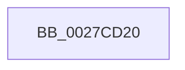

# ExpAcquireSpinLockSharedAtDpcLevelInstrumented

- RVA: `0x0027CD20`–`0x0027CD30` (길이 `16` bytes)
- VA: `0x000000014027CD20`
- 실행 섹션: `.text`
- PDB 이름 있음: `예`; PDB Function 태그: `아니요`
- unwind 정보 RVA: `0x00066200`
- 디코드: `4`개 명령, `16/16` bytes 표시
- 미해석 바이트: `0` (있으면 어셈블리에 `.byte`로 보존)

> 이 문서는 커널 이미지의 기계어와 PDB 기호를 분석해 생성했습니다. 4번과 5번은 함수 원형과 자료형을 바이너리 사용 방식에서 추정한 C 해석이며 원본 소스 복구 결과는 아닙니다.

## 1. Dependencies

- 직접 호출 지점: **0**; 고유 호출 대상: **0**
- 직접 호출자로 확인된 함수: **39**
- RIP 상대 이미지 참조: **0**

### Outgoing calls
- 직접 디코드된 call 명령이 없습니다.

### Direct callers
- [KiActivateWaiterQueueWithNoLocks](../20/KiActivateWaiterQueueWithNoLocks_function_0020CEB0.md) at `0x0020CEFA`
- [sub_00221431](../22/Unknown_function_00221431.md) at `0x002214C0`
- [MiLockWorkingSetOptimal](../23/MiLockWorkingSetOptimal_function_00238FC0.md) at `0x00239083`
- [ExAcquireSpinLockSharedAtDpcLevel](../24/ExAcquireSpinLockSharedAtDpcLevel_function_00248E30.md) at `0x00248E49`
- [sub_0024A238](../24/Unknown_function_0024A238.md) at `0x0024A2EB`
- [sub_0024DB56](../24/Unknown_function_0024DB56.md) at `0x0024DBA0`
- [ExAcquireSpinLockShared](../24/ExAcquireSpinLockShared_function_0024DCE0.md) at `0x0024DD1C`
- [KiAbEntryRemoveFromTree](../26/KiAbEntryRemoveFromTree_function_00262410.md) at `0x002624C7`
- [MiLockVadTree](MiLockVadTree_function_0027C0F0.md) at `0x0027C142`
- [MiLockVadTree](MiLockVadTree_function_0027C0F0.md) at `0x0027C1B5`
- [MiLockWorkingSetCoreShared](MiLockWorkingSetCoreShared_function_0027C3E0.md) at `0x0027C40C`
- [MiAcquirePageListLock](MiAcquirePageListLock_function_0027C450.md) at `0x0027C4FB`
- [sub_0027CC13](Unknown_function_0027CC13.md) at `0x0027CC70`
- [MiMakeHyperRangeAccessible](MiMakeHyperRangeAccessible_function_0027CE10.md) at `0x0027CF3C`
- [MiAddWorkingSetEntries](MiAddWorkingSetEntries_function_0027DC00.md) at `0x0027DCB8`
- [MiMakeSystemAddressValid](MiMakeSystemAddressValid_function_0027FF70.md) at `0x0028066A`
- [MiReacquireWalkLocks](../28/MiReacquireWalkLocks_function_002819A0.md) at `0x00281A61`
- [MiSetVaAgeList](../29/MiSetVaAgeList_function_00290A20.md) at `0x00290B84`
- [MmIsFileObjectAPagingFile](../29/MmIsFileObjectAPagingFile_function_0029BDAC.md) at `0x0029BE03`
- [sub_002BBF53](../2B/Unknown_function_002BBF53.md) at `0x002BBF9D`
- [KiAcquireProcessLockShared](../2C/KiAcquireProcessLockShared_function_002CF9A0.md) at `0x002CF9E6`
- [sub_002E087E](../2E/Unknown_function_002E087E.md) at `0x002E09B3`
- [ExpAddTagForBigPages](../2E/ExpAddTagForBigPages_function_002EF570.md) at `0x002EF5FB`
- [sub_002F0082](../2F/Unknown_function_002F0082.md) at `0x002F00BF`
- [MiReturnLockedVadOrNextVa](../31/MiReturnLockedVadOrNextVa_function_00316980.md) at `0x00316A1C`
- [MiUserFault](../32/MiUserFault_function_00329840.md) at `0x00329A09`
- [sub_0032D782](../32/Unknown_function_0032D782.md) at `0x0032D862`
- [sub_0032E02E](../32/Unknown_function_0032E02E.md) at `0x0032E116`
- [MiCheckVirtualAddress](../32/MiCheckVirtualAddress_function_0032E4F0.md) at `0x0032E597`
- [ExAllocateHeapPool](../35/ExAllocateHeapPool_function_0035BA30.md) at `0x0035CEC2`
- [sub_003602E3](../36/Unknown_function_003602E3.md) at `0x00360378`
- [MiUpdateWorkingSetPrivateSize](../36/MiUpdateWorkingSetPrivateSize_function_00362250.md) at `0x003622AA`
- [MiEndingOffsetWithLock](../40/MiEndingOffsetWithLock_function_00404718.md) at `0x0040476C`
- [sub_0040E53F](../40/Unknown_function_0040E53F.md) at `0x0040E5A0`
- [ExpRemoveTagForBigPages](../41/ExpRemoveTagForBigPages_function_00411980.md) at `0x004119E5`
- [MiLockPageListAndLastPage](../41/MiLockPageListAndLastPage_function_00411BA0.md) at `0x00411C35`
- [sub_0041CB87](../41/Unknown_function_0041CB87.md) at `0x0041CBF0`
- [KeQueryBasePriorityThread](../41/KeQueryBasePriorityThread_function_0041E500.md) at `0x0041E557`
- [sub_004346AE](../43/Unknown_function_004346AE.md) at `0x00434701`
- [sub_00B830A9](../../poolcode/B8/Unknown_function_00B830A9.md) at `0x00B83136`

### Static image references
- 디코드된 RIP-relative 메모리 참조가 없습니다.

## 2. Other-region calls and transfers

- 다른 실행 섹션으로 향하는 call: **0**
- 별도 외부 분기/꼬리 이동을 확인하지 못했습니다.

## 3. Assembly (complete function range)

```asm
0027CD20  48 89 5C 24 18                  mov qword ptr [rsp + 0x18], rbx
0027CD25  48 89 6C 24 20                  mov qword ptr [rsp + 0x20], rbp
0027CD2A  41 56                           push r14
0027CD2C  48 83 EC 30                     sub rsp, 0x30
```

## 4. C-style interpretation (structured pseudocode)

```c
void __fastcall ExpAcquireSpinLockSharedAtDpcLevelInstrumented(void)
{
    __int64 v_rsp;
    unsigned __int64 v_stack_p18;
    unsigned __int64 v_stack_p20;

    v_stack_p18 = v_rbx;
    v_stack_p20 = v_rbp;
    v_rsp = (v_rsp) - (48);
    return;
}
```

## 5. (Beta) C Style

```c
void ExpAcquireSpinLockSharedAtDpcLevelInstrumented(void)
{
    int64_t local_rsp;
    uint64_t v_stack_p18;
    uint64_t v_stack_p20;

    v_stack_p18 = local_rbx;
    v_stack_p20 = local_rbp;
    local_rsp = (local_rsp) - (48);
    return;
}
```

## 6. Execution-region graph

[열기: 2D/3D 그래프와 함수 탐색 컨트롤 패널](../../../control-panel.html?section=text&rva=0x0027CD20&view=graph)

- 2D 그래프는 위에서 아래로 흐르고, 3D 그래프는 빈 공간을 드래그해 회전합니다. Shift+드래그는 이동, 휠은 확대·축소, 함수 노드 선택은 대상 보고서 이동입니다.

### Static fallback


