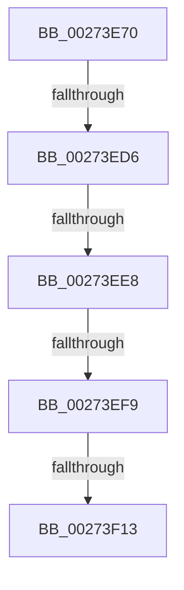

# ExpReleaseResourceForThreadLite

- RVA: `0x00273E70`–`0x00273F20` (길이 `176` bytes)
- VA: `0x0000000140273E70`
- 실행 섹션: `.text`
- PDB 이름 있음: `예`; PDB Function 태그: `아니요`
- unwind 정보 RVA: `0x00065D68`
- 디코드: `42`개 명령, `176/176` bytes 표시
- 미해석 바이트: `0` (있으면 어셈블리에 `.byte`로 보존)

> 이 문서는 커널 이미지의 기계어와 PDB 기호를 분석해 생성했습니다. 4번과 5번은 함수 원형과 자료형을 바이너리 사용 방식에서 추정한 C 해석이며 원본 소스 복구 결과는 아닙니다.

## 1. Dependencies

- 직접 호출 지점: **0**; 고유 호출 대상: **0**
- 직접 호출자로 확인된 함수: **1**
- RIP 상대 이미지 참조: **4**

### Outgoing calls
- 직접 디코드된 call 명령이 없습니다.

### Direct callers
- [ExReleaseResourceForThreadLite](ExReleaseResourceForThreadLite_function_00273C10.md) at `0x00273C2B`

### Static image references
- `0x00273E87` → RVA `0x00E0A740` (`.data`; read)
- `0x00273ECA` → RVA `0x00FC6D20` (`ALMOSTRO`; read)
- `0x00273ED6` → RVA `0x00FC6B06` (`ALMOSTRO`; read)
- `0x00273F13` → RVA `0x00EFAC10` (`.data`; read)

## 2. Other-region calls and transfers

- 다른 실행 섹션으로 향하는 call: **0**
- call이 아닌 외부 분기/꼬리 이동: **5**
  - `0x00273ED0` → [sub_0027456F](Unknown_function_0027456F.md) (`tail-transfer`)
  - `0x00273EE2` → [sub_00273F75](Unknown_function_00273F75.md) (`tail-transfer`)
  - `0x00273EF3` → [sub_002746AC + 0x2D](Unknown_function_002746AC.md) (`tail-transfer`)
  - `0x00273F0D` → [sub_002746AC](Unknown_function_002746AC.md) (`tail-transfer`)
  - `0x00273F1A` → [sub_002746AC](Unknown_function_002746AC.md) (`tail-transfer`)

## 3. Assembly (complete function range)

```asm
00273E70  40 55                           push rbp
00273E72  53                              push rbx
00273E73  56                              push rsi
00273E74  57                              push rdi
00273E75  41 54                           push r12
00273E77  41 56                           push r14
00273E79  41 57                           push r15
00273E7B  48 8D 6C 24 F0                  lea rbp, [rsp - 0x10]
00273E80  48 81 EC 10 01 00 00            sub rsp, 0x110
00273E87  48 8B 05 B2 68 B9 00            mov rax, qword ptr [rip + 0xb968b2]
00273E8E  48 33 C4                        xor rax, rsp
00273E91  48 89 45 08                     mov qword ptr [rbp + 8], rax
00273E95  33 C0                           xor eax, eax
00273E97  48 8D 79 60                     lea rdi, [rcx + 0x60]
00273E9B  0F 57 C0                        xorps xmm0, xmm0
00273E9E  48 89 44 24 58                  mov qword ptr [rsp + 0x58], rax
00273EA3  0F 11 44 24 48                  movups xmmword ptr [rsp + 0x48], xmm0
00273EA8  45 33 FF                        xor r15d, r15d
00273EAB  48 89 7C 24 50                  mov qword ptr [rsp + 0x50], rdi
00273EB0  4C 89 7C 24 48                  mov qword ptr [rsp + 0x48], r15
00273EB5  48 8B F2                        mov rsi, rdx
00273EB8  90                              nop
00273EB9  48 8B D9                        mov rbx, rcx
00273EBC  45 0F 20 C6                     mov r14, cr8
00273EC0  41 BC 02 00 00 00               mov r12d, 2
00273EC6  45 0F 22 C4                     mov cr8, r12
00273ECA  39 05 50 2E D5 00               cmp dword ptr [rip + 0xd52e50], eax
00273ED0  0F 85 99 06 00 00               jne 0x14027456f
00273ED6  F6 05 29 2C D5 00 21            test byte ptr [rip + 0xd52c29], 0x21
00273EDD  44 88 74 24 58                  mov byte ptr [rsp + 0x58], r14b
00273EE2  0F 85 8D 00 00 00               jne 0x140273f75
00273EE8  48 8D 54 24 48                  lea rdx, [rsp + 0x48]
00273EED  48 87 17                        xchg qword ptr [rdi], rdx
00273EF0  48 85 D2                        test rdx, rdx
00273EF3  0F 85 E0 07 00 00               jne 0x1402746d9
00273EF9  65 4C 8B 04 25 88 01 00 00      mov r8, qword ptr gs:[0x188]
00273F02  0F B7 53 1A                     movzx edx, word ptr [rbx + 0x1a]
00273F06  0F B7 CA                        movzx ecx, dx
00273F09  66 83 E1 01                     and cx, 1
00273F0D  0F 85 99 07 00 00               jne 0x1402746ac
00273F13  44 39 3D F6 6C C8 00            cmp dword ptr [rip + 0xc86cf6], r15d
00273F1A  0F 85 8C 07 00 00               jne 0x1402746ac
```

## 4. C-style interpretation (structured pseudocode)

```c
__int64 __fastcall ExpReleaseResourceForThreadLite(__int64 a1, __int64 a2)
{
    __int64 result;
    __int64 v_r15;
    __int64 v_rsp;
    unsigned __int64 v_stack_m100;
    unsigned __int64 v_stack_m40;
    unsigned __int64 v_stack_m48;
    unsigned __int64 v_stack_mF0;
    unsigned __int64 v_stack_mF8;

    v_rsp = (v_rsp) - (272);
    result = (*(unsigned __int64 *)(v_rip + 12150962)) ^ (v_rsp);
    v_stack_m40 = result;
    result = 0;
    v_stack_mF0 = 0;
    v_stack_m100 = v_xmm0;
    v_r15 = 0;
    v_stack_mF8 = a1 + 96;
    v_stack_m100 = 0;
    v_stack_mF0 = (unsigned __int8)(v_cr8);
    a1 = (unsigned __int16)(((unsigned __int16)(*(unsigned __int16 *)(a1 + 26))) & (1));
}
```

## 5. (Beta) C Style

```c
int64_t ExpReleaseResourceForThreadLite(void *Arg1, int64_t Arg2)
{
    uint8_t *arg1 = (uint8_t *)Arg1;

    int64_t result;
    int64_t local_r15;
    int64_t local_rsp;
    uint64_t v_stack_m100;
    uint64_t v_stack_m40;
    uint64_t v_stack_m48;
    uint64_t v_stack_mF0;
    uint64_t v_stack_mF8;

    local_rsp = (local_rsp) - (272);
    result = (*(uint64_t *)(v_rip + 0xB968B2)) ^ (local_rsp);
    v_stack_m40 = result;
    result = 0;
    v_stack_mF0 = 0;
    v_stack_m100 = v_xmm0;
    local_r15 = 0;
    v_stack_mF8 = Arg1 + 96;
    v_stack_m100 = 0;
    v_stack_mF0 = (uint8_t)(v_cr8);
    Arg1 = (uint16_t)(((uint16_t)(*(uint16_t *)(arg1 + 0x1A))) & (1));
}
```

### 관측된 메모리 오프셋

구조체 형식이 확인되지 않은 접근은 인자 기준의 오프셋으로만 기록했습니다.

| 기준 인자 | 오프셋 표현 | 폭 (bit) | 접근 |
|---|---:|---:|---|
| `Arg1` | `+ 0x0` | `64` | `R/W` |
| `Arg1` | `+ 0x1A` | `16` | `R` |
| `Arg1` | `+ 0x60` | `64` | `R` |

## 6. Execution-region graph

[열기: 2D/3D 그래프와 함수 탐색 컨트롤 패널](../../../control-panel.html?section=text&rva=0x00273E70&view=graph)

- 2D 그래프는 위에서 아래로 흐르고, 3D 그래프는 빈 공간을 드래그해 회전합니다. Shift+드래그는 이동, 휠은 확대·축소, 함수 노드 선택은 대상 보고서 이동입니다.

### Static fallback


