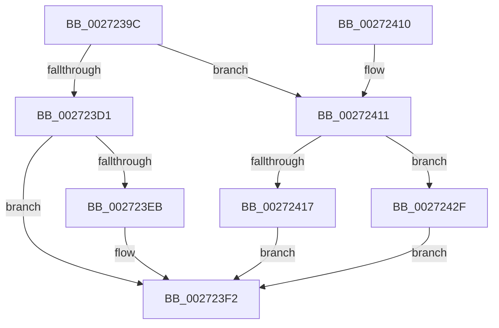

# FsRtlNotifySetCancelRoutine

- RVA: `0x0027239C`–`0x0027243B` (길이 `159` bytes)
- VA: `0x000000014027239C`
- 실행 섹션: `.text`
- PDB 이름 있음: `예`; PDB Function 태그: `아니요`
- unwind 정보 RVA: `0x00065B90`
- 디코드: `47`개 명령, `159/159` bytes 표시
- 미해석 바이트: `0` (있으면 어셈블리에 `.byte`로 보존)

> 이 문서는 커널 이미지의 기계어와 PDB 기호를 분석해 생성했습니다. 4번과 5번은 함수 원형과 자료형을 바이너리 사용 방식에서 추정한 C 해석이며 원본 소스 복구 결과는 아닙니다.

## 1. Dependencies

- 직접 호출 지점: **4**; 고유 호출 대상: **3**
- 직접 호출자로 확인된 함수: **3**
- RIP 상대 이미지 참조: **1**

### Outgoing calls
- `0x002723C4` → [KeAcquireQueuedSpinLock](KeAcquireQueuedSpinLock_function_00273D80.md) (function, `0x00273D80`)
- `0x002723E1` → [KeReleaseQueuedSpinLock](KeReleaseQueuedSpinLock_function_00272540.md) (function, `0x00272540`)
- `0x00272428` → [KeReleaseQueuedSpinLock](KeReleaseQueuedSpinLock_function_00272540.md) (function, `0x00272540`)
- `0x00272434` → [FsRtlCancelNotify](../4E/FsRtlCancelNotify_function_004E7F90.md) (function, `0x004E7F90`)

### Direct callers
- [FsRtlNotifyCompleteIrp](../../page/A1/FsRtlNotifyCompleteIrp_function_00A1FA28.md) at `0x00A1FA4A`
- [FsRtlNotifyFilterChangeDirectory](../../page/AA/FsRtlNotifyFilterChangeDirectory_function_00AAB9E0.md) at `0x00AABCD1`
- [FsRtlNotifyFilterChangeDirectoryLite](../../page/AD/FsRtlNotifyFilterChangeDirectoryLite_function_00ADC950.md) at `0x00ADCC0D`

### Static image references
- `0x00272417` → RVA `0x004E7F90` (`FsRtlCancelNotify`; read)

## 2. Other-region calls and transfers

- 다른 실행 섹션으로 향하는 call: **0**
- 별도 외부 분기/꼬리 이동을 확인하지 못했습니다.

## 3. Assembly (complete function range)

```asm
0027239C  48 8B C4                        mov rax, rsp
0027239F  48 89 58 08                     mov qword ptr [rax + 8], rbx
002723A3  48 89 68 10                     mov qword ptr [rax + 0x10], rbp
002723A7  48 89 70 18                     mov qword ptr [rax + 0x18], rsi
002723AB  48 89 78 20                     mov qword ptr [rax + 0x20], rdi
002723AF  41 56                           push r14
002723B1  48 83 EC 20                     sub rsp, 0x20
002723B5  48 8B F9                        mov rdi, rcx
002723B8  33 F6                           xor esi, esi
002723BA  48 8B EA                        mov rbp, rdx
002723BD  44 8D 76 07                     lea r14d, [rsi + 7]
002723C1  41 8B CE                        mov ecx, r14d
002723C4  E8 B7 19 00 00                  call 0x140273d80
002723C9  88 47 45                        mov byte ptr [rdi + 0x45], al
002723CC  48 85 ED                        test rbp, rbp
002723CF  74 40                           je 0x140272411
002723D1  8B DE                           mov ebx, esi
002723D3  41 8B CE                        mov ecx, r14d
002723D6  48 87 5F 68                     xchg qword ptr [rdi + 0x68], rbx
002723DA  8A 57 45                        mov dl, byte ptr [rdi + 0x45]
002723DD  48 89 77 38                     mov qword ptr [rdi + 0x38], rsi
002723E1  E8 5A 01 00 00                  call 0x140272540
002723E6  48 85 DB                        test rbx, rbx
002723E9  74 07                           je 0x1402723f2
002723EB  F0 FF 4D 70                     lock dec dword ptr [rbp + 0x70]
002723EF  40 B6 01                        mov sil, 1
002723F2  48 8B 5C 24 30                  mov rbx, qword ptr [rsp + 0x30]
002723F7  40 8A C6                        mov al, sil
002723FA  48 8B 74 24 40                  mov rsi, qword ptr [rsp + 0x40]
002723FF  48 8B 6C 24 38                  mov rbp, qword ptr [rsp + 0x38]
00272404  48 8B 7C 24 48                  mov rdi, qword ptr [rsp + 0x48]
00272409  48 83 C4 20                     add rsp, 0x20
0027240D  41 5E                           pop r14
0027240F  C3                              ret
00272410  CC                              int3
00272411  40 38 77 44                     cmp byte ptr [rdi + 0x44], sil
00272415  75 18                           jne 0x14027242f
00272417  48 8D 0D 72 5B 27 00            lea rcx, [rip + 0x275b72]
0027241E  48 87 4F 68                     xchg qword ptr [rdi + 0x68], rcx
00272422  8A 57 45                        mov dl, byte ptr [rdi + 0x45]
00272425  49 8B CE                        mov rcx, r14
00272428  E8 13 01 00 00                  call 0x140272540
0027242D  EB C3                           jmp 0x1402723f2
0027242F  48 8B D7                        mov rdx, rdi
00272432  33 C9                           xor ecx, ecx
00272434  E8 57 5B 27 00                  call 0x1404e7f90
00272439  EB B7                           jmp 0x1402723f2
```

## 4. C-style interpretation (structured pseudocode)

```c
__int64 __fastcall FsRtlNotifySetCancelRoutine(__int64 a1, __int64 a2)
{
    __int64 result;
    __int64 v_rsi;
    __int64 v_rsp;
    unsigned __int64 v_stack_p10;
    unsigned __int64 v_stack_p18;
    unsigned __int64 v_stack_p20;
    unsigned __int64 v_stack_p8;

    *(unsigned __int64 *)(v_rsp + 8) = v_rbx;
    *(unsigned __int64 *)(v_rsp + 16) = v_rbp;
    *(unsigned __int64 *)(v_rsp + 24) = v_rsi;
    *(unsigned __int64 *)(v_rsp + 32) = v_rdi;
    v_rsp = (v_rsp) - (32);
    v_rsi = 0;
    result = KeAcquireQueuedSpinLock((unsigned int)((unsigned int)(v_rsi + 7)), a2, a3, a4);
    *(unsigned __int8 *)(a1 + 69) = (unsigned __int8)(result);
    if (a2 == 0) goto loc_00272411;
    *(unsigned __int64 *)(a1 + 56) = 0;
    result = KeReleaseQueuedSpinLock((unsigned int)((unsigned int)(v_rsi + 7)), *(unsigned __int8 *)(a1 + 69), a3, a4);
    if (0 != 0) {
        v_rsi = 1;
    }
    v_rsp = (v_rsp) + (32);
    return (unsigned __int8)(v_rsi);
loc_00272411:
    if ((*(unsigned __int8 *)(v_stack_p20 + 68)) != ((unsigned __int8)(v_stack_p18))) goto loc_0027242F;
    result = KeReleaseQueuedSpinLock(v_rsi + 7, *(unsigned __int8 *)(v_stack_p20 + 69), a3, a4);
    goto loc_002723F2;
loc_0027242F:
    a1 = 0;
    result = FsRtlCancelNotify(a1, v_stack_p20, a3, a4);
    goto loc_002723F2;
}
```

## 5. (Beta) C Style

```c
int64_t FsRtlNotifySetCancelRoutine(void *Arg1, int64_t Arg2)
{
    uint8_t *arg1 = (uint8_t *)Arg1;

    int64_t result;
    int64_t local_rsi;
    int64_t local_rsp;
    uint64_t v_stack_p10;
    uint64_t v_stack_p18;
    uint64_t v_stack_p20;
    uint64_t v_stack_p8;

    *(uint64_t *)(local_rsp + 0x8) = local_rbx;
    *(uint64_t *)(local_rsp + 0x10) = local_rbp;
    *(uint64_t *)(local_rsp + 0x18) = local_rsi;
    *(uint64_t *)(local_rsp + 0x20) = local_rdi;
    local_rsp = (local_rsp) - (32);
    local_rsi = 0;
    result = KeAcquireQueuedSpinLock((uint32_t)((uint32_t)(local_rsi + 7)), Arg2, a3, a4);
    *(uint8_t *)(arg1 + 0x45) = (uint8_t)(result);
    if (Arg2 == 0) goto loc_00272411;
    *(uint64_t *)(arg1 + 0x38) = 0;
    result = KeReleaseQueuedSpinLock((uint32_t)((uint32_t)(local_rsi + 7)), *(uint8_t *)(arg1 + 0x45), a3, a4);
    if (0 != 0) {
        local_rsi = 1;
    }
    local_rsp = (local_rsp) + (32);
    return (uint8_t)(local_rsi);
loc_00272411:
    if ((*(uint8_t *)(v_stack_p20 + 0x44)) != ((uint8_t)(v_stack_p18))) goto loc_0027242F;
    result = KeReleaseQueuedSpinLock(local_rsi + 7, *(uint8_t *)(v_stack_p20 + 0x45), a3, a4);
    goto loc_002723F2;
loc_0027242F:
    Arg1 = 0;
    result = FsRtlCancelNotify(Arg1, v_stack_p20, a3, a4);
    goto loc_002723F2;
}
```

### 관측된 메모리 오프셋

구조체 형식이 확인되지 않은 접근은 인자 기준의 오프셋으로만 기록했습니다.

| 기준 인자 | 오프셋 표현 | 폭 (bit) | 접근 |
|---|---:|---:|---|
| `Arg1` | `+ 0x38` | `64` | `W` |
| `Arg1` | `+ 0x44` | `8` | `R` |
| `Arg1` | `+ 0x45` | `8` | `R` |
| `Arg1` | `+ 0x45` | `8` | `W` |
| `Arg1` | `+ 0x68` | `64` | `R/W` |

## 6. Execution-region graph

[열기: 2D/3D 그래프와 함수 탐색 컨트롤 패널](../../../control-panel.html?section=text&rva=0x0027239C&view=graph)

- 2D 그래프는 위에서 아래로 흐르고, 3D 그래프는 빈 공간을 드래그해 회전합니다. Shift+드래그는 이동, 휠은 확대·축소, 함수 노드 선택은 대상 보고서 이동입니다.

### Static fallback


