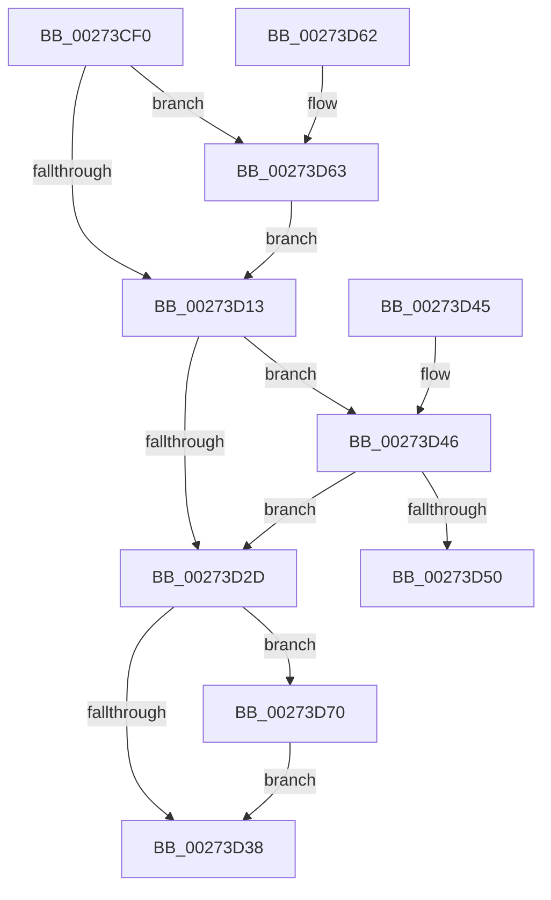

# IoAcquireCancelSpinLock

- RVA: `0x00273CF0`–`0x00273D7A` (길이 `138` bytes)
- VA: `0x0000000140273CF0`
- 실행 섹션: `.text`
- PDB 이름 있음: `예`; PDB Function 태그: `아니요`
- unwind 정보 RVA: `0x00065D30`
- 디코드: `41`개 명령, `138/138` bytes 표시
- 미해석 바이트: `0` (있으면 어셈블리에 `.byte`로 보존)

> 이 문서는 커널 이미지의 기계어와 PDB 기호를 분석해 생성했습니다. 4번과 5번은 함수 원형과 자료형을 바이너리 사용 방식에서 추정한 C 해석이며 원본 소스 복구 결과는 아닙니다.

## 1. Dependencies

- 직접 호출 지점: **3**; 고유 호출 대상: **3**
- 직접 호출자로 확인된 함수: **0**
- RIP 상대 이미지 참조: **3**

### Outgoing calls
- `0x00273D50` → [KiAcquireQueuedSpinLockInstrumented](KiAcquireQueuedSpinLockInstrumented_function_00275850.md) (function, `0x00275850`)
- `0x00273D69` → [KiRaiseIrqlProcessIrqlFlags](../4F/KiRaiseIrqlProcessIrqlFlags_function_004F56FC.md) (function, `0x004F56FC`)
- `0x00273D73` → [KxWaitForLockOwnerShip](../25/KxWaitForLockOwnerShip_function_00257EB0.md) (function, `0x00257EB0`)

### Direct callers
- 이 함수 시작 RVA로 연결되는 직접 call은 확인되지 않았습니다. 간접 호출은 완전히 역산할 수 없습니다.

### Static image references
- `0x00273D0A` → RVA `0x00FC6D20` (`ALMOSTRO`; read)
- `0x00273D24` → RVA `0x00FC6B06` (`ALMOSTRO`; read)
- `0x00273D46` → RVA `0x00F0DE58` (`.data`; read)

## 2. Other-region calls and transfers

- 다른 실행 섹션으로 향하는 call: **0**
- 별도 외부 분기/꼬리 이동을 확인하지 못했습니다.

## 3. Assembly (complete function range)

```asm
00273CF0  48 89 5C 24 08                  mov qword ptr [rsp + 8], rbx
00273CF5  57                              push rdi
00273CF6  48 83 EC 20                     sub rsp, 0x20
00273CFA  48 8B F9                        mov rdi, rcx
00273CFD  44 0F 20 C3                     mov rbx, cr8
00273D01  B8 02 00 00 00                  mov eax, 2
00273D06  44 0F 22 C0                     mov cr8, rax
00273D0A  83 3D 0F 30 D5 00 00            cmp dword ptr [rip + 0xd5300f], 0
00273D11  75 50                           jne 0x140273d63
00273D13  65 48 8B 0C 25 28 00 00 00      mov rcx, qword ptr gs:[0x28]
00273D1C  48 8B 51 78                     mov rdx, qword ptr [rcx + 0x78]
00273D20  48 83 C1 70                     add rcx, 0x70
00273D24  F6 05 DB 2D D5 00 21            test byte ptr [rip + 0xd52ddb], 0x21
00273D2B  75 19                           jne 0x140273d46
00273D2D  48 8B C1                        mov rax, rcx
00273D30  48 87 02                        xchg qword ptr [rdx], rax
00273D33  48 85 C0                        test rax, rax
00273D36  75 38                           jne 0x140273d70
00273D38  88 1F                           mov byte ptr [rdi], bl
00273D3A  48 8B 5C 24 30                  mov rbx, qword ptr [rsp + 0x30]
00273D3F  48 83 C4 20                     add rsp, 0x20
00273D43  5F                              pop rdi
00273D44  C3                              ret
00273D45  CC                              int3
00273D46  8B 05 0C A1 C9 00               mov eax, dword ptr [rip + 0xc9a10c]
00273D4C  85 C0                           test eax, eax
00273D4E  75 DD                           jne 0x140273d2d
00273D50  E8 FB 1A 00 00                  call 0x140275850
00273D55  88 1F                           mov byte ptr [rdi], bl
00273D57  48 8B 5C 24 30                  mov rbx, qword ptr [rsp + 0x30]
00273D5C  48 83 C4 20                     add rsp, 0x20
00273D60  5F                              pop rdi
00273D61  C3                              ret
00273D62  CC                              int3
00273D63  0F B6 D0                        movzx edx, al
00273D66  0F B6 CB                        movzx ecx, bl
00273D69  E8 8E 19 28 00                  call 0x1404f56fc
00273D6E  EB A3                           jmp 0x140273d13
00273D70  48 8B D0                        mov rdx, rax
00273D73  E8 38 41 FE FF                  call 0x140257eb0
00273D78  EB BE                           jmp 0x140273d38
```

## 4. C-style interpretation (structured pseudocode)

```c
__int64 __fastcall IoAcquireCancelSpinLock(__int64 a1)
{
    __int64 result;
    __int64 v_rsp;
    unsigned __int64 v_stack_p30;
    unsigned __int64 v_stack_p8;

    v_stack_p8 = v_rbx;
    v_rsp = (v_rsp) - (32);
    if ((*(unsigned int *)(v_rip + 13971471)) != 0) goto loc_00273D63;
loc_00273D13:
    a1 = (*(unsigned __int64 *)(gs_base + (0 + 40))) + (112);
    if (((*(unsigned __int8 *)(v_rip + 13970907)) & (33)) != 0) goto loc_00273D46;
loc_00273D2D:
    if (a1 != 0) goto loc_00273D70;
loc_00273D38:
    *(unsigned __int8 *)(a1) = (unsigned __int8)(v_cr8);
    v_rsp = (v_rsp) + (32);
    return a1;
loc_00273D46:
    if ((unsigned int)((unsigned int)(*(unsigned int *)(v_rip + 13213964))) != 0) goto loc_00273D2D;
    result = KiAcquireQueuedSpinLockInstrumented(a1, *(unsigned __int64 *)(*(unsigned __int64 *)(gs_base + (0 + 40)) + 120), a3, a4);
    *(unsigned __int8 *)(a1) = (unsigned __int8)(v_stack_p8);
    v_rsp = (v_rsp) + (32);
    return result;
loc_00273D63:
    result = KiRaiseIrqlProcessIrqlFlags((unsigned __int8)(v_stack_p30), (unsigned __int8)(result), a3, a4);
    goto loc_00273D13;
loc_00273D70:
    result = KxWaitForLockOwnerShip((unsigned __int8)(v_stack_p30), result, a3, a4);
    goto loc_00273D38;
}
```

## 5. (Beta) C Style

```c
void *IoAcquireCancelSpinLock(void *Arg1)
{
    uint8_t *arg1 = (uint8_t *)Arg1;

    int64_t result;
    int64_t local_rsp;
    uint64_t v_stack_p30;
    uint64_t v_stack_p8;

    v_stack_p8 = local_rbx;
    local_rsp = (local_rsp) - (32);
    if ((*(uint32_t *)(v_rip + 0xD5300F)) != 0) goto loc_00273D63;
loc_00273D13:
    Arg1 = (*(uint64_t *)(gs_base + (0 + 0x28))) + (112);
    if (((*(uint8_t *)(v_rip + 0xD52DDB)) & (33)) != 0) goto loc_00273D46;
loc_00273D2D:
    if (Arg1 != NULL) goto loc_00273D70;
loc_00273D38:
    *(uint8_t *)(arg1) = (uint8_t)(v_cr8);
    local_rsp = (local_rsp) + (32);
    return Arg1;
loc_00273D46:
    if ((uint32_t)((uint32_t)(*(uint32_t *)(v_rip + 0xC9A10C))) != 0) goto loc_00273D2D;
    result = KiAcquireQueuedSpinLockInstrumented(Arg1, *(uint64_t *)(*(uint64_t *)(gs_base + (0 + 0x28)) + 0x78), a3, a4);
    *(uint8_t *)(arg1) = (uint8_t)(v_stack_p8);
    local_rsp = (local_rsp) + (32);
    return result;
loc_00273D63:
    result = KiRaiseIrqlProcessIrqlFlags((uint8_t)(v_stack_p30), (uint8_t)(result), a3, a4);
    goto loc_00273D13;
loc_00273D70:
    result = KxWaitForLockOwnerShip((uint8_t)(v_stack_p30), result, a3, a4);
    goto loc_00273D38;
}
```

### 관측된 메모리 오프셋

구조체 형식이 확인되지 않은 접근은 인자 기준의 오프셋으로만 기록했습니다.

| 기준 인자 | 오프셋 표현 | 폭 (bit) | 접근 |
|---|---:|---:|---|
| `Arg1` | `+ 0x0` | `8` | `W` |

## 6. Execution-region graph

[열기: 2D/3D 그래프와 함수 탐색 컨트롤 패널](../../../control-panel.html?section=text&rva=0x00273CF0&view=graph)

- 2D 그래프는 위에서 아래로 흐르고, 3D 그래프는 빈 공간을 드래그해 회전합니다. Shift+드래그는 이동, 휠은 확대·축소, 함수 노드 선택은 대상 보고서 이동입니다.

### Static fallback


