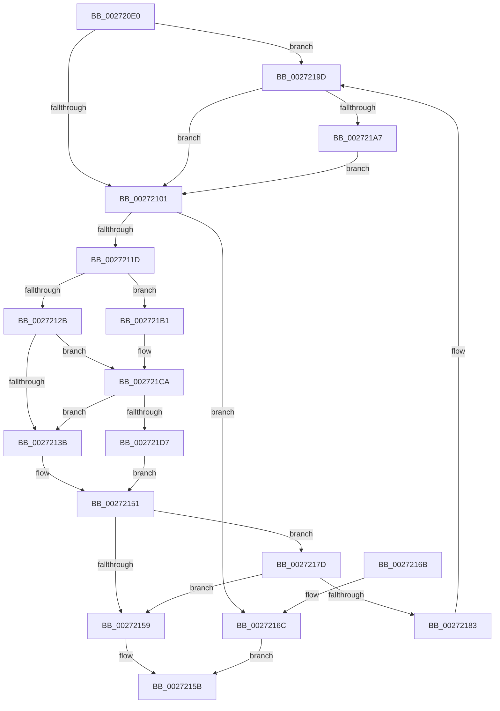

# IoCancelIrp

- RVA: `0x002720E0`–`0x002721F2` (길이 `274` bytes)
- VA: `0x00000001402720E0`
- 실행 섹션: `.text`
- PDB 이름 있음: `예`; PDB Function 태그: `아니요`
- unwind 정보 RVA: `0x00065B70`
- 디코드: `71`개 명령, `274/274` bytes 표시
- 미해석 바이트: `0` (있으면 어셈블리에 `.byte`로 보존)

> 이 문서는 커널 이미지의 기계어와 PDB 기호를 분석해 생성했습니다. 4번과 5번은 함수 원형과 자료형을 바이너리 사용 방식에서 추정한 C 해석이며 원본 소스 복구 결과는 아닙니다.

## 1. Dependencies

- 직접 호출 지점: **7**; 고유 호출 대상: **6**
- 직접 호출자로 확인된 함수: **23**
- RIP 상대 이미지 참조: **3**

### Outgoing calls
- `0x00272106` → [KeAcquireQueuedSpinLock](KeAcquireQueuedSpinLock_function_00273D80.md) (function, `0x00273D80`)
- `0x0027214C` → [guard_dispatch_icall](../6B/guard_dispatch_icall_function_006BAAD0.md) (function, `0x006BAAD0`)
- `0x00272174` → [KeReleaseQueuedSpinLock](KeReleaseQueuedSpinLock_function_00272540.md) (function, `0x00272540`)
- `0x00272197` → [KeBugCheckEx](../4F/KeBugCheckEx_function_004FD660.md) (function, `0x004FD660`)
- `0x002721A7` → [IovCancelIrp](../../pagevrfy/B9/IovCancelIrp_function_00B926E0.md) (function, `0x00B926E0`)
- `0x002721C4` → [KeBugCheckEx](../4F/KeBugCheckEx_function_004FD660.md) (function, `0x004FD660`)
- `0x002721E8` → [IovpCancelRoutine](../../pagevrfy/B9/IovpCancelRoutine_function_00B9D4F8.md) (function, `0x00B9D4F8`)

### Direct callers
- [sub_002072CB](../20/Unknown_function_002072CB.md) at `0x002072EC`
- [PopThermalUpdateTimerPolicy](../43/PopThermalUpdateTimerPolicy_function_00430BEC.md) at `0x00430C57`
- [IopCancelIrpsInCurrentThreadList](../47/IopCancelIrpsInCurrentThreadList_function_0047AB14.md) at `0x0047ABF1`
- [PopThermalZoneTimerCallback](../4B/PopThermalZoneTimerCallback_function_004B9050.md) at `0x004B9058`
- [FsRtlpWaitOnIrp](../4E/FsRtlpWaitOnIrp_function_004E7998.md) at `0x004E7D72`
- [PopThermalSxExit](../5D/PopThermalSxExit_function_005D55F8.md) at `0x005D5723`
- [PopThermalZoneDpc](../5D/PopThermalZoneDpc_function_005D5950.md) at `0x005D59FB`
- [IopCancelPendingEject](../../page/73/IopCancelPendingEject_function_0073DBF4.md) at `0x0073DC14`
- [PopThermalZoneRemove](../../page/75/PopThermalZoneRemove_function_0075FAD0.md) at `0x0075FAE5`
- [PopBatteryRemove](../../page/76/PopBatteryRemove_function_00766D40.md) at `0x00766D4D`
- [PopBatteryUpdateTestExempt](../../page/76/PopBatteryUpdateTestExempt_function_00766F54.md) at `0x00766FE3`
- [PopBatteryUpdateTestExempt](../../page/76/PopBatteryUpdateTestExempt_function_00766F54.md) at `0x007670EF`
- [PopPowerAdapterRemove](../../page/76/PopPowerAdapterRemove_function_00768180.md) at `0x007681BD`
- [PopFanRemove](../../page/76/PopFanRemove_function_007691D0.md) at `0x007691E4`
- [IoCancelThreadIo](../../page/90/IoCancelThreadIo_function_00906830.md) at `0x009068BC`
- [NtCancelIoFile](../../page/9E/NtCancelIoFile_function_009E93E0.md) at `0x009E94B1`
- [FsRtlQueryKernelEaFile](../../page/A0/FsRtlQueryKernelEaFile_function_00A0C680.md) at `0x00A0C841`
- [FsRtlSetKernelEaFile](../../page/A0/FsRtlSetKernelEaFile_function_00A0C8B0.md) at `0x00A0CA0A`
- [FsRtlKernelFsControlFile](../../page/A0/FsRtlKernelFsControlFile_function_00A0CA70.md) at `0x00A0CD65`
- [PopThermalReadCounters](../../page/A0/PopThermalReadCounters_function_00A0E5B8.md) at `0x00A0E66D`
- [FsRtlQueryInformationFile](../../page/A3/FsRtlQueryInformationFile_function_00A38780.md) at `0x00A388EF`
- [IopCancelAlertedRequest](../../page/A9/IopCancelAlertedRequest_function_00A948F8.md) at `0x00A9492C`
- [PopThermalZoneUpdateCoolingPolicy](../../page/AB/PopThermalZoneUpdateCoolingPolicy_function_00AB1584.md) at `0x00AB15C2`
- [PopBatteryWorker](../../page/AE/PopBatteryWorker_function_00AE1650.md) at `0x00AE177F`
- [PopBatteryWorker](../../page/AE/PopBatteryWorker_function_00AE1650.md) at `0x00AE17A3`

### Static image references
- `0x002720EF` → RVA `0x00E681A0` (`.data`; read)
- `0x0027212B` → RVA `0x00F04984` (`.data`; read)
- `0x002721CA` → RVA `0x00FFDA18` (`PAGEVRFD`; read)

## 2. Other-region calls and transfers

- 다른 실행 섹션으로 향하는 call: **2**
  - `0x002721A7` → [IovCancelIrp](../../pagevrfy/B9/IovCancelIrp_function_00B926E0.md) (`.text` → `PAGEVRFY`)
  - `0x002721E8` → [IovpCancelRoutine](../../pagevrfy/B9/IovpCancelRoutine_function_00B9D4F8.md) (`.text` → `PAGEVRFY`)
- 별도 외부 분기/꼬리 이동을 확인하지 못했습니다.

## 3. Assembly (complete function range)

```asm
002720E0  48 89 5C 24 08                  mov qword ptr [rsp + 8], rbx
002720E5  48 89 74 24 10                  mov qword ptr [rsp + 0x10], rsi
002720EA  57                              push rdi
002720EB  48 83 EC 30                     sub rsp, 0x30
002720EF  48 8B 05 AA 60 BF 00            mov rax, qword ptr [rip + 0xbf60aa]
002720F6  48 8B D9                        mov rbx, rcx
002720F9  A8 10                           test al, 0x10
002720FB  0F 85 9C 00 00 00               jne 0x14027219d
00272101  B9 07 00 00 00                  mov ecx, 7
00272106  E8 75 1C 00 00                  call 0x140273d80
0027210B  33 FF                           xor edi, edi
0027210D  C6 43 44 01                     mov byte ptr [rbx + 0x44], 1
00272111  48 87 7B 68                     xchg qword ptr [rbx + 0x68], rdi
00272115  40 8A F0                        mov sil, al
00272118  48 85 FF                        test rdi, rdi
0027211B  74 4F                           je 0x14027216c
0027211D  8A 4B 42                        mov cl, byte ptr [rbx + 0x42]
00272120  FE C1                           inc cl
00272122  38 4B 43                        cmp byte ptr [rbx + 0x43], cl
00272125  0F 8F 86 00 00 00               jg 0x1402721b1
0027212B  83 3D 52 28 C9 00 00            cmp dword ptr [rip + 0xc92852], 0
00272132  88 43 45                        mov byte ptr [rbx + 0x45], al
00272135  0F 85 8F 00 00 00               jne 0x1402721ca
0027213B  48 8B 8B B8 00 00 00            mov rcx, qword ptr [rbx + 0xb8]
00272142  48 8B D3                        mov rdx, rbx
00272145  48 8B C7                        mov rax, rdi
00272148  48 8B 49 28                     mov rcx, qword ptr [rcx + 0x28]
0027214C  E8 7F 89 44 00                  call 0x1406baad0
00272151  44 0F 20 C0                     mov rax, cr8
00272155  3C 02                           cmp al, 2
00272157  74 24                           je 0x14027217d
00272159  B0 01                           mov al, 1
0027215B  48 8B 5C 24 40                  mov rbx, qword ptr [rsp + 0x40]
00272160  48 8B 74 24 48                  mov rsi, qword ptr [rsp + 0x48]
00272165  48 83 C4 30                     add rsp, 0x30
00272169  5F                              pop rdi
0027216A  C3                              ret
0027216B  CC                              int3
0027216C  40 8A D6                        mov dl, sil
0027216F  B9 07 00 00 00                  mov ecx, 7
00272174  E8 C7 03 00 00                  call 0x140272540
00272179  32 C0                           xor al, al
0027217B  EB DE                           jmp 0x14027215b
0027217D  40 80 FE 02                     cmp sil, 2
00272181  74 D6                           je 0x140272159
00272183  48 83 64 24 20 00               and qword ptr [rsp + 0x20], 0
00272189  45 33 C9                        xor r9d, r9d
0027218C  4C 8B C7                        mov r8, rdi
0027218F  48 8B D3                        mov rdx, rbx
00272192  B9 1B 01 00 00                  mov ecx, 0x11b
00272197  E8 C4 B4 28 00                  call 0x1404fd660
0027219C  CC                              int3
0027219D  0F BA E0 0A                     bt eax, 0xa
002721A1  0F 83 5A FF FF FF               jae 0x140272101
002721A7  E8 34 05 92 00                  call 0x140b926e0
002721AC  E9 50 FF FF FF                  jmp 0x140272101
002721B1  48 83 64 24 20 00               and qword ptr [rsp + 0x20], 0
002721B7  45 33 C9                        xor r9d, r9d
002721BA  4C 8B C7                        mov r8, rdi
002721BD  48 8B D3                        mov rdx, rbx
002721C0  41 8D 49 48                     lea ecx, [r9 + 0x48]
002721C4  E8 97 B4 28 00                  call 0x1404fd660
002721C9  CC                              int3
002721CA  83 3D 47 B8 D8 00 00            cmp dword ptr [rip + 0xd8b847], 0
002721D1  0F 84 64 FF FF FF               je 0x14027213b
002721D7  48 8B 8B B8 00 00 00            mov rcx, qword ptr [rbx + 0xb8]
002721DE  4C 8B C7                        mov r8, rdi
002721E1  48 8B D3                        mov rdx, rbx
002721E4  48 8B 49 28                     mov rcx, qword ptr [rcx + 0x28]
002721E8  E8 0B B3 92 00                  call 0x140b9d4f8
002721ED  E9 5F FF FF FF                  jmp 0x140272151
```

## 4. C-style interpretation (structured pseudocode)

```c
__int64 __fastcall IoCancelIrp(__int64 a1, __int64 a2, __int64 a3, int a4)
{
    __int64 result;
    __int64 v_rdi;
    __int64 v_rsp;
    unsigned __int64 v_stack_p10;
    unsigned __int64 v_stack_p20;
    unsigned __int64 v_stack_p8;

    v_stack_p8 = v_rbx;
    v_stack_p10 = v_rsi;
    v_rsp = (v_rsp) - (48);
    if ((((unsigned __int8)(*(unsigned __int64 *)(v_rip + 12542122))) & (16)) != 0) goto loc_0027219D;
loc_00272101:
    result = KeAcquireQueuedSpinLock(7, a2, a3, a4);
    v_rdi = 0;
    *(unsigned __int8 *)(a1 + 68) = 1;
    if (0 == 0) goto loc_0027216C;
    a1 = (unsigned __int8)((*(unsigned __int8 *)(a1 + 66)) + 1);
    if ((*(unsigned __int8 *)(a1 + 67)) > ((unsigned __int8)(a1))) goto loc_002721B1;
    *(unsigned __int8 *)(a1 + 69) = (unsigned __int8)(result);
    if ((*(unsigned int *)(v_rip + 13183058)) != 0) goto loc_002721CA;
loc_0027213B:
    result = guard_dispatch_icall(*(unsigned __int64 *)(*(unsigned __int64 *)(a1 + 184) + 40), a1, a3, a4);
loc_00272151:
    if (((unsigned __int8)(v_cr8)) == 2) goto loc_0027217D;
loc_00272159:
loc_0027215B:
    v_rsp = (v_rsp) + (48);
    return 1;
loc_0027216C:
    result = KeReleaseQueuedSpinLock(7, (unsigned __int8)(v_stack_p10), a3, a4);
    result = 0;
    goto loc_0027215B;
loc_0027217D:
    if (((unsigned __int8)(v_stack_p10)) == 2) goto loc_00272159;
    a4 = 0;
    result = KeBugCheckEx(283, v_stack_p8, 0, a4);
loc_0027219D:
    if (condition_is_above_or_equal) goto loc_00272101;
    result = IovCancelIrp(283, v_stack_p8, 0, a4);
    goto loc_00272101;
loc_002721B1:
    a4 = 0;
    result = KeBugCheckEx(a4 + 72, v_stack_p8, 0, a4);
loc_002721CA:
    if ((*(unsigned int *)(v_rip + 14202951)) == 0) goto loc_0027213B;
    result = IovpCancelRoutine(*(unsigned __int64 *)(*(unsigned __int64 *)(v_stack_p8 + 184) + 40), v_stack_p8, 0, a4);
    goto loc_00272151;
}
```

## 5. (Beta) C Style

```c
int64_t IoCancelIrp(void *Arg1, int64_t Arg2, int64_t Arg3, int32_t Arg4)
{
    uint8_t *arg1 = (uint8_t *)Arg1;

    int64_t result;
    int64_t local_rdi;
    int64_t local_rsp;
    uint64_t v_stack_p10;
    uint64_t v_stack_p20;
    uint64_t v_stack_p8;

    v_stack_p8 = local_rbx;
    v_stack_p10 = local_rsi;
    local_rsp = (local_rsp) - (48);
    if ((((uint8_t)(*(uint64_t *)(v_rip + 0xBF60AA))) & (16)) != 0) goto loc_0027219D;
loc_00272101:
    result = KeAcquireQueuedSpinLock(7, Arg2, Arg3, Arg4);
    local_rdi = 0;
    *(uint8_t *)(arg1 + 0x44) = 1;
    if (0 == 0) goto loc_0027216C;
    Arg1 = (uint8_t)((*(uint8_t *)(arg1 + 0x42)) + 1);
    if ((*(uint8_t *)(arg1 + 0x43)) > ((uint8_t)(Arg1))) goto loc_002721B1;
    *(uint8_t *)(arg1 + 0x45) = (uint8_t)(result);
    if ((*(uint32_t *)(v_rip + 0xC92852)) != 0) goto loc_002721CA;
loc_0027213B:
    result = guard_dispatch_icall(*(uint64_t *)(*(uint64_t *)(arg1 + 0xB8) + 0x28), Arg1, Arg3, Arg4);
loc_00272151:
    if (((uint8_t)(v_cr8)) == 2) goto loc_0027217D;
loc_00272159:
loc_0027215B:
    local_rsp = (local_rsp) + (48);
    return 1;
loc_0027216C:
    result = KeReleaseQueuedSpinLock(7, (uint8_t)(v_stack_p10), Arg3, Arg4);
    result = 0;
    goto loc_0027215B;
loc_0027217D:
    if (((uint8_t)(v_stack_p10)) == 2) goto loc_00272159;
    Arg4 = 0;
    result = KeBugCheckEx(283, v_stack_p8, 0, Arg4);
loc_0027219D:
    if (condition_is_above_or_equal) goto loc_00272101;
    result = IovCancelIrp(283, v_stack_p8, 0, Arg4);
    goto loc_00272101;
loc_002721B1:
    Arg4 = 0;
    result = KeBugCheckEx(Arg4 + 72, v_stack_p8, 0, Arg4);
loc_002721CA:
    if ((*(uint32_t *)(v_rip + 0xD8B847)) == 0) goto loc_0027213B;
    result = IovpCancelRoutine(*(uint64_t *)(*(uint64_t *)(v_stack_p8 + 0xB8) + 0x28), v_stack_p8, 0, Arg4);
    goto loc_00272151;
}
```

### 관측된 메모리 오프셋

구조체 형식이 확인되지 않은 접근은 인자 기준의 오프셋으로만 기록했습니다.

| 기준 인자 | 오프셋 표현 | 폭 (bit) | 접근 |
|---|---:|---:|---|
| `Arg1` | `+ 0x42` | `8` | `R` |
| `Arg1` | `+ 0x43` | `8` | `R` |
| `Arg1` | `+ 0x44` | `8` | `W` |
| `Arg1` | `+ 0x45` | `8` | `W` |
| `Arg1` | `+ 0x68` | `64` | `R/W` |
| `Arg1` | `+ 0xB8` | `64` | `R` |

## 6. Execution-region graph

[열기: 2D/3D 그래프와 함수 탐색 컨트롤 패널](../../../control-panel.html?section=text&rva=0x002720E0&view=graph)

- 2D 그래프는 위에서 아래로 흐르고, 3D 그래프는 빈 공간을 드래그해 회전합니다. Shift+드래그는 이동, 휠은 확대·축소, 함수 노드 선택은 대상 보고서 이동입니다.

### Static fallback


