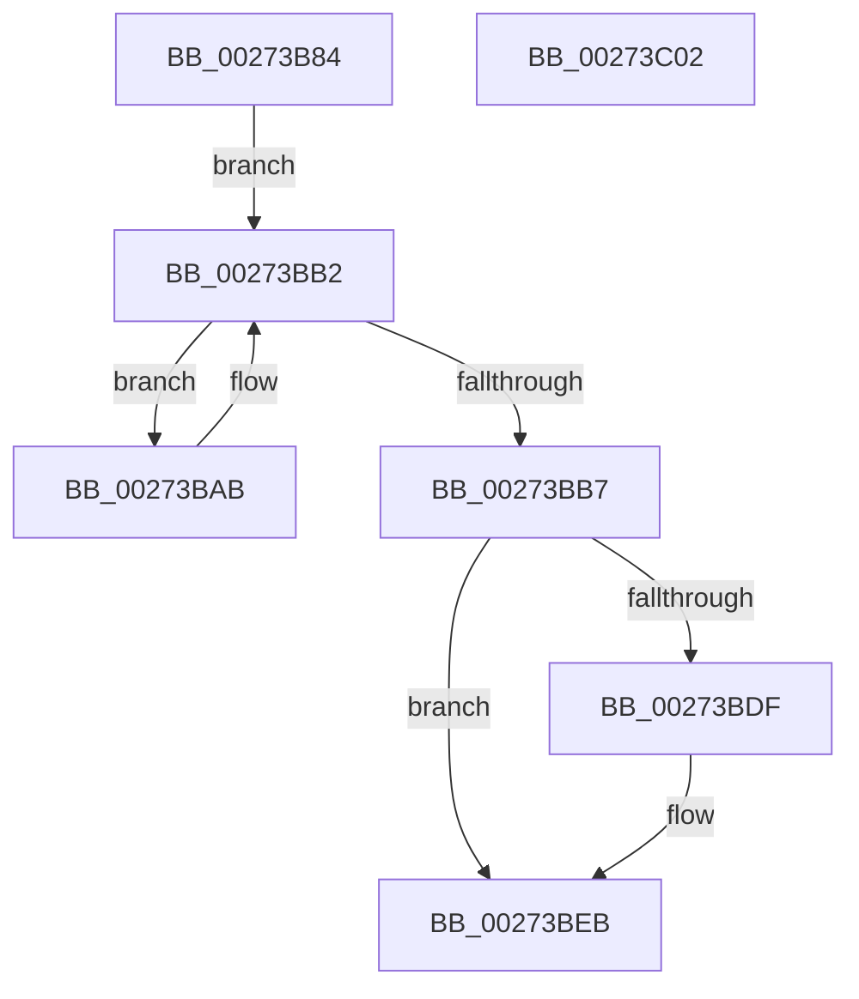

# IoGetAttachedDeviceReferenceWithTag

- RVA: `0x00273B84`–`0x00273C03` (길이 `127` bytes)
- VA: `0x0000000140273B84`
- 실행 섹션: `.text`
- PDB 이름 있음: `예`; PDB Function 태그: `아니요`
- unwind 정보 RVA: `0x00060BC4`
- 디코드: `34`개 명령, `127/127` bytes 표시
- 미해석 바이트: `0` (있으면 어셈블리에 `.byte`로 보존)

> 이 문서는 커널 이미지의 기계어와 PDB 기호를 분석해 생성했습니다. 4번과 5번은 함수 원형과 자료형을 바이너리 사용 방식에서 추정한 C 해석이며 원본 소스 복구 결과는 아닙니다.

## 1. Dependencies

- 직접 호출 지점: **4**; 고유 호출 대상: **4**
- 직접 호출자로 확인된 함수: **9**
- RIP 상대 이미지 참조: **1**

### Outgoing calls
- `0x00273B9D` → [KeAcquireQueuedSpinLock](KeAcquireQueuedSpinLock_function_00273D80.md) (function, `0x00273D80`)
- `0x00273BBC` → [ObfReferenceObjectWithTag](../21/ObfReferenceObjectWithTag_function_00210710.md) (function, `0x00210710`)
- `0x00273BD1` → [KeReleaseInStackQueuedSpinLockFromDpcLevel](../21/KeReleaseInStackQueuedSpinLockFromDpcLevel_function_002171B0.md) (function, `0x002171B0`)
- `0x00273BE6` → [KiLowerIrqlProcessIrqlFlags](../4F/KiLowerIrqlProcessIrqlFlags_function_004F5698.md) (function, `0x004F5698`)

### Direct callers
- [PopAllocateIrp](PopAllocateIrp_function_0027116C.md) at `0x002711D8`
- [IopEjectDevice](../../page/73/IopEjectDevice_function_0073DC84.md) at `0x0073DD36`
- [PopDirectedDripsIsPnpSoftwareDeviceNode](../../page/75/PopDirectedDripsIsPnpSoftwareDeviceNode_function_007578E4.md) at `0x007578F6`
- [PopFxRegisterDevice](../../page/75/PopFxRegisterDevice_function_00759B80.md) at `0x00759BD7`
- [IopSynchronousCall](../../page/8F/IopSynchronousCall_function_008FB018.md) at `0x008FB052`
- [PipCallDriverAddDevice](../../page/A2/PipCallDriverAddDevice_function_00A272E0.md) at `0x00A27655`
- [PipCallDriverAddDevice](../../page/A2/PipCallDriverAddDevice_function_00A272E0.md) at `0x00A27AA9`
- [PnpQueryInterface](../../page/A2/PnpQueryInterface_function_00A28D38.md) at `0x00A28DAF`
- [PnpAsynchronousCall](../../page/A6/PnpAsynchronousCall_function_00A635D0.md) at `0x00A635F9`
- [PiControlGetDeviceStack](../../page/A6/PiControlGetDeviceStack_function_00A6FE34.md) at `0x00A6FE9E`

### Static image references
- `0x00273BD6` → RVA `0x00FC6D20` (`ALMOSTRO`; read)

## 2. Other-region calls and transfers

- 다른 실행 섹션으로 향하는 call: **0**
- 별도 외부 분기/꼬리 이동을 확인하지 못했습니다.

## 3. Assembly (complete function range)

```asm
00273B84  48 89 5C 24 08                  mov qword ptr [rsp + 8], rbx
00273B89  48 89 74 24 10                  mov qword ptr [rsp + 0x10], rsi
00273B8E  57                              push rdi
00273B8F  48 83 EC 20                     sub rsp, 0x20
00273B93  48 8B D9                        mov rbx, rcx
00273B96  8B F2                           mov esi, edx
00273B98  B9 0A 00 00 00                  mov ecx, 0xa
00273B9D  E8 DE 01 00 00                  call 0x140273d80
00273BA2  48 8B 4B 18                     mov rcx, qword ptr [rbx + 0x18]
00273BA6  0F B6 F8                        movzx edi, al
00273BA9  EB 07                           jmp 0x140273bb2
00273BAB  48 8B D9                        mov rbx, rcx
00273BAE  48 8B 49 18                     mov rcx, qword ptr [rcx + 0x18]
00273BB2  48 85 C9                        test rcx, rcx
00273BB5  75 F4                           jne 0x140273bab
00273BB7  8B D6                           mov edx, esi
00273BB9  48 8B CB                        mov rcx, rbx
00273BBC  E8 4F CB F9 FF                  call 0x140210710
00273BC1  65 48 8B 0C 25 28 00 00 00      mov rcx, qword ptr gs:[0x28]
00273BCA  48 81 C1 A0 00 00 00            add rcx, 0xa0
00273BD1  E8 DA 35 FA FF                  call 0x1402171b0
00273BD6  83 3D 43 31 D5 00 00            cmp dword ptr [rip + 0xd53143], 0
00273BDD  74 0C                           je 0x140273beb
00273BDF  44 0F 20 C1                     mov rcx, cr8
00273BE3  40 8A D7                        mov dl, dil
00273BE6  E8 AD 1A 28 00                  call 0x1404f5698
00273BEB  44 0F 22 C7                     mov cr8, rdi
00273BEF  48 8B 74 24 38                  mov rsi, qword ptr [rsp + 0x38]
00273BF4  48 8B C3                        mov rax, rbx
00273BF7  48 8B 5C 24 30                  mov rbx, qword ptr [rsp + 0x30]
00273BFC  48 83 C4 20                     add rsp, 0x20
00273C00  5F                              pop rdi
00273C01  C3                              ret
00273C02  CC                              int3
```

## 4. C-style interpretation (structured pseudocode)

```c
__int64 __fastcall IoGetAttachedDeviceReferenceWithTag(__int64 a1, int a2)
{
    __int64 result;
    __int64 v_rsp;
    unsigned __int64 v_stack_p10;
    unsigned __int64 v_stack_p8;

    v_stack_p8 = v_rbx;
    v_stack_p10 = v_rsi;
    v_rsp = (v_rsp) - (32);
    result = KeAcquireQueuedSpinLock(10, a2, a3, a4);
    goto loc_00273BB2;
loc_00273BAB:
loc_00273BB2:
    if (*(unsigned __int64 *)(*(unsigned __int64 *)(a1 + 24) + 24) != 0) goto loc_00273BAB;
    result = ObfReferenceObjectWithTag(*(unsigned __int64 *)(a1 + 24), (unsigned int)((unsigned int)((unsigned int)(a2))), a3, a4);
    a1 = (*(unsigned __int64 *)(gs_base + (0 + 40))) + (160);
    result = KeReleaseInStackQueuedSpinLockFromDpcLevel(a1, (unsigned int)((unsigned int)((unsigned int)(a2))), a3, a4);
    if ((*(unsigned int *)(v_rip + 13971779)) != 0) {
        a1 = v_cr8;
        a2 = (unsigned __int8)((unsigned __int8)(result));
        result = KiLowerIrqlProcessIrqlFlags(a1, a2, a3, a4);
    }
    v_rsp = (v_rsp) + (32);
    return *(unsigned __int64 *)(a1 + 24);
}
```

## 5. (Beta) C Style

```c
int64_t IoGetAttachedDeviceReferenceWithTag(void *Arg1, int32_t Arg2)
{
    uint8_t *arg1 = (uint8_t *)Arg1;

    int64_t result;
    int64_t local_rsp;
    uint64_t v_stack_p10;
    uint64_t v_stack_p8;

    v_stack_p8 = local_rbx;
    v_stack_p10 = local_rsi;
    local_rsp = (local_rsp) - (32);
    result = KeAcquireQueuedSpinLock(10, Arg2, a3, a4);
    goto loc_00273BB2;
loc_00273BAB:
loc_00273BB2:
    if (*(uint64_t *)(*(uint64_t *)(arg1 + 0x18) + 0x18) != 0) goto loc_00273BAB;
    result = ObfReferenceObjectWithTag(*(uint64_t *)(arg1 + 0x18), (uint32_t)((uint32_t)((uint32_t)(Arg2))), a3, a4);
    Arg1 = (*(uint64_t *)(gs_base + (0 + 0x28))) + (160);
    result = KeReleaseInStackQueuedSpinLockFromDpcLevel(Arg1, (uint32_t)((uint32_t)((uint32_t)(Arg2))), a3, a4);
    if ((*(uint32_t *)(v_rip + 0xD53143)) != 0) {
        Arg1 = v_cr8;
        Arg2 = (uint8_t)((uint8_t)(result));
        result = KiLowerIrqlProcessIrqlFlags(Arg1, Arg2, a3, a4);
    }
    local_rsp = (local_rsp) + (32);
    return *(uint64_t *)(arg1 + 0x18);
}
```

### 관측된 메모리 오프셋

구조체 형식이 확인되지 않은 접근은 인자 기준의 오프셋으로만 기록했습니다.

| 기준 인자 | 오프셋 표현 | 폭 (bit) | 접근 |
|---|---:|---:|---|
| `Arg1` | `+ 0x18` | `64` | `R` |

## 6. Execution-region graph

[열기: 2D/3D 그래프와 함수 탐색 컨트롤 패널](../../../control-panel.html?section=text&rva=0x00273B84&view=graph)

- 2D 그래프는 위에서 아래로 흐르고, 3D 그래프는 빈 공간을 드래그해 회전합니다. Shift+드래그는 이동, 휠은 확대·축소, 함수 노드 선택은 대상 보고서 이동입니다.

### Static fallback


