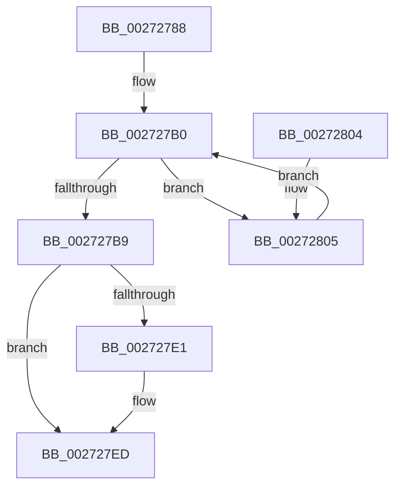

# IoGetDeviceAttachmentBaseRefWithTag

- RVA: `0x00272788`–`0x00272811` (길이 `137` bytes)
- VA: `0x0000000140272788`
- 실행 섹션: `.text`
- PDB 이름 있음: `예`; PDB Function 태그: `아니요`
- unwind 정보 RVA: `0x00065C48`
- 디코드: `35`개 명령, `137/137` bytes 표시
- 미해석 바이트: `0` (있으면 어셈블리에 `.byte`로 보존)

> 이 문서는 커널 이미지의 기계어와 PDB 기호를 분석해 생성했습니다. 4번과 5번은 함수 원형과 자료형을 바이너리 사용 방식에서 추정한 C 해석이며 원본 소스 복구 결과는 아닙니다.

## 1. Dependencies

- 직접 호출 지점: **4**; 고유 호출 대상: **4**
- 직접 호출자로 확인된 함수: **42**
- RIP 상대 이미지 참조: **1**

### Outgoing calls
- `0x002727A1` → [KeAcquireQueuedSpinLock](KeAcquireQueuedSpinLock_function_00273D80.md) (function, `0x00273D80`)
- `0x002727BE` → [ObfReferenceObjectWithTag](../21/ObfReferenceObjectWithTag_function_00210710.md) (function, `0x00210710`)
- `0x002727D3` → [KeReleaseInStackQueuedSpinLockFromDpcLevel](../21/KeReleaseInStackQueuedSpinLockFromDpcLevel_function_002171B0.md) (function, `0x002171B0`)
- `0x002727E8` → [KiLowerIrqlProcessIrqlFlags](../4F/KiLowerIrqlProcessIrqlFlags_function_004F5698.md) (function, `0x004F5698`)

### Direct callers
- [PoStoreRequester](../23/PoStoreRequester_function_002304D4.md) at `0x002305E3`
- [PopAllocateIrp](PopAllocateIrp_function_0027116C.md) at `0x002711E8`
- [FsRtlReleaseFileForModWrite](../29/FsRtlReleaseFileForModWrite_function_00299100.md) at `0x00299264`
- [FsRtlAcquireFileForModWriteEx](../29/FsRtlAcquireFileForModWriteEx_function_00299E5C.md) at `0x0029A1FA`
- [PopTraceThermalRequestPassiveHistogram](../42/PopTraceThermalRequestPassiveHistogram_function_0042FFB4.md) at `0x00430007`
- [PopCheckAndHandleThermalConditions](../4A/PopCheckAndHandleThermalConditions_function_004A8C00.md) at `0x004A8CF2`
- [PoSetSystemWakeDevice](../4A/PoSetSystemWakeDevice_function_004AA6D0.md) at `0x004AA6DB`
- [PopDiagTraceDeviceIdleCheck](../4A/PopDiagTraceDeviceIdleCheck_function_004AB30C.md) at `0x004AB3AF`
- [PopDiagTraceThermalZoneRundown](../4A/PopDiagTraceThermalZoneRundown_function_004AF240.md) at `0x004AF2B8`
- [PnpHandleEnumerateHandlesAgainstPdoStack](../4C/PnpHandleEnumerateHandlesAgainstPdoStack_function_004C8F94.md) at `0x004C901C`
- [PopTraceThermalZonePassiveHistogram](../4D/PopTraceThermalZonePassiveHistogram_function_004DDD10.md) at `0x004DDD45`
- [PopTraceThermalRequestActiveActivity](../4E/PopTraceThermalRequestActiveActivity_function_004E9104.md) at `0x004E9164`
- [HalpIommuGetDeviceId](../55/HalpIommuGetDeviceId_function_005536C0.md) at `0x005536FE`
- [PopDiagTraceThermalStateChange](../5D/PopDiagTraceThermalStateChange_function_005D702C.md) at `0x005D7088`
- [PopDiagTraceThermalZoneEnumeration](../5D/PopDiagTraceThermalZoneEnumeration_function_005D7154.md) at `0x005D71C9`
- [PopDiagTraceThermalZoneThrottleDurationPerfTrack](../5D/PopDiagTraceThermalZoneThrottleDurationPerfTrack_function_005D74F4.md) at `0x005D7554`
- [PopDiagTraceThermalZoneThrottlePerfTrack](../5D/PopDiagTraceThermalZoneThrottlePerfTrack_function_005D7628.md) at `0x005D7686`
- [PopTracePowerLimitHistogram](../5D/PopTracePowerLimitHistogram_function_005D7B10.md) at `0x005D7B59`
- [PopTraceThermalZoneActiveActivity](../5D/PopTraceThermalZoneActiveActivity_function_005D7FE0.md) at `0x005D801D`
- [PopTraceZoneCr3Mitigated](../5D/PopTraceZoneCr3Mitigated_function_005D81B4.md) at `0x005D81EB`
- [PopTraceZoneCr3Tripped](../5D/PopTraceZoneCr3Tripped_function_005D82DC.md) at `0x005D8313`
- [SmKmEtwAppendObjectName](../60/SmKmEtwAppendObjectName_function_0060F6D8.md) at `0x0060F75B`
- [PiPagePathSetState](../../page/72/PiPagePathSetState_function_0072BDE0.md) at `0x0072BEB7`
- [PopAssociateThermalRequest](../../page/75/PopAssociateThermalRequest_function_00756E78.md) at `0x00756F63`
- [PopDirectedDripsNotifyTransitionFailed](../../page/75/PopDirectedDripsNotifyTransitionFailed_function_00757A34.md) at `0x00757A3F`
- [PopFxRegisterDevice](../../page/75/PopFxRegisterDevice_function_00759B80.md) at `0x00759BB8`
- [PopDiagTracePassiveCooling](../../page/76/PopDiagTracePassiveCooling_function_00761CAC.md) at `0x00761D61`
- [PopDiagTracePowerLimitExtension](../../page/76/PopDiagTracePowerLimitExtension_function_0076233C.md) at `0x007623D1`
- [PopDiagTracePowerLimitRequest](../../page/76/PopDiagTracePowerLimitRequest_function_007626D0.md) at `0x00762785`
- [PopDiagTraceZoneCriticalTripPointExceeded](../../page/76/PopDiagTraceZoneCriticalTripPointExceeded_function_007637D8.md) at `0x00763834`
- [PopDiagTraceZoneS4TripPointExceeded](../../page/76/PopDiagTraceZoneS4TripPointExceeded_function_007638CC.md) at `0x00763928`
- [PopSqmThermalCriticalEvent](../../page/77/PopSqmThermalCriticalEvent_function_00772678.md) at `0x007726B1`
- [PoThermalCounterSetCallback](../../page/A0/PoThermalCounterSetCallback_function_00A0E350.md) at `0x00A0E425`
- [IopQueryInterfaceRecurseUp](../../page/A2/IopQueryInterfaceRecurseUp_function_00A283C8.md) at `0x00A28419`
- [PopDiagTraceCoolingExtension](../../page/A3/PopDiagTraceCoolingExtension_function_00A39C28.md) at `0x00A39CB1`
- [PopCheckThermalPolicy](../../page/A4/PopCheckThermalPolicy_function_00A4E6C8.md) at `0x00A4E6F5`
- [PopDiagTraceThermalCoolingMode](../../page/A4/PopDiagTraceThermalCoolingMode_function_00A4E96C.md) at `0x00A4E9D7`
- [PiControlGetDeviceStack](../../page/A6/PiControlGetDeviceStack_function_00A6FE34.md) at `0x00A6FE84`
- [PopDiagTraceActiveCooling](../../page/AD/PopDiagTraceActiveCooling_function_00AD72A8.md) at `0x00AD7357`
- [PopDiagTraceThermalRequest](../../page/AD/PopDiagTraceThermalRequest_function_00ADF828.md) at `0x00ADF8C7`
- [PopNotifyDevice](../../pagelk/B7/PopNotifyDevice_function_00B7DAAC.md) at `0x00B7DBE7`
- [IopMarkBootPartition](../../init/C2/IopMarkBootPartition_function_00C2CFA0.md) at `0x00C2D0E8`

### Static image references
- `0x002727D8` → RVA `0x00FC6D20` (`ALMOSTRO`; read)

## 2. Other-region calls and transfers

- 다른 실행 섹션으로 향하는 call: **0**
- 별도 외부 분기/꼬리 이동을 확인하지 못했습니다.

## 3. Assembly (complete function range)

```asm
00272788  48 89 5C 24 08                  mov qword ptr [rsp + 8], rbx
0027278D  48 89 74 24 10                  mov qword ptr [rsp + 0x10], rsi
00272792  57                              push rdi
00272793  48 83 EC 20                     sub rsp, 0x20
00272797  48 8B D9                        mov rbx, rcx
0027279A  8B F2                           mov esi, edx
0027279C  B9 0A 00 00 00                  mov ecx, 0xa
002727A1  E8 DA 15 00 00                  call 0x140273d80
002727A6  48 8B 8B 38 01 00 00            mov rcx, qword ptr [rbx + 0x138]
002727AD  0F B6 F8                        movzx edi, al
002727B0  4C 8B 41 30                     mov r8, qword ptr [rcx + 0x30]
002727B4  4D 85 C0                        test r8, r8
002727B7  75 4C                           jne 0x140272805
002727B9  8B D6                           mov edx, esi
002727BB  48 8B CB                        mov rcx, rbx
002727BE  E8 4D DF F9 FF                  call 0x140210710
002727C3  65 48 8B 0C 25 28 00 00 00      mov rcx, qword ptr gs:[0x28]
002727CC  48 81 C1 A0 00 00 00            add rcx, 0xa0
002727D3  E8 D8 49 FA FF                  call 0x1402171b0
002727D8  83 3D 41 45 D5 00 00            cmp dword ptr [rip + 0xd54541], 0
002727DF  74 0C                           je 0x1402727ed
002727E1  44 0F 20 C1                     mov rcx, cr8
002727E5  40 8A D7                        mov dl, dil
002727E8  E8 AB 2E 28 00                  call 0x1404f5698
002727ED  44 0F 22 C7                     mov cr8, rdi
002727F1  48 8B 74 24 38                  mov rsi, qword ptr [rsp + 0x38]
002727F6  48 8B C3                        mov rax, rbx
002727F9  48 8B 5C 24 30                  mov rbx, qword ptr [rsp + 0x30]
002727FE  48 83 C4 20                     add rsp, 0x20
00272802  5F                              pop rdi
00272803  C3                              ret
00272804  CC                              int3
00272805  49 8B 88 38 01 00 00            mov rcx, qword ptr [r8 + 0x138]
0027280C  49 8B D8                        mov rbx, r8
0027280F  EB 9F                           jmp 0x1402727b0
```

## 4. C-style interpretation (structured pseudocode)

```c
__int64 __fastcall IoGetDeviceAttachmentBaseRefWithTag(__int64 a1, int a2)
{
    __int64 result;
    __int64 v_rsp;
    unsigned __int64 v_stack_p10;
    unsigned __int64 v_stack_p8;

    v_stack_p8 = v_rbx;
    v_stack_p10 = v_rsi;
    v_rsp = (v_rsp) - (32);
    result = KeAcquireQueuedSpinLock(10, a2, a3, a4);
loc_002727B0:
    if (*(unsigned __int64 *)(*(unsigned __int64 *)(a1 + 312) + 48) != 0) goto loc_00272805;
    result = ObfReferenceObjectWithTag(a1, (unsigned int)((unsigned int)((unsigned int)(a2))), *(unsigned __int64 *)(*(unsigned __int64 *)(a1 + 312) + 48), a4);
    a1 = (*(unsigned __int64 *)(gs_base + (0 + 40))) + (160);
    result = KeReleaseInStackQueuedSpinLockFromDpcLevel(a1, (unsigned int)((unsigned int)((unsigned int)(a2))), *(unsigned __int64 *)(*(unsigned __int64 *)(a1 + 312) + 48), a4);
    if ((*(unsigned int *)(v_rip + 13976897)) != 0) {
        a1 = v_cr8;
        a2 = (unsigned __int8)((unsigned __int8)(result));
        result = KiLowerIrqlProcessIrqlFlags(a1, a2, *(unsigned __int64 *)(*(unsigned __int64 *)(a1 + 312) + 48), a4);
    }
    v_rsp = (v_rsp) + (32);
    return a1;
loc_00272805:
    goto loc_002727B0;
}
```

## 5. (Beta) C Style

```c
void *IoGetDeviceAttachmentBaseRefWithTag(void *Arg1, int32_t Arg2)
{
    uint8_t *arg1 = (uint8_t *)Arg1;

    int64_t result;
    int64_t local_rsp;
    uint64_t v_stack_p10;
    uint64_t v_stack_p8;

    v_stack_p8 = local_rbx;
    v_stack_p10 = local_rsi;
    local_rsp = (local_rsp) - (32);
    result = KeAcquireQueuedSpinLock(10, Arg2, a3, a4);
loc_002727B0:
    if (*(uint64_t *)(*(uint64_t *)(arg1 + 0x138) + 0x30) != 0) goto loc_00272805;
    result = ObfReferenceObjectWithTag(Arg1, (uint32_t)((uint32_t)((uint32_t)(Arg2))), *(uint64_t *)(*(uint64_t *)(arg1 + 0x138) + 0x30), a4);
    Arg1 = (*(uint64_t *)(gs_base + (0 + 0x28))) + (160);
    result = KeReleaseInStackQueuedSpinLockFromDpcLevel(Arg1, (uint32_t)((uint32_t)((uint32_t)(Arg2))), *(uint64_t *)(*(uint64_t *)(arg1 + 0x138) + 0x30), a4);
    if ((*(uint32_t *)(v_rip + 0xD54541)) != 0) {
        Arg1 = v_cr8;
        Arg2 = (uint8_t)((uint8_t)(result));
        result = KiLowerIrqlProcessIrqlFlags(Arg1, Arg2, *(uint64_t *)(*(uint64_t *)(arg1 + 0x138) + 0x30), a4);
    }
    local_rsp = (local_rsp) + (32);
    return Arg1;
loc_00272805:
    goto loc_002727B0;
}
```

### 관측된 메모리 오프셋

구조체 형식이 확인되지 않은 접근은 인자 기준의 오프셋으로만 기록했습니다.

| 기준 인자 | 오프셋 표현 | 폭 (bit) | 접근 |
|---|---:|---:|---|
| `Arg1` | `+ 0x138` | `64` | `R` |

## 6. Execution-region graph

[열기: 2D/3D 그래프와 함수 탐색 컨트롤 패널](../../../control-panel.html?section=text&rva=0x00272788&view=graph)

- 2D 그래프는 위에서 아래로 흐르고, 3D 그래프는 빈 공간을 드래그해 회전합니다. Shift+드래그는 이동, 휠은 확대·축소, 함수 노드 선택은 대상 보고서 이동입니다.

### Static fallback


