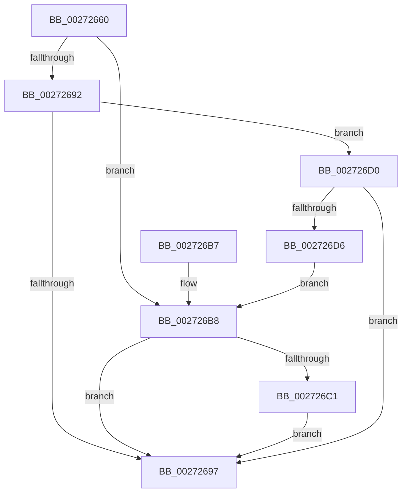

# IoGetLowerDeviceObjectWithTag

- RVA: `0x00272660`–`0x002726D8` (길이 `120` bytes)
- VA: `0x0000000140272660`
- 실행 섹션: `.text`
- PDB 이름 있음: `예`; PDB Function 태그: `아니요`
- unwind 정보 RVA: `0x00065748`
- 디코드: `37`개 명령, `120/120` bytes 표시
- 미해석 바이트: `0` (있으면 어셈블리에 `.byte`로 보존)

> 이 문서는 커널 이미지의 기계어와 PDB 기호를 분석해 생성했습니다. 4번과 5번은 함수 원형과 자료형을 바이너리 사용 방식에서 추정한 C 해석이며 원본 소스 복구 결과는 아닙니다.

## 1. Dependencies

- 직접 호출 지점: **3**; 고유 호출 대상: **3**
- 직접 호출자로 확인된 함수: **5**
- RIP 상대 이미지 참조: **0**

### Outgoing calls
- `0x00272679` → [KeAcquireQueuedSpinLock](KeAcquireQueuedSpinLock_function_00273D80.md) (function, `0x00273D80`)
- `0x0027269F` → [KeReleaseQueuedSpinLock](KeReleaseQueuedSpinLock_function_00272540.md) (function, `0x00272540`)
- `0x002726C9` → [ObfReferenceObjectWithTag](../21/ObfReferenceObjectWithTag_function_00210710.md) (function, `0x00210710`)

### Direct callers
- [IoGetLowerDeviceObject](IoGetLowerDeviceObject_function_00272380.md) at `0x00272389`
- [IopSynchronousCall](../../page/8F/IopSynchronousCall_function_008FB018.md) at `0x008FB184`
- [PiControlGetDeviceStack](../../page/A6/PiControlGetDeviceStack_function_00A6FE34.md) at `0x00A70108`
- [IoBuildPoDeviceNotifyList](../../pagelk/B7/IoBuildPoDeviceNotifyList_function_00B78B0C.md) at `0x00B78E82`
- [IopCheckDeviceFlags](../../pagelk/B7/IopCheckDeviceFlags_function_00B79250.md) at `0x00B792AC`

### Static image references
- 디코드된 RIP-relative 메모리 참조가 없습니다.

## 2. Other-region calls and transfers

- 다른 실행 섹션으로 향하는 call: **0**
- 별도 외부 분기/꼬리 이동을 확인하지 못했습니다.

## 3. Assembly (complete function range)

```asm
00272660  48 89 5C 24 08                  mov qword ptr [rsp + 8], rbx
00272665  48 89 74 24 10                  mov qword ptr [rsp + 0x10], rsi
0027266A  57                              push rdi
0027266B  48 83 EC 20                     sub rsp, 0x20
0027266F  48 8B D9                        mov rbx, rcx
00272672  8B F2                           mov esi, edx
00272674  B9 0A 00 00 00                  mov ecx, 0xa
00272679  E8 02 17 00 00                  call 0x140273d80
0027267E  40 8A F8                        mov dil, al
00272681  48 8B 83 38 01 00 00            mov rax, qword ptr [rbx + 0x138]
00272688  33 DB                           xor ebx, ebx
0027268A  8B 48 20                        mov ecx, dword ptr [rax + 0x20]
0027268D  F6 C1 0F                        test cl, 0xf
00272690  74 26                           je 0x1402726b8
00272692  F6 C1 0E                        test cl, 0xe
00272695  74 39                           je 0x1402726d0
00272697  40 8A D7                        mov dl, dil
0027269A  B9 0A 00 00 00                  mov ecx, 0xa
0027269F  E8 9C FE FF FF                  call 0x140272540
002726A4  48 8B 74 24 38                  mov rsi, qword ptr [rsp + 0x38]
002726A9  48 8B C3                        mov rax, rbx
002726AC  48 8B 5C 24 30                  mov rbx, qword ptr [rsp + 0x30]
002726B1  48 83 C4 20                     add rsp, 0x20
002726B5  5F                              pop rdi
002726B6  C3                              ret
002726B7  CC                              int3
002726B8  48 8B 40 30                     mov rax, qword ptr [rax + 0x30]
002726BC  48 85 C0                        test rax, rax
002726BF  74 D6                           je 0x140272697
002726C1  8B D6                           mov edx, esi
002726C3  48 8B C8                        mov rcx, rax
002726C6  48 8B D8                        mov rbx, rax
002726C9  E8 42 E0 F9 FF                  call 0x140210710
002726CE  EB C7                           jmp 0x140272697
002726D0  48 39 58 30                     cmp qword ptr [rax + 0x30], rbx
002726D4  74 C1                           je 0x140272697
002726D6  EB E0                           jmp 0x1402726b8
```

## 4. C-style interpretation (structured pseudocode)

```c
__int64 __fastcall IoGetLowerDeviceObjectWithTag(__int64 a1, int a2)
{
    __int64 result;
    __int64 v_rbx;
    __int64 v_rsp;
    unsigned __int64 v_stack_p10;
    unsigned __int64 v_stack_p8;

    v_stack_p8 = v_rbx;
    v_stack_p10 = v_rsi;
    v_rsp = (v_rsp) - (32);
    result = KeAcquireQueuedSpinLock(10, a2, a3, a4);
    v_rbx = 0;
    if ((((unsigned __int8)((unsigned int)(*(unsigned int *)(*(unsigned __int64 *)(a1 + 312) + 32)))) & (15)) == 0) goto loc_002726B8;
    if ((((unsigned __int8)((unsigned int)(*(unsigned int *)(*(unsigned __int64 *)(a1 + 312) + 32)))) & (14)) == 0) goto loc_002726D0;
loc_00272697:
    result = KeReleaseQueuedSpinLock(10, (unsigned __int8)((unsigned __int8)(result)), a3, a4);
    v_rsp = (v_rsp) + (32);
    return 0;
loc_002726B8:
    if (*(unsigned __int64 *)(0 + 48) == 0) goto loc_00272697;
    result = ObfReferenceObjectWithTag(*(unsigned __int64 *)(0 + 48), (unsigned int)((unsigned int)(v_stack_p10)), a3, a4);
    goto loc_00272697;
loc_002726D0:
    if ((*(unsigned __int64 *)(result + 48)) == (*(unsigned __int64 *)(0 + 48))) goto loc_00272697;
    goto loc_002726B8;
}
```

## 5. (Beta) C Style

```c
int64_t IoGetLowerDeviceObjectWithTag(void *Arg1, int32_t Arg2)
{
    uint8_t *arg1 = (uint8_t *)Arg1;

    int64_t result;
    int64_t local_rbx;
    int64_t local_rsp;
    uint64_t v_stack_p10;
    uint64_t v_stack_p8;

    v_stack_p8 = local_rbx;
    v_stack_p10 = local_rsi;
    local_rsp = (local_rsp) - (32);
    result = KeAcquireQueuedSpinLock(10, Arg2, a3, a4);
    local_rbx = 0;
    if ((((uint8_t)((uint32_t)(*(uint32_t *)(*(uint64_t *)(arg1 + 0x138) + 0x20)))) & (15)) == 0) goto loc_002726B8;
    if ((((uint8_t)((uint32_t)(*(uint32_t *)(*(uint64_t *)(arg1 + 0x138) + 0x20)))) & (14)) == 0) goto loc_002726D0;
loc_00272697:
    result = KeReleaseQueuedSpinLock(10, (uint8_t)((uint8_t)(result)), a3, a4);
    local_rsp = (local_rsp) + (32);
    return 0;
loc_002726B8:
    if (*(uint64_t *)(0 + 0x30) == 0) goto loc_00272697;
    result = ObfReferenceObjectWithTag(*(uint64_t *)(0 + 0x30), (uint32_t)((uint32_t)(v_stack_p10)), a3, a4);
    goto loc_00272697;
loc_002726D0:
    if ((*(uint64_t *)(result + 0x30)) == (*(uint64_t *)(0 + 0x30))) goto loc_00272697;
    goto loc_002726B8;
}
```

### 관측된 메모리 오프셋

구조체 형식이 확인되지 않은 접근은 인자 기준의 오프셋으로만 기록했습니다.

| 기준 인자 | 오프셋 표현 | 폭 (bit) | 접근 |
|---|---:|---:|---|
| `Arg1` | `+ 0x138` | `64` | `R` |

## 6. Execution-region graph

[열기: 2D/3D 그래프와 함수 탐색 컨트롤 패널](../../../control-panel.html?section=text&rva=0x00272660&view=graph)

- 2D 그래프는 위에서 아래로 흐르고, 3D 그래프는 빈 공간을 드래그해 회전합니다. Shift+드래그는 이동, 휠은 확대·축소, 함수 노드 선택은 대상 보고서 이동입니다.

### Static fallback


