# IopCompleteUnloadOrDelete

- RVA: `0x00270BC8`–`0x00270ECD` (길이 `773` bytes)
- VA: `0x0000000140270BC8`
- 실행 섹션: `.text`
- PDB 이름 있음: `예`; PDB Function 태그: `아니요`
- unwind 정보 RVA: `0x00065A7C`
- 디코드: `223`개 명령, `773/773` bytes 표시
- 미해석 바이트: `0` (있으면 어셈블리에 `.byte`로 보존)

> 이 문서는 커널 이미지의 기계어와 PDB 기호를 분석해 생성했습니다. 4번과 5번은 함수 원형과 자료형을 바이너리 사용 방식에서 추정한 C 해석이며 원본 소스 복구 결과는 아닙니다.

## 1. Dependencies

- 직접 호출 지점: **24**; 고유 호출 대상: **18**
- 직접 호출자로 확인된 함수: **4**
- RIP 상대 이미지 참조: **2**

### Outgoing calls
- `0x00270C0A` → [IopGetDeviceAttachmentBase](IopGetDeviceAttachmentBase_function_002726E0.md) (function, `0x002726E0`)
- `0x00270C4A` → [KeReleaseQueuedSpinLock](KeReleaseQueuedSpinLock_function_00272540.md) (function, `0x00272540`)
- `0x00270C5A` → [PnpChainDereferenceComplete](../../page/A0/PnpChainDereferenceComplete_function_00A047F4.md) (function, `0x00A047F4`)
- `0x00270CA3` → [IopIncrementDeviceObjectRefCount](../41/IopIncrementDeviceObjectRefCount_function_0041B1D0.md) (function, `0x0041B1D0`)
- `0x00270CAE` → [KeReleaseQueuedSpinLock](KeReleaseQueuedSpinLock_function_00272540.md) (function, `0x00272540`)
- `0x00270CD9` → [MmIsDriverVerifying](../4A/MmIsDriverVerifying_function_004A8770.md) (function, `0x004A8770`)
- `0x00270CE5` → [VfFastIoSnapState](../../pagevrfy/BB/VfFastIoSnapState_function_00BB97BC.md) (function, `0x00BB97BC`)
- `0x00270CFC` → [guard_dispatch_icall](../6B/guard_dispatch_icall_function_006BAAD0.md) (function, `0x006BAAD0`)
- `0x00270D0C` → [VfFastIoCheckState](../../pagevrfy/BB/VfFastIoCheckState_function_00BB9440.md) (function, `0x00BB9440`)
- `0x00270D14` → [KeAcquireQueuedSpinLock](KeAcquireQueuedSpinLock_function_00273D80.md) (function, `0x00273D80`)
- `0x00270D21` → [IopDecrementDeviceObjectRefCount](../42/IopDecrementDeviceObjectRefCount_function_00428220.md) (function, `0x00428220`)
- `0x00270D37` → [KeReleaseQueuedSpinLock](KeReleaseQueuedSpinLock_function_00272540.md) (function, `0x00272540`)
- `0x00270D4D` → [ObDereferenceSecurityDescriptor](../../page/87/ObDereferenceSecurityDescriptor_function_008740A0.md) (function, `0x008740A0`)
- `0x00270D5C` → [IopInsertRemoveDevice](../48/IopInsertRemoveDevice_function_0048E350.md) (function, `0x0048E350`)
- `0x00270D69` → [ObfDereferenceObjectWithTag](../2F/ObfDereferenceObjectWithTag_function_002F78E0.md) (function, `0x002F78E0`)
- `0x00270D7D` → [KeAcquireQueuedSpinLock](KeAcquireQueuedSpinLock_function_00273D80.md) (function, `0x00273D80`)
- `0x00270D96` → [KeReleaseQueuedSpinLock](KeReleaseQueuedSpinLock_function_00272540.md) (function, `0x00272540`)
- `0x00270DF2` → [KeReleaseQueuedSpinLock](KeReleaseQueuedSpinLock_function_00272540.md) (function, `0x00272540`)
- `0x00270E0A` → [memset](../6C/memset_function_006C6C40.md) (function, `0x006C6C40`)
- `0x00270E4B` → [IopLoadUnloadDriver](../../page/99/IopLoadUnloadDriver_function_00996B80.md) (function, `0x00996B80`)
- `0x00270E7E` → [ExQueueWorkItem](../2F/ExQueueWorkItem_function_002F9520.md) (function, `0x002F9520`)
- `0x00270E94` → [KeWaitForSingleObject](../20/KeWaitForSingleObject_function_0020E6B0.md) (function, `0x0020E6B0`)
- `0x00270E9C` → [ObMakeTemporaryObject](../../page/A7/ObMakeTemporaryObject_function_00A7F860.md) (function, `0x00A7F860`)
- `0x00270EA9` → [ObfDereferenceObjectWithTag](../2F/ObfDereferenceObjectWithTag_function_002F78E0.md) (function, `0x002F78E0`)

### Direct callers
- [IoDetachDevice](../26/IoDetachDevice_function_0026FA10.md) at `0x0026FA68`
- [IoDeleteDevice](../26/IoDeleteDevice_function_0026FE90.md) at `0x0026FF42`
- [IopCheckVpbMounted](IopCheckVpbMounted_function_00270540.md) at `0x002707CB`
- [IopDecrementDeviceObjectRef](IopDecrementDeviceObjectRef_function_00270970.md) at `0x00270B2F`

### Static image references
- `0x00270CC8` → RVA `0x00F04A20` (`.data`; read)
- `0x00270E62` → RVA `0x00996B80` (`IopLoadUnloadDriver`; read)

## 2. Other-region calls and transfers

- 다른 실행 섹션으로 향하는 call: **6**
  - `0x00270C5A` → [PnpChainDereferenceComplete](../../page/A0/PnpChainDereferenceComplete_function_00A047F4.md) (`.text` → `PAGE`)
  - `0x00270CE5` → [VfFastIoSnapState](../../pagevrfy/BB/VfFastIoSnapState_function_00BB97BC.md) (`.text` → `PAGEVRFY`)
  - `0x00270D0C` → [VfFastIoCheckState](../../pagevrfy/BB/VfFastIoCheckState_function_00BB9440.md) (`.text` → `PAGEVRFY`)
  - `0x00270D4D` → [ObDereferenceSecurityDescriptor](../../page/87/ObDereferenceSecurityDescriptor_function_008740A0.md) (`.text` → `PAGE`)
  - `0x00270E4B` → [IopLoadUnloadDriver](../../page/99/IopLoadUnloadDriver_function_00996B80.md) (`.text` → `PAGE`)
  - `0x00270E9C` → [ObMakeTemporaryObject](../../page/A7/ObMakeTemporaryObject_function_00A7F860.md) (`.text` → `PAGE`)
- 별도 외부 분기/꼬리 이동을 확인하지 못했습니다.

## 3. Assembly (complete function range)

```asm
00270BC8  48 89 5C 24 18                  mov qword ptr [rsp + 0x18], rbx
00270BCD  88 54 24 10                     mov byte ptr [rsp + 0x10], dl
00270BD1  55                              push rbp
00270BD2  56                              push rsi
00270BD3  57                              push rdi
00270BD4  41 54                           push r12
00270BD6  41 55                           push r13
00270BD8  41 56                           push r14
00270BDA  41 57                           push r15
00270BDC  48 8B EC                        mov rbp, rsp
00270BDF  48 81 EC 80 00 00 00            sub rsp, 0x80
00270BE6  48 8B 81 38 01 00 00            mov rax, qword ptr [rcx + 0x138]
00270BED  33 FF                           xor edi, edi
00270BEF  48 8B 71 08                     mov rsi, qword ptr [rcx + 8]
00270BF3  48 8B D9                        mov rbx, rcx
00270BF6  45 8A F8                        mov r15b, r8b
00270BF9  44 8A EF                        mov r13b, dil
00270BFC  41 B4 01                        mov r12b, 1
00270BFF  8B 48 20                        mov ecx, dword ptr [rax + 0x20]
00270C02  F6 C1 04                        test cl, 4
00270C05  74 5F                           je 0x140270c66
00270C07  48 8B CB                        mov rcx, rbx
00270C0A  E8 D1 1A 00 00                  call 0x1402726e0
00270C0F  48 8B F0                        mov rsi, rax
00270C12  48 89 45 40                     mov qword ptr [rbp + 0x40], rax
00270C16  8B D7                           mov edx, edi
00270C18  48 8D 4D 40                     lea rcx, [rbp + 0x40]
00270C1C  8B DF                           mov ebx, edi
00270C1E  85 DB                           test ebx, ebx
00270C20  75 20                           jne 0x140270c42
00270C22  48 8B 01                        mov rax, qword ptr [rcx]
00270C25  EB 0B                           jmp 0x140270c32
00270C27  8B 58 04                        mov ebx, dword ptr [rax + 4]
00270C2A  85 DB                           test ebx, ebx
00270C2C  75 09                           jne 0x140270c37
00270C2E  48 8B 40 18                     mov rax, qword ptr [rax + 0x18]
00270C32  48 85 C0                        test rax, rax
00270C35  75 F0                           jne 0x140270c27
00270C37  FF C2                           inc edx
00270C39  48 83 C1 08                     add rcx, 8
00270C3D  83 FA 01                        cmp edx, 1
00270C40  72 DC                           jb 0x140270c1e
00270C42  41 8A D7                        mov dl, r15b
00270C45  B9 0A 00 00 00                  mov ecx, 0xa
00270C4A  E8 F1 18 00 00                  call 0x140272540
00270C4F  85 DB                           test ebx, ebx
00270C51  75 0C                           jne 0x140270c5f
00270C53  0F B6 55 48                     movzx edx, byte ptr [rbp + 0x48]
00270C57  48 8B CE                        mov rcx, rsi
00270C5A  E8 95 3B 79 00                  call 0x140a047f4
00270C5F  32 C0                           xor al, al
00270C61  E9 4B 02 00 00                  jmp 0x140270eb1
00270C66  41 BE 0A 00 00 00               mov r14d, 0xa
00270C6C  F6 C1 02                        test cl, 2
00270C6F  0F 84 2E 01 00 00               je 0x140270da3
00270C75  41 84 CC                        test r12b, cl
00270C78  74 08                           je 0x140270c82
00270C7A  8B 46 10                        mov eax, dword ptr [rsi + 0x10]
00270C7D  41 84 C4                        test r12b, al
00270C80  74 03                           je 0x140270c85
00270C82  44 8A E7                        mov r12b, dil
00270C85  48 8B 43 18                     mov rax, qword ptr [rbx + 0x18]
00270C89  48 89 45 40                     mov qword ptr [rbp + 0x40], rax
00270C8D  48 85 C0                        test rax, rax
00270C90  0F 84 9B 00 00 00               je 0x140270d31
00270C96  48 8B 40 08                     mov rax, qword ptr [rax + 8]
00270C9A  33 D2                           xor edx, edx
00270C9C  48 8B CB                        mov rcx, rbx
00270C9F  4C 8B 68 50                     mov r13, qword ptr [rax + 0x50]
00270CA3  E8 28 A5 1A 00                  call 0x14041b1d0
00270CA8  41 8A D7                        mov dl, r15b
00270CAB  49 8B CE                        mov rcx, r14
00270CAE  E8 8D 18 00 00                  call 0x140272540
00270CB3  4D 85 ED                        test r13, r13
00270CB6  74 59                           je 0x140270d11
00270CB8  41 83 7D 00 68                  cmp dword ptr [r13], 0x68
00270CBD  76 52                           jbe 0x140270d11
00270CBF  4D 8B 6D 68                     mov r13, qword ptr [r13 + 0x68]
00270CC3  4D 85 ED                        test r13, r13
00270CC6  74 49                           je 0x140270d11
00270CC8  8B 05 52 3D C9 00               mov eax, dword ptr [rip + 0xc93d52]
00270CCE  A8 10                           test al, 0x10
00270CD0  74 1D                           je 0x140270cef
00270CD2  4C 8B 7B 08                     mov r15, qword ptr [rbx + 8]
00270CD6  49 8B CF                        mov rcx, r15
00270CD9  E8 92 7A 23 00                  call 0x1404a8770
00270CDE  85 C0                           test eax, eax
00270CE0  74 0D                           je 0x140270cef
00270CE2  49 8B CF                        mov rcx, r15
00270CE5  E8 D2 8A 94 00                  call 0x140bb97bc
00270CEA  4C 8B F8                        mov r15, rax
00270CED  EB 03                           jmp 0x140270cf2
00270CEF  4C 8B FF                        mov r15, rdi
00270CF2  48 8B 4D 40                     mov rcx, qword ptr [rbp + 0x40]
00270CF6  48 8B D3                        mov rdx, rbx
00270CF9  49 8B C5                        mov rax, r13
00270CFC  E8 CF 9D 44 00                  call 0x1406baad0
00270D01  4D 85 FF                        test r15, r15
00270D04  74 0B                           je 0x140270d11
00270D06  49 8B D5                        mov rdx, r13
00270D09  49 8B CF                        mov rcx, r15
00270D0C  E8 2F 87 94 00                  call 0x140bb9440
00270D11  49 8B CE                        mov rcx, r14
00270D14  E8 67 30 00 00                  call 0x140273d80
00270D19  33 D2                           xor edx, edx
00270D1B  48 8B CB                        mov rcx, rbx
00270D1E  44 8A F8                        mov r15b, al
00270D21  E8 FA 74 1B 00                  call 0x140428220
00270D26  48 39 7B 18                     cmp qword ptr [rbx + 0x18], rdi
00270D2A  75 64                           jne 0x140270d90
00270D2C  39 7B 04                        cmp dword ptr [rbx + 4], edi
00270D2F  75 5F                           jne 0x140270d90
00270D31  41 8A D7                        mov dl, r15b
00270D34  49 8B CE                        mov rcx, r14
00270D37  E8 04 18 00 00                  call 0x140272540
00270D3C  48 8B 8B 10 01 00 00            mov rcx, qword ptr [rbx + 0x110]
00270D43  48 85 C9                        test rcx, rcx
00270D46  74 0A                           je 0x140270d52
00270D48  BA 01 00 00 00                  mov edx, 1
00270D4D  E8 4E 33 60 00                  call 0x1408740a0
00270D52  48 8B 4B 08                     mov rcx, qword ptr [rbx + 8]
00270D56  45 33 C0                        xor r8d, r8d
00270D59  48 8B D3                        mov rdx, rbx
00270D5C  E8 EF D5 21 00                  call 0x14048e350
00270D61  BA 44 66 6C 74                  mov edx, 0x746c6644
00270D66  48 8B CB                        mov rcx, rbx
00270D69  E8 72 6B 08 00                  call 0x1402f78e0
00270D6E  41 B5 01                        mov r13b, 1
00270D71  45 84 E4                        test r12b, r12b
00270D74  0F 84 34 01 00 00               je 0x140270eae
00270D7A  49 8B CE                        mov rcx, r14
00270D7D  E8 FE 2F 00 00                  call 0x140273d80
00270D82  44 8A F8                        mov r15b, al
00270D85  8B 46 10                        mov eax, dword ptr [rsi + 0x10]
00270D88  41 84 C5                        test r13b, al
00270D8B  74 16                           je 0x140270da3
00270D8D  41 8A FD                        mov dil, r13b
00270D90  41 8A D7                        mov dl, r15b
00270D93  49 8B CE                        mov rcx, r14
00270D96  E8 A5 17 00 00                  call 0x140272540
00270D9B  40 8A C7                        mov al, dil
00270D9E  E9 0E 01 00 00                  jmp 0x140270eb1
00270DA3  48 8B 56 08                     mov rdx, qword ptr [rsi + 8]
00270DA7  48 85 D2                        test rdx, rdx
00270DAA  74 23                           je 0x140270dcf
00270DAC  39 7A 04                        cmp dword ptr [rdx + 4], edi
00270DAF  75 1B                           jne 0x140270dcc
00270DB1  48 39 7A 18                     cmp qword ptr [rdx + 0x18], rdi
00270DB5  75 15                           jne 0x140270dcc
00270DB7  48 8B 82 38 01 00 00            mov rax, qword ptr [rdx + 0x138]
00270DBE  8B 48 20                        mov ecx, dword ptr [rax + 0x20]
00270DC1  F6 C1 06                        test cl, 6
00270DC4  75 06                           jne 0x140270dcc
00270DC6  48 8B 52 10                     mov rdx, qword ptr [rdx + 0x10]
00270DCA  EB DB                           jmp 0x140270da7
00270DCC  44 8A E7                        mov r12b, dil
00270DCF  8B 46 10                        mov eax, dword ptr [rsi + 0x10]
00270DD2  84 C0                           test al, al
00270DD4  79 0B                           jns 0x140270de1
00270DD6  48 39 7E 08                     cmp qword ptr [rsi + 8], rdi
00270DDA  74 05                           je 0x140270de1
00270DDC  44 8A E7                        mov r12b, dil
00270DDF  EB 0B                           jmp 0x140270dec
00270DE1  45 84 E4                        test r12b, r12b
00270DE4  74 06                           je 0x140270dec
00270DE6  83 C8 01                        or eax, 1
00270DE9  89 46 10                        mov dword ptr [rsi + 0x10], eax
00270DEC  41 8A D7                        mov dl, r15b
00270DEF  49 8B CE                        mov rcx, r14
00270DF2  E8 49 17 00 00                  call 0x140272540
00270DF7  45 84 E4                        test r12b, r12b
00270DFA  0F 84 AE 00 00 00               je 0x140270eae
00270E00  33 D2                           xor edx, edx
00270E02  48 8D 4D B0                     lea rcx, [rbp - 0x50]
00270E06  44 8D 42 50                     lea r8d, [rdx + 0x50]
00270E0A  E8 31 5E 45 00                  call 0x1406c6c40
00270E0F  48 8D 45 D8                     lea rax, [rbp - 0x28]
00270E13  C6 45 D2 06                     mov byte ptr [rbp - 0x2e], 6
00270E17  48 8D 4D B0                     lea rcx, [rbp - 0x50]
00270E1B  48 89 45 E0                     mov qword ptr [rbp - 0x20], rax
00270E1F  48 8D 45 D8                     lea rax, [rbp - 0x28]
00270E23  89 7D D4                        mov dword ptr [rbp - 0x2c], edi
00270E26  48 89 45 D8                     mov qword ptr [rbp - 0x28], rax
00270E2A  48 89 75 E8                     mov qword ptr [rbp - 0x18], rsi
00270E2E  40 38 7D 48                     cmp byte ptr [rbp + 0x48], dil
00270E32  74 2E                           je 0x140270e62
00270E34  65 48 8B 04 25 88 01 00 00      mov rax, qword ptr gs:[0x188]
00270E3D  48 8B 98 98 06 00 00            mov rbx, qword ptr [rax + 0x698]
00270E44  48 89 B8 98 06 00 00            mov qword ptr [rax + 0x698], rdi
00270E4B  E8 30 5D 72 00                  call 0x140996b80
00270E50  65 48 8B 04 25 88 01 00 00      mov rax, qword ptr gs:[0x188]
00270E59  48 89 98 98 06 00 00            mov qword ptr [rax + 0x698], rbx
00270E60  EB 37                           jmp 0x140270e99
00270E62  48 8D 05 17 5D 72 00            lea rax, [rip + 0x725d17]
00270E69  48 89 7D B0                     mov qword ptr [rbp - 0x50], rdi
00270E6D  48 89 45 C0                     mov qword ptr [rbp - 0x40], rax
00270E71  BA 01 00 00 00                  mov edx, 1
00270E76  48 8D 45 B0                     lea rax, [rbp - 0x50]
00270E7A  48 89 45 C8                     mov qword ptr [rbp - 0x38], rax
00270E7E  E8 9D 86 08 00                  call 0x1402f9520
00270E83  45 33 C9                        xor r9d, r9d
00270E86  48 89 7C 24 20                  mov qword ptr [rsp + 0x20], rdi
00270E8B  45 33 C0                        xor r8d, r8d
00270E8E  48 8D 4D D0                     lea rcx, [rbp - 0x30]
00270E92  33 D2                           xor edx, edx
00270E94  E8 17 D8 F9 FF                  call 0x14020e6b0
00270E99  48 8B CE                        mov rcx, rsi
00270E9C  E8 BF E9 80 00                  call 0x140a7f860
00270EA1  BA 44 66 6C 74                  mov edx, 0x746c6644
00270EA6  48 8B CE                        mov rcx, rsi
00270EA9  E8 32 6A 08 00                  call 0x1402f78e0
00270EAE  41 8A C5                        mov al, r13b
00270EB1  48 8B 9C 24 D0 00 00 00         mov rbx, qword ptr [rsp + 0xd0]
00270EB9  48 81 C4 80 00 00 00            add rsp, 0x80
00270EC0  41 5F                           pop r15
00270EC2  41 5E                           pop r14
00270EC4  41 5D                           pop r13
00270EC6  41 5C                           pop r12
00270EC8  5F                              pop rdi
00270EC9  5E                              pop rsi
00270ECA  5D                              pop rbp
00270ECB  C3                              ret
00270ECC  CC                              int3
```

## 4. C-style interpretation (structured pseudocode)

```c
__int64 __fastcall IopCompleteUnloadOrDelete(__int64 a1, unsigned __int8 a2, int a3, int a4)
{
    __int64 result;
    __int64 v_r12;
    __int64 v_rdi;
    __int64 v_rsp;
    unsigned __int64 v_stack_m50;
    unsigned __int64 v_stack_m58;
    unsigned __int64 v_stack_m60;
    unsigned int v_stack_m64;
    unsigned __int8 v_stack_m66;
    unsigned __int64 v_stack_m68;
    unsigned __int64 v_stack_m70;
    unsigned __int64 v_stack_m78;
    unsigned __int64 v_stack_m88;
    unsigned __int64 v_stack_m98;
    unsigned __int8 v_stack_p10;
    unsigned __int64 v_stack_p18;
    unsigned __int64 v_stack_p8;

    v_stack_p18 = v_rbx;
    v_stack_p10 = a2;
    v_rsp = (v_rsp) - (128);
    v_rdi = 0;
    if ((((unsigned __int8)((unsigned int)(*(unsigned int *)(*(unsigned __int64 *)(a1 + 312) + 32)))) & (4)) == 0) goto loc_00270C66;
    result = IopGetDeviceAttachmentBase(a1, a2, a3, a4);
    v_stack_p8 = result;
loc_00270C1E:
    if (0 != 0) goto loc_00270C42;
    goto loc_00270C32;
loc_00270C27:
    if ((unsigned int)((unsigned int)(*(unsigned int *)(*(unsigned __int64 *)(v_stack_p8) + 4))) != 0) goto loc_00270C37;
loc_00270C32:
    if (*(unsigned __int64 *)(*(unsigned __int64 *)(v_stack_p8) + 24) != 0) goto loc_00270C27;
loc_00270C37:
    a2 = (unsigned int)((0) + 1);
    a1 = (v_stack_p8) + (8);
    if (a2 < 1) goto loc_00270C1E;
loc_00270C42:
    result = KeReleaseQueuedSpinLock(10, (unsigned __int8)((unsigned __int8)(a3)), a3, a4);
    if ((unsigned int)((unsigned int)(*(unsigned int *)(*(unsigned __int64 *)(v_stack_p8) + 4))) == 0) {
        a2 = v_stack_p10;
        a1 = result;
        result = PnpChainDereferenceComplete(a1, a2, a3, a4);
    }
    result = 0;
    goto loc_00270EB1;
loc_00270C66:
    if ((((unsigned __int8)(a1)) & (2)) == 0) goto loc_00270DA3;
    if (((1) & ((unsigned __int8)(a1))) == 0) goto loc_00270C82;
    v_r12 = 1;
    if (((1) & ((unsigned __int8)((unsigned int)(*(unsigned int *)(result + 16))))) != 0) {
        v_r12 = 0;
    }
    v_stack_p8 = *(unsigned __int64 *)((unsigned int)(*(unsigned int *)(*(unsigned __int64 *)(v_stack_p8) + 4)) + 24);
    if (*(unsigned __int64 *)((unsigned int)(*(unsigned int *)(*(unsigned __int64 *)(v_stack_p8) + 4)) + 24) == 0) goto loc_00270D31;
    a2 = 0;
    result = IopIncrementDeviceObjectRefCount((unsigned int)(*(unsigned int *)(*(unsigned __int64 *)(v_stack_p8) + 4)), a2, a3, a4);
    result = KeReleaseQueuedSpinLock(10, (unsigned __int8)((unsigned __int8)(a3)), a3, a4);
    if (*(unsigned __int64 *)(*(unsigned __int64 *)(*(unsigned __int64 *)((unsigned int)(*(unsigned int *)(*(unsigned __int64 *)(v_stack_p8) + 4)) + 24) + 8) + 80) == 0) goto loc_00270D11;
    if ((*(unsigned int *)(*(unsigned __int64 *)(*(unsigned __int64 *)(*(unsigned __int64 *)((unsigned int)(*(unsigned int *)(*(unsigned __int64 *)(v_stack_p8) + 4)) + 24) + 8) + 80))) <= 104) goto loc_00270D11;
    if (*(unsigned __int64 *)(*(unsigned __int64 *)(*(unsigned __int64 *)(*(unsigned __int64 *)((unsigned int)(*(unsigned int *)(*(unsigned __int64 *)(v_stack_p8) + 4)) + 24) + 8) + 80) + 104) == 0) goto loc_00270D11;
    if ((((unsigned __int8)((unsigned int)(*(unsigned int *)(v_rip + 13188434)))) & (16)) == 0) goto loc_00270CEF;
    result = MmIsDriverVerifying(*(unsigned __int64 *)((unsigned int)(*(unsigned int *)(*(unsigned __int64 *)(v_stack_p8) + 4)) + 8), (unsigned __int8)((unsigned __int8)(a3)), a3, a4);
    if ((unsigned int)(result) == 0) goto loc_00270CEF;
    result = VfFastIoSnapState(*(unsigned __int64 *)((unsigned int)(*(unsigned int *)(*(unsigned __int64 *)(v_stack_p8) + 4)) + 8), (unsigned __int8)((unsigned __int8)(a3)), a3, a4);
    goto loc_00270CF2;
loc_00270CEF:
loc_00270CF2:
    result = guard_dispatch_icall(v_stack_p8, (unsigned int)(*(unsigned int *)(*(unsigned __int64 *)(v_stack_p8) + 4)), a3, a4);
    if (0 != 0) {
        a2 = *(unsigned __int64 *)(*(unsigned __int64 *)(*(unsigned __int64 *)(*(unsigned __int64 *)((unsigned int)(*(unsigned int *)(*(unsigned __int64 *)(v_stack_p8) + 4)) + 24) + 8) + 80) + 104);
        a1 = 0;
        result = VfFastIoCheckState(a1, a2, a3, a4);
    }
    result = KeAcquireQueuedSpinLock(10, a2, a3, a4);
    a2 = 0;
    result = IopDecrementDeviceObjectRefCount((unsigned int)(*(unsigned int *)(*(unsigned __int64 *)(v_stack_p8) + 4)), a2, a3, a4);
    if ((*(unsigned __int64 *)((unsigned int)(*(unsigned int *)(*(unsigned __int64 *)(v_stack_p8) + 4)) + 24)) != 0) goto loc_00270D90;
    if ((*(unsigned int *)((unsigned int)(*(unsigned int *)(*(unsigned __int64 *)(v_stack_p8) + 4)) + 4)) != 0) goto loc_00270D90;
loc_00270D31:
    result = KeReleaseQueuedSpinLock(10, (unsigned __int8)((unsigned __int8)(result)), a3, a4);
    if (*(unsigned __int64 *)((unsigned int)(*(unsigned int *)(*(unsigned __int64 *)(v_stack_p8) + 4)) + 272) != 0) {
        a2 = 1;
        result = ObDereferenceSecurityDescriptor(*(unsigned __int64 *)((unsigned int)(*(unsigned int *)(*(unsigned __int64 *)(v_stack_p8) + 4)) + 272), a2, a3, a4);
    }
    a3 = 0;
    result = IopInsertRemoveDevice(*(unsigned __int64 *)((unsigned int)(*(unsigned int *)(*(unsigned __int64 *)(v_stack_p8) + 4)) + 8), (unsigned int)(*(unsigned int *)(*(unsigned __int64 *)(v_stack_p8) + 4)), a3, a4);
    result = ObfDereferenceObjectWithTag((unsigned int)(*(unsigned int *)(*(unsigned __int64 *)(v_stack_p8) + 4)), (unsigned int)(0x746C6644ULL), a3, a4);
    if ((unsigned __int8)(v_r12) == 0) goto loc_00270EAE;
    result = KeAcquireQueuedSpinLock(10, (unsigned int)(0x746C6644ULL), a3, a4);
    if (((1) & ((unsigned __int8)((unsigned int)(*(unsigned int *)(result + 16))))) == 0) goto loc_00270DA3;
loc_00270D90:
    result = KeReleaseQueuedSpinLock(10, (unsigned __int8)((unsigned __int8)(result)), a3, a4);
    goto loc_00270EB1;
loc_00270DA3:
loc_00270DA7:
    if (*(unsigned __int64 *)(result + 8) == 0) goto loc_00270DCF;
    if ((*(unsigned int *)(*(unsigned __int64 *)(result + 8) + 4)) != 1) goto loc_00270DCC;
    if ((*(unsigned __int64 *)(*(unsigned __int64 *)(result + 8) + 24)) != 1) goto loc_00270DCC;
    if ((((unsigned __int8)((unsigned int)(*(unsigned int *)(*(unsigned __int64 *)(*(unsigned __int64 *)(result + 8) + 312) + 32)))) & (6)) != 0) goto loc_00270DCC;
    goto loc_00270DA7;
loc_00270DCC:
loc_00270DCF:
    if (!sign_flag) goto loc_00270DE1;
    if ((*(unsigned __int64 *)(result + 8)) == 1) goto loc_00270DE1;
    goto loc_00270DEC;
loc_00270DE1:
    result = (unsigned int)(*(unsigned int *)(result + 16));
    if (1 != 0) {
        result = (unsigned int)(((unsigned int)(*(unsigned int *)(result + 16))) | (1));
        *(unsigned int *)(result + 16) = (unsigned int)(result);
    }
    result = KeReleaseQueuedSpinLock(10, (unsigned __int8)((unsigned __int8)(result)), a3, a4);
    if (1 == 0) goto loc_00270EAE;
    a2 = 0;
    result = memset(v_stack_m88, a2, a2 + 80, a4);
    v_stack_m66 = 6;
    v_stack_m58 = v_stack_m60;
    v_stack_m64 = 1;
    v_stack_m60 = v_stack_m60;
    v_stack_m50 = result;
    if (v_stack_p10 == 1) goto loc_00270E62;
    *(unsigned __int64 *)(*(unsigned __int64 *)(gs_base + (0 + 392)) + 1688) = 1;
    result = IopLoadUnloadDriver(v_stack_m88, a2, a2 + 80, a4);
    *(unsigned __int64 *)(*(unsigned __int64 *)(gs_base + (0 + 392)) + 1688) = *(unsigned __int64 *)(*(unsigned __int64 *)(gs_base + (0 + 392)) + 1688);
    goto loc_00270E99;
loc_00270E62:
    v_stack_m88 = 1;
    v_stack_m78 = v_rip + 7494935;
    v_stack_m70 = v_stack_m88;
    result = ExQueueWorkItem(v_stack_m88, 1, a2 + 80, a4);
    a4 = 0;
    v_stack_m98 = 1;
    a3 = 0;
    a2 = 0;
    result = KeWaitForSingleObject(v_stack_m68, a2, a3, a4);
loc_00270E99:
    result = ObMakeTemporaryObject(result, a2, a3, a4);
    result = ObfDereferenceObjectWithTag(result, (unsigned int)(0x746C6644ULL), a3, a4);
loc_00270EAE:
loc_00270EB1:
    v_rsp = (v_rsp) + (128);
    return 1;
}
```

## 5. (Beta) C Style

```c
int64_t IopCompleteUnloadOrDelete(void *Arg1, uint8_t Arg2, int32_t Arg3, int32_t Arg4)
{
    uint8_t *arg1 = (uint8_t *)Arg1;

    int64_t result;
    int64_t local_r12;
    int64_t local_rdi;
    int64_t local_rsp;
    uint64_t v_stack_m50;
    uint64_t v_stack_m58;
    uint64_t v_stack_m60;
    uint32_t v_stack_m64;
    uint8_t v_stack_m66;
    uint64_t v_stack_m68;
    uint64_t v_stack_m70;
    uint64_t v_stack_m78;
    uint64_t v_stack_m88;
    uint64_t v_stack_m98;
    uint8_t v_stack_p10;
    uint64_t v_stack_p18;
    uint64_t v_stack_p8;

    v_stack_p18 = local_rbx;
    v_stack_p10 = Arg2;
    local_rsp = (local_rsp) - (128);
    local_rdi = 0;
    if ((((uint8_t)((uint32_t)(*(uint32_t *)(*(uint64_t *)(arg1 + 0x138) + 0x20)))) & (4)) == 0) goto loc_00270C66;
    result = IopGetDeviceAttachmentBase(Arg1, Arg2, Arg3, Arg4);
    v_stack_p8 = result;
loc_00270C1E:
    if (0 != 0) goto loc_00270C42;
    goto loc_00270C32;
loc_00270C27:
    if ((uint32_t)((uint32_t)(*(uint32_t *)(*(uint64_t *)(v_stack_p8) + 0x4))) != 0) goto loc_00270C37;
loc_00270C32:
    if (*(uint64_t *)(*(uint64_t *)(v_stack_p8) + 0x18) != 0) goto loc_00270C27;
loc_00270C37:
    Arg2 = (uint32_t)((0) + 1);
    Arg1 = (v_stack_p8) + (8);
    if (Arg2 < 1) goto loc_00270C1E;
loc_00270C42:
    result = KeReleaseQueuedSpinLock(10, (uint8_t)((uint8_t)(Arg3)), Arg3, Arg4);
    if ((uint32_t)((uint32_t)(*(uint32_t *)(*(uint64_t *)(v_stack_p8) + 0x4))) == 0) {
        Arg2 = v_stack_p10;
        Arg1 = result;
        result = PnpChainDereferenceComplete(Arg1, Arg2, Arg3, Arg4);
    }
    result = 0;
    goto loc_00270EB1;
loc_00270C66:
    if ((((uint8_t)(Arg1)) & (2)) == 0) goto loc_00270DA3;
    if (((1) & ((uint8_t)(Arg1))) == 0) goto loc_00270C82;
    local_r12 = 1;
    if (((1) & ((uint8_t)((uint32_t)(*(uint32_t *)(result + 0x10))))) != 0) {
        local_r12 = 0;
    }
    v_stack_p8 = *(uint64_t *)((uint32_t)(*(uint32_t *)(*(uint64_t *)(v_stack_p8) + 0x4)) + 0x18);
    if (*(uint64_t *)((uint32_t)(*(uint32_t *)(*(uint64_t *)(v_stack_p8) + 0x4)) + 0x18) == 0) goto loc_00270D31;
    Arg2 = 0;
    result = IopIncrementDeviceObjectRefCount((uint32_t)(*(uint32_t *)(*(uint64_t *)(v_stack_p8) + 0x4)), Arg2, Arg3, Arg4);
    result = KeReleaseQueuedSpinLock(10, (uint8_t)((uint8_t)(Arg3)), Arg3, Arg4);
    if (*(uint64_t *)(*(uint64_t *)(*(uint64_t *)((uint32_t)(*(uint32_t *)(*(uint64_t *)(v_stack_p8) + 0x4)) + 0x18) + 0x8) + 0x50) == 0) goto loc_00270D11;
    if ((*(uint32_t *)(*(uint64_t *)(*(uint64_t *)(*(uint64_t *)((uint32_t)(*(uint32_t *)(*(uint64_t *)(v_stack_p8) + 0x4)) + 0x18) + 0x8) + 0x50))) <= 104) goto loc_00270D11;
    if (*(uint64_t *)(*(uint64_t *)(*(uint64_t *)(*(uint64_t *)((uint32_t)(*(uint32_t *)(*(uint64_t *)(v_stack_p8) + 0x4)) + 0x18) + 0x8) + 0x50) + 0x68) == 0) goto loc_00270D11;
    if ((((uint8_t)((uint32_t)(*(uint32_t *)(v_rip + 0xC93D52)))) & (16)) == 0) goto loc_00270CEF;
    result = MmIsDriverVerifying(*(uint64_t *)((uint32_t)(*(uint32_t *)(*(uint64_t *)(v_stack_p8) + 0x4)) + 0x8), (uint8_t)((uint8_t)(Arg3)), Arg3, Arg4);
    if ((uint32_t)(result) == 0) goto loc_00270CEF;
    result = VfFastIoSnapState(*(uint64_t *)((uint32_t)(*(uint32_t *)(*(uint64_t *)(v_stack_p8) + 0x4)) + 0x8), (uint8_t)((uint8_t)(Arg3)), Arg3, Arg4);
    goto loc_00270CF2;
loc_00270CEF:
loc_00270CF2:
    result = guard_dispatch_icall(v_stack_p8, (uint32_t)(*(uint32_t *)(*(uint64_t *)(v_stack_p8) + 0x4)), Arg3, Arg4);
    if (0 != 0) {
        Arg2 = *(uint64_t *)(*(uint64_t *)(*(uint64_t *)(*(uint64_t *)((uint32_t)(*(uint32_t *)(*(uint64_t *)(v_stack_p8) + 0x4)) + 0x18) + 0x8) + 0x50) + 0x68);
        Arg1 = 0;
        result = VfFastIoCheckState(Arg1, Arg2, Arg3, Arg4);
    }
    result = KeAcquireQueuedSpinLock(10, Arg2, Arg3, Arg4);
    Arg2 = 0;
    result = IopDecrementDeviceObjectRefCount((uint32_t)(*(uint32_t *)(*(uint64_t *)(v_stack_p8) + 0x4)), Arg2, Arg3, Arg4);
    if ((*(uint64_t *)((uint32_t)(*(uint32_t *)(*(uint64_t *)(v_stack_p8) + 0x4)) + 0x18)) != 0) goto loc_00270D90;
    if ((*(uint32_t *)((uint32_t)(*(uint32_t *)(*(uint64_t *)(v_stack_p8) + 0x4)) + 0x4)) != 0) goto loc_00270D90;
loc_00270D31:
    result = KeReleaseQueuedSpinLock(10, (uint8_t)((uint8_t)(result)), Arg3, Arg4);
    if (*(uint64_t *)((uint32_t)(*(uint32_t *)(*(uint64_t *)(v_stack_p8) + 0x4)) + 0x110) != 0) {
        Arg2 = 1;
        result = ObDereferenceSecurityDescriptor(*(uint64_t *)((uint32_t)(*(uint32_t *)(*(uint64_t *)(v_stack_p8) + 0x4)) + 0x110), Arg2, Arg3, Arg4);
    }
    Arg3 = 0;
    result = IopInsertRemoveDevice(*(uint64_t *)((uint32_t)(*(uint32_t *)(*(uint64_t *)(v_stack_p8) + 0x4)) + 0x8), (uint32_t)(*(uint32_t *)(*(uint64_t *)(v_stack_p8) + 0x4)), Arg3, Arg4);
    result = ObfDereferenceObjectWithTag((uint32_t)(*(uint32_t *)(*(uint64_t *)(v_stack_p8) + 0x4)), (uint32_t)(0x746C6644ULL), Arg3, Arg4);
    if ((uint8_t)(local_r12) == 0) goto loc_00270EAE;
    result = KeAcquireQueuedSpinLock(10, (uint32_t)(0x746C6644ULL), Arg3, Arg4);
    if (((1) & ((uint8_t)((uint32_t)(*(uint32_t *)(result + 0x10))))) == 0) goto loc_00270DA3;
loc_00270D90:
    result = KeReleaseQueuedSpinLock(10, (uint8_t)((uint8_t)(result)), Arg3, Arg4);
    goto loc_00270EB1;
loc_00270DA3:
loc_00270DA7:
    if (*(uint64_t *)(result + 0x8) == 0) goto loc_00270DCF;
    if ((*(uint32_t *)(*(uint64_t *)(result + 0x8) + 0x4)) != 1) goto loc_00270DCC;
    if ((*(uint64_t *)(*(uint64_t *)(result + 0x8) + 0x18)) != 1) goto loc_00270DCC;
    if ((((uint8_t)((uint32_t)(*(uint32_t *)(*(uint64_t *)(*(uint64_t *)(result + 0x8) + 0x138) + 0x20)))) & (6)) != 0) goto loc_00270DCC;
    goto loc_00270DA7;
loc_00270DCC:
loc_00270DCF:
    if (!sign_flag) goto loc_00270DE1;
    if ((*(uint64_t *)(result + 0x8)) == 1) goto loc_00270DE1;
    goto loc_00270DEC;
loc_00270DE1:
    result = (uint32_t)(*(uint32_t *)(result + 0x10));
    if (1 != 0) {
        result = (uint32_t)(((uint32_t)(*(uint32_t *)(result + 0x10))) | (1));
        *(uint32_t *)(result + 0x10) = (uint32_t)(result);
    }
    result = KeReleaseQueuedSpinLock(10, (uint8_t)((uint8_t)(result)), Arg3, Arg4);
    if (1 == 0) goto loc_00270EAE;
    Arg2 = 0;
    result = memset(v_stack_m88, Arg2, Arg2 + 80, Arg4);
    v_stack_m66 = 6;
    v_stack_m58 = v_stack_m60;
    v_stack_m64 = 1;
    v_stack_m60 = v_stack_m60;
    v_stack_m50 = result;
    if (v_stack_p10 == 1) goto loc_00270E62;
    *(uint64_t *)(*(uint64_t *)(gs_base + (0 + 0x188)) + 0x698) = 1;
    result = IopLoadUnloadDriver(v_stack_m88, Arg2, Arg2 + 80, Arg4);
    *(uint64_t *)(*(uint64_t *)(gs_base + (0 + 0x188)) + 0x698) = *(uint64_t *)(*(uint64_t *)(gs_base + (0 + 0x188)) + 0x698);
    goto loc_00270E99;
loc_00270E62:
    v_stack_m88 = 1;
    v_stack_m78 = v_rip + 7494935;
    v_stack_m70 = v_stack_m88;
    result = ExQueueWorkItem(v_stack_m88, 1, Arg2 + 80, Arg4);
    Arg4 = 0;
    v_stack_m98 = 1;
    Arg3 = 0;
    Arg2 = 0;
    result = KeWaitForSingleObject(v_stack_m68, Arg2, Arg3, Arg4);
loc_00270E99:
    result = ObMakeTemporaryObject(result, Arg2, Arg3, Arg4);
    result = ObfDereferenceObjectWithTag(result, (uint32_t)(0x746C6644ULL), Arg3, Arg4);
loc_00270EAE:
loc_00270EB1:
    local_rsp = (local_rsp) + (128);
    return 1;
}
```

### 관측된 메모리 오프셋

구조체 형식이 확인되지 않은 접근은 인자 기준의 오프셋으로만 기록했습니다.

| 기준 인자 | 오프셋 표현 | 폭 (bit) | 접근 |
|---|---:|---:|---|
| `Arg1` | `+ 0x4` | `32` | `R` |
| `Arg1` | `+ 0x8` | `64` | `R` |
| `Arg1` | `+ 0x18` | `64` | `R` |
| `Arg1` | `+ 0x110` | `64` | `R` |
| `Arg1` | `+ 0x138` | `64` | `R` |

## 6. Execution-region graph

[열기: 2D/3D 그래프와 함수 탐색 컨트롤 패널](../../../control-panel.html?section=text&rva=0x00270BC8&view=graph)

- 2D 그래프는 위에서 아래로 흐르고, 3D 그래프는 빈 공간을 드래그해 회전합니다. Shift+드래그는 이동, 휠은 확대·축소, 함수 노드 선택은 대상 보고서 이동입니다.

### Static fallback

```mermaid
flowchart TD
  bb_00270BC8[BB_00270BC8]
  bb_00270C07[BB_00270C07]
  bb_00270C1E[BB_00270C1E]
  bb_00270C22[BB_00270C22]
  bb_00270C27[BB_00270C27]
  bb_00270C2E[BB_00270C2E]
  bb_00270C32[BB_00270C32]
  bb_00270C37[BB_00270C37]
  bb_00270C42[BB_00270C42]
  bb_00270C53[BB_00270C53]
  bb_00270C5F[BB_00270C5F]
  bb_00270C66[BB_00270C66]
  bb_00270C75[BB_00270C75]
  bb_00270C7A[BB_00270C7A]
  bb_00270C82[BB_00270C82]
  bb_00270C85[BB_00270C85]
  bb_00270C96[BB_00270C96]
  bb_00270CB8[BB_00270CB8]
  bb_00270CBF[BB_00270CBF]
  bb_00270CC8[BB_00270CC8]
  bb_00270CD2[BB_00270CD2]
  bb_00270CE2[BB_00270CE2]
  bb_00270CEF[BB_00270CEF]
  bb_00270CF2[BB_00270CF2]
  bb_00270D06[BB_00270D06]
  bb_00270D11[BB_00270D11]
  bb_00270D2C[BB_00270D2C]
  bb_00270D31[BB_00270D31]
  bb_00270D48[BB_00270D48]
  bb_00270D52[BB_00270D52]
  bb_00270D7A[BB_00270D7A]
  bb_00270D8D[BB_00270D8D]
  bb_00270D90[BB_00270D90]
  bb_00270DA3[BB_00270DA3]
  bb_00270DA7[BB_00270DA7]
  bb_00270DAC[BB_00270DAC]
  bb_00270DB1[BB_00270DB1]
  bb_00270DB7[BB_00270DB7]
  bb_00270DC6[BB_00270DC6]
  bb_00270DCC[BB_00270DCC]
  bb_00270DCF[BB_00270DCF]
  bb_00270DD6[BB_00270DD6]
  bb_00270DDC[BB_00270DDC]
  bb_00270DE1[BB_00270DE1]
  bb_00270DE6[BB_00270DE6]
  bb_00270DEC[BB_00270DEC]
  bb_00270E00[BB_00270E00]
  bb_00270E34[BB_00270E34]
  bb_00270E62[BB_00270E62]
  bb_00270E99[BB_00270E99]
  bb_00270EAE[BB_00270EAE]
  bb_00270EB1[BB_00270EB1]
  bb_00270ECC[BB_00270ECC]
  bb_00270BC8 -->|branch| bb_00270C66
  bb_00270BC8 -->|fallthrough| bb_00270C07
  bb_00270C07 -->|flow| bb_00270C1E
  bb_00270C1E -->|branch| bb_00270C42
  bb_00270C1E -->|fallthrough| bb_00270C22
  bb_00270C22 -->|branch| bb_00270C32
  bb_00270C27 -->|branch| bb_00270C37
  bb_00270C27 -->|fallthrough| bb_00270C2E
  bb_00270C2E -->|flow| bb_00270C32
  bb_00270C32 -->|branch| bb_00270C27
  bb_00270C32 -->|fallthrough| bb_00270C37
  bb_00270C37 -->|branch| bb_00270C1E
  bb_00270C37 -->|fallthrough| bb_00270C42
  bb_00270C42 -->|branch| bb_00270C5F
  bb_00270C42 -->|fallthrough| bb_00270C53
  bb_00270C53 -->|flow| bb_00270C5F
  bb_00270C5F -->|branch| bb_00270EB1
  bb_00270C66 -->|branch| bb_00270DA3
  bb_00270C66 -->|fallthrough| bb_00270C75
  bb_00270C75 -->|branch| bb_00270C82
  bb_00270C75 -->|fallthrough| bb_00270C7A
  bb_00270C7A -->|branch| bb_00270C85
  bb_00270C7A -->|fallthrough| bb_00270C82
  bb_00270C82 -->|flow| bb_00270C85
  bb_00270C85 -->|branch| bb_00270D31
  bb_00270C85 -->|fallthrough| bb_00270C96
  bb_00270C96 -->|branch| bb_00270D11
  bb_00270C96 -->|fallthrough| bb_00270CB8
  bb_00270CB8 -->|branch| bb_00270D11
  bb_00270CB8 -->|fallthrough| bb_00270CBF
  bb_00270CBF -->|branch| bb_00270D11
  bb_00270CBF -->|fallthrough| bb_00270CC8
  bb_00270CC8 -->|branch| bb_00270CEF
  bb_00270CC8 -->|fallthrough| bb_00270CD2
  bb_00270CD2 -->|branch| bb_00270CEF
  bb_00270CD2 -->|fallthrough| bb_00270CE2
  bb_00270CE2 -->|branch| bb_00270CF2
  bb_00270CEF -->|flow| bb_00270CF2
  bb_00270CF2 -->|branch| bb_00270D11
  bb_00270CF2 -->|fallthrough| bb_00270D06
  bb_00270D06 -->|flow| bb_00270D11
  bb_00270D11 -->|branch| bb_00270D90
  bb_00270D11 -->|fallthrough| bb_00270D2C
  bb_00270D2C -->|branch| bb_00270D90
  bb_00270D2C -->|fallthrough| bb_00270D31
  bb_00270D31 -->|branch| bb_00270D52
  bb_00270D31 -->|fallthrough| bb_00270D48
  bb_00270D48 -->|flow| bb_00270D52
  bb_00270D52 -->|branch| bb_00270EAE
  bb_00270D52 -->|fallthrough| bb_00270D7A
  bb_00270D7A -->|branch| bb_00270DA3
  bb_00270D7A -->|fallthrough| bb_00270D8D
  bb_00270D8D -->|flow| bb_00270D90
  bb_00270D90 -->|branch| bb_00270EB1
  bb_00270DA3 -->|flow| bb_00270DA7
  bb_00270DA7 -->|branch| bb_00270DCF
  bb_00270DA7 -->|fallthrough| bb_00270DAC
  bb_00270DAC -->|branch| bb_00270DCC
  bb_00270DAC -->|fallthrough| bb_00270DB1
  bb_00270DB1 -->|branch| bb_00270DCC
  bb_00270DB1 -->|fallthrough| bb_00270DB7
  bb_00270DB7 -->|branch| bb_00270DCC
  bb_00270DB7 -->|fallthrough| bb_00270DC6
  bb_00270DC6 -->|branch| bb_00270DA7
  bb_00270DCC -->|flow| bb_00270DCF
  bb_00270DCF -->|branch| bb_00270DE1
  bb_00270DCF -->|fallthrough| bb_00270DD6
  bb_00270DD6 -->|branch| bb_00270DE1
  bb_00270DD6 -->|fallthrough| bb_00270DDC
  bb_00270DDC -->|branch| bb_00270DEC
  bb_00270DE1 -->|branch| bb_00270DEC
  bb_00270DE1 -->|fallthrough| bb_00270DE6
  bb_00270DE6 -->|flow| bb_00270DEC
  bb_00270DEC -->|branch| bb_00270EAE
  bb_00270DEC -->|fallthrough| bb_00270E00
  bb_00270E00 -->|branch| bb_00270E62
  bb_00270E00 -->|fallthrough| bb_00270E34
  bb_00270E34 -->|branch| bb_00270E99
  bb_00270E62 -->|flow| bb_00270E99
  bb_00270E99 -->|flow| bb_00270EAE
  bb_00270EAE -->|flow| bb_00270EB1
```


